# ⚡Project Odin Guidelines⚡

**Last updated:** Oct 8, 2026

Welcome to Project Odin!!

Project Odin is an exciting initiative at the frontier of AI development. The goal is to capture realistic, professional macOS workflows to help train and evaluate AI systems. The recordings show how professionals use applications, menus, and system features to complete meaningful work.

These recordings help train and evaluate AI systems by showing **how real users interact with applications, menus, and macOS system behaviors.**

## Your Role

Plan and record a complex, natural task within your approved domain of expertise. Use professional judgment, narrate your decisions, and produce a complete final deliverable.

During each task, you will:

- Plan and prepare the task
- Record and narrate the workflow
- Validate and upload the required files

Change Log

|   |   |
|---|---|
| **Changes in the last 14 days:** |   |
| : Oct 8, 2026 | **Task Idea** section updated to reflect migration of Task Idea from Odin Dashboard to Mercor Studio. |
| : Oct 3, 2026 | **Idea Approval and Task Creation process update.** Once an Idea is approved, the Studio task will be auto-created. Follow the steps in the <u>Task Ideation</u> and <u>Studio Workflow</u> pages to start your task. |

Sep 29, 2026

: **Complete guide refresh**

Tasks follow the guidelines in effect when they are submitted. A small one- or two-hour allowance applies only to recordings already underway when guidance changes, not to submitted tasks.

Changes are announced in [#odin--announcements](https://mercor.enterprise.slack.com/archives/C0C4DS98P0T) and logged in the <u>Changelog</u>.

# Expectations

#### Weekly Activity

**Target Goal:** While not a hard requirement, the general expectation is to aim for **2 submitted tasks per week** once onboarding is complete.

## Task Domains

You will be recording yourself completing tasks across several domains.

**Abbreviation**

**ARCH**

**AUD**

**BUSI**

**DES**

**DSD**

**EDU ENG FIN**

**GTM**

**HLS HR IMG IT LAW RNA TEXT VFX VID**

**Category / Department**

Architecture

Audio & Music Production Consulting & Business Operations; Product Management Design (Graphic / UX / UI) Data Science & Analytics; Software & AI/ML Engineering Education Engineering (Non-Software) Finance Marketing; Sales & Biz Dev Healthcare & Life Sciences HR & People Ops Photography IT Support Legal Research & Academia Content & Writing Animation & VFX Video

## System Requirements

**TaskRecorder** - You need a Mac with an M-series Apple Silicon processor.

## Complete Onboarding

1. Confirm that you have a compatible Apple Silicon M-series Mac.
2. Sign in to Okta with the personal email linked to your Mercor account.
    - a. Open your @mercor.expert account from the Google Workspace tile in Okta.
    - b. Use @mercor.expert for Studio and every Odin Document.
3. Log in to RL Studio through your Mercor My Apps dashboard
4. Keep Insightful running in the background whenever you work on Odin.
5. Set up your Mac: Workpuls/Insightful, Recorder user, Accessibility Inspector, and Task Recorder 2.4.3 (See <u>Technical Setup</u>).
6. In Slack, open the [#odin--new-onboarders](https://mercor.enterprise.slack.com/archives/C0C4F03Q9J9) and follow the pinned Start here post.

## Required Tools

| **Tool** | **Purpose** |
|---|---|
| **Okta** | Accessing Google Workspace and Slack |
| **Insightful** | Tracking project activity |
| **Slack** | Project communication and support |
| **Odin Dashboard** | Go through the onboarding steps |
| **Studio** | Idea proposal and Submitting tasks |
| **TaskRecorder** | Recording tasks |
| **Accessibility Inspector** | Helps Task Recorder capture all required metadata |
| **Loki** | Ask @Loki in any Loki Slack channel |

## Before You Begin

Read all sections of this guide, complete the Setup Quest, and check the latest & pinned messages in the Slack channels. If you encounter a problem, use the <u>Technical Issues</u> and <u>Contacts</u> tabs for support.

# Payments

## How Payment Works

Project Odin ***pays per approved task***. A task qualifies for payment once it reaches the **Ready for Delivery** status. Base payment depends on the approved recording length.

Additional bonuses may be offered for:

- # of approved tasks bonuses
- Video length-based payment
- One-shot bonuses
- First approved task bonuses (compensating for onboarding time)

## Payment by Recording Length

|   |   |   |   |
|---|---|---|---|
| **Recorded video length for payment (min)** | **15-24** | **25-34** | **35-45** |
| Payment per Approved Task | $41.19 | $51.76 | $64.01 |

Check [#odin--announcements](https://mercor.enterprise.slack.com/archives/C0C4DS98P0T) in Slack for any updates on payment structure and bonus periods.

### General Payment Info

- No fixed working hours.
- We pay all legitimate delivered work unless it's flagged for fraud, spam, or policy violations.
- Refer to [Mercor’s pay policy](https://talent.docs.mercor.com/how-to/payments).

## Payment Providers

- **Stripe:** The primary payment platform for ongoing contributors. After accepting a job offer, follow the [instructions](https://talent.docs.mercor.com/how-to/payments#setting-up-stripe) to create your payout account.
- **Wise:** Generally used for one-time payments, contributors who have not completed Stripe onboarding, or contributors whose bank accounts are in countries Stripe does not support. You don't need a Mercor account to receive payment through Wise. Follow the [instructions](https://talent.docs.mercor.com/how-to/payments#setting-up-wise) to set up Wise.

## Payment Timing

- **First payout:** Verification may add 3-5 business days.
- **Later payouts:** Payments initiated on Wednesday generally settle within 1-2 business days and often arrive by Thursday.
- **Bonus payments:** Eligible bonuses are generally paid in the second payment cycle after the bonus period ends.
- **Possible delays:** Bank holidays, processing schedules, and bank cutoffs may delay settlements.

# Important Links

**Tools**

1. RLStudio: [**Mercor My Apps dashboard**](https://c-mercor.okta.com/)
2. TaskRecorder:
    - a. [**TaskRecorder 2.4.3**](https://odin-mercor1.vercel.app/downloads/TaskRecorder2.4.3.dmg) **(Apple Silicon M-series Macs only)**
3. Slack
    - a. **Project Odin Announcement Channel:** [**#odin--announcements**](https://mercor.enterprise.slack.com/archives/C0C4DS98P0T)
4. Use your assigned **OTA Account** to log in to Task Recorder
5. [Odin Dashboard](https://odin-mercor1.vercel.app/)

# Workflow Overview

|   |   |
|---|---|
| **1** | [**Task Plan**](https://docs.google.com/document/d/1tOxjGqxhA6T49kXw9hrhwpEsk8ERaFOsB6gqZcrLAHg/edit?tab=t.q1fos6uucvgv#heading=h.mq4e92pddh60) Develop a clear, realistic task that uses your existing domain skills and judgment, then propose it in Studio. Your idea needs to be approved. |
| **2** | [**Prepare**](#part-2-propose-a-task) Once your idea is approved, a Studio task is auto-created and claimed by you. Your full approval text is pre-filled into the Prompt/Description field; complete the required Studio fields, and prepare your Metadata.rtf, files, apps, and recording environment. |
| **3** | [**Record and Validate**](https://docs.google.com/document/d/1tOxjGqxhA6T49kXw9hrhwpEsk8ERaFOsB6gqZcrLAHg/edit?tab=t.5jgzqi8t6h9v#heading=h.g9vbog37nkvj) Record and narrate the complete task from beginning to end. Review the recording and required files for quality and compliance. |
| **4** | [**Upload and Submit**](https://docs.google.com/document/d/1tOxjGqxhA6T49kXw9hrhwpEsk8ERaFOsB6gqZcrLAHg/edit?tab=t.1n828lkdi4u2#heading=h.bf84837k6ml5) Verify the required TaskRecorder and deliverable files, then upload them to Studio. Complete the remaining Studio fields and submit the task. |

# MacOS Technical Setup

**MacOS Requirement**

Complete the following setup before recording your first task. These requirements are not preferences or recommendations; they are **technical requirements** of the data collection application.

**Hardware Expectations**

- **Processor:** Apple Silicon M-series Mac
- **macOS:** Version 15 or newer
- **Memory (RAM):** 16 GB preferred
    - 8 GB RAM technically works, but sometimes struggles with TaskRecorder
    - 24 GB or more may be needed for visually demanding tasks
- **Display:** Built-in laptop display preferred
    - Avoid recording at native 4K/5K resolution. Resolution, graphic complexity, open apps, and motion can affect safe recording length.
- **Disk Space:** 35 GB of free disk space for a 20-minute task
    - More space is required for longer or graphic-heavy recordings, as TR requires a lot of disk space
- **Connectivity:** Stable, high-speed internet connection is required for uploading the large recording files

**Software & Licensing Expectations**

Some tasks involve **specialized software** (for example: CAD tools, creative software, developer tools).

- Sign in to apps only with your assigned OTA account.
- Use only licenses that allow commercial use.
- You may use your own licensed copy if you activate it before recording and no name, email or license detail appears in the recording.

> Purchase of any software or subscriptions will not be reimbursed.

**Creating a Recording User Account & Downloading Apps**

**Create a Recorder Mac User**

*Use a separate macOS account for all project recordings. This prevents personal information, accounts, notifications, and unrelated project content from appearing in your recording.*

1. Open **System Settings.**

    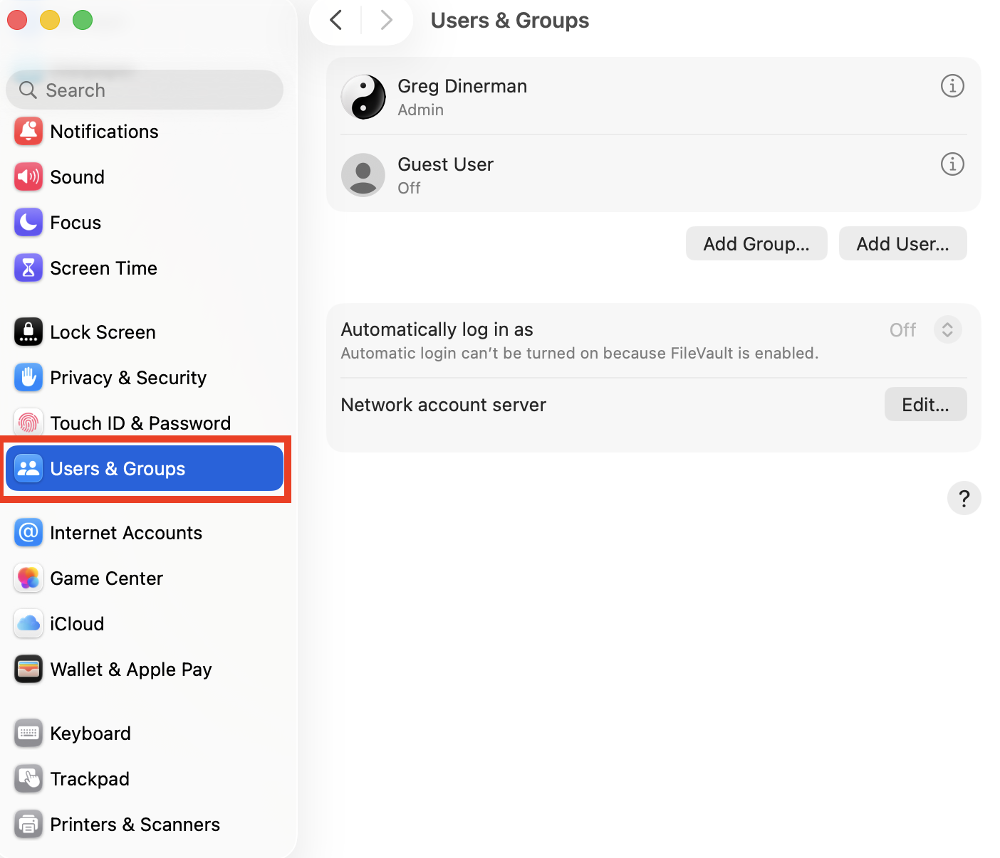

    > *Text shown in the image:* Mac menu bar: Chrome · File · Edit · View · History. Apple menu open: About This Mac · **System Settings…** (highlighted) · App Store · Recent Items · Force Quit Chrome (⌥⇧⌘⎋) · Sleep · Restart… · Shut Down… · Lock Screen (⌃⌘Q) · Log Out Hannah W… (⇧⌘Q)

2. Go to **Users & Groups**.

    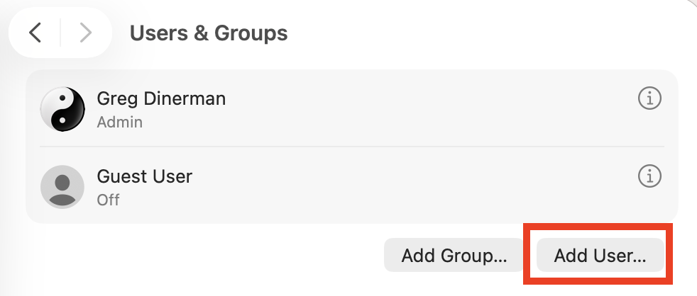

    > *Text shown in the image:* System Settings. Left sidebar: Search · Notifications · Sound · Focus · Screen Time · Lock Screen · Privacy & Security · Login Password · **Users & Groups** (highlighted) · Internet Accounts · Game Center · iCloud · Wallet & Apple Pay · Keyboard · Mouse · Printers & Scanners. Main pane: General — Manage your overall setup and preferences for Mac, such as software updates, device language, AirDrop, and more. · About · Software Update · Storage · AppleCare & Warranty · AirDrop & Continuity · AutoFill & Passwords · Date & Time · Language & Region · Login Items & Extensions · Sharing

3. Click **Add User**.

    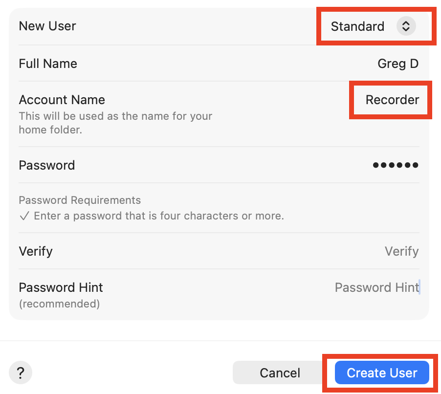

    > *Text shown in the image:* Users & Groups: Admin · Guest User (Off) · Add Group… · **Add User…** (highlighted)

4. Create an **Administrator** user and use a neutral account name such as ***Recorder***. *Do not use a real name.*

    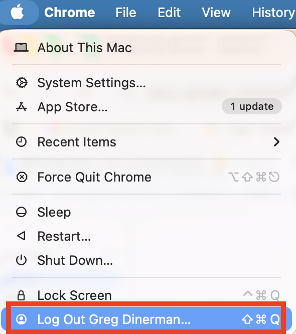

    > *Text shown in the image:* New User dialog: New User — **Administrator** (highlighted) · Full Name — **Recorder** (highlighted) · Account Name — recorder (This will be used as the name for your home folder.) · Password (hidden) · Password Requirements: ✓ Enter a password that is four characters or more. · Verify (hidden) · Password Hint (recommended) · Cancel · **Create User** (highlighted)

**Download & Install Workpuls/Insightful**

*Insightful should be running in the background whenever you work on Project Odin.*

1. Go to the [Use Insightful for Time Tracking](https://talent.docs.mercor.com/how-to/use-insightful) page.
2. Under [**Step 1: Download the desktop application**](https://talent.docs.mercor.com/how-to/use-insightful#step-1-download-the-desktop-application), click on the Workpuls/Insightful download link.

    

    > *Text shown in the image:* Step 1: Download the desktop application You do not need to wait for an invitation email from Insightful, and you do not need to accept one. Once your contract is active, download the app, compatible with your Operating System, directly from here: https://app.insightful.io/#/token/download (link highlighted)

3. Select **macOS** download.

    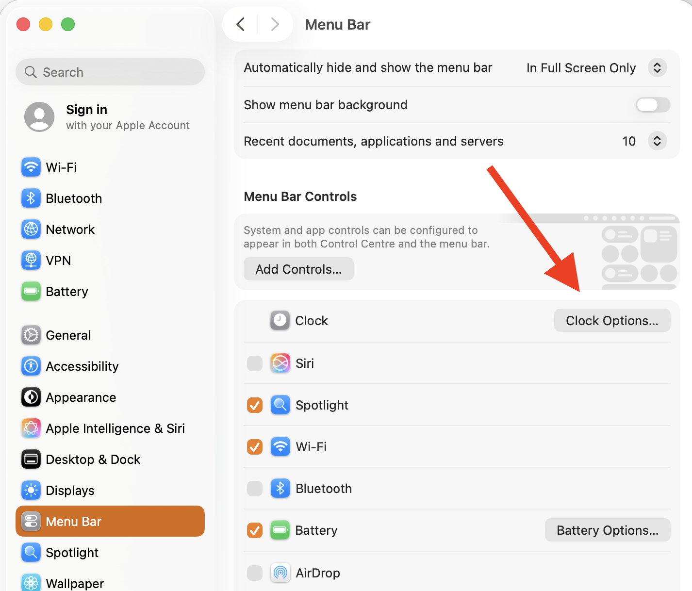

    > *Text shown in the image:* Password Successfully Created! Now you can download and install Insightful on your device. Use your email and the password you created to log into the app after installation. Download installation file for your operating system: Windows · **macOS** (highlighted) · Linux (BETA) Having trouble installing Insightful? Click here for help · I installed Insightful

4. Click and open the downloaded Workpuls.dmg, then drag it into the **Applications** folder.

    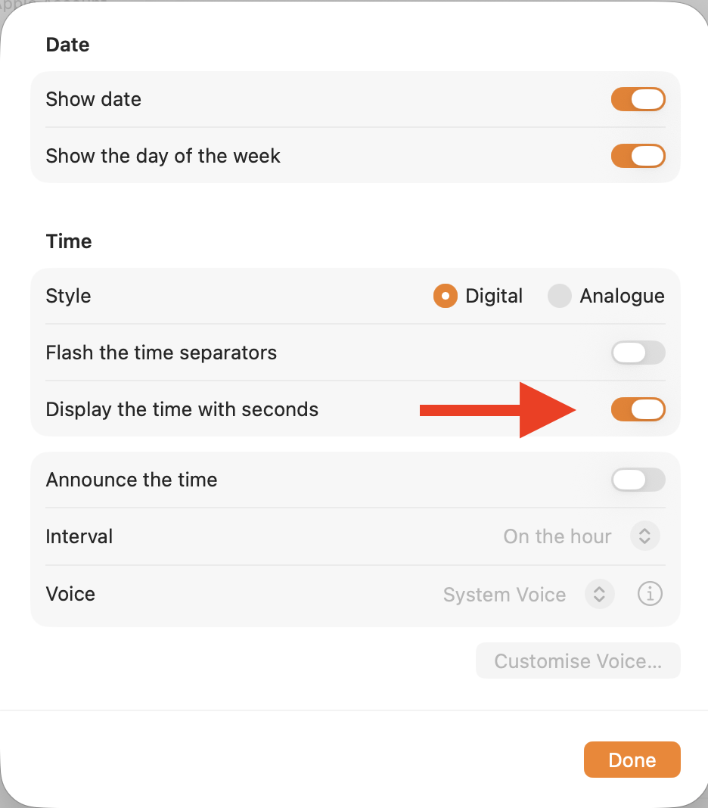

    > *Text shown in the image:* Workpuls 8.1.22 — drag the Workpuls app icon (highlighted) onto the Applications folder (arrow).

**Download & Install Xcode**

*The Accessibility Inspector is accessed through Xcode and must remain running throughout every recording. Xcode itself may be closed.*

1. Search and install **Xcode** from the App Store.

    

***If you have macOS 26.6 or lower:***

1. First, determine which version of Xcode you need, based on your macOS version, by checking [here](https://developer.apple.com/xcode/system-requirements/).
2. Navigate to the [Apple Developer More Downloads](https://developer.apple.com/download/all/) page.
3. Sign in with your Apple ID.
    - a. Accept the Apple Developer Agreement and decide whether you would like to receive communications from Apple.

        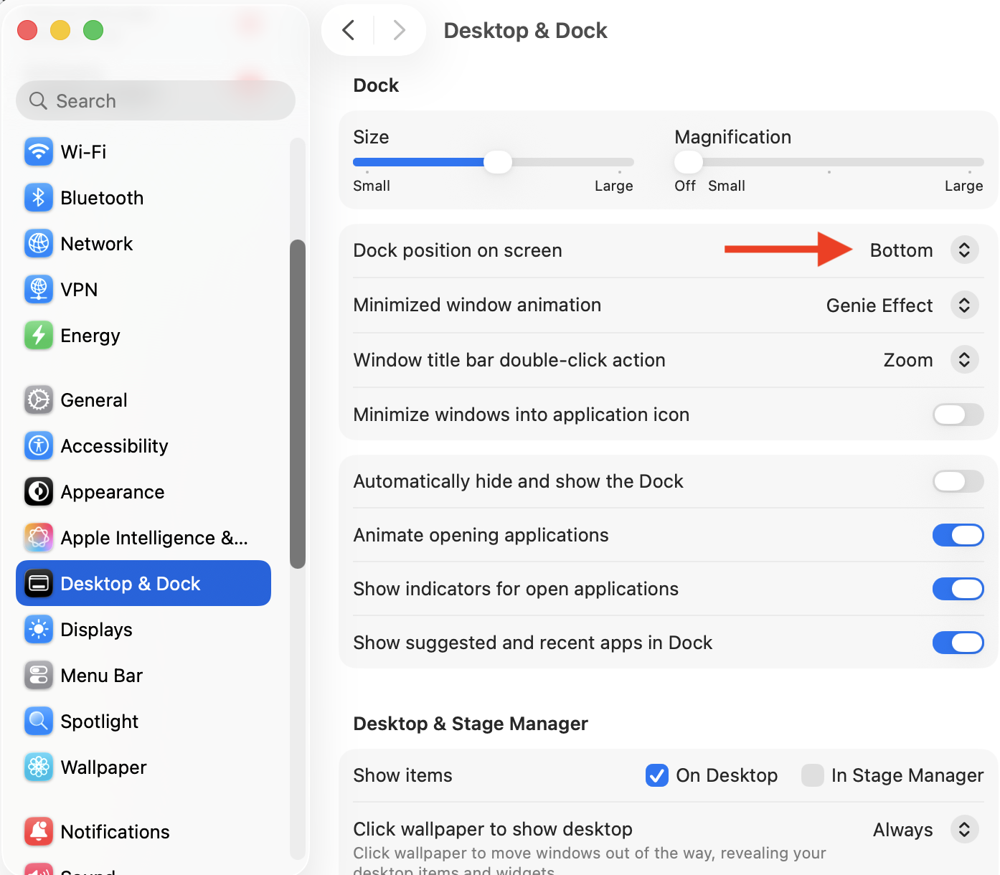

        > *Text shown in the image:* Apple Developer Agreement page. Navigation: Get Started · Platforms · Technologies · Community. Download PDF. THIS IS A LEGAL AGREEMENT BETWEEN YOU AND APPLE INC. (“APPLE”). YOUR PARTICIPATION AS AN APPLE DEVELOPER. PLEASE READ THIS … (“AGREEMENT”) BEFORE PRESSING THE “AGREE” BUTTON AT THE …  “AGREE,” YOU ARE AGREEING TO BE BOUND BY THE TERMS OF THIS … Apple Developer Agreement — 1. Relationship With Apple; Apple Account and Password. … (text is cut off at the right edge of the screenshot). I’d like to receive communications announcing the latest events, news and … — ○ Yes · ◉ **No** (selected, highlighted) · **Agree** button

    - b. Select “I’m not interested” when asked to “Customize your experience with Apple Developer”

        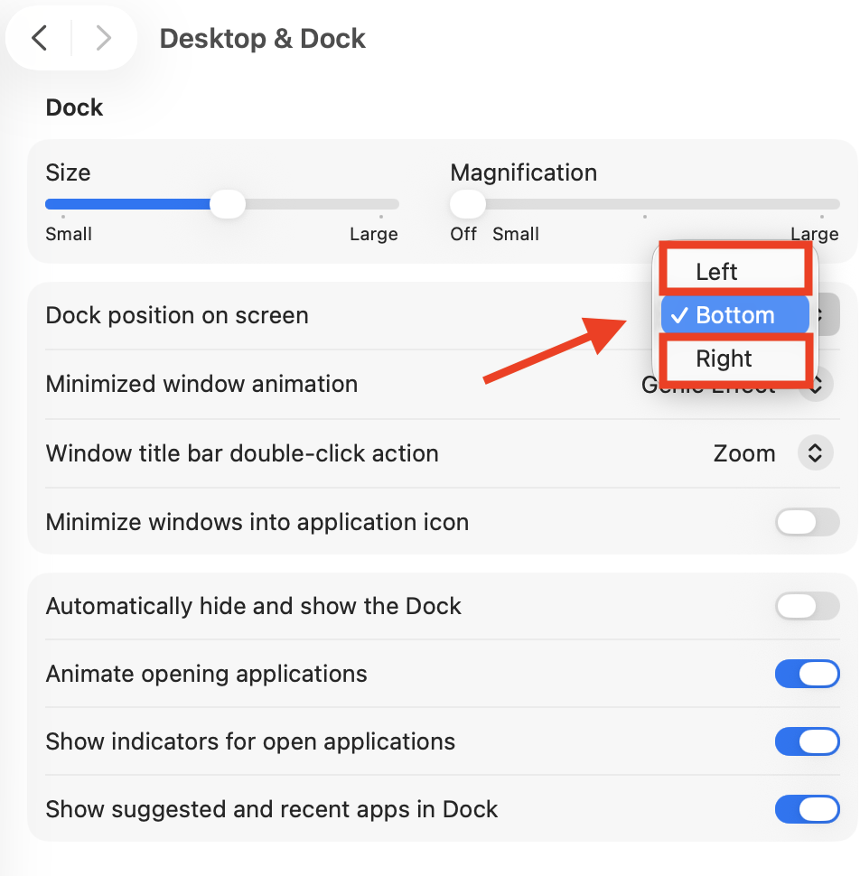

        > *Text shown in the image:* Customize your experience with Apple Developer. Create a developer profile to get personalized news, updates, and activity announcements based on your interests and preferences. Learn more. · Get started · Remind me later · I’m not interested

**Download & Install TaskRecorder**

1. Download the current TaskRecorder installer from the <u>Important Links</u> page.
2. On your regular macOS profile, download the TaskRecorder installer and move its DMG to /Users/Shared. Sign out, sign in to the Recorder profile, open /Users/Shared, and follow the installation steps below.
3. Eject any older TaskRecorder disk image (dmg).
4. Drag TaskRecorder into **Applications**, *select **Replace** if prompted*.

    

> Once you have downloaded/installed Insightful, Xcode, and TaskRecorder, you can log out of your main user account.

---

**Setting Up the Recording User Account**

**Change Required UI Elements**

1. **Log out** of your personal account and sign in to the Recorder account.

    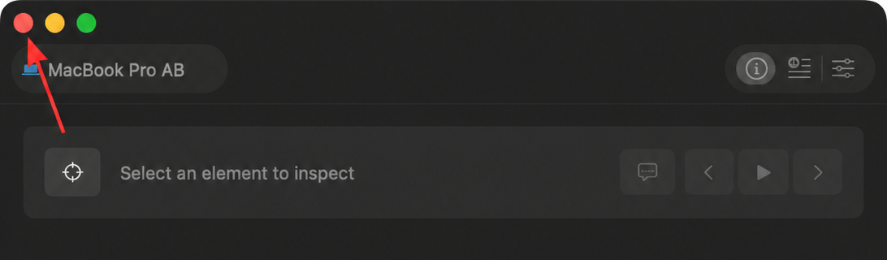

2. Complete the initial setup without connecting an iCloud account.
3. Keep the system language set to English.
4. **Configure the clock to display seconds:** Go to **System Settings > Menu Bar > Clock Options** > toggle **Display the time with seconds** on

    

    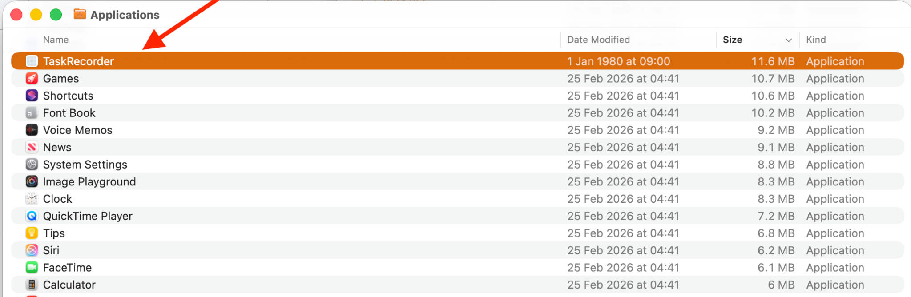

5. Set dock at left/right: Go to **System Settings > Desktop & Dock > Bottom** dropdown > select **Left/Right**

    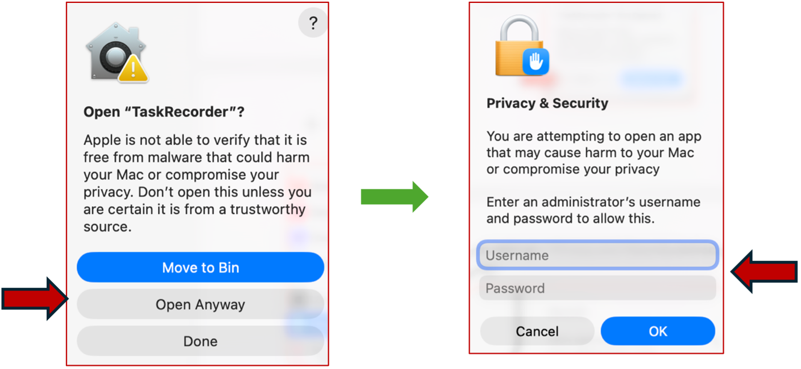

    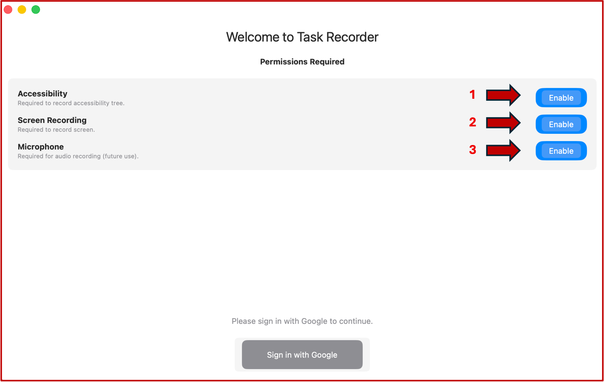

6. Change one UI element: background, light or dark mode, dock size, interface appearance, or resolution. (changing background wallpaper is recommended)

    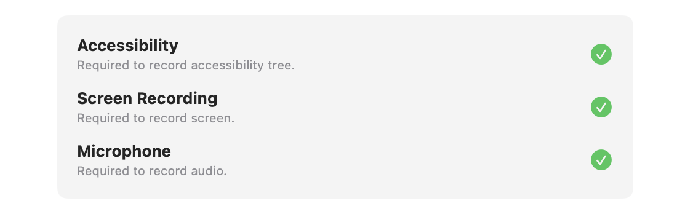

    > *Text shown in the image:* System Settings → Wallpaper. Sidebar: Search · VPN · Energy · General · Accessibility · Appearance · Apple Intelligence & Siri · Desktop & Dock · Displays · Menu Bar · Spotlight · **Wallpaper** (selected) · Notifications · Sound · Focus · Screen Time. Main pane: current wallpaper (a cyberpunk city image, file name “cyberpunk-blade-runner-2049-movie-sci-fi-scifi-city-with-neon-lights-and-holograms-best-most-popular-free-download-wallpapers-for-macbook-pro-and-macbook-air-and-microsoft-windows-desktop-pcs-4k-07-12-2024-1733638359-hd-wallpaper”) · Fill Screen · Show on all Spaces (on) · Screen Saver… · Clock Appearance… · Dynamic Wallpapers (Show All (34)): Tahoe, Sequoia, Macintosh, Sonoma · Your Photos: Add Photo…

*Keep Studio, Slack, the Writer Guidelines, and other project-administration material in your regular macOS profile.*

**Set up and Log into Workpuls/Insightful**

1. Follow [**Step 2: Sign in**](https://talent.docs.mercor.com/how-to/use-insightful#step-2-sign-in) to log into Insightful.
2. After logging into Insightful, find Odin from your project list, click on the **play** button to start tracking time.

    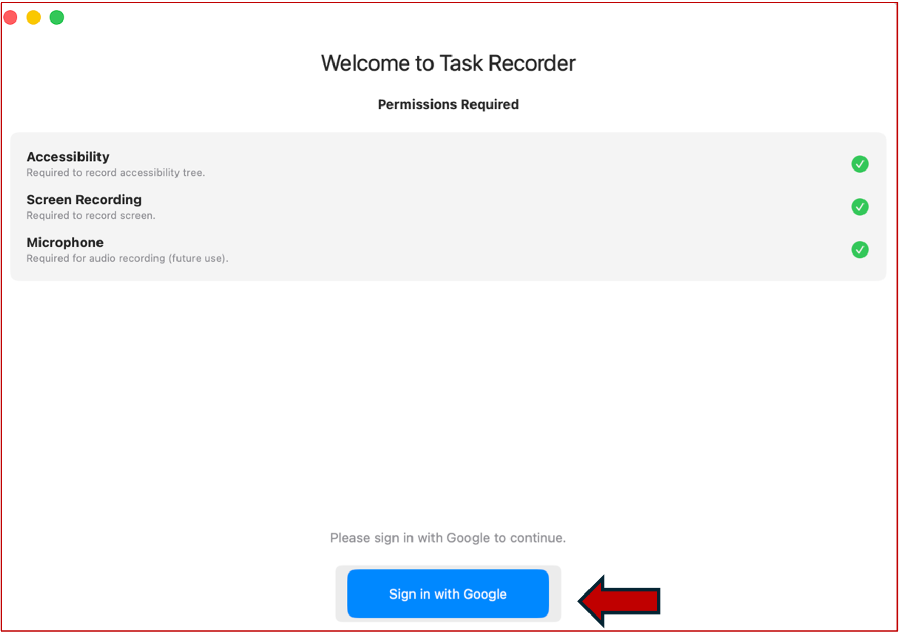

    > *Text shown in the image:* Insightful app. Search projects · 62:15 h/week · Assigned Projects: **Odin** (highlighted) — 387:47:19 — 1 TASK · Last sync: Today at 10:15 PM · Open Dashboard

    

    > *Text shown in the image:* Insightful app. ‹ PROJECTS (back link) · Odin · 22:46 h/week · Search tasks · Today (Recent Time): task “Glowstone-Project Thor - Task” — Priority: Low — 387:47:19 — with a ▶ play button (highlighted) · Last sync: Today at 10:15 PM · Open Dashboard

*If you have issues downloading, installing, or tracking time through Insightful, reach out to Mercor Support via [Melvin](https://talent.docs.mercor.com/support/melvin).*

**Set up Accessibility Inspector**

1. Open **Xcode** from Applications and go through the initial Xcode setup until you see the view below.

    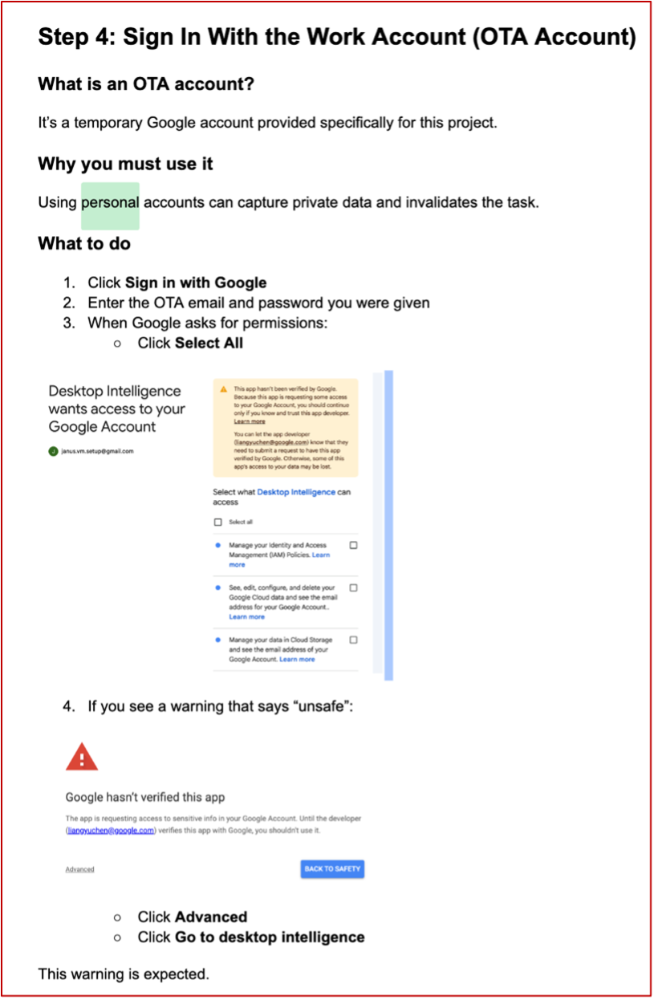

    > *Text shown in the image:* Finder → Applications folder (sidebar: Shared · Favorites: Applications, Desktop, Documents, Downloads · Locations: iCloud Drive, hannahw, Macintosh HD, TaskRecorder, AirDrop, Network). Apps shown: Slack · Stickies · Stocks · System Settings · TaskRecorder · TextEdit · Time Machine · Tips · TV · Utilities · Voice Memos · Weather · WeChat · Workpuls · **Xcode** (highlighted)

    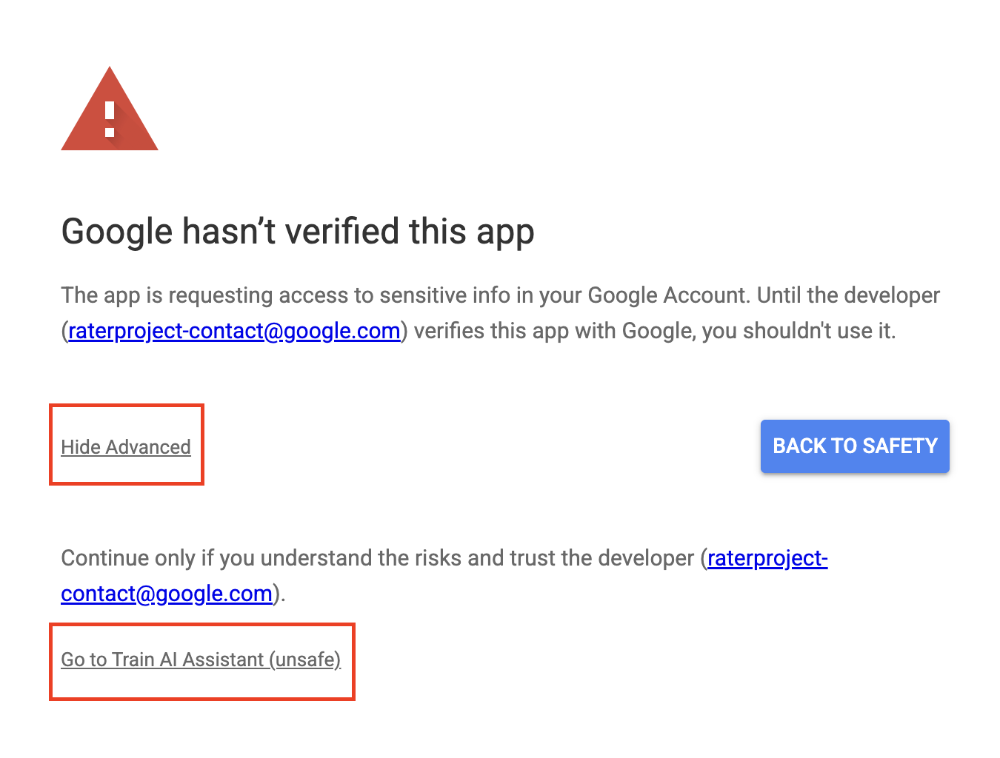

    > *Text shown in the image:* Xcode — Version 26.6. Create New Project… · Clone Git Repository… · Open Existing Project… · No Recent Projects

2. In the dock, right-click on Xcode > **Open Developer Tool > Accessibility Inspector**

    

    > *Text shown in the image:* Right-click the Xcode icon in the Dock (highlighted) → **Open Developer Tool** (highlighted) → submenu: Instruments · Simulator · Icon Composer · Reality Composer Pro · **Accessibility Inspector** (highlighted) · FileMerge · Create ML. Other menu items: Options · Show All Windows · Hide · Quit

3. After Accessibility Inspector is opened, click the **red X** in the upper-right corner to close the Accessibility Inspector window using the red button.

    

    > *Text shown in the image:* Accessibility Inspector window — close button (red, highlighted); toolbar: “Select an element to inspect”

    - a. Do not minimize or fully quit the application.
4. Confirm that the blue magnifying-glass icon remains in the dock with a **dot** underneath it.

    

**Set up TaskRecorder**

1. Open TaskRecorder from the Applications folder.

    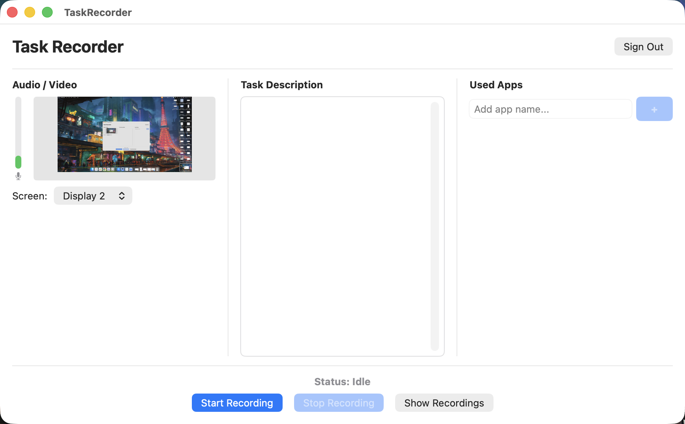

2. If macOS blocks the application, select **Done**, then go to **System Settings > Privacy & Security > Open Anyway**.

    

    

3. Authenticate and confirm that you want to open the application.

    

*See <u>Technical Issues</u> if TaskRecorder does not open normally.*

**Grant Permissions and Sign In**

1. Grant TaskRecorder access to:
    - a. Accessibility
    - b. Screen Recording
    - c. Microphone

        

2. Confirm that all three permissions show green check marks in TaskRecorder.

    

3. Click **Sign in with Google** using your assigned OTA Google (and not the **@mercor.expert** one) account.
    - a. Use a clean browser profile with no personal or Mercor.expert Google account active.

        **Note: DO NOT**

        - Change names
        - Change password
        - Add 2FA
        - Add recovery phone numbers
        - Use for personal purposes

on assigned OTA accounts.

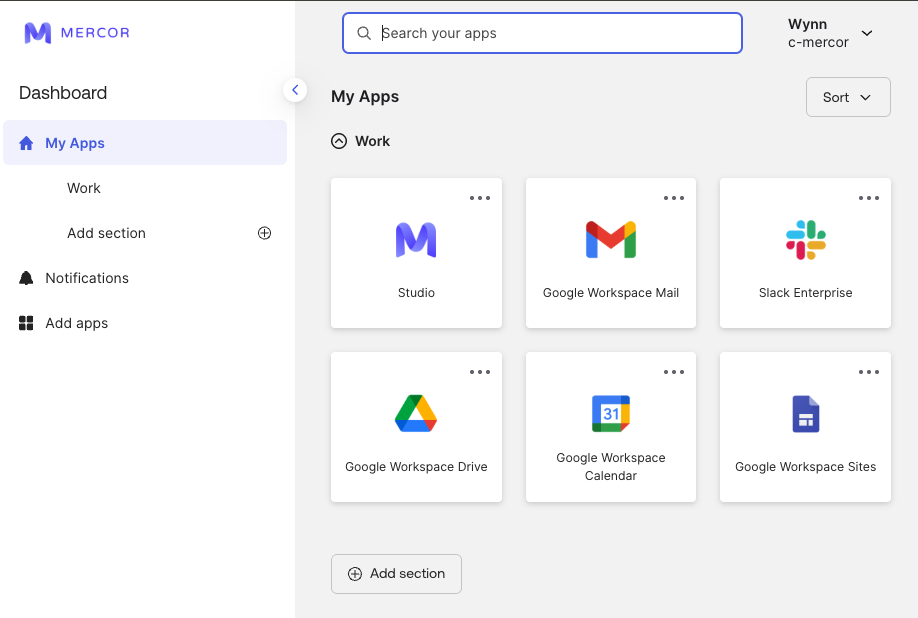

> *Text shown in the image:* Step 4: Sign In With the Work Account (OTA Account) What is an OTA account? It's a temporary Google account provided specifically for this project. Why you must use it: Using personal accounts can capture private data and invalidates the task. What to do: 1. Click Sign in with Google · 2. Enter the OTA email and password you were given · 3. When Google asks for permissions: Click Select All · 4. If you see a warning that says “unsafe”: Click Advanced, then click Go to desktop intelligence. This warning is expected.

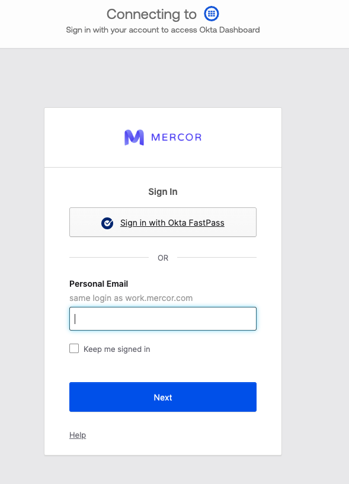

4. Approve the requested Google permissions.
    - a. If Google displays an unverified-app warning, select **Advanced > Go to Train AI Assistant (or desktop intelligence)**

        

5. Return to TaskRecorder when the browser confirms it received the authentication code.

    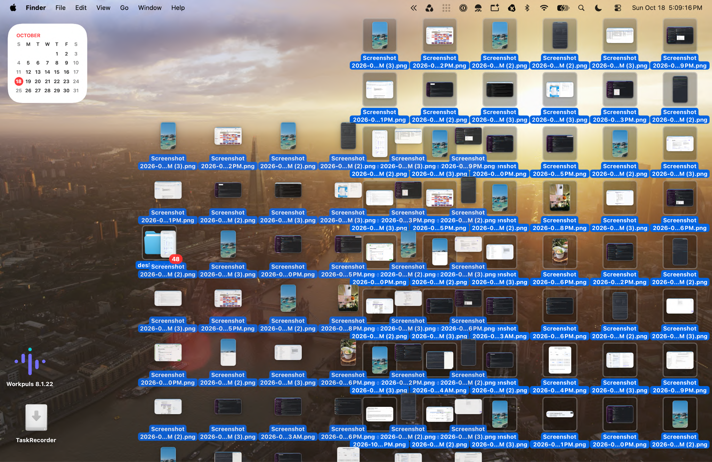

    > *Text shown in the image:* Authentication code received.

    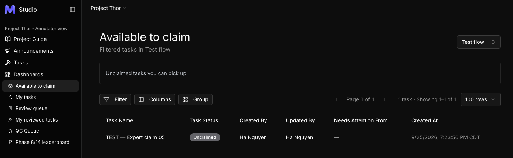

*See <u>Technical Issues</u> if there are login issues.*

# Task Ideation

A strong task reflects realistic professional work, demonstrates meaningful expertise and judgment, and produces a clear final deliverable.

**IMPORTANT:** Plan for a recording, including the short intro, that is at least 15 minutes and no more than 45 minutes (15:00-45:00). The workflow should feel natural, be mostly mouse-driven, and use real task apps.

**IMPORTANT:** Every task **Idea** must be submitted and approved in the Studio first. Once your **Idea** is approved, a task will be auto-created for you in Studio.

**Brainstorming Stage**

**Step 1. Define the Professional Context**

Start by identifying:

- Your professional role
- The purpose of the task
- The intended user, client, or stakeholder

The scenario should be realistic for someone working in your domain of expertise.

**Step 2. Plan Complex Professional Work**

Choose realistic work in your domain that uses skills and judgment you already have and produces a clear, useful deliverable.

Examples include:

🎨 **Healthcare / Medicine:** Review de-identified patient education materials, compare them with clinic guidance, and create an updated handout.

📊 **Engineering / Data:** Clean and compare a permitted dataset, create clear charts, and prepare a short findings report for a stakeholder.

🏢**Architecture:** Update a room layout from a client brief, check the dimensions and circulation, and export a labeled plan for review.

> **Note:** Using several apps or completing many basic steps does not make a task complex.

**Step 3. Select Your Apps**

Use genuine task apps that materially contribute to the workflow.

- Use only apps with a license that **allows commercial use**. If you are using a trial or free version, please check that it allows commercial use.
- Use at least 3 apps by default
    - 1 or 2 apps are allowed only when the main app work is deeply technical and complex
- Repeated use of the same app still counts as one app
- A supporting app counts only when it contributes meaningfully to the task or final output
    - **Example: Clockify**
        - Only starting and stopping a timer → **does not count**
        - Manage relevant client, project, and task records, assign tracked time or billing details, and generate or export a report or invoice that contributes to the task results → **does count**
- The opening Task Description(Goal) document app does not count unless it is used again for substantive task work
- Insightful never counts as a task app
- **DO NOT** use restricted apps
- **DO NOT** purchase software specifically for the project. Software and subscription costs are not reimbursable.

> Vary your app choices across submissions when possible.

**Step 4. Prepare Appropriate Input (if applicable)**

Identify any files, datasets, templates, and source materials you may need for the task. Input files are not a requirement for tasking.

Inputs must:

- Contain no private or non-public personal information
- Be self-created, synthetic, or AI-generated before recording
- Contain no visible watermarks or copyrighted materials
- Be available before the recording begins

Do not use paywalled, watermarked, copyrighted, Unsplash, or unclear-rights content. Verify the original source and license.

**Note:** AI may be used to prepare inputs before recording, but no AI interaction, branding, or watermark may appear during the recording.

**In Studio Final Notes:**

- For AI-generated inputs: Enter AI-generated before recording
- For non-AI inputs: Provide the original source URL if applicable.

**Step 5. Define the Final Deliverables**

Every task must produce at least one clear, useful final output.

Before recording, identify:

- What you will create
- Who will use it
- What format it will use
- How you will verify its accuracy, quality, or completeness

> The recording should show the complete process that leads to the final deliverable.

---

**Metadata.rtf Drafting Stage**

Download the provided [Metadata.rtf template](https://drive.google.com/file/d/1_WThzOJgZzk_WcUdDtqO1QR4qYG1tbGa/view), and complete the three sections:

1. **Topology:** List every app visit in chronological order, repeating an app each time you return to it. Use only LOOKUP, CREATE, or MODIFY to identify the action for each visit to each app.
2. **Request:** Paste the same Goal text you entered in TaskRecorder. It must match TaskRecorder exactly.
3. **Task Description:** Write a numbered, high-level outline of the main task steps, naming the apps, key methods, and final deliverable. The steps should reflect the workflow in Studio and TaskRecorder.

> - Propose your task idea in the Mercor Studio and get it approved before recording.
>
> - See the Golden Example page for complete Task Description/Metadata.rtf/Recording examples.

# Step-by-Step Studio Workflow

Complete the <u>Technical Setup</u> page instructions before following the Studio workflow below.

**Part 1. Start in Studio**

Studio is the main platform for Project Odin task workflows. Let’s get started by getting logged in, and finding key information, and navigating to the correct “World”.

1. Go to **Okta** ([https://c-mercor.okta.com/](https://c-mercor.okta.com/)) and sign in with the personal email <u>linked to your Mercor account.</u>

    

    **Do not use a VPN** - Okta blocks sign-ins through a VPN, proxy, or other anonymizing network and shows a 403 Access Forbidden error before the sign-in page loads. Turn off any VPN (system-wide app or browser extension) before starting the Okta setup and whenever you sign in to Okta. See the Account Security and Conduct policy.

2. Click the **Studio** app in Google Workspace to bring you to the Project Odin Dashboard.

    

    > *Text shown in the image:* Dashboard (side menu): My Apps · Work · Add section · Notifications · Add apps · Last sign in: a few seconds ago. My Apps → Work: Google Workspace Mail · Slack Enterprise · Google Workspace Drive · Google Workspace Calendar · **Studio** (tooltip “Studio”) · Google Workspace Sites

3. Within Studio, you can navigate to the project guidelines or to your active workstreams using the left sidebar.

    

    > *Text shown in the image:* Studio — Odin - Annotator view. Left menu: Project Guide · Announcements (new-activity dot) · Tasks · Dashboards. INTRODUCTION — ⚡ Introduction ⚡ Project Odin Guidelines ⚡ Last updated: Sep 29, 2026. Changes in the last 14 days: • Sep 29, 2026: Complete guide refresh Tasks follow the guidelines in effect when they are submitted. A small one- or two-hour allowance applies only to recordings already underway when guidance changes, not to submitted tasks.

4. Within Tasks, navigate to the World **Odin Production Full Workflow** if you need to.

    

    > *Text shown in the image:* Tasks — Manage tasks in Odin Production Full Workflow. Tabs: Tasks · Query. Workflow selector: Odin Production Full Workflow. Button: + Create Task

## Part 2. Propose a Task

Now that we are logged in to Studio, we can get to work! We will first propose a task for submission. The review team will check this for novelty and compliance before you progress to actually recording a workflow.

1. Create a new task with the button **+ Create Task**

    

    > *Text shown in the image:* Tasks — Manage tasks in Odin Production Full Workflow. Tabs: Tasks · Query. Workflow selector: Odin Production Full Workflow. Button: + Create Task

2. Start entering information related to your proposed task.
    - a. **Goal of Your Proposal/Flow:** Describe the desired outcome of someone executing this task, and who will use the resulting work product.

        

        > *Text shown in the image:* PROPOSAL — In this section, you will outline your proposed idea for the recording you will submit. GOAL OF YOUR PROPOSAL/FLOW — In this section, you will write what you will accomplish in your recording. What are you trying to accomplish? Include the purpose and who will use the result. (Placeholder) For example: Build a sales dashboard so a regional manager can compare monthly revenue and spot underperforming products.

    - b. **Existing Material/Starting Point:**
        - **Starting from scratch:** No materials are being introduced before the work begins.
        - **Using existing material:** Files, data, or a project you already have on hand before beginning recording are being used. Where existing material is being used, describe it. When starting from scratch, no information is needed.

            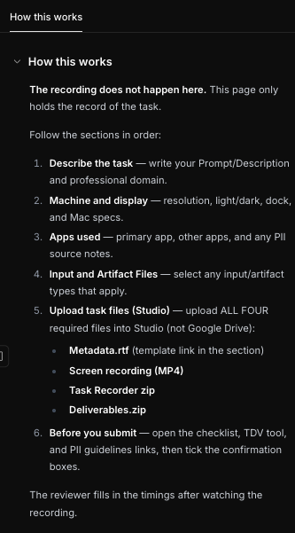

            > *Text shown in the image:* EXISTING MATERIAL Starting point — Existing material means files, data or a project you already have before recording. Options: Starting from scratch · Using existing material What is already available? (Placeholder) For example: A workbook with cleaned sales data, but no charts or calculations.

    - c. **Apps:** Choose the apps you will use. Use at least 3 apps by default; 1 or 2 apps are allowed only when the main app work is deeply technical and complex.

        As seen in the screenshot, some apps are “**restricted**” - these cannot be used.

        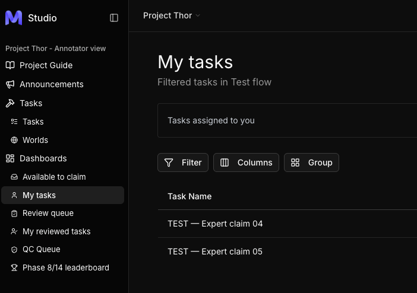

        > *Text shown in the image:* APPS No app is used (checkbox: No app is used) Apps — Use at least 3 apps by default; 1 or 2 only when the main app work is deeply technical and complex. Select options… (dropdown with search “Search, or type a value not listed…”): 3D Slicer · Activity Monitor.app · 🚫 RESTRICTED Adobe Acrobat · …

    - d. **Results and Checks:** Describe what will be produced by the work conducted. This refers to the work product being recorded, not the recording itself.

        E.g.: If I was recording myself creating a presentation, then the presentation is what I am describing.

        Verifying the result refers to the key qualities of the final product that would qualify the work as “complete”.

        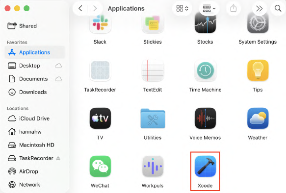

        > *Text shown in the image:* RESULT AND CHECKS What will you actually create, analyze or decide? (Placeholder) For example: Compare regional sales in a workbook and identify which products need attention. How will you verify the result? (Placeholder) For example: Reconcile totals to the source data and test each region filter.

    - e. **Previous work:** Does the task reflect a continuation of another task which you have previously completed, or is it entirely new work? If this is a continuation, then you will provide the ID of the previous task, and explain what new work is being done. If this is a new task, these continuation fields will not be visible.

        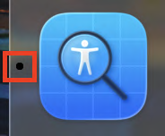

        > *Text shown in the image:* PREVIOUS WORK Previous work — Is this new work or a continuation? Options: New task · **Continuation of a task** (selected) Previous task ID or approval ID — (Placeholder) Paste the related task ID or Odin approval ID What is new in this task? — (Placeholder) Describe only the new work you will record.

    - f. **Submit Idea:** The task will be passed to the review team, who will check your work and either return it to you for edits or approve the task.

        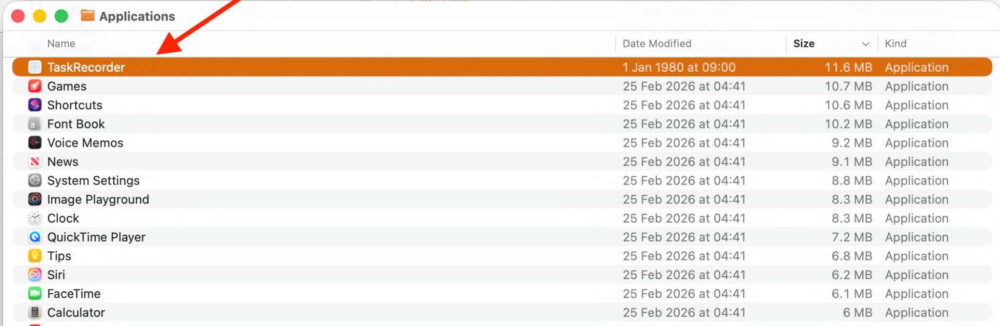

        > *Text shown in the image:* SUBMIT YOUR IDEA — button: Submit idea

**Key Points:**

- Keep Ideas Current: One approved idea = one Studio task
- Never reuse an Approval ID. A pending change request does not replace your current approval; always use the newest approved revision.
- If your plan changes materially, submit a change request and wait for approval before recording.

**Idea Examples**

➡

**Goal:** As a chemical engineer, investigate an uncontrolled exothermic temperature spike during an industrial polymer curing cycle. DBeaver will query a local SQLite reactor database, aggregating thermal sensor logs to extract the precise timeline of the thermal runaway. Visual Studio Code will be used to modify the reactor's Python control script, lowering the catalyst injection thresholds to prevent future thermal breaches. Mimestream will draft and format an urgent process-safety notification, attaching the SQL temperature logs and updated script, dispatched directly to the plant operations manager.

**Starting Point:** Starting from scratch

**Deliverables:**

- A finalized chemical safety audit containing the DBeaver thermal anomaly dataset (exothermic\_spike\_timeline.csv)
- The corrected VS Code automation script (catalyst\_injection\_controller.py)
- The dispatched Mimestream safety alert

    (operations\_manager\_warning\_sent.eml)

➡

**Goal:** I am a data analyst supporting a facility engineer who has to decide whether a harmonic filter installed on a factory feeder is good enough to keep. Using synthetic current waveforms sampled at 10 kHz before and after the filter was installed, I will compute the FFT spectrum of each waveform, measure the amplitudes of the 50 Hz fundamental and its odd harmonics up to the 13th, calculate total harmonic distortion, generate a one-page PDF report with the two spectra, check each harmonic against its limit in a spreadsheet, and annotate the report with the distortion result and a keep or replace decision. I will build and calibrate a digital signal processing pipeline from scratch on a blank audio track in Audacity. The goal is to generate harmonic test signals, apply multi-notch filter cascades to remove electrical hum, execute Nyquist low-pass filtering to attenuate high-frequency noise, measure Signal-to-Noise Ratio (SNR) and RMS dynamic range in dB, and export spectral frequency renders alongside signal metrics logs.

**Starting point:** Using existing material

**What is already available?:** Two synthetic CSV files of current samples (one second each at 10 kHz, before and after the filter) and a small Python helper module with the FFT and plotting functions. All are AI-generated before recording.

**Deliverables**

- The executed notebook (.ipynb), the harmonic amplitude table (.csv)
- The spreadsheet with the per-harmonic limit check
- The decision downloaded as .xlsx, and the one-page PDF report annotated in Skim

> **Top Tip: Use your "Goal" for Recording:** Paste only the Goal section into TaskRecorder, the opening document, and the "Request" section in Metadata.rtf. Do not show the Approval ID or the rest of the approval text on screen.

**Missing Task?**

Approval states are saved during account setup. Follow your dashboard's next step or use **Copy Setup Request**. An authorized admin will review existing tasks before new creation.

---

## Part 3. Fill Out and Submit a Task

### Step 1. Complete the Pre-Recording Fields

**Before recording:**

1. Once your idea is approved and the task status goes to **In Progress**, go through the checklist before you record.

    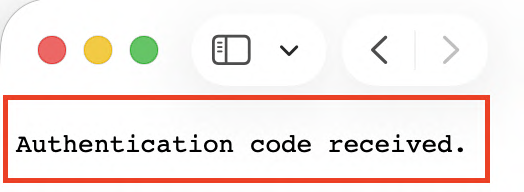

    > *Text shown in the image:* BEFORE YOU RECORD: EVERY CHECK YOUR RECORDING MUST PASS What your recording will be checked against Read this **before you record**. After you upload, Studio runs the automated checks; you tick the manual checks yourself; then you confirm and submit.

2. Machine and Display
    - a. Enter the **Resolution, Light/Dark Mode, dock position, and confirm you have changed your Desktop Wallpaper.**
    - b. After recording, verify that the inputs still match.

        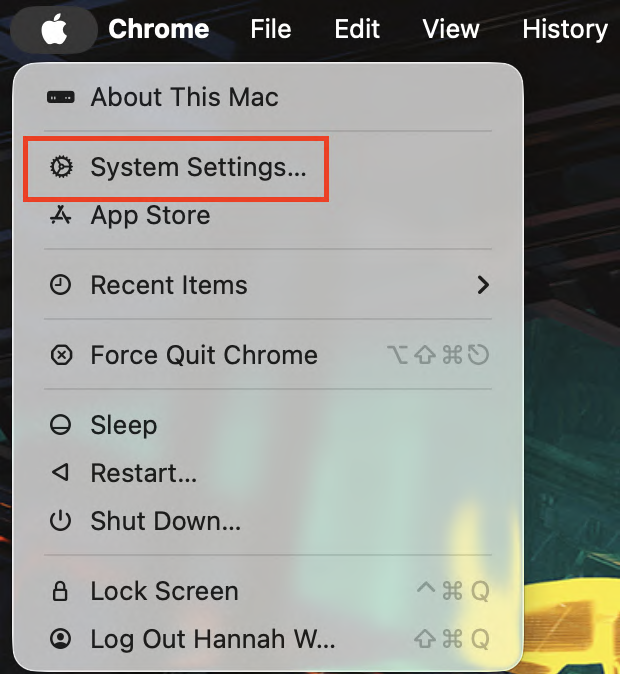

        > *Text shown in the image:* MACHINE AND DISPLAY → DISPLAY Resolution* — Select… Light/Dark Mode* — Required before Submit for Review. Select… Position of Doc* — Required before Submit for Review. Left or Right dock/doc position. Select… Wallpaper changed* — Confirm the desktop wallpaper was changed for this recording (required before Submit for Review). Select…

    - c. Enter the **Mac Spec**.
        - i. CPU/chip, GPU, RAM, and available Storage:
            1. Find the chip and memory in Apple menu > About This Mac
            2. GPU details in System Information > Graphics/Displays
            3. Available Storage in System Settings > General > Storage

                

                > *Text shown in the image:* MAC SPEC Mac CPU (Chip)* — Select… Mac GPU* — Select… Mac RAM* — Select… Mac Storage* — Select…

3. Inputs Used
    - a. **Royalty-free and copyright-free sources from the web:** Provide the Web source URL for the source.
    - b. **AI-generated file:** Files generated using Gemini. (No other AI models allowed)
    - c. **Manually created file:** Any file you manually created before the recording.

        

        > *Text shown in the image:* INPUT AND ARTIFACT FILES Input and artifact files — Select any that apply for input/artifact files used on this task. You may select multiple options, or none. Select options… → Search options… · Royalty-free and copyright-free sources from the web · AI-generated file · Manually created file

### Step 2. Record the Task and Check Files

Follow the <u>How to Record Step By Step</u> page to complete the task with TaskRecorder.

### Step 3. Upload the Verified Files and Submit in Studio

1. On the Studio task page, upload your completed metadata.rtf, .mp4, TaskRecorder zip, & deliverables.zip.
    - a. **DO NOT** include Metadata.rtf in Deliverables.zip.

        

        > *Text shown in the image:* WHAT TO UPLOAD HERE Upload ALL FOUR files into Studio (not Google Drive). For every task, upload these four items here: 1. Screen recording (MP4) — your MP4 screen recording of the task 2. deliverables.zip — the deliverables package for this task 3. Task Recorder zip — the zip exported from Task Recorder (`recording_*.zip`) 4. Metadata.rtf — download the template link below, fill it in, and upload the filled file Confirm all four are attached before you continue to the submit step.

        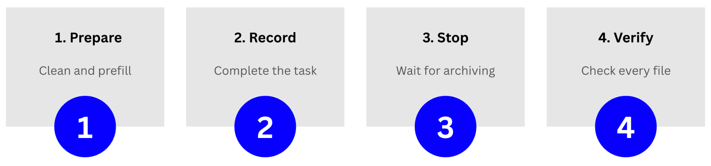

        > *Text shown in the image:* TASK FILES Metadata.rtf Template — Static Metadata.rtf template (same Google Drive file for every Odin task). Download, fill in, and upload with your recording. https://drive.google.com/file/d/1_WThzOJgZzk_WcUdDtqO1QR4qYG1tbGa/view?usp=drive_link Metadata.rtf Upload* — The filled-in Metadata.rtf for this recording. [Upload File] Screen recording (MP4)* — The MP4 screen recording for this task. [Upload File] Task Recorder zip* — The zip exported from Task Recorder (recording_*.zip). [Upload File] Deliverables.zip* — The deliverables.zip package for this task. Name every file in the zip by what it is: Inputs: input 1, input 2, … · In-between files: artifact 1, artifact 2, … · The result: final output 1, final output 2, … Keep the extension, for example “final output 1.xlsx”. For a code project, put the whole project in a folder named “final output 1”. [Upload File]

2. Run AutoQC checks
    - a. You must run both AutoQCs before submitting.
    - b. **Files & Recording**

        

        > *Text shown in the image:* AUTOMATED CHECKS (1 OF 2): FILES & RECORDING Studio runs these for you after you upload. You do not fill anything in here. Checks marked “blocks submit” must pass or be disputed before you can submit. Not run yet — 34 checks in 4 sections · [Run AutoQC] · ▸ What gets checked

    - c. **Narration**

        

        > *Text shown in the image:* AUTOMATED CHECKS (2 OF 2): NARRATION Studio runs these for you about 10 minutes after the file checks. You do not fill anything in here. Checks marked “blocks submit” must pass or be disputed before you can submit. Not run yet — 6 checks in 1 section · [Run AutoQC] · ▸ What gets checked

    - d. Review feedback from AutoQC checks and resolve any blocking findings.
3. Manual Checks
    - a. Manual self-review checklist that you need to go through. Only check a box once you have verified it.

        

        > *Text shown in the image:* MANUAL CHECKS: YOU VERIFY THESE YOURSELF Studio cannot check these for you. Tick each item only after you have checked it against your recording, then confirm below. Confirm that you have completed each necessary component before submitting your task. This is critical to the success of your submission. MANUAL CHECKS (22 ITEMS) — Each box is required before you can submit for review. ☐ Metadata.rtf apps and OTA listed match the apps and OTA listed in Studio — Studio. Tick only after you have checked this against your recording. (Checklist item 4) ☐ Seconds are displayed on the menu bar clock — Video spot check. Tick only after you have checked this against your recording. (Checklist item 9) (The screenshot is cut off here; the remaining items are not visible.)

4. Checklist and PII Confirmation
    - a. Review the **Task Checklist** and confirm your task meets all requirements.
    - b. Review **PII Guidelines** and confirm your task meets all requirements.
    - c. Before you submit, open the checklist and PII guidelines links, and double-check.

        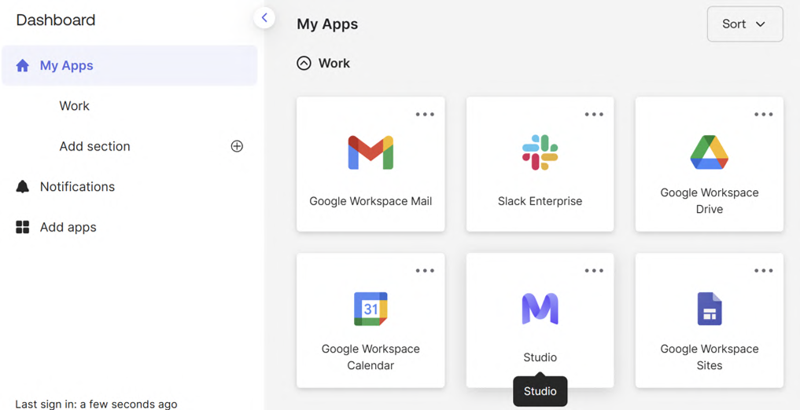

        > *Text shown in the image:* CHECKLIST AND PII CONFIRMATION — Open the linked docs, review your recording against them, then confirm. Task Checklist 🔒 — I HAVE REVIEWED THIS TASK AGAINST THE TASK CHECKLIST. Open the checklist below, then confirm. https://docs.google.com/document/d/1tOxjGqxhA6T49kXw9hrhwpEsk8ERaFOsB6gqZcrLAHg/edit?tab=t.cs8oabjr7dht Checklist Confirmation* — I HAVE REVIEWED THIS TASK AGAINST THE TASK CHECKLIST. Select… PII guidelines 🔒 — I HAVE VERIFIED NO PERSONALLY IDENTIFIABLE INFORMATION IS CONTAINED WITHIN THIS RECORDING. Review the Writer Guidelines (PII rules), then confirm. https://docs.google.com/document/d/1tOxjGqxhA6T49kXw9hrhwpEsk8ERaFOsB6gqZcrLAHg/edit?tab=t.yef60lr6ji08 PII Checkbox* — I HAVE VERIFIED NO PERSONALLY IDENTIFIABLE INFORMATION IS CONTAINED WITHIN THIS RECORDING. Select…

5. Final Confirmation box
    - a. Check this box **only** after every AutoQC has passed and every manual check has been completed.

        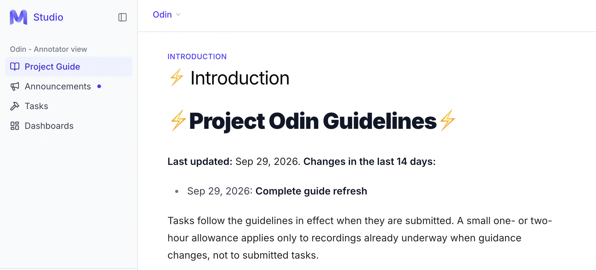

        > *Text shown in the image:* FINAL CONFIRMATION (REQUIRED TO SUBMIT) Yes, I confirm that I checked that my recording meets all of the above criteria. ☐ Required to submit for review. Tick this only after every automated check has passed (or been disputed) and every manual check above is ticked.

6. Add any **Final Notes** that you would like to convey to the Reviewer.

    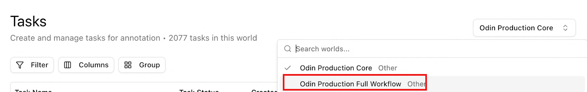

    > *Text shown in the image:* BEFORE YOU SUBMIT → FINAL NOTE Final note — Optional notes for reviewers (issues while recording, quirks, etc.). Writers fill this before submit. Reviewer Feedback is separate. (Placeholder) Any issues while recording, edge cases, or notes for review…

7. Select **Submit** to send the task for review.
    - a. Select **Revise idea** if you need to update your idea, then re-submit for idea checks and updated idea will get reviewed again as normal.

        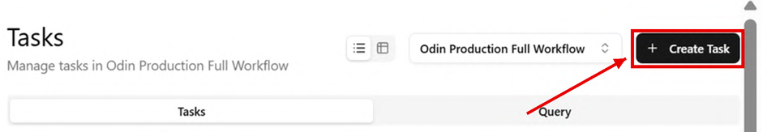

        > *Text shown in the image:* ACTIONS — buttons: Submit for Review · Revise idea

> The task will only Submit after all required fields have been filled out!

*After clicking **Submit for Review**, the Task Status should change to **Awaiting Review**.*

---

## After Submission

Check the statuses your task will go through after submission

⏱️ **Ready for review / In Review:** the task has been submitted and is waiting for a Reviewer / is actively being reviewed.

📝 **Needs Edits:** the task can be fixed and resubmitted. Required action may include **re-recording, files/metadata, clarification, or a combination**.

✅ **Review Approved:** the task has passed human review. This is distinct from final QC clearance.

🛂 **Awaiting Final QC:** the task has been randomly selected for additional QC and is being held until it passes.

🚚 **Ready for Delivery:** the task has cleared all required checks, including QC if sampled.

⛔ **Rejected:** the task is unusable within its approved scope and cannot be fixed through edits. An invalid task concept is an example.

Track your task status in the **My Tasks** tab of the Dashboard in Studio.

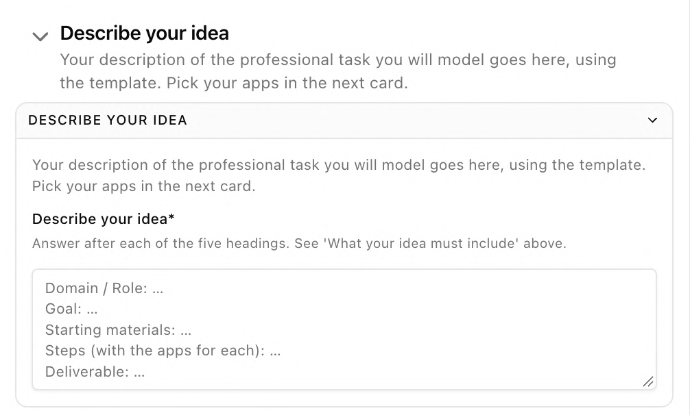

> *Text shown in the image:* Studio — Odin - Annotator view. Left menu: Project Guide · Announcements (dot) · Tasks · Dashboards · Available to claim · **My tasks** (highlighted) · Leaderboard. Main: My tasks — Filtered tasks in Odin Production Core. “Tasks assigned to you”. Filter · Columns · Group. Table: Task Name “task 10038” — Task Status “Claimed”

> Always check the Reviewer and Auditor comments at each status' change to avoid repetitive mistakes.

# How To Record: Step-by-Step

This page explains how to prepare, record, stop, and verify a task.

## Recording Workflow at a Glance

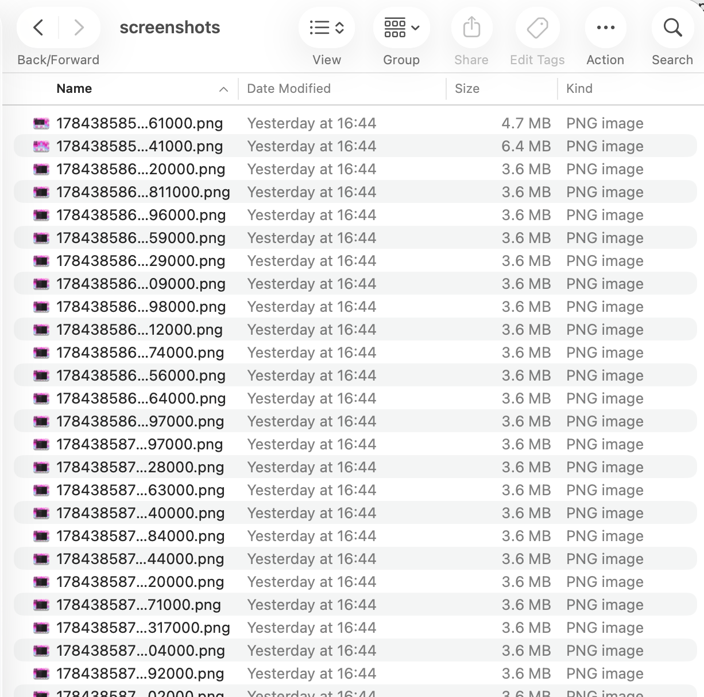

> *Text shown in the image:* 1. Prepare — Clean and prefill · 2. Record — Complete the task · 3. Stop — Wait for archiving · 4. Verify — Check every file

## Step 1. Prepare the Recording

Clean your desktop and prefill all of the fields in Task Recorder.

|   |   |
|---|---|
| ☐ **Accessibility Inspector** | **CRITICAL:** Keep Accessibility Inspector running throughout the recording. Close only its window with the red button; do not quit the app. A dot must remain beneath its Dock icon. |
| ☐ **TaskRecorder** | You are signed in with your assigned OTA account, all three permissions are green, the microphone is on, and the correct display is selected. |
| ☐ **Display** | The resolution matches Studio, the dock is on the left or right, the clock displays seconds in the menu bar, and the cursor uses its default appearance. |
| ☐ **System** | The Mac is connected to power and has enough free storage. |
| ☐ **Privacy** | Personal accounts, notifications, recent files, and private information are hidden |
| ☐ **Project Materials** | Close Studio, Slack, the Writer Guidelines, Google Drive folders, Metadata.rtf, and anything showing Mercor or Project Odin. |
| ☐ **Unused Softwares** | Quit unused apps, calls, screen-sharing/recording tools, and unnecessary background utilities before starting. Close unused browser tabs and pause nonessential sync or downloads. **Keep TaskRecorder and Accessibility Inspector running**; do not |

disable required system or security services.

**Task Details**

Your idea is approved in the Mercor Studio, and the full approval

text is pasted in Studio Prompt/Description.

**Task Apps**

Launch, log in to, load, and minimize every genuine task app. No

task work has been completed yet.

**Input Files**

Prepared inputs must follow the requirements in Task Ideation,

Step 4.

Open a document containing only the Goal section of your **Opening Doc**

approval text in Word or Google Docs, or an allowed app. It is the only window visible behind the TaskRecorder. Do not show the Approval ID or the rest of the approval text. **DO NOT** use Notes.app or TextEdit.app.

**Prefill TaskRecorder Fields**

After preparing the recording environment, complete the TaskRecorder fields before selecting **Start Recording**. For every new task, check for details left from the previous task and replace them with the current Task Description (Goal), app list, and assigned OTA account.

| **Field** | **What to Enter** |
|---|---|
| **Task Description** | • Paste only the **Goal** section of your approval text, exactly as approved. Do not include the Approval ID, task revision, apps list, or other approval sections. • Do not shorten, revise, or summarize it. • Never paste a link, a file path or a document URL in place of the description. Source URLs for input files go only in Final Notes. |
| **Used Apps** | • Add every genuine app you will use to complete the task. |

|   |   |
|---|---|
|   | • The app list must match Studio and your approval. |

> *Text shown in the image:* Task Recorder window (macOS TaskRecorder app, Sign Out button). Audio / Video: preview, Screen: Display 1. Task Description: “Use Android Studio Logcat to diagnose a runtime issue in an Android application by capturing relevant application logs, filtering them by application process and log level, searching for the relevant error, and identifying the cause of the failure. The result will provide a clear diagnostic finding that an Android developer can use to troubleshoot the application.” Used Apps: (Add app name…) Android Studio. Status: Idle · Start Recording · Stop Recording (disabled) · Show Recordings

> **Important:** The Task Description (Goal), Used Apps and OTA account must be correct before recording. Missing or mismatched information may cause a task to be rejected.

**Step 2. Start and Record**

1. Leave the Task Description (Goal) document on screen and behind the TaskRecorder, then click the **Start Recording** button in TaskRecorder.

    

    > *Text shown in the image:* Full desktop screenshot with a document showing the task description (“Use Android Studio Logcat to diagnose a runtime issue in an Android application…”) and the Task Recorder window in front of it; a red arrow points to the **Start Recording** button (highlighted).

2. Minimize the TaskRecorder window.
3. Leave the Task Description (Goal) document window visible for a few seconds and say:

    ❝ **I will be beginning my task soon. Here is the workflow I have in mind. ❞**

    - a. Keep the introduction narration under 20 seconds. **DO NOT** read or explain the full Task Description (Goal).
4. Minimize the Task Description (Goal) document.
5. Start your task recording and complete the professional workflow while following all of the <u>Recording Expectations</u>.

## Step 3. Stop and Archive

1. After completing the task, save all artifacts and outputs.
2. Bring TaskRecorder to the front, then click the **Stop Recording** button.

    

    > *Text shown in the image:* Task Recorder window while recording — Status: Recording… (green). Audio / Video: “No Preview Available”, Screen: Display 1 (disabled). Task Description: “Use Android Studio Logcat to diagnose a runtime issue in an Android application by capturing relevant application logs, filtering them by application process and log level, searching for the relevant error, and identifying the cause of the failure. The result will provide a clear diagnostic finding that an Android developer can use to troubleshoot the application.” Used Apps: Android Studio. Buttons: Start Recording (disabled) · **Stop Recording** (highlighted) · Show Recordings

3. Do not quit TaskRecorder while it processes the recording.
4. Wait for the status to move through **Stopping > Archiving > Idle**.

> **DO NOT** interrupt the archiving process. Continue only after TaskRecorder displays **Idle**.

5. Click the **Show Recordings** button and locate the newest timestamped recording folder.

    

    > *Text shown in the image:* Task Recorder window — Status: Idle. Task Description: “Use Android Studio Logcat to diagnose a runtime issue in an Android application by capturing relevant application logs, filtering them by application process and log level, searching for the relevant error, and identifying the cause of the failure. The result will provide a clear diagnostic finding that an Android developer can use to troubleshoot the application.” Used Apps: Android Studio. Buttons: Start Recording · Stop Recording (disabled) · **Show Recordings** (highlighted)

## Step 4. Validate the Output

Locate the corresponding/newest recording\_TIMESTAMP.zip and recording\_TIMESTAMP folder.

⇩

> **DO NOT** re-name, delete or modify the recording files.

### Video.mp4 Verification

Open video.mp4 file

- **IMPORTANT: Open video.mp4 in QuickTime and check the beginning, middle, and end.** Confirm that it is the correct complete attempt, the picture is usable, narration and any task-relevant audio are audible, and the recording has no corruption or unexpected truncation.
- If corrupted: Upload the recording\_TIMESTAMP.zip to the [TR Recordings](https://drive.google.com/drive/folders/1kQ0r-Yj_1i1urwvOdIZL5JWNW1ObQUk-?usp=drive_link) folder.
    - a. This task does not qualify for submission, but submitting your failed recording may help us identify bugs.

#### Screenshot Verification

Open the screenshot folder and confirm that the matching recording archive contains the PNG screenshots and event.jsonl. Check that video.mp4, the archive, and the task files all belong to the same recording attempt; do not mix files from different attempts.

- Divide the PNG screenshot count by the video duration in seconds.

|   |   |
|---|---|
| ✅ **OK** | ❌**BAD** |
|  • A 15-minute recording should contain more than 450 screenshots. • More than 0.5 per recording second. • Healthy captures often contain many more. | 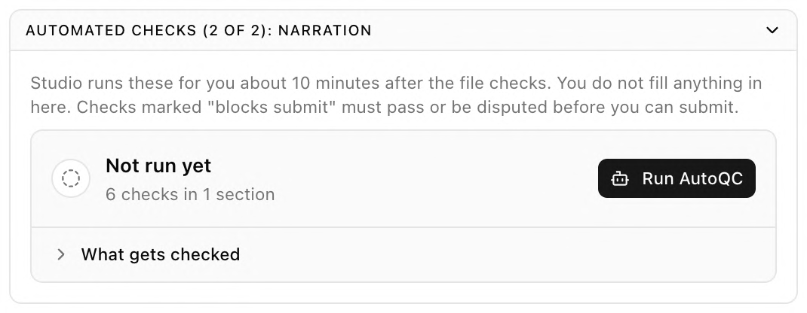 • Only a few screenshots were saved • Fewer than 0.5 per recording second. • Do not submit. • Follow [steps in the FAQ](#getting-help) to troubleshoot. |

### Organize Output

Organize and rename files inside Deliverables.zip using clear names:

- **Inputs:** Any original starting files prepared in advance
    - input 1, input 2, etc.
- **Intermediate Artifacts:** Any files downloaded during recording, intermediate deliverables, or work-in-progress artifacts created during the task
    - artifact 1, artifact 2, etc.
- **Final Outputs:** The final product produced by the expert
    - final output 1, final output 2, etc.

---

## Continue in Studio

Before uploading, open Deliverables.zip and check that every input, intermediate artifact, and final output is present, correctly labeled, and readable. Confirm that the recording archive and separate video.mp4 match this same attempt. Upload Metadata.rtf separately to Studio, not inside Deliverables.zip.

After recording and files pass validation, follow [Studio Workflow, Part 3](#step-3-upload-the-verified-files-and-submit-in-studio) to upload the verified files and submit the task. Confirm that the status changes to Awaiting Review

# Workflow Checklist

This is the most important document in this manual: Please check off every item before

submitting, this checklist will help you be most successful quickly!

**<u>Before Recording (Task Plan)</u>**

- [ ] **Workpuls/Insightful:** Insightful/Workpuls is running and minimized during all Odin project work.
- [ ] **Idea Approved**: Your idea needs to be approved first.
- [ ] **Professional Expertise**: The task uses your existing domain skills and judgment. If your task could be completed by an intern or college student with a few weeks of experience, it is too simple.
- [ ] [**Task Variety**](https://docs.google.com/document/d/1tOxjGqxhA6T49kXw9hrhwpEsk8ERaFOsB6gqZcrLAHg/edit?tab=t.oz1fc9yt4781#heading=h.ptnyoirf0d4g): Your task is meaningfully different from your previous tasks (see Create Meaningful Task Variety). The idea review also checks this.
- [ ] [**Restricted Apps**](#restricted-and-limited-use-apps): The apps you are planning to use are not restricted apps.
- [ ] **Genuine Task Apps**: Each counted app contributes meaningful work; follow the default app-count rule and its documented technical-complexity exception.
- [ ] **Metadata.rtf**: Before recording, download the Metadata.rtf template from your claimed task in Studio. Complete Topology, Request, and Task Description.
- [ ] **Metadata Consistency**: The Request section of Metadata.rtf matches the Goal in TaskRecorder. Topology and Request describe the same objective, inputs, app order, methods, and outputs.
- [ ] **Input Files**: If applicable, prepare files free of private or non-public PII, royalty- and copyright-free (CC0).
- [ ] **Input Provenance**: In Final Notes, record actual non-AI source URLs or exactly “AI-generated before recording”; complete Source of Data when applicable.

**<u>Before Recording (Prepare)</u>**

- [ ] [**Find Your Created Task in Studio**](#part-2-propose-a-task): Fill in all of the required fields.
- [ ] **TaskRecorder Version**: The latest approved version is installed.
- [ ] [**Storage and Power**](#step-1-prepare-the-recording): The Mac is connected to power and has enough free storage for the complete recording and archives.
- [ ] **OTA Login**: Use the OTA Logins only for TR and apps; no other login can show during the recording.
- [ ] [**Clean Workspace**](#step-1-prepare-the-recording): Hide personal accounts, notifications, recent files, and private information; close project materials before recording.
- [ ] **Prefill TR**: Paste the approved Goal and genuine used apps in TaskRecorder.
- [ ] **Accessibility Inspector**: Accessibility Inspector is running with its window closed.
- [ ] **UI Diversity**: Change at least one of the following: background, layout, and light or dark theme.
- [ ] **Mouse cursor:** Mouse cursor size & color must stay default.
- [ ] [**Recording Settings**](#step-1-prepare-the-recording): The selected display and resolution match Studio; TaskRecorder permissions are green, and the microphone is on.
- [ ] **Dock Visibility**: Keep the Dock visible and set it to left or right, not bottom.
- [ ] [**Clock Seconds**](#step-1-prepare-the-recording): Seconds are displayed on the menu bar clock.
- [ ] [**Open Apps**](#step-1-prepare-the-recording): Fully launch, log in, load, open required files/workspaces; minimize to the dock.
- [ ] [**Background Apps**](#step-1-prepare-the-recording): Quit unused apps, calls, and unnecessary background utilities; keep TaskRecorder and Accessibility Inspector running.
- [ ] **Task Description (Goal)**: Open the approved Goal document behind the TaskRecorder window.

**<u>During Recording (Record and Validate)</u>**

- [ ] **Minimize TR**: Immediately minimize TaskRecorder after clicking Start Recording.
- [ ] **Continuous Recording**: Use one uninterrupted recording from Start Recording through the saved final output and Stop Recording.
- [ ] **Brief Intro**: In under 20s, say the intro sentence, minimize Task Description (Goal), and begin.
- [ ] **Recording Length**: Plan for a recording, including the short intro, that is at least 15 minutes and no more than 45 minutes (15:00-45:00).
- [ ] **Narration**: Narrate continuously: identify what, where, and why; avoid vague “here” and “this”.
- [ ] **Audio Quality**: Speech is clear and synchronized with the screen; narration and any task-relevant audio are audible.
- [ ] **Audio Gap**: No single silent gap over 45s.
- [ ] **No Profanity**: No profanity in narration or shown in recording.
- [ ] **No AI Use During Recording**: Show no AI interaction or policy-violating content
- [ ] **No PII**: Show no private or non-public PII or project references; follow the documented public GitHub and research-author exceptions.
- [ ] **CC0 Sources:** Verify original-source rights and confirm that the license permits commercial use; do not rely only on a CC filter or use Unsplash or unclear-rights media.
- [ ] **Mouse Activity**: No single mouse inactivity over 45s.
- [ ] **Teaching Pointer**: Point to what you describe, move naturally, and allow about one second around completed clicks so viewers can follow.
- [ ] **Limited Typing**: Keep the workflow mouse-driven and avoid long typing blocks
- [ ] **Keyboard Shortcuts**: Use visible mouse actions when practical; explain every necessary keyboard shortcut as you use it.
- [ ] **Window Management**: Keep one ordinary task window clear or arrange task windows side by side.
- [ ] **Metadata.rtf**: The Metadata.rtf file not shown during recording.
- [ ] [**Workpuls/Insightful**](#restricted-and-limited-use-apps): The Insightful window not shown during recording.
- [ ] [**Keep TR Hidden**](#step-3-stop-and-archive): TaskRecorder remains hidden during recording; only open again before stopping.
- [ ] **Final Output Quality**: Complete and save the promised output, then check that it is accurate, readable, and professionally usable.
- [ ] [**Video integrity**](#videomp4-verification): Check the beginning, middle, and end for the correct complete task, usable picture, and audible narration.
- [ ] [**Recording Archive**](#step-4-validate-the-output): The archive contains the PNG screenshots and event.jsonl; the archive, video, and task files belong to the same attempt.
- [ ] [**Screenshot count**](#screenshot-verification): Screenshot folder contains more than 0.5 screenshots per recording second.
- [ ] [**Frame-Drop Report**](#step-2-record-the-task-and-check-files): Complete Yes/No, the number of occurrences and when they happened, plus any other technical issues observed.

**<u>After Recording (Upload and Submit)</u>**

- [ ] [**All files uploaded**](#step-3-upload-the-verified-files-and-submit-in-studio): Upload the unmodified recording\_TIMESTAMP.zip, the separate video.mp4 and Deliverables.zip to Studio. Upload Metadata.rtf separately in Studio.
    - [ ] [**Deliverables Save**](#organize-output): Label every input, intermediate artifact, and final output clearly, preserving the correct file extensions.
    - [ ] [**Metadata Upload**](#step-3-upload-the-verified-files-and-submit-in-studio): After recording, upload the completed Metadata.rtf in its separate Studio field; keep it outside Deliverables.zip.
    - [ ] **Deliverables Zip**: All task inputs, intermediate artifacts, and final outputs are included in Deliverables.zip.
    - [ ] [**Archive Readability**](#continue-in-studio): Open Deliverables.zip and verify that every required input, intermediate artifact, and final output is present and readable.
- [ ] [**Mac and Task Metadata**](#step-1-complete-the-pre-recording-fields): Verify CPU/GPU, RAM, available storage, resolution, theme, and domain against the recording actually made.
- [ ] [**Submit for Review**](#step-3-upload-the-verified-files-and-submit-in-studio): Confirm successful uploads, complete the required fields and boxes, select Submit, and check for Awaiting Review status.

# Core Recording Standards

A strong recording shows a complete, realistic professional workflow. It should demonstrate how you think, make decisions, use your tools, and produce a usable result.

\> ⏱️**Task Length:** Each recording, including the short intro, must be at least 15 minutes and no more than 45 minutes (15:00-45:00).

**What a Strong Recording Demonstrates**

| **Quality** | **What It Means** |
|---|---|
| **Natural** | Work and narrate as you normally would when demonstrating a professional process. |
| **Complete** | Show the full workflow through completion and saving of the final deliverables. |
| **Correct** | Use the assigned account, approved apps, required resolution, and proper recording setup. |
| **Mostly Mouse-Driven** | Use visible application controls whenever practical. Avoid long typing-only sections and excessive keyboard shortcuts. |
| **Professional** | Apply meaningful expertise, methods, standards, calculations, or decision-making. |
| **Deliberate** | Work at a natural pace and allow actions to finish before continuing. Do not rush through the task. |
| **Appropriate** | Do not display sexually explicit, graphically violent, hateful, discriminatory, or otherwise prohibited content. |

---

**In This Section**

1. **<u>Domain Expertise</u>**

    *Demonstrate domain expertise and avoid repeatedly submitting the same workflow.*

2. **<u>Narration</u>**

    *Narrate What, Where, and Why with clear, continuous, synchronized audio.*

3. **<u>Apps and Desktop</u>**

    *Use genuine task apps, avoid restricted software, and maintain a clean recording environment.*

4. **<u>On-Screen Presentation</u>**

    *Manage windows clearly, use the cursor as a teaching pointer, and follow the typing limits.*

5. **<u>PII, Licensed Content, and AI Use</u>**

    *Protect private information, use permitted content, and avoid prohibited AI interactions.*

**Complete and Meaningful Final Output**

Create at least one final deliverable during the recording. It should be accurate, complete, clean, readable, and usable by a client, stakeholder, or colleague. Before stopping the recording, review the finished work and confirm that it was saved and rendered correctly.

> **Follow the Organize Output instructions for file naming conventions.**

# Professional Expertise and Task Variety

A strong recording shows how a professional thinks, makes decisions, and verifies their work. Across tasks, it should also demonstrate meaningful variety rather than repeating the same workflow with a different topic.

**Demonstrate Professional Expertise**

Apply methods and skills you already understand. Explain what you are analyzing, changing, or deciding, why those choices matter, and how you will verify the results.

| **Demonstrate Expertise** | **Does Not Prove Expertise** |
|---|---|
| Applying domain standards, calculations, or decision criteria | Using a professional title or technical vocabulary |
| Explaining the reasoning behind important choices | Only opening a complex application |
| Using app features and methods appropriate to your task | Completing only generic actions that do not use domain knowledge |
| Checking the final result against clear requirements | Adding unnecessary apps, clicks, or steps |

Use the litmus test: "Can an intern or college student with a few weeks of experience and with no domain expertise complete this task?" If yes, choose a task that better uses your domain skills. The task should show skills and judgment you already have, with app use appropriate to the work.

You can show professional expertise through a technically deep workflow or, when the assigned app is simple by nature, through clear professional reasoning about choices, standards, risks and checks. A basic workflow in an app that supports much deeper work is not enough. Ask: could a friend with no domain expertise complete and explain this task? If so, add genuine professional judgment rather than extra clicks. Unless an announced supporting-app exception applies, the assigned app should do most of the work.

---

**Mistakes and Corrections**

Small slips are normal. If you mistype, misclick or open the wrong menu now and then, notice it, say what you are fixing, fix it, check the fix and carry on. Restart only if:

1. searching, guessing, undoing or redoing starts to take over the recording, or
2. an error changes the final result and you cannot fix it on screen.

Frequent errors that break the flow of the task will be sent back. Do not learn the software by trial and error while recording: know how you will do each step before you start. Do not re-record just for an occasional corrected typo; submit and use the review feedback."

One small mistake does not automatically invalidate a recording. Occasional small slips are acceptable when you identify the mistake, explain the correction, fix it and check the result. Restart if repeated searching, guessing, undoing or redoing dominates the recording, or a material error cannot be corrected on screen.

---

**Create Meaningful Task Variety**

You may not submit tasks **that substantially repeat the same workflow**. You may reuse the same app, but the work performed should change meaningfully. You can create variety by changing:

- The professional objective
- The type or structure of the inputs
- The decisions, constraints, or evaluation criteria
- The methods, calculations, or specialist features used
- How information moves between apps
- The final deliverable and how it is verified

**Task variety is checked when you propose your idea on the Mercor Studio. Ideas that substantially repeat existing work will not be approved.**

**Note:**

- Changing only the title, client, topic, location, colors, browser, dataset, or file format is insufficient.
- Replacing an app with another app that performs the same function is also too similar.

> Changing only the topic, wording, company name, colors, or source material does not create a meaningfully different workflow

---

**A small mistake is handled deliberately**

*Q: Which recording meets the standard?*

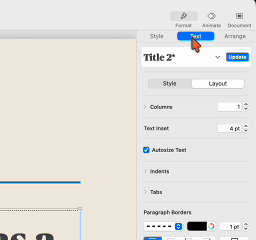

> *Text shown in the image:* **Recording A:** A writer creates a fourth competitor report by changing the company names, repeatedly guesses and undoes calculations, and finishes without verifying the result. **Recording B:** A strategy analyst uses familiar apps for a new market-entry workflow, applies weighted criteria, corrects one formula error, verifies the results, and produces primary and fallback recommendations.

❝

**Recording B meets the standard.** Professional methods are applied, a

meaningful different workflow is demonstrated, and one small mistake is handled deliberately. ❞

# Narration Quality

TaskRecorder captures microphone audio, and narration is required throughout the task. Speak like a professional teaching a colleague who cannot see your screen.

**Prepare Your Audio**

**Before recording:**

1. Check your microphone in TaskRecorder in the top-right menu bar.

    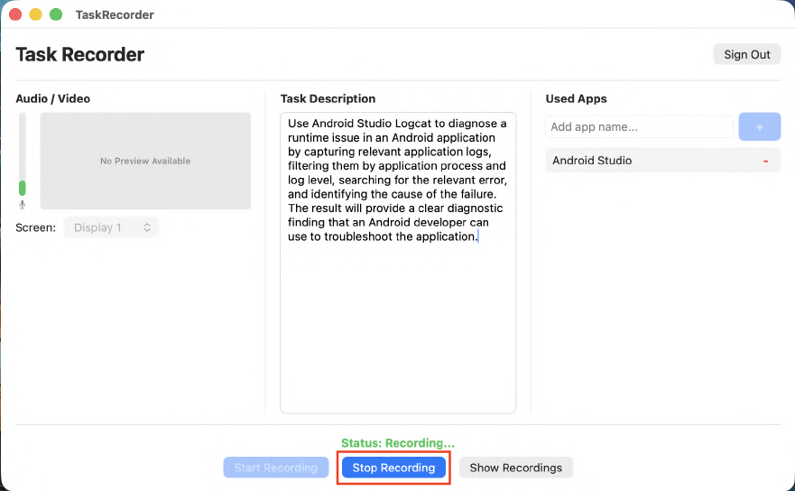

    > *Text shown in the image:* TaskRecorder — Mic Mode: Standard (selected) · Voice Isolation

2. Say a short test sentence and confirm that the volume bar beside the preview rises into the **green**.

    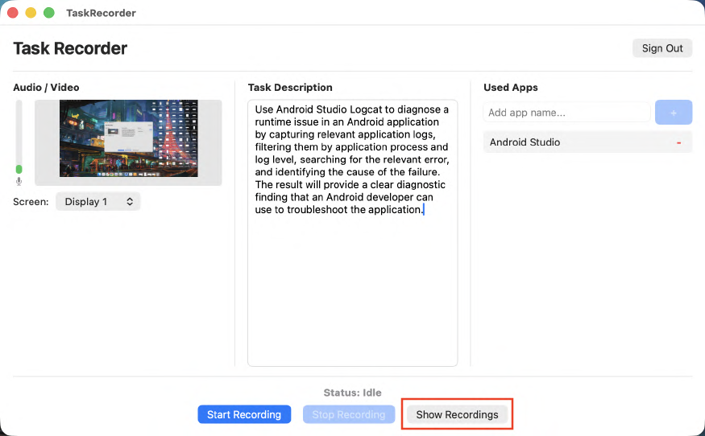

3. Keep the selected microphone connected for the entire recording.

Do not switch, disconnect, or reconnect input or output devices while recording. If a previous recording lost audio, make a short control recording with the built-in microphone before attempting another full task.

> When available, use headphones with a dedicated microphone for clearer audio.
>
> **Note:** For **audio or video tasks** that will feature audio playback, TaskRecorder does not capture internal system audio stream. Audio will only be captured by TaskRecorder if played aloud and picked up by your microphone.

---

**Narrate the Complete Workflow**

Narrate your thought process and meaningful actions, including:

- What you are analyzing, changing or deciding
- Mouse movements, clicks, and scrolling
- Why you selected a method, setting, or value
- What happened after the action
- How you verified the result

Speaking frequently is not enough. A listener should be able to identify the exact app and control, understand the purpose of the action, follow the workflow in the correct order, and hear the confirmed result without seeing the screen.

> **DO NOT** simply read or recite the written Task Description (Goal).

**Use What, Where, and Why**

For each meaningful step, say what you are doing, identify the control and where it is on screen, and explain the purpose or result when it is not obvious. Keep your cursor on the item you are naming. Speak naturally; an occasional ‘this’ or ‘here’ is fine when the reference is clear, but do not make viewers guess.

Common Mistakes: Narrate the action, exact location, and purpose of meaningful steps, with your cursor on the item you name."

| **Element** | **Explain** |
|---|---|
| **What** | The action you are taking |
| **Where** | The exact app, control, file, value, or interface location |
| **Why** | The purpose or what happens after the action |
| **Cursor** | Point to or briefly hover over the item you name; tracing text while reading can help |

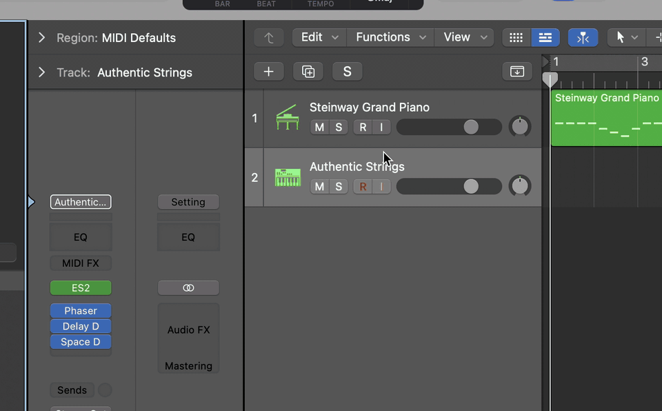

**Example:** ❝ I’ll **click** the **Title 2 at the top to open the Headings Dropdown Menu**, then **select Subtitles to change the text to the subtitle headings format**. ❞

Narration is **REQUIRED** for each meaningful step. Use it naturally to teach the workflow, not to list robotic actions.

**Narration Examples**

**1. Finance: calculate the purchase-order total**

[Source video at 11:45](https://drive.google.com/file/d/1TOANq_bwgQ_Qyti7PL2R86mR1xAgctUP/view?usp=sharing&t=705)

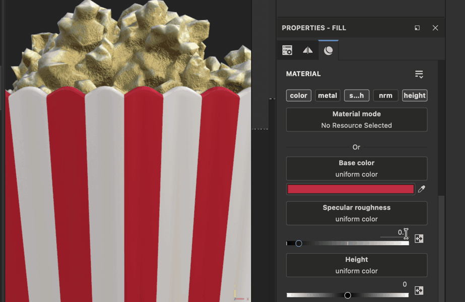

- “Now I need to figure out what the total order value is.” \[What\] \[Why\]
- “I can do that by adding this £12,474 amount to the £62,370.” \[What\] \[Why\]
- “I'm going to left-click on the plus sign in Calculator, then enter six, two, three, seven, zero.” \[What\] \[Where\]
- “I'll click equals at the bottom-right of the Calculator.” \[What\] \[Where\]
- “The final value is £74,844, exactly what it should be per the contract.” \[What\] \[Why\]

**2. Typography: narrow the anatomy list to eight terms**

[Source video at 00:48](https://drive.google.com/file/d/1T5H40VnOM61CnNUQb0zYkhBw2PgIZ8R8/view?usp=sharing&t=48)

> *Text shown in the image:* Typography Anatomy: 1. Baseline · 2. Cap Height · 3. X Height · 4. Serif · 5. Stem · 6. Stroke · 7. Ascender · 8. Descender · 9. Letterspacing · 10. Leading · 11. Counter · 12. Aperture · 13. Terminal · 14. Leg · 15. Spine · 16. Bowl · 17. Arm · 18. Crossbar · 19. Finial · 20. Eye · 21. Shoulder

- “I'm only going to show the eight I think are most important in this presentation.” \[What\] \[Why\]
- “I'll drag from just after Shoulder up to just below Counter.” \[What\] \[Where\]
- “On the right-hand side, I'll click the strikethrough text option.” \[What\] \[Where\]
- “I'll select Leading and click strikethrough, then select from Stroke up to Stem and do the same.” \[What\] \[Where\]
- “That should leave me with eight.” \[What\]

**3. Audio and music: set the string-track level**

[Source video at 06:20](https://drive.google.com/file/d/18aeXVN8jy6rAIQPv_BMUByg53KDnnSrq/view?usp=sharing&t=380)

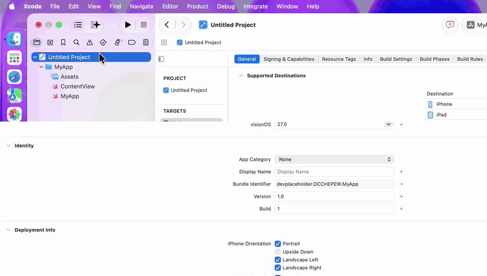

- “We've properly loaded our additional string track.” \[What\]
- “Just to the lower right of Authentic Strings is its volume slider.” \[Where\]
- “These string patches tend to be very loud, so I'll click the volume slider.” \[What\] \[Why\]
- “I'll move it left to about minus 10 dB, which is a good place to start.” \[What\] \[Why\]

**4. VFX: give the printed ink a slight height**

[Source video at 30:55](https://drive.google.com/file/d/1wVBfJCTIAPJHJ6w3hoVHnZxSk-ujKYLA/view?usp=sharing&t=1855)

- “I'll navigate down to Height.” \[What\] \[Where\]
- “The red ink on a cardboard box forms a slightly raised layer.” \[Why\]
- “I'll go to the black-and-white gradient bar under Height and click the zero in its text box.” \[What\] \[Where\]
- “I'll type 0.01 for an ever-so-slight height difference and press Enter.” \[What\] \[Why\]

**5. Software: apply the exported app icon**

[Source video at 24:11](https://drive.google.com/file/d/14Fgj-2mtxKmCXIMiGnUT57EElc5rnjec/view?usp=sharing&t=1451)

- “I'll click General on the right side of the Project Navigator.” \[What\] \[Where\]
    - “I'll drag the scrollbar down until I see App Icons and Launch Screen.” \[What\] \[Where\]
    - “In that section, I'll click the App Icon field, type AppIcon without a space, and press Enter.” \[What\] \[Where\]
    - “This applies to the icon we exported to the app.” \[What\] \[Why\]

---

**Name the Exact Target**

Avoid vague references such as “this”, “that”, or “here”. Identify each item clearly before or while interacting with it.

| **Avoid** | **Use Instead** |
|---|---|
| I’ll click this button | I’ll select the blue Export button in the top-right corner |
| I’m changing that value | I’m changing the font size, which is currently set to 12 |
| I’ll click the right-side button | I’ll select Plotly’s camera icon, Download as PNG |
| I’ll place that up there | I’ll click, hold, and drag the title to the upper center of the Preview |
| It’s saved | Article.pdf is now saved in the Desktop folder |

> For an unlabeled icon, name its app or panel, function, or visible symbol. Identify visual assets by their subject or filename, not only by position or color.

---

**Coordinate Your Voice and Cursor**

Your narration, cursor, and on-screen action should work together.

- Name the target before or while moving toward it.
- Rest the cursor briefly over the named control before acting.
- When searching, scan the relevant menu or toolbar naturally and explain what you expect to find.
- If an action fails, explain what happened, make one deliberate correction, and confirm the corrected result.
- Announce every keyboard shortcut before or while using it.

---

**Follow the Audio Standards**

|   |   |
|---|---|
| **Will be approved if:** | **Will be rejected if:** |
| • Describes What / Where / Why during the action. • Follows the video; the cursor points, hovers, and guides attention. • The voiceover is clear, coherent, well-paced, understandable, and free of sustained or distracting background noise. • Announces every keyboard shortcut before or as it is used. • 100% in English, including reading | • Misses actions, mismatches the video, or recites the written Task Description (Goal) instead of narrating the work. • Narration is too vague to identify What, Where, Why, or the result. • An audio pause exceeds 45 seconds. • Sustained background noise affects the recording. • Uses keyboard shortcuts without verbal explanation. • Audio includes private or non-public PII or profanity. |

---

**Review the Audio**

Before submitting, review the recording to confirm that:

- [ ] Narration is audible near the beginning, middle, and end.
- [ ] The narration matches the actions shown.
- [ ] No audio gap exceeds 45 seconds.
- [ ] Actions, decisions, and results are explained clearly.
- [ ] No sustained background noise, private information, or profanity.
- [ ] Every keyboard shortcut is announced.

---

**Pause and Decide**

*Q: Which recording meets the standard?*

> *Text shown in the image:* **Recording A:** “In Excel, I’ll select cell F12 in the Summary worksheet to verify the annual revenue formula. The formula bar shows SUM(B12:E12), confirming that all four quarterly totals are included. I’ll now press Command and S on my keyboard to save the verified workbook” **Recording B:** “I’ll click this here and fix the value.”

❝

**Recording A meets the standard.** The narration identifies the app and

location, explains the purpose, confirms the result, and announces the keyboard shortcut. ❞

# Apps and Desktop

A strong recording uses tools that genuinely contribute to the work, an approved browser, and a clean desktop that varies naturally across tasks.

**Choose Apps that Contribute**

Use at least 3 genuine apps by default. Each app should make a meaningful contribution to the professional workflow or final deliverable.

| **Counts as a Genuine Task App** | **Does Not Count** |
|---|---|
| Supports meaningful research, analysis, creation, editing, or verification | Is only opened, named, or briefly visited |
| Produces or changes information used elsewhere in the workflow | Is used only for setup, navigation, or project administration |
| Has a clear purpose in the Task Description (Goal) | Display the opening Task Description (Goal) but is not used again |

The intro Task Description (Goal) document app counts only if you also use it for substantive task work.

> List the same genuine apps in Task Description, Studio, and TaskRecorder.

**The 1-2 App Exception**

A task may use only one or two apps when the work inside the primary app is deeply technical and complex enough to demonstrate substantial professional expertise by itself.

For example, an advanced editing, mixing, mastering, and verification workflow in professional audio software may qualify. Completing basic actions in a complex app does not.

> A complex app does not automatically make a complex task.

All other requirements still apply, including narration, originality, recording length, and a complete deliverable.

---

**Avoid Restricted Apps**

Review Restricted Apps before choosing the tools for your task. Do not open, display, or use a restricted app during the recording, even for a brief or supporting action.

If your planned workflow requires a restricted app:

1. Choose a permitted alternative before recording
2. Revise the Task Description
3. Update the Use Apps in Task Description, Studio, and TaskRecorder.

> Opening or interacting with a restricted app, even briefly, may invalidate the recording.

---

**Vary the Desktop Appearance**

Before recording, vary multiple aspects of the desktop appearance where practical. You may change:

- Screen resolution
- Light or dark mode
- Desktop background
- Dock size
- Application or interface layout (i.e., color)

> The dock must remain on the **left or right** side of the screen, never at the bottom.
>
> Mouse cursor size & color must stay default.

---

**Pause and Decide**

*Q: Which recording meets the standard?*

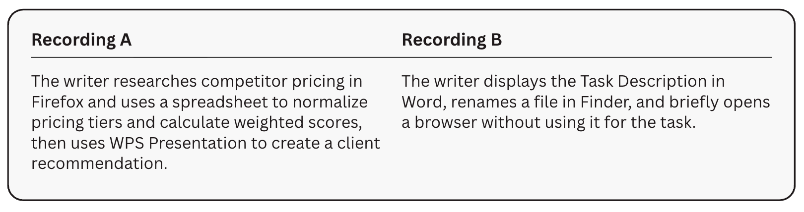

> *Text shown in the image:* **Recording A:** The writer researches competitor pricing in Firefox and uses a spreadsheet to normalize pricing tiers and calculate weighted scores, then uses WPS Presentation to create a client recommendation. **Recording B:** The writer displays the Task Description in Word, renames a file in Finder, and briefly opens a browser without using it for the task.

❝ **Recording A**

**meets the standard.** Each app contributes meaningfully to a connected professional workflow through research, analysis, and stakeholder communication. ❞

### On-Screen Presentation

A quality recording should make the work easy to follow visually. Keep the active content visible and use the cursor to direct the viewer’s attention.

**Manage Windows Clearly**

Keep one clear active window, or arrange only the task-relevant windows you need side by side. Other task apps may remain open, but minimize them when you don't need them for the current step.

| **Do** | **Avoid ‼️** |
|---|---|
| 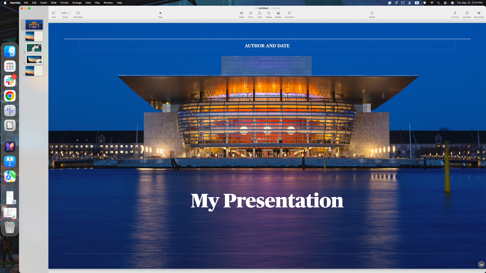 Use ordinary **Fill** for one active window |  Using Full Screen or full-screen Split View |
|  Arrange relevant windows side by side when both are needed |  Stacking, overlapping, or pushing windows open |
| • Keep the menu bar, clock, and dock visible. • Rearrange or minimize a window if it becomes substantially covered. • Keep active windows large and easy to read. | • Leaving unused or fully covered windows open. • Covering a task window by more than approximately 25%. • Using small floating windows surrounded by unused desktop |

**Pop-ups Exception**

- Temporary pop-ups or dialogs within the same app may overlap while you are actively using them.

**Window Management Examples and Resources**

- [One-at-a-time window management example](https://drive.google.com/file/d/1WQ0XPW9-U4RfN0INEY-6npWJFZ2SJCqh/view?usp=drive_link) (0:31)
- [How to use window tiling on Mac | Apple Support](https://www.youtube.com/watch?v=U3KAmUYkkVc) (Youtube, 1:16)
- [Move and arrange app windows on Mac](https://support.apple.com/guide/mac-help/work-with-app-windows-mchlp2469/mac)

---

**Use the Mouse as a Teaching Pointer**

The cursor should guide the viewer’s attention and make each action easy to follow. Move naturally, pause before acting, and point to the content you are discussing.

✅ **Good Example**

❌ **Bad Example**

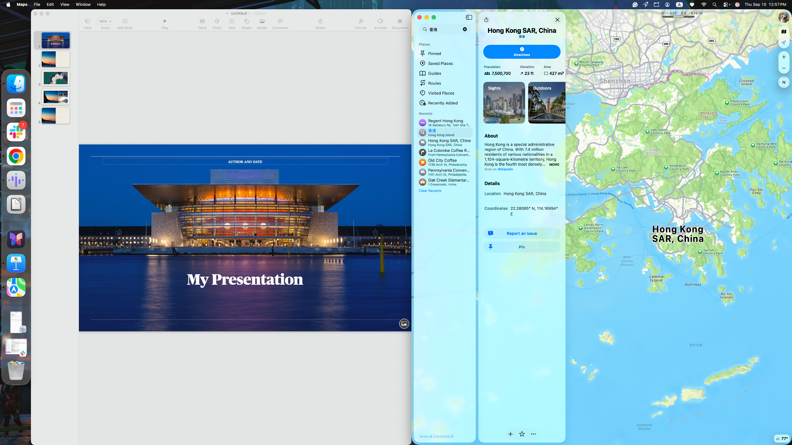

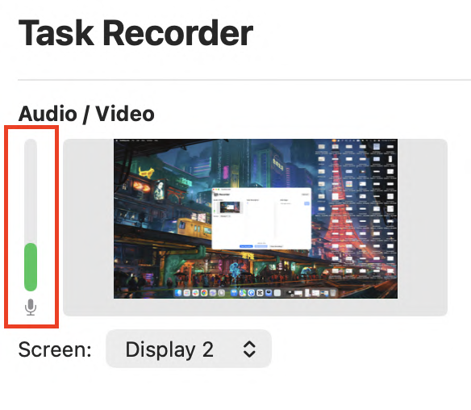

*The cursor moves naturally, shows what is being*

*The cursor moves too quickly and distracts the discussed, and makes the next action clear.*

*viewer from the task.*

**When practical:**

- Point to text, buttons, icons, or interface areas as you discuss or use them.
- Trace along text or an area when it helps direct attention.
- Pause briefly over a useful control so its tooltip or preview can appear.
- Scan the relevant toolbar or panel naturally when locating a tool.
- Use visible interface controls instead of relying only on keyboard shortcuts.
- Clicks should be deliberate and unrushed; **pause about 1 second after every click**.

> Move, Pause, Point, and then Act.

**Limit Typing Time**

Typing is expected, and the cursor may remain still while you type. But it should not dominate the recording.

| **Recording Type** | **Typing Limit** |
|---|---|
| **Coding + Content & Writing tasks** | Up to **30%** of the total recording |
| **All other tasks** | Below **20%** of the total recording |
| **Any task** | No continuous typing segment or mouse inactivity longer than 45s |

Break longer entries into shorter segments. Between typing segments, review what you entered, use the cursor to point out important details, format the content, test the result, or complete another meaningful action.

---

**Pause and Decide**

*Q: Which recording meets the standard?*

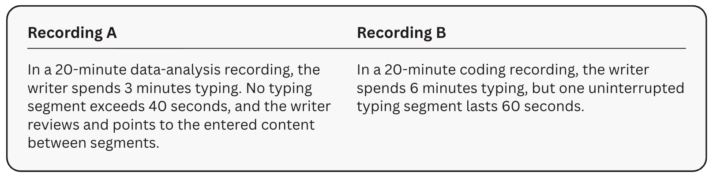

> *Text shown in the image:* **Recording A:** In a 20-minute data-analysis recording, the writer spends 3 minutes typing. No typing segment exceeds 40 seconds, and the writer reviews and points to the entered content between segments. **Recording B:** In a 20-minute coding recording, the writer spends 6 minutes typing, but one uninterrupted typing segment lasts 60 seconds.

❝ **Recording A**

**meets the standard.** The total typing time is below 20% for a non-coding task, and every typing segment stays under 45 seconds. ❞

## PII, Licensed Content, and AI Use

Keep all private information, project materials, unlicensed content, and prohibited AI activity out of the recording. These rules apply to task apps, input files, browser tabs, filenames, notifications, and anything else that may appear on screen.

**Protect Personal and Project Information**

Do not show information that could identify a real private person, including:

- Personal email addresses or phone numbers
- Home addresses
- Account or identification numbers
- Biometrics
- MAC addresses
- Your personal name or account information
- Other private or non-public personal information

Project information must also remain hidden, including references to:

- Mercor
- Project Odin
- Project Odin Writer Guidelines
- Studio instructions or task-management pages
- Other project-administration materials

---

**Use Licensed Content**

Images, videos, and other downloaded assets must be CC0 or Public Domain. Confirm that the source terms permit commercial use; royalty-free alone does not establish either requirement.

Do not use content that contains:

- A visible creator watermark
- A copyright symbol or ownership notice
- Unverified or unclear licensing
- Paywalled or otherwise restricted material

> AI-generated content is acceptable, however, this has to be done before recording.

---

**Avoid Prohibited AI Use**

Do not interact with AI or generate or revise task content during recording. Eligible AI-prepared input files may be shown and used if created before recording, with no AI interface, branding or watermark visible. Follow the prepared-input disclosure instructions in Studio Final Notes.

| **Use Case** | **Status** | **Rule** |
|---|---|---|
| Standard Google Search results | **Allowed** | Use search results normally |
| Opening a static link shown in Google AI Overview, including under **Show more** | **Allowed** | Do not interact with the AI Overview |
| Selecting **Ask anything** in Google AI Overview | **Not allowed** | This begins an AI interaction |
| Using AI Mode, Gemini, ChatGPT, Claude, or another conversational assistant | **Not allowed** | Do not prompt, chat, ask follow-up questions, generate, or summarize |
| Using AI to generate task content during recording | **Not allowed** | Task content must be created manually through the recorded professional workflow |
| Using an AI-powered feature for substantive task work | **Not allowed** | The feature cannot make meaningful task decisions or create the deliverable |
| Using ordinary built-in functionality | **May be** | It must involve no prompting, |
| that is not presented as AI | **allowed** | conversation, generation, or summarization |
| Running software that contains an AI or ML component | **Conditionally allowed** | It must be part of normal software validation and cannot act as an assistant that completes the task |

> When an ordinary built-in feature is permitted, narrate the action and result without describing the feature as AI.

**AI-Prepared Input Files**

An eligible input file may be created with Gemini **before** the recorded session. The file must still meet all privacy, licensing, and prepared-file requirements. During the recording:

- Do not show the AI tool, interaction, branding, or watermark
    - Gemini watermark is allowed, but **no** other watermark is allowed.
- Do not discuss how the file was generated
- Do not use AI to revise or generate additional task content during recording

> Follow the Prepared Input Files instructions for the required disclosure outside the recording.

---

**Pause and Decide**

*Q: Which recording meets the standard?*

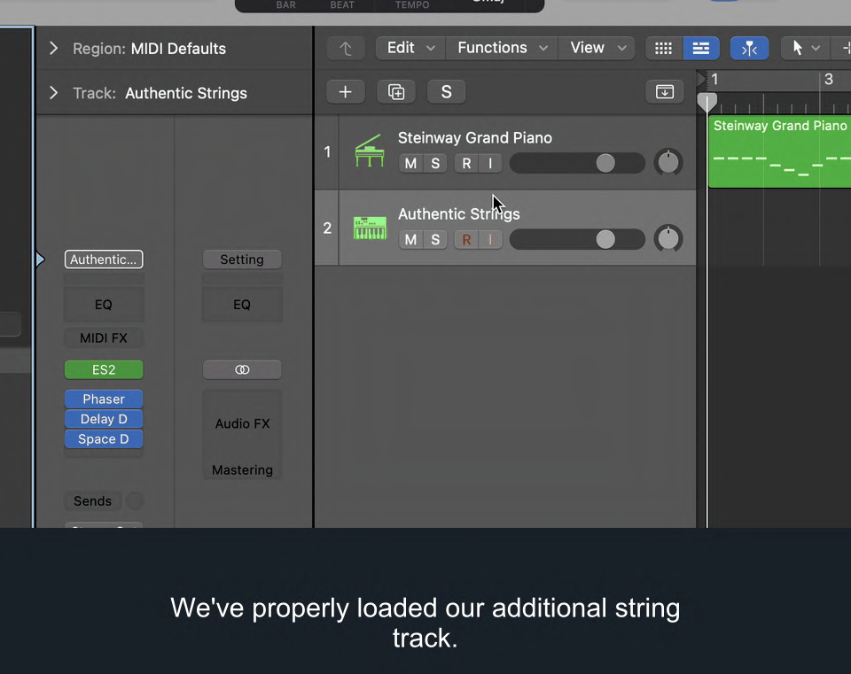

> *Text shown in the image:* **Recording A:** A writer displays a personal company email address with the person’s name and uses Photoshop’s AI-powered subject identification feature to create a mask for the final deliverable. **Recording B:** A writer uses the fictional name Sandy Jones and the address sandyjones@example.com. They use a verified CC0 image and open a standard Google result that appeared in the AI Overview without selecting Ask Anything.

❝ **Recording B**

**meets the standard.** Fictional information, verified CC0 content, and Google Search without interacting with generative AI. ❞

# ⚡Additional Resources⚡

# 🏅Golden Examples🏅

Use the Golden Examples to study task complexity, professional workflow, and narration standards.

---

1. [Finance](#golden-examples)
2. Design
3. Audio & Music
4. Animation & VFX
5. Software & AI/ML Engineering

---

[1. Finance](https://drive.google.com/file/d/1TOANq_bwgQ_Qyti7PL2R86mR1xAgctUP/view?usp=sharing)

**Task Description**

I am an Account Receivable personnel at a company in the UK and have been tasked with adding a new vendor to our ERP system and creating a Purchase Order (PO) tracking workflow for our Accounting team to manage POs better. I will begin by adding missing information onto a sample PO on the Pages app, then transfer the vendor details, and PO line items onto our ERP system on Microsoft Dynamics 365 Business Central, and finally create a PO tracking workflow on Monday.com. I will verify the flow is complete by running the same at the end of its creation and check if the status updates as per the trigger, and deliver the final PO raised on Microsoft Dynamics 365 Business Central and the PO workflow from Monday.com to my team.

**Apps Used**

Monday.com

Microsoft Dynamics 365 Business Central

Pages (NOTE: Pages is restricted now, do **NOT** use it in your own tasks.)

Video: [Full task recording](https://drive.google.com/file/d/1TOANq_bwgQ_Qyti7PL2R86mR1xAgctUP/view?usp=sharing) (44:19)

[2. Design](https://drive.google.com/file/d/10HcP0usXgrPBP4AdVLBUNdjpONvHc_Iq/view?usp=sharing)

**Task Description**

I am a Content Creator preparing aspects of a new podcast. Using OBS Studio, I will setup different scenes for different aspects of the podcast such as pre-show and screen-share, which will involve the import of some images. The final deliverables will be the export of the scenes created in OBS.

**Apps Used**

OBS Studio

Video: [Full task recording](https://drive.google.com/file/d/10HcP0usXgrPBP4AdVLBUNdjpONvHc_Iq/view?usp=sharing) (24:44)

[3. Audio & Music](https://drive.google.com/file/d/18aeXVN8jy6rAIQPv_BMUByg53KDnnSrq/view?usp=sharing)

**Task Description**

I am a film score composer and I’m working on the underlying theme for a heroic end credit sequence. I will use Logic Pro in the second phase (P2) of the execution to compose a string accompaniment for the piano top melody created in phase one (PI). I will also establish a chordal sequence (I - vi - IV - V) to define the passage. The final deliverable will be a stereo export of the complete Logic Pro session.

**Apps Used**

Logic Pro (NOTE: Logic Pro is restricted now, do **NOT** use it in your own tasks.)

Video: [Full task recording](https://drive.google.com/file/d/18aeXVN8jy6rAIQPv_BMUByg53KDnnSrq/view?usp=sharing) (22:58)

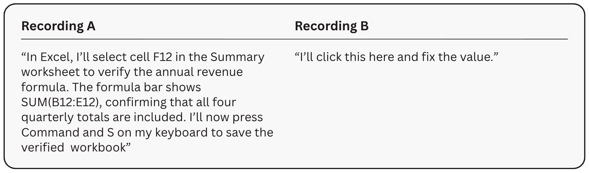

[4. Animation & VFX](https://drive.google.com/file/d/1wVBfJCTIAPJHJ6w3hoVHnZxSk-ujKYLA/view?usp=drive_link)

**Task Description**

You are a 3D Modeler tasked with cleaning up the textures of a photogrammetry model for use in Unreal Engine. Use Adobe Substance 3D Painter to bake the provided high poly model onto the provided low poly model, apply the provided photogrammetry diffuse texture, clean up artifacts on the texture, add a powdery finish to the popcorn and add red and white striped packaging textures to the popcorn box. Export the texture maps appropriate for use in Unreal Engine.

**Apps Used**

Substance 3D Painter

Video: [Full task recording](https://drive.google.com/file/d/1wVBfJCTIAPJHJ6w3hoVHnZxSk-ujKYLA/view?usp=drive_link) (40:59)

[5. Software & AI/ML Engineering](https://drive.google.com/file/d/14Fgj-2mtxKmCXIMiGnUT57EElc5rnjec/view?usp=drive_link)

**Task Description**

As an iOS app developer I want to create a distinctive visual identity for a simple Music Player app. Use SF Symbols as independent visual components, and compose them as separate layers in Icon Composer. Build & refine the multi-layered icon in Icon Composer and integrate the resulting icon into a SwiftUI Music Player app in Xcode. Deliver the layered icon and Xcode project; verify that the app builds successfully and the icon is correctly integrated.

**Apps Used**

Device Hub

Xcode

SF Symbols

Icon Composer

Video: [Full task recording](https://drive.google.com/file/d/14Fgj-2mtxKmCXIMiGnUT57EElc5rnjec/view?usp=drive_link) (28:37)

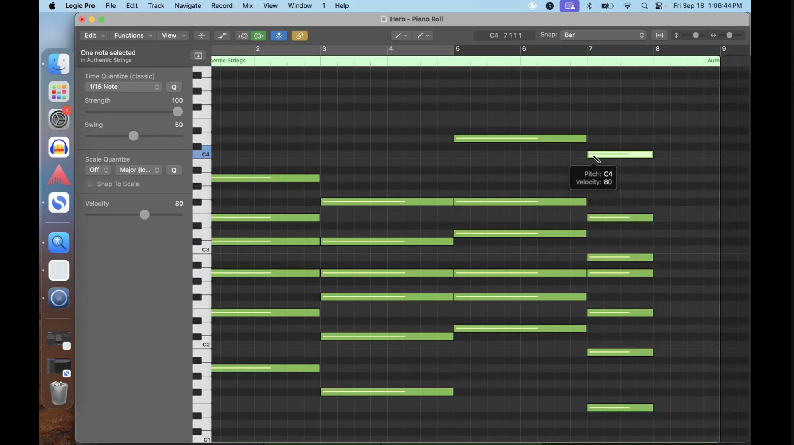

## Good vs. Bad Task

Below are key points of a good TaskRecorder task and what to avoid. Use the Golden Examples to study professional workflow and narration.

| **PROJECT Odin · GOOD VS. BAD TASK** |   |   |
|---|---|---|
|   | **Bad Task** | **Good Task** |
| **Task Description** | • Task description (Goal) is too vague to explain the task, apps, or intended result. | • Get your idea approved. Use only the Goal in TaskRecorder and the opening doc. • Task description (Goal) document is not a restricted app. |
| **Intro** | • The recording does not show the Task Description (Goal) briefly at the start, followed by minimizing it. • Introduction narration is long and descriptive rather than saying the provided introduction sentence. • The introduction does **not** include narration, only an app with the written Task Description (Goal). • Recording starts after important actions for the task are completed • The recording includes preparation that belongs before the task, such as drafting the Task Description (Goal), loading apps, or changing the desktop setup. | • TR is *<u>minimized immediately</u>* after the recording starts. • Setup takes place *<u>before</u>* the recording. • Narrates a concise introduction • Recording starts with apps open (dot under the app in the dock) and Task Description (Goal) shown • Task Description (Goal) document is *<u>closed</u>* a few seconds after the introduction has concluded . |
| **UI Diversity** | • No change in any of the UI elements • Dock at the bottom of the screen • Menu bar clock does not show seconds | • Vary at least one permitted UI element across recordings, such as the background, layout or light/dark theme. • Dock at the left or right of the screen • Menu bar clock shows seconds |
| **Screen Discipline** | • Scrolls past relevant content repeatedly without acting • More than ~25% of a window/app is covered by other windows/apps and left un-minimized • **Windows are stacked on top of each other**, fully covering background apps • A small floating window makes the content hard to see and leaves most of the desktop unused. | • Environment set up intentionally before starting • Organized workspace maintained throughout • Only windows relevant to the current task/sub-task remain visible; all others minimized • Use one clear ordinary window or place needed windows side by side. Temporary pop-ups or dialogs within the same app may overlap while you use them. • Full-screen (clock and dock not visible) is **not** used |
| **Cursor & Mouse** | • Constant aimless circles or jitter, no task intent • Frequently uses keyboard shortcuts where mouse actions were expected • The cursor remains inactive for more than 45 seconds. Keep pauses brief, ideally under 30 seconds, without artificial mouse movement. | • Deliberate, goes only where attention is • Use the cursor as a teaching pointer so viewers can follow your reasoning. |
| **Pacing & Presence** | • Experts rush through steps • Uneven pacing; idle periods present but task moves forward • Duration padded with unnecessary actions | • Well-paced start to finish; every segment has task value • Work naturally, explain your decisions and avoid unnecessary waiting. • Experts wait 1s beat before clicking the next item |
| **Workflow Adherence & Complexity** | • No clear task goal or planned workflow. • Abandoned within 30 sec, no meaningful attempt • [**Restricted app used**](#restricted-and-limited-use-apps) • No coherent workflow; unrelated activity begins • The stated task goal is not completed. • Less than half of the intended workflow completed • Tasks substantially repeat the same workflow; changing only the topic or wording does not make it different. • None of the client required apps is used in the task (if applicable) • The workflow stays at basic steps and the output is too simple to be useful. • Majority completed; one major step skipped or weak • Coding and Content & Writing tasks: up to 30% of the recording may be typing. • All other tasks: below 20%. • For every task, no continuous typing segment or mouse inactivity longer than 45 seconds. • Extra apps are added only to increase the count, without contributing meaningful work; any one- or two-app exception must meet the full technical-complexity guidance. • Metadata file is shown in the recording | • At least one client required app is used in the task (if applicable) • Keep the work mouse-driven. Treat 30% typing for Coding + Content & Writing tasks and 20% for other tasks as upper limits, not targets. • Complete the planned workflow and produce a clear, useful final deliverable. • Explain your choices and the professional reasons behind them. • Use each app naturally and give it a clear purpose in the task or final output. • Metadata file is NOT shown in the recording |
| **Completion** | • Recording incomplete or missing • Deliverables not saved • Output present but too thin or generic to be usable • Continues tinkering after task done, ambiguous endpoint | • Output is reviewed before stopping; clear wrap-up • Add further work only when it genuinely improves the promised result in a relevant direction • Prior feedback fully addressed • Include every input, intermediate artifact and final output in Deliverables.zip, using the required labels and file extensions. |
| **Accuracy and Error Recovery** | • Multiple significant errors, no self-correction • Notices error but doesn’t fully resolve it • Corrects mistake but doesn’t verify the fix | • No material error occurs, or any error is promptly diagnosed, corrected and verified without disrupting the workflow • Final output is carefully reviewed |
| **Domain & Tool Expertise** | • Basic, generic work that someone without your domain expertise could do. • Basic work that does not require domain knowledge combined with surface level app tool use • Meanders through menus with no progress visible • Learns the software by trial and error during recording | • Use professional methods and app features you already know. Explain important choices and anticipate relevant edge cases. |
| **Narration & Audio** | • No narration, or audio absent/unintelligible • Narration contradicts what’s on screen • Gap >45 sec, speaking the Task Description (Goal), or profanity • Long stretches unnarrated; major steps happen in silence • Rambling or filler that doesn’t track the workflow • Narrates some steps but skips others; intermittent gaps • Explains what but rarely why • Occasional shortcuts not called out • Background noise obscures narration | • Narrate throughout, as if teaching someone how to do the task. • Name what you are doing, where you are doing it and why, using specific control and location names. • The cursor is positioned over the item being referred to in the narration. • Explain your reasoning and small professional decisions as they happen. • Clean synchronised audio; concise, no rambling; no background noise |
| **Written Quality** | • Writing errors affect the meaning or make the final output unusable. | • Use accurate, professional writing and clean formatting. Minor errors are acceptable only if they do not affect the meaning or core result. |

# ❌ <u>Restricted and Limited-Use Apps</u>

Do not use or interact with any app listed as “🚫 RESTRICTED” in RLStudio for task work. Any task that uses a restricted app for task work cannot be delivered and will not be compensated. Make sure you check the App field in RLStudio before recording to prevent that.

**Before you record, check every app and browser:**

- **Check the app catalog.** Studio has a full list of apps during the idea stage.
- **Check the browser too.** A web app such as Google Sheets or Gmail is still restricted if you open it in a restricted browser. Safari and Chrome are both restricted for task work, so use another browser such as Firefox, Brave, or Edge.
- **Common restricted apps:** Safari, Chrome, Excel, Keynote, Pages, Numbers, iMovie, Final Cut Pro, Logic Pro, Calendar, Reminders, Preview and Terminal. The catalog has the full list.
- **New apps need approval.** An app that isn't approved yet needs an app-use request on the dashboard. You can't record until both the app and your idea are approved.

Limited-use exceptions:

- 

    **Chrome** may be used only to authenticate TaskRecorder before recording.

    **TextEdit** may be used only to create Metadata.rtf before recording, and

- 

    cannot be used for the Task Description (Goal) document during the Intro. **Workpuls/Insightful** tracker should be running and minimized in your dock,

- 

    but never interact with it or show its window during recording.

    **Common Mistakes**

| **Rejection Item** | **Explanation** |
|---|---|
| Task Description | Use the friend-with-no-domain-expertise test to choose a task that uses your skills. The Task Description (Goal) should briefly explain your role, the apps and key methods, and the intended result; it does not need to fill a page. |
| Task Recorder Version | You must use the current version of Task Recorder and not an older one from past phases. |
| [Frame loss (TR)](#screenshot-verification) | Missing PNGs or low PNG count (&lt;0.5 per second of recording). We must have all the data required for the client. |
| [Restricted app](#restricted-and-limited-use-apps) | Do not use an app marked restricted in RLStudio, including by entering it under Other in Studio. |
| UI Diversity | Task must have at least one change. |
| Dock | Dock should be on the left or right and not minimized. Dock should **not** be at the bottom of the screen. |
| Menu bar clock | Seconds must be displayed on the menu bar clock. |
| No Setup/Introduction | Task description (Goal) document must be displayed at the beginning of the video and intro narration should not last longer than 20 seconds. |
| Accessibility Inspector | Accessibility Inspector not running during the video. |
| Task length | Total video length: Recording length, including the short intro, must be at least 15 minutes and no more than 45 minutes (15:00-45:00). |
|   | Narration below the target Narration does not clearly describe What, Where and Why for each meaningful step. |
| Profanity | Profanity must not be in narration or shown in recording |
| Silence gap | Any single audio silence gap over 45s threshold is not allowed |
| AI usage | Any generative AI in video. **Only ordinary built-in functionality not presented as AI is permitted; do not prompt, converse, generate or summarize task content with AI during recording.** AI may prepare inputs before recording. At first use, explain the prepared file's contents, purpose and royalty- and copyright-free status without naming an AI tool or inventing a source. Put “AI-generated before recording” in Studio Final Notes. |
| PII | Private or non-public personal information must not be visible or audible. Examples of exceptions are public GitHub user information/emails and author information/emails in public research papers; these do not permit unrelated private information. |
| Project references | Keep Mercor, Project Odin, Studio and other project materials out of view. TaskRecorder may appear only for the required Start Recording and Stop Recording actions; minimize it immediately after starting. |
| Copyright | Do not use paywalled, watermarked, Unsplash or unclear-rights content. Check the original source for CC0/public-domain or equivalent permission and terms permitting AI-training use; a search filter alone is not sufficient. |
| Input files (if applicable) | Include all input files in Deliverables.zip. In Studio Final Notes, provide each non-AI source URL or exactly “AI-generated before recording” for AI-created inputs; complete Source of Data when applicable as well. |
| Window Management | Applications and windows covered by another window (excluding pop-ups within the same app) by more than approximately 25%. |
| Mouse inactivity | Any single cursor pause > 45 seconds is not allowed |
| Excessive typing | Typing should not take up too much of video length |
| Deliverable File missing from the .zip | The deliverable must contain a final output file in the deliverable.zip. If input files, intermediate artifacts, or multiple final outputs exist in the task, all of them must be present in the deliverable.zip. |
| Metadata visibility | Metadata.rtf window should not be shown in the recording |
| Workpuls/Insightful | Workpuls/Insightful window can not be opened in the recording (it is allowed minimized in the Dock) |

# Known Technical Issues

## System Audio Issues

A known issue is that changing your audio input/output during a recording may prevent your narration from being captured. If your workflow requires this, make a short test recording first to see whether your system is affected.

## TaskRecorder Technical Issues

⚠️ **<u>A few troubleshooting tips - if you see the following errors</u>**

---

### <u>popping out:</u>

**\[Zero or very few screenshots, empty recordings, unreadable/cut-off videos\]** Do not submit. Close large accessibility trees and interfering apps (e.g. close calls, screen sharing, computer-control agents, unused complex browser tabs, large Finder folders and large unused documents), restart after a severe failure, and record the task again.

**\[Daemon is not ready\]** It means a background program (daemon) could not be initiated. Terminate the TaskRecorder app and restart again

If you need to share logs in Slack’s technical issues channel, logs will be inside each recording’s folder (archive) as recording.log

### For a fresh restart:

1. Start simple: fully quit and reopen TaskRecorder and Accessibility Inspector. Reboot after a zero-screenshot, unreadable-video or repeated failure before trying again.
2. Make sure Xcode is installed and Accessibility Inspector is running. Close the Accessibility Inspector window with the red button, but do not quit or yellow-minimize the app. Its blue Dock icon must keep a dot below it.
3. If TaskRecorder lacks a permission, remove and re-add TaskRecorder under the matching System Settings → Privacy & Security category, grant it again, then fully quit and reopen TaskRecorder.
4. There is no separate macOS screenshot switch to enable. Verify TaskRecorder’s Screen Recording and Accessibility permissions instead.

### Specific Error

> *Text shown in the image:* Recording Error Failed to negotiate upload connection: Impersonation (ID Token) failed: { "error": { "code": 403, "message": "Permission 'iam.serviceAccounts.getOpenIdToken' denied on resource (or it may not exist).", "status": "PERMISSION_DENIED", "details": [ { "@type": "type.googleapis.com/google.rpc.ErrorInfo", "reason": "IAM_PERMISSION_DENIED", "domain": "iam.googleapis.com", "metadata": { "permission": "iam.serviceAccounts.getOpenIdToken" } } ] } } [OK]

Use only the OTA account assigned to you. Cancel the failed sign-in, open a clean browser profile containing that assigned account, and retry. If it still fails, ask support to verify the assignment; do not switch OTA accounts unless the assignment is officially changed.

> *Text shown in the image:* Left: Accessibility permission list — Discord (off), OnScreen Control (on), OSCMultiMonitor (on), TaskRecorder (on), Workpuls (on), zoom.us (off). Right: Welcome to Task Recorder — Permissions Required: Accessibility (Required to record accessibility tree.) [Enable]; Screen Recording (Required to record screen.) ✓; Microphone (Required for audio recording (future use).) ✓

**<u>Solution:</u>** Remove/add TaskRecorder in accessibility (System Settings -> Privacy/Security -> Accessibility). Click at - and then at + and include TaskRecorder again. ON/Close/Reopen. The same route can also be followed for Screen Recording if needed.

# Frequently Asked Questions (FAQ)

- [General Understanding](#general-understanding)
    - [What am I actually doing in this project?](#onboarding)
    - [Am I being evaluated on how well I do the task?](#onboarding)
- [Onboarding](#onboarding)
    - [In the onboarding document, it's mentioned "Any laptop and processor works for this version of Project Odin". Can we use a Windows laptop?](#onboarding)
    - [When will my task be reviewed?](#onboarding)
    - I need more time to complete onboarding. What should I do?
    - What happens if my first task needs revision or is rejected?
    - Do I run Insightful, and is onboarding paid?
- [Tasks](#tasks)
    - [In my domain of expertise, all tasks follow a largely consistent workflow, with only minor variations. Given this, is it okay to continue working on these types of tasks?](#recording)
    - [Can I create an iCloud account with my OTA credentials?](#recording)
- [Recording](#recording)
    - [Can I pause a recording?](#recording)
    - [What if I make a mistake during the task?](#stopping--submitting)
- [Stopping & Submitting](#stopping--submitting)
    - [How do I stop recording?](#finishing-the-task)
    - [If I re‑record the same task multiple times, which version gets reviewed?](#finishing-the-task)
    - [Can I watch my recordings?](#finishing-the-task)
- [Finishing the Task](#finishing-the-task)
    - [How do I know I’m completely done?](#studio)
    - [Is it okay to redo a task if I think it’s bad?](#studio)
- <u>Studio</u>
    - [What goes in "Description" in Studio?](#studio)
    - [What counts as a task app, and what if it is not listed?](#studio)
    - [Where is Finder in the list of apps?](#accounts--privacy)
    - [What goes in "Crash Console messages" and "Final Notes" in Studio?](https://docs.google.com/document/d/1pWRX4iYK_GHQRDPEbAC9N6mDZ9ClvLm5efPS-OUziCo/edit?tab=t.vdcsjsu6gniw#heading=h.ajy46zcqmgnk)
    - [I don't see a field to add the task link in Studio. Should I submit the task in the task platform and Studio separately?](https://docs.google.com/document/d/1pWRX4iYK_GHQRDPEbAC9N6mDZ9ClvLm5efPS-OUziCo/edit?tab=t.vdcsjsu6gniw#heading=h.6s0f5pq08vje)
- [Accounts & Privacy](#accounts--privacy)
    - [Can I use my personal Google, Apple, or app accounts?](#accounts--privacy)
    - [What if I accidentally logged into a personal account during recording?](#accounts--privacy)
    - [Can I work on any computer?](#accounts--privacy)
    - What should my computer look like if I have successfully completed the account and Task Recorder setup?
    - What is the difference between my Mercor expert email and the OTA accounts?
- [Pre-Recording Preparation](#pre-recording-preparation)
    - [What should my opening note contain?](#task-recorder-device-and-system-requirements)
    - [Does the note-taking app count as a task app?](#task-recorder-device-and-system-requirements)
    - [What is the required opening sequence?](#task-recorder-device-and-system-requirements)
- [Task Recorder Device and System Requirements](#task-recorder-device-and-system-requirements)
    - [Does having an M‑series MacBook (Apple Silicon) solve compatibility issues with TaskRecorder?](#task-recorder-device-and-system-requirements)
    - [How can I check whether my Mac is Intel or Apple Silicon?](#taskrecorder-installation)
    - [I have an Intel Mac. What happens to my contract?](#taskrecorder-installation)
    - [How do I share my Mac specifications if support asks for them?](#taskrecorder-installation)
- [TaskRecorder Installation](#taskrecorder-installation)
    - [Why is macOS required for TaskRecorder?](#taskrecorder-installation)
    - Do I need to uninstall the old versions ?
    - I can’t install TaskRecorder, the install fails
    - On TaskRecorder the login button isn’t clickable.
    - I enabled Accessibility, but TaskRecorder keeps sending me back to settings.
    - I deleted TaskRecorder to reinstall, but it still appears in permissions.
    - How do I confirm I’m fully ready?
- [TaskRecorder Accounts, Browsers, and Chrome Profiles](#taskrecorder-accounts-browsers-and-chrome-profiles)
    - [How should I set up my browser and profiles for TaskRecorder?](#taskrecorder-accounts-browsers-and-chrome-profiles)
    - [Which account should I use for TaskRecorder?](#taskrecorder-accounts-browsers-and-chrome-profiles)
    - [My login still fails after clearing cache, cookies, and reinstalling. Any other tricks?](#taskrecorder-stopping--uploading)
- [TaskRecorder Stopping & Uploading](#taskrecorder-stopping--uploading)
    - [How do I stop recording?](#taskrecorder-stopping--uploading)
    - [Where are my recordings saved?](#taskrecorder-stopping--uploading)
    - [If I re‑record the same task multiple times, which version gets uploaded?](#taskrecorder-errors--troubleshooting)
    - [Can I watch my recordings before uploading?](#taskrecorder-errors--troubleshooting)
- [TaskRecorder Errors & Troubleshooting](#taskrecorder-errors--troubleshooting)
    - [What if permissions won’t turn green?](#taskrecorder-errors--troubleshooting)
    - [What if the app behaves differently than the guide?](#taskrecorder-errors--troubleshooting)
    - [What if video.mp4 is unreadable, ends early, or TaskRecorder crashes?](#getting-help)
    - [What if I get an empty recording or very few screenshots?](#getting-help)
- [Getting Help](#getting-help)
    - [When should I ask for help?](#getting-help)
    - [How do I contact support?](#payments--bonuses)
    - [Unfortunately, I won’t be able to work on the project, how do I get offboarded?](#payments--bonuses)
- [Payments & Bonuses](#payments--bonuses)
    - [What if my payment is delayed?](#payments--bonuses)
    - [I have received an incorrect amount.](#payments--bonuses)
    - [My bonus payment is missing.](#window-management)
- [Window Management](#window-management)
    - [What is the simplest window-management rule?](#window-management)
    - [Does a second window from the same app count?](#window-management)
    - [What if a window opens on top of another window?](#window-management)
    - [What is the difference between Fill and Full Screen?](#window-management)
    - [How should I arrange the opening note and task apps before recording?](#window-management)

---

## General Understanding

**What am I actually doing in this project?**

Please read the <u>Project Overview Section</u>

---

**Am I being evaluated on how well I do the task?**

Yes. Quality is essential, and the task itself must be distinct, realistic and within your domain of expertise. It should demonstrate authentic professional expertise through deliberate execution, clear narration and a complete deliverable. Ask yourself: "Can your friend with no domain expertise complete this task?" If yes, choose a task that better uses your domain skills. Review the “Good” vs “Bad” Task section, and ask Loki first if you are unsure.

---

## Onboarding

**In the onboarding document, it's mentioned, "Any laptop and processor works for this version of Project Odin". Can we use a Windows laptop?**

TaskRecorder requires a compatible Apple Silicon Mac (M-series chip) running the supported macOS version. Check the current TaskRecorder Device and System Requirements before tasking.

---

**When will my task be reviewed?**

We review tasks based on the submission queue, prioritizing earlier submissions. Timing varies with the number of tasks waiting, so there is no guaranteed turnaround time. We have seen the average time for review reach 10-12 hours, and it is an average, so we ask you to be patient.

Track the task’s status and comments in Studio. Please do not contact individual reviewers or create a duplicate submission.

We understand that the feedback is important and our reviewers are doing an incredible job, but you should also use the checklists; feedback is instant, and you can't get it wrong. The secret to first-pass approval is... USING THE CHECKLIST

---

**I need more time to complete onboarding. What should I do?**

Complete onboarding before beginning your first task. Start tasking only when the phase is open and you are ready to follow the full guidelines.

---

**What happens if my first task needs revision or is rejected?**

Needs Revision: Follow the feedback, make the requested corrections, and resubmit before the active phase deadline. Rejected: Do not attempt or resubmit the same task.

---

**Do I run Insightful, and is onboarding paid?**

Run Insightful, minimized, during onboarding, manual study and all active task work-including preparation, recording, upload and submission.

Insightful records project activity; its displayed time or earnings do not determine payment. Project Odin pays per delivered task that reaches Ready for Delivery status. Onboarding, reading and technical setup are not separately paid hourly unless an official announcement creates an exception.

---

## Tasks

**In my domain of expertise, all tasks follow a largely consistent workflow, with only minor variations. Given this, is it okay to continue working on these types of tasks?**

A similar professional workflow is acceptable only when each task has meaningful variation in its goal, inputs, decisions or deliverable. Do not add an app artificially just to make a task look different.

---

**Can there be too much typing and not enough mouse movements for a coding task?**

Software engineering tasks are an exception where more typing is acceptable; however, it’s still highly recommended to reduce it to a minimum where possible.

---

**Can I create an iCloud account with my OTA credentials?**

No. Please create tasks where iCloud isn't required.

Some system services like iCloud reject the OTA password and prevent you from creating a full Apple ID with those credentials. They also ask for a phone number, which would expose private personal information.

---

## Recording

**Can I pause a recording?**

No. There is no pause function.

If you need to stop:

- End the recording
- Restart the task

---

**What if I make a mistake during the task?**

- **Small mistake:** Continue
- **Big mistake:** Stop and restart the task.

Restarting is always allowed and preferred over submitting low-quality work.

---

## Stopping & Submitting

**How do I stop recording?**

See [TaskRecorder Stopping & Uploading](#taskrecorder-stopping--uploading) for the current stop, archive, and validation sequence.

---

**If I re‑record the same task multiple times, which version gets reviewed?**

- See [TaskRecorder Stopping & Uploading](#taskrecorder-stopping--uploading) for complete attempt-selection and upload guidance.
- Upload only the final verified attempt.

---

**Can I watch my recordings?**

See [TaskRecorder Stopping & Uploading](#taskrecorder-stopping--uploading) for the complete recording-validation procedure.

If you identify a problem, re-record or ask Loki first and follow the support route in <u>Contacts</u> if needed.

---

## Finishing the Task

**How do I know I’m completely done?**

You are done when:

- Recording is stopped, and the required platform questions and submission steps are complete.
- For TaskRecorder, upload and validate the required recording and deliverable files.
- All Studio fields are complete, and the status is Awaiting Review.

---

**Is it okay to redo a task if I think it’s bad?**

Yes. It is always better to redo a task than submit something unclear or incomplete.

---

## Studio

**What goes in "Description" in Studio?**

Follow the <u>Task Ideation</u> page to plan your idea, then propose it in a task in Studio. Once it is approved, record the work exactly as approved.

**Important:** Your Description and Apps Used fields must match the actual recording. The Prompt/Description is automatically filled into a task and can not be changed after and Idea is approved.

---

**What counts as a task app, and what if it is not listed?**

An app counts only when it is meaningfully and necessarily used during the task to create, edit, analyze, transform, or validate the result.

Simply opening an app, signing in, moving a file, or briefly switching to it does not make it count. Finder and Apps.app do not count. The pre-recording note-taking app does not count; it counts only if you materially use it again during the task.

• Default: at least three genuine task apps. Use one or two only when the description clearly demonstrates deeply technical, complex work inside the main app

• Each app must be necessary to the professional workflow

• Every app entered in Studio must be visibly and meaningfully used

If a permitted app is missing from Studio, select Other and enter its exact name. An app's absence from the list does not confirm it is permitted or appropriately licensed; check the current app guidance before recording.

If you have chosen to install an app and successfully recorded your task, select “Other” at the end of the dropdown in Studio, and type the name of the new app in the text box.

---

**Where is Finder in the list of apps?**

Finder and Apps.app do not count as genuine task apps. Consider only apps in which you demonstrate expertise and that are essential to the professional workflow or deliverable.

---

## Accounts & Privacy

**Can I use my personal Google, Apple, or app accounts?**

- Sign in to apps only with your assigned OTA account.
- Use only licenses that allow commercial use.
- You may use your own licensed copy if you activate it before recording and no name, email or license detail appears in the recording.

---

**What if I accidentally logged into a personal account during recording?**

Stop immediately and do not submit the recording. Remove the personal account, confirm that only approved OTA accounts are visible, and re-record from the beginning. If you are unsure whether private or non-public personal information appeared, ask Loki first.

---

**Can I work on any computer?**

TaskRecorder must run directly on a compatible physical Apple Silicon Mac using the supported macOS version.

With Task Recorder, check <u>Mac requirements</u>.

Welcome back to all users.

---

**What should my computer look like if I have successfully completed the account and Task Recorder setup?**

- Hours, minutes & seconds in the clock on the menu bar
- Dock positioned to left or right side
- Wall paper changed
- Accessibility Inspector running in the dock
- Opening note with the Goal (not Notes.app or TextEdit) ready behind TaskRecorder
- TaskRecorder logged in and populated with the same Task Description (Goal) as the opening note, as well as all apps that will be used in the task
- All apps launched, preprepared files ready and everything minimized in the dock. **Note:** in the below example you can also see further customization as it has dark mode enabled.

    

---

**What is the difference between my Mercor expert email and the OTA accounts?**

Your [Mercor expert email](https://talent.docs.mercor.com/working/expert-email) account is used to access

- Mercor resources
- **onboarding documents.**

OTA accounts are a separate set of Google accounts

- Used to log into TaskRecorder
- Used to log into Google services (Gmail, Drive etc) during tasks.

---

## Pre-Recording Preparation

**What should my opening note contain?**

You need to propose your idea in the task and wait for approval first. Once the idea is approved, a Studio task will be auto-created, the full approval text, including the Approval ID, will be pre-filled in the Studio Prompt/Description field. Paste only the **Goal** section into TaskRecorder, your opening note, and the Metadata.rtf Request section. See the Task Ideation page in the Writer Guidelines.

**Does the note-taking app count as a task app?**

No. It does not count toward the required task apps unless you materially use it to complete the task itself.

**What is the required opening sequence?**

Before recording, enter the Task Description (Goal) and Used Apps (genuinely used apps) in TaskRecorder. Fully launch every task app, complete startup dialogs, log in and load, open required files or workspaces, position each window, and minimize every app. Do not perform task work yet; leave only the prepared opening note visible. Start recording, immediately minimize TaskRecorder, and say: “I will be beginning my task soon. Here is the workflow I have in mind.” Use only this sentence and keep the entire recorded introduction under 20 seconds. Then minimize the note, bring prepared apps forward from the Dock, and begin tasking. Never launch or set up an app after Start Recording.

## Task Recorder Device and System Requirements

**Does having an M‑series MacBook (Apple Silicon) solve compatibility issues with TaskRecorder?**

- TaskRecorder is designed for
    - Apple M-series Silicon Macs
    - running macOS 15 or higher

TaskRecorder is not compatible with Intel Macs or non-M-series devices in this phase.

---

**How can I check whether my Mac is Intel or Apple Silicon?**

- Click the Apple menu → “About This Mac” to see the chip type (Intel, M1/M2/M3, etc)

---

**I have an Intel Mac. What happens to my contract?**

Intel Macs and non-M-series devices are not compatible with TaskRecorder for this phase. Contact support if you are unsure about your eligibility.

---

**How do I share my Mac specifications if support asks for them?**

- Open the Apple menu → “About This Mac”
- Take a screenshot showing your Mac model, chip type (for example, M2), and macOS version (for example, 15.x or newer).
- Ask Loki first and attach this screenshot. If the answer remains unresolved, forward the Loki thread and screenshot to the relevant channel listed in <u>Contacts</u>.

---

## TaskRecorder Installation

**Why is macOS required for TaskRecorder?**

Project Odin aims to capture **real, native macOS desktop workflows**. The recordings must reflect how users actually interact with macOS applications, menus, system behaviors, and shortcuts.

Because of this:

- Tasks must be completed on a **real Mac**
- TaskRecorder must run directly on a compatible physical Mac
- Browser-based Mac environments are **not used** for this part of the project

The client cannot accept recordings created outside native macOS environments for TaskRecorder tasks.

---

**Do I need to uninstall the old versions?**

- If an older TaskRecorder is already installed, first remove TaskRecorder from Privacy & Security > Screen Recording and > Accessibility (select it and click -), move the old app from Applications to the Bin, then install the new version and grant all three permissions again.

---

**I can’t install TaskRecorder; the install fails**

Restart your computer and try again.

---

---

**On TaskRecorder, the login button isn’t clickable.**

If TaskRecorder can't be granted all permissions (**Accessibility, Screen Recording, Microphone**), the sign-in button won’t be activated and will remain unclickable.

---

**I enabled Accessibility, but TaskRecorder keeps sending me back to settings.**

If a permission remains missing after you enable it, remove and re-add TaskRecorder in that permission panel:

1. Open **System Settings**
2. Go to **Privacy & Security > Accessibility**
3. Select **TaskRecorder** and click **- (minus)** to remove it
4. Click **+ (plus)** and add **TaskRecorder** again from **Applications**
5. Toggle it **ON**
6. Quit TaskRecorder completely and reopen it

---

**I deleted TaskRecorder to reinstall, but it still appears in permissions.**

MacOS may keep the permission entry even after deleting the app. Therefore, removing permissions separately before uninstalling the app is recommended.

---

**How do I confirm I’m fully ready?**

Do a short test recording:

1. Select the intended display and start a short recording.
2. Bring TaskRecorder to the front, click Stop Recording, and wait through Stopping → Archiving → Idle.
3. Click on “Show Recordings” in TaskRecorder or In Finder choose Go → Go to Folder and open ~/Library/Application Support/TaskRecorder/recordings
4. Confirm you see in a new folder
    - screenshots/ containing PNG files
    - video.mp4
    - JSON file(s)

Run a short test with the permitted app(s) and any critical dialog or audio action you expect to use. Stop through Idle, then confirm that automatic recording\_TIMESTAMP.zip exists, video.mp4 opens and reaches the end, narration is audible near the beginning and end, and screenshots appear at more than 0.5 per second.

---

## TaskRecorder Accounts, Browsers, and Chrome Profiles

**How should I set up my browser and profiles for TaskRecorder?**

If you encounter issues and cannot log in TaskRecorder with an OTA account, try this:

- Create a dedicated Chrome profile linked only to your chosen OTA account:
    - Click the profile icon in the top‑right of Chrome
    - Select “Add profile.”
    - Sign in only with your assigned OTA account
- Close all other Chrome windows
- Sign out of other Google accounts (including mercor.expert) in that browser
- Only use the clean OTA profile when logging into TaskRecorder

---

**Which account should I use for TaskRecorder?**

- Use the accounts as follows:

    • Mercor Expert: Studio and project documents

    • Assigned OTA: TaskRecorder and task-related service logins

    • Personal accounts: **never** use during project tasks

- Sign in to TaskRecorder only with the OTA account assigned you, normally task.recording.xxx@gmail.com.
- Do not use your personal Gmail account, your Mercor Expert account, or a different OTA account.
- A ServiceNotAllowed or “organization has not enabled access” error normally means Google selected an unauthorized account. Cancel the login, open a clean browser profile containing only the assigned OTA account, select Use another account, and try again. If it still fails, ask Loki first and include the error screenshot and Task ID.

---

**My login still fails after clearing cache and cookies and reinstalling. Any other tricks?**

- Set a rarely used browser as your default
- Remove all accounts from that browser
- Add only one OTA account
- Then try TaskRecorder login again so the permission flow goes through a clean profile.

If that still fails, ask Loki first. If the answer remains unresolved, forward the Loki thread and screenshots to the technical-issues channel listed in <u>Contacts</u>.

---

## TaskRecorder Stopping & Uploading

**How do I stop recording?**

Bring TaskRecorder to the front and click Stop Recording. Command + Shift + 9 does not stop the current version of TaskRecorder.

---

**Where are my recordings saved?**

TaskRecorder stores each recording temporarily in the hidden folder:

~/Library/Application Support/TaskRecorder/recordings

You can open this folder by clicking “Show Recordings” in TaskRecorder.

When opened, the archive contains:

- screenshots/ containing PNG files
- video.mp4
- frames.jsonl, ax.jsonl, input.jsonl and recording.log

**Important: If you haven’t run a recording yet, you may not see the output folder structure.**

---

**If I re‑record the same task multiple times, which version gets uploaded?**

- Each attempt creates a timestamped local folder and a recording\_TIMESTAMP.zip archive automatically, as in TaskRecorder 2.4.3. Only the ZIP archive is accepted; older .tar.gz archives are not accepted.
- Use the timestamp to identify the final attempt

Keep the raw recording folder and earlier attempts until you've verified all contents have been uploaded to Studio. Then delete obsolete attempts, empty Trash, and recheck free storage before the next recording. Do not rename or edit the chosen archive.

---

**Can I watch my recordings before uploading?**

- Yes. And you should.
- To validate a copy, confirm video.mp4 opens and reaches the end, screenshots/ contains PNG files, there are hundreds of screenshots, and the JSONL files exist at the archive root. Listen near the beginning, middle, and final minute to confirm narration continues. For audio-production tasks, verify narration and required app playback separately. If playback appears delayed or out of sync, check the local video.mp4 in QuickTime before deciding the recording is defective. Do not rename, edit, unzip, or manually recreate the original recording\_TIMESTAMP.zip.
- Check for issues like missing narration, visible private or non-public personal information, or a TaskRecorder/Insightful overlay at the wrong time.

If any of these issues exist, re-record. Do not trim or edit the TaskRecorder archive.

---

## TaskRecorder Errors & Troubleshooting

**What if permissions won’t turn green?**

Go back to: **System Settings → Privacy & Security**

Enable the missing permissions, then return to TaskRecorder.

If the permissions still will not enable, ask Loki first and include a screenshot of the affected Privacy & Security panel.

---

**What if the app behaves differently than the guide?**

Stop and ask Loki first. Include the app version, current step, expected result, actual result and a screenshot; do not guess or improvise.

---

**What if video.mp4 is unreadable, ends early, or TaskRecorder crashes?**

- Do not submit the archive. Fully quit and reopen TaskRecorder and Accessibility Inspector, close interfering apps and large accessibility trees, and re-record. Reboot after a zero-screenshot, unreadable-video or repeated failure.
- Run one short test recording. If it fails again, upload the failed archive, ask Loki first and, if the issue remains unresolved, forward the Loki thread and archive link to [#odin--tech-issues](https://mercor.enterprise.slack.com/archives/C0C4F0M0PPX)

---

**What if I get an empty recording or very few screenshots?**

- A large or busy accessibility tree can delay a capture and block later screenshots. Close calls, agents, unused complex tabs, large Finder folders and large unused documents before re-recording.

After any failed recording:

- Fully quit and reopen TaskRecorder and Accessibility Inspector; reboot after a severe or repeated failure.
- Verify video.mp4 and screenshots before submission, and report persistent issues.
- After the recovery steps above, run one short test recording. If the screenshot issue persists, upload the failed archive, ask Loki first and, if the issue remains unresolved, forward the Loki thread and archive link to [#odin--tech-issues](https://mercor.enterprise.slack.com/archives/C0C4F0M0PPX)

---

## Getting Help

**When should I ask for help?**

Ask for help if:

- You are unsure whether a recording is valid
- You think private data may have been recorded
- You feel stuck or confused

Asking questions is expected and encouraged.

---

**How do I contact support?**

Ask Loki first. If the answer remains unresolved or Loki directs you onward, forward the complete thread to the designated project channel listed in <u>Contacts</u>. Include your Task ID, current step, expected result, actual result and a screenshot. Do not DM individual reviewers or EPMs unless specifically asked.

- What you expected to happen
- What actually happened
- A screenshot if possible

---

**Unfortunately, I won’t be able to work on the project, how do I get offboarded?**

If you go to [https://work.mercor.com/maven](https://work.mercor.com/maven), you can do a self-service project off-boarding. It only takes a moment, just ask to be removed from the Odin project and Maven will create a link for you. We are sorry to see you go and hope to work with you again soon on another project.

---

## Payments & Bonuses

**What if my payment is delayed?**

Check your email for verification requests and confirm the applicable timing in Payments. First-payout verification can add 3-5 business days. Contact support once the applicable expected window has passed without resolution.

---

**I have received an incorrect amount.**

- See the [Payment guidelines](https://talent.docs.mercor.com/how-to/payments)
- You will have to reach support with information like Project Name, your [Mercor expert email](https://talent.docs.mercor.com/working/expert-email), and the number of tasks validated so that we can resolve your query as quickly as possible.

---

**My bonus payment is missing.**

Bonuses are generally paid in the second payment cycle after the bonus period ends. Check your assigned payout provider, Stripe or Wise as applicable, for the payment and any verification requests. Bank settlement timing varies. If the expected window has passed, use the support route in Payments.

## Window Management

**What is the simplest window-management rule?**

Use one clear ordinary window, or arrange only the task-relevant windows you need side by side. Minimize the rest. See the full Window Management guidance.

**Does a second window from the same app count?**

Ordinary task windows must not overlap. Temporary pop-ups or dialogs within the same app may overlap while you are using them, including a Mail compose window over the inbox. Keep all private information hidden and minimize the pop-up when you no longer need it.

**What if a window opens on top of another window?**

Do not panic or rush. Correct it immediately by moving, resizing, minimizing or closing it, narrate the correction, then continue. A brief opening transition is not the problem; continuing to work with stacked windows is. Applications and windows covered by another window (excluding pop-ups within the same app) by more than approximately 25%.

**What is the difference between Fill and Full Screen?**

Use ordinary Fill when you want one large window. It keeps the menu bar, clock and Dock visible. Avoid Full Screen and full-screen Split View. See [Apple’s short video](https://www.youtube.com/watch?v=U3KAmUYkkVc) and [Apple’s window guide](https://support.apple.com/guide/mac-help/work-with-app-windows-mchlp2469/mac).

**How should I arrange the opening note and task apps before recording?**

Before recording, fully launch every task app, complete startup dialogs, log in and wait for loading, open required files or workspaces, position each window, and minimize every app. Open a note in a permitted app containing only the Goal section of your approval text, and paste the same Goal into TaskRecorder. The full approval text goes in Studio Prompt/Description. Do not perform task work yet, and keep only the opening note visible. After Start Recording, immediately minimize TaskRecorder, say only the required sentence, and keep the entire introduction under 20 seconds. Then minimize the note, bring prepared apps forward from the Dock, and begin tasking.

# 📩 Contacts

## How to Get Unstuck, What Systems Are Involved, and Who Can Help

This page exists so you never have to guess what to do when something feels unclear or broken. If you are confused, unsure, or think you may have made a mistake, **stop and use this page** before continuing.

---

## How Support Works Overall

Slack is the primary place for support on this project. If something does not behave as expected, seek support. You are never expected to troubleshoot serious issues on your own.

Asking for help is normal and encouraged, especially early on. **Check the manual, search Slack, and ask Odin first!**

If you need to ask a new question, the fastest way to get help is to briefly explain where you are in the process, what you expected to happen, and what actually happened. Screenshots are helpful, so include them whenever relevant, especially for tech issues (error messages, missing buttons or options...).

We understand the desire to reach out directly to reviewers and EPMs; however, it is not the appropriate route and will only delay your answer.

|   |   |
|---|---|
| **Query Type** | **Where to look** |
| Access Issues (e.g., Insightful, Mercor Expert Email, etc.) | See the [Insightful guidelines](https://talent.docs.mercor.com/how-to/use-insightful), [Okta guidelines](https://talent.docs.mercor.com/how-to/okta-access), or [Mercor Expert Email](https://talent.docs.mercor.com/new-releases/new-expert-email) first. Otherwise contact: • **Okta/Slack Issues:** [support@mercor.com](mailto:support@mercor.com) |
| Payment Queries (e.g., bonus not paid, mismatched pay rates, etc.) | See the [Payment guidelines](https://talent.docs.mercor.com/how-to/payments) |
| Insightful Hours Inaccuracy | See the [Payment guidelines](https://talent.docs.mercor.com/how-to/payments) |
| All other questions | **Slack** (see below) |

---

## Slack Support Channels

### How to Get Support

For the fastest help, follow these three steps. Asking questions is encouraged, especially when you are new.

1. 🤖 **Start with Loki in your domain specific -loki channel:** Do not forget to type "@loki" in your question or you won't start the bot. When posting a technical issue, include the step you were on, what you expected, what happened, and a screenshot if helpful.
2. **Forward your question** from Odin’s channel only if Odin's answer is not enough. Please forward the question in the appropriate channel (see below) so that we can see that you asked Odin first, and give the team time to pick it up, channels are actively monitored across shifts. 🌐
3. **Escalation:** If guidance conflicts or you still need help after using the normal support route (Odin first, then a forward in the appropriate channel) say so in the thread and ask for escalation. The support team will route your question to the appropriate EPM.

|   |   |
|---|---|
| **Channel name** | **Purpose** |
| Onboarding |   |
| [#odin--new-onboarders](https://mercor.enterprise.slack.com/archives/C0C4F03Q9J9) | • Only for new joiners • Will be moved to ‘writers’ accordingly after signup |
| [#odin--onboarding-loki](https://mercor.enterprise.slack.com/archives/C0C4KUEKLQ2) | • 🤖 First port of call if you have an onboarding question • **Ask all questions to @Loki first** |
| After Completing Onboarding |   |
| [#odin--announcements](https://mercor.enterprise.slack.com/archives/C0C4DS98P0T) | • Important project-wide updates • Important reminders • CHECK before recording |
| [#odin--tech-issues](https://mercor.enterprise.slack.com/archives/C0C4F0M0PPX) | • Tech-related questions |
| Domain Writers Channels | • All tasking related discussions happen here |
| Domain Announcement Channels | • Important domain specific updates • Important reminders • CHECK before recording |
| Domain Loki Channels | • 🤖 First port of call if you have a question • **Ask all questions to @Loki first** |

---

## Understanding the Systems You Are Using

**Slack (Primary Communication)**

Slack is where all coordination, questions, and support happen. If you are unsure where to ask a question, ask in Slack. If you are blocked or need quick clarification, Slack is the right place. If something is private, contact a project lead directly; otherwise use the relevant project channel.

**<u>You do not need to wait until something is “serious” to reach out.</u>**

**Project Managers (Primary Support)**

**For:** task execution, quality questions, clarification on instructions, whether to redo work, and general guidance.

Please primarily reach out via Slack (you can tag EPMs in any project channel using @ and searching for the name)

- **Sarah F**
    - Slack: [\[EXP\] Sarah F](mailto:actinium.tianfu.terebellum@mercor.expert)
    - Email: [actinium.tianfu.terebellum@mercor.expert](mailto:actinium.tianfu.terebellum@mercor.expert)
- **Greg D**
    - Slack:

        [\[EXP\] Greg D](mailto:cursa.salm.regulus@mercor.expert)

    - Email: [cursa.salm.regulus@mercor.expert](mailto:cursa.salm.regulus@mercor.expert)
- **Wynn R**
    - Slack: [\[EXP\] Wynn R](mailto:paradys.achernar.aldulfin@mercor.expert)
    - Email: [paradys.achernar.aldulfin@mercor.expert](mailto:paradys.achernar.aldulfin@mercor.expert)
- **Stuart W**
    - Slack:

        [\[EXP\] Stuart W](mailto:pipirima.zubenelgenubi.tabit@mercor.expert)

    - Email: [pipirima.zubenelgenubi.tabit@mercor.expert](mailto:pipirima.zubenelgenubi.tabit@mercor.expert)
- **Zi J**
    - Slack:

        [\[EXP\] Zi J](mailto:mekbuda.sualocin.caesium@mercor.expert)

    - Email: [mekbuda.sualocin.caesium@mercor.expert](mailto:mekbuda.sualocin.caesium@mercor.expert)
- **Arnaud B**
    - Slack: [\[EXP\] Arnaud B](mailto:neon.beemim.alya@mercor.expert)
    - Email: [neon.beemim.alya@mercor.expert](mailto:neon.beemim.alya@mercor.expert)
- **Sandra B**
    - Slack:

        [\[EXP\] Sandra B](mailto:kaffalmusalsala.phact.hunor@mercor.expert)

    - Email: [kaffalmusalsala.phact.hunor@mercor.expert](mailto:kaffalmusalsala.phact.hunor@mercor.expert)

Use the relevant project channel whenever possible so others can benefit from the answer. Contact an individual only when specifically directed or when the issue is private.

---

**Strategic Project Leads**

**For:** contract questions or other higher-level questions that EPMs and Leads have been unable to resolve.

- **Mark Voges** - Senior Strategic Project Lead

    Email: [markvoges@mercor.com](mailto:markvoges@mercor.com)

- **Pranav Tippa** - Strategic Project Lead

    Email: [pranavtippa@mercor.com](mailto:pranavtippa@mercor.com)

---

# Instructions Changelog

This table records changes to the guidelines so you can see what changed and when. The Last Updated date and recent-change recap in the Introduction are updated with every change.

| **Date** | **Changes** |
|---|---|
| Oct 8, 2026 | •  Task Idea section updated to reflect migration of Task Idea from Odin Dashboard to Mercor Studio. •  Technical Setup page updated. Create an **admin recording user account** for tasking. |
| Oct 3, 2026 | •  Updated Idea Approval and Task Creation process. Once an Idea is approved, the Studio task will be auto-created. •  Removed the rule on claiming 2 tasks at a time. |
| Oct 2, 2026 | •  Clarified an earlier item about Goal &lt;-> metadata.rtf The following items must match each other: 1) Goal from Prompt/Description in Studio; 2) Task Description in TaskRecorder window/metadata.json; 3) Request section in metadata.rtf |
| Oct 2, 2026 | •  Task length updated to more than 15 minutes and no more than 45 minutes |
| Oct 1, 2026 | •  Task ideas must be approved in the Odin Dashboard before claiming or recording. Paste the full approval text into Studio Prompt/Description; paste only the Goal into TaskRecorder, the opening doc, and the Metadata.rtf Request. Updated Workflow Overview, Studio Workflow, Task Ideation, How to Record, Workflow Checklist, Task Variety, FAQ, and Good vs Bad Task. |
| Sep 29, 2026 | •  Updated to Odin & Loki |
| Sep 29, 2026 | •  Complete overhaul of guide given RLStudio migration |
