# ⚡Project Odin Guidelines⚡

**Last updated:** Oct 17, 2026

(see [changelog](#instructions-changelog) for recent changes)

Welcome to Project Odin!!

Project Odin is an exciting initiative at the frontier of AI development. The goal is to capture realistic, professional macOS workflows to help train and evaluate AI systems. The recordings show how professionals use applications, menus, and system features to complete meaningful work.

These recordings help train and evaluate AI systems by showing **how real users interact with applications, menus, and macOS system behaviors.**

## Your Role

Plan and record a complex, natural task within your approved domain of expertise. Use professional judgment, narrate your decisions, and produce a complete final deliverable.

During each task, you will:

- Plan and prepare the task
- Record and narrate the workflow
- Validate and upload the required files

Change Log

|   |   |
|---|---|
| **Changes in the last 14 days:** |   |
| Oct 19, 2026: | 3 apps are suggested but not required. Goal document should be closed or minimized after intro. Reimbursements considered on a case by case basis. Chrome profile setup replaced with Firefox. For help, ask Loki first, and technical issues now go to #odin--helpdesk. You no longer need a separate recorder account - you may use any account so long as the recording is free of any PII or copyrighted material. **NEW - Epilogue narration requirements:** All task ideas originally approved at or after **Oct 19, 2026 6PM PT** must include an epilogue narration (target: 3-4 mins; maximum: 4:00; longer epilogues may be sent back) which serves as a brief reflection of the work. See <u>here</u> for more details Writer recording guidance remains 15:00 to 50:59 total, including intro and epilogue. Reviewers may accept recordings up to 54:59; this acceptance tolerance does not raise the writer planning target. |
| Oct 17, 2026: | [Captioned narration GIFs added to five Golden Examples.](https://docs.google.com/document/d/1tOxjGqxhA6T49kXw9hrhwpEsk8ERaFOsB6gqZcrLAHg/edit?tab=t.nvo0dh78tkt4#heading=h.44gyofw0lccm) [Only Major AutoQC flags block submission; Minor flags are advice. An approved idea continues in the same Studio task. Insightful note added for promoted reviewers who write tasks.](https://docs.google.com/document/d/1tOxjGqxhA6T49kXw9hrhwpEsk8ERaFOsB6gqZcrLAHg/edit?tab=t.nvo0dh78tkt4#heading=h.44gyofw0lccm) |
| : Oct 8, 2026 | **Task Idea** section updated to reflect migration of Task Idea from Odin Dashboard to Mercor Studio. |
| : Oct 3, 2026 | **Idea Approval and Task Creation process update.** Once an Idea is approved, the task you proposed it in moves to In Progress; continue in that same task. Follow the steps in the <u>Task Ideation</u> and <u>Studio Workflow</u> pages to start your task. |

Sep 29, 2026: **Complete guide refresh**

Tasks follow the guidelines in effect when they are submitted. A small one- or two-hour allowance applies only to recordings already underway when guidance changes, not to submitted tasks.

Changes are announced in [#odin--announcements](https://mercor.enterprise.slack.com/archives/C0C4DS98P0T) and logged in the <u>Changelog</u>.

# Expectations

#### Weekly Activity

**Target Goal:** While not a hard requirement, the general expectation is to aim for **ONE task per day** once onboarding is complete. Please complete onboarding as quickly as possible.

## System Requirements

**TaskRecorder - You need a Mac running macOS 15 or newer. Apple M-series Macs use TaskRecorder2.4.4.dmg; Intel Macs use**

**TaskRecorder2.4.4-Intel.dmg (both from Important Links).**

## Complete Onboarding (\*This can take a little time)

1. Confirm that you have a Mac running macOS 15 or newer. Apple silicon Macs use TaskRecorder2.4.4.dmg; Intel Macs use

    TaskRecorder2.4.4-Intel.dmg.

2. Sign in to Okta with the personal email linked to your Mercor account.
    - a. Open your @mercor.expert account from the Google Workspace tile in Okta.
    - b. Use @mercor.expert for Studio and every Odin Document.
3. Log in to RL Studio through your Mercor My Apps dashboard
4. Run Insightful for active hourly-paid Odin work. Do not run it for eligible tasks retaining old per-task terms (Pay FAQ Q9). The first onboarding task follows fixed milestone pay after the 3 paid setup hours.
5. Set up your Mac: Workpuls/Insightful, Accessibility Inspector, and TaskRecorder 2.4.4; a separate Recorder user is optional (See <u>Technical Setup</u>).
6. In Slack, open the [#odin--new-onboarders](https://mercor.enterprise.slack.com/archives/C0C4F03Q9J9) and follow the pinned Start here post.

## Required Tools

| **Tool** | **Purpose** |
|---|---|
| **Okta** | Accessing Google Workspace and Slack |
| **Insightful** | Tracking project activity |
| **Slack** | Project communication and support |
| **Odin Dashboard** | Contains personalized payout information |
| **Studio** | Onboarding, Idea proposal and Submitting tasks |
| **TaskRecorder** | Recording tasks |
| **Accessibility Inspector** | Helps Task Recorder capture all required metadata |
| **Loki** | Ask @Loki in #odin--helpdesk |

## Before You Begin

Read all sections of this guide, then open Studio → Project Odin → Odin Production Full Workflow → + Create Task and follow the onboarding steps in the task. Check the latest & pinned messages in the Slack channels. If you encounter a problem, use the <u>Technical Issues</u> and <u>Contacts</u> tabs for support.

## Task Domains

You will record your computer screen while completing professional tasks across several domains, narrating what you are doing and why. No webcam or filming yourself is required.

**Abbreviation**

**ARCH**

**AUD**

**BUSI**

**DES**

**DSD**

**EDU**

**Category / Department**

Architecture

Audio & Music Production Consulting & Business Operations; Product Management Design (Graphic / UX / UI) Data Science & Analytics; Software & AI/ML Engineering Education

**Abbreviation**

**ARCH**

**AUD**

**BUSI**

**DES**

**DSD**

**ENG FIN**

**GTM**

**HLS HR IMG IT LAW RNA TEXT VFX VID**

**Category / Department**

Architecture

Audio & Music Production Consulting & Business Operations; Product Management Design (Graphic / UX / UI) Data Science & Analytics; Software & AI/ML Engineering Engineering (Non-Software) Finance Marketing; Sales & Biz Dev Healthcare & Life Sciences HR & People Ops Photography IT Support Legal Research & Academia Content & Writing Animation & VFX Video

# Payments

## How Payment Works

Your current contract sets your base hourly pay. Writer adds a 37.5% tier bonus and Super Writer adds 87.5% of that base. Approval in the progression rules below means Ready for Delivery (RFD). See the [Pay FAQ](#odin-writer-pay-faq) for detailed rules and exceptions.

**Video walkthrough (3.5 minutes):** [Odin writer pay - New hourly model.mp4](https://drive.google.com/file/d/1UUuqcYhBbBR9CJ-5R21WJdMCcQRcaQha/view) **Presentation slides:** [Odin writer pay | New hourly model](https://docs.google.com/presentation/d/1cDnnInd_uQ9fiBEl-sOAzvxv7AJYWCUggJ81TPEG5_U/edit)

Pay, progression and work limits:

- **Initial Onboarding–set up and first task:** Up to 3 paid setup hours in total at your contract's base rate. The first task itself is not paid hourly: you receive $150 once on its first submission and $250 once when it reaches RFD. Its approval unlocks Trial.
- **Trial–task 2, 3, and 4**: Work at your base hourly rate, starting with 12 hours on Insightful. Each approved task adds 3 hours. After 3 Trial tasks reach RFD, enter Production as a Writer. Rejected tasks do not count toward these 3 approvals. Up to 3 open tasks; at 0 hours, pause and contact Maven.
- **Production–if your base is $40/hour:** Throttled Writer $40/hour, up to 40 hours/week and 3 open tasks; Writer $55/hour, up to 60 hours/week and 5 open tasks; Super Writer $75/hour, up to 80 hours/week and 10 open tasks. Higher bases scale proportionally. Stay within your weekly hours. Tasks awaiting approval count as open; rejected tasks are closed.
- **Tier reviews:** Efficiency means approved video produced for the hours worked, assessed regularly. A warning keeps your current pay while you have time to recover; your tier may then change if efficiency has not recovered. Persistently very low efficiency may lead to removal. Unfinished tasks count toward assessment only once approved or rejected. Tier assessment uses several metrics, primarily the time needed to deliver RFD tasks.

**Starting tier for new writers:** If you receive your first Odin contract on or after October 21, 2026 at 12:00 a.m. Pacific, you do not need to check the lookup table. You start in Onboarding and move to Trial after your first task reaches Ready for Delivery (RFD).

**Starting tier for existing writers:** Check the [starting-tier lookup table](https://docs.google.com/spreadsheets/d/1fQe_mZ6Dge6_IP4U22eyL0aIs6eKDa2xWbUN4hqcueo/edit) with your mercor.expert Google account. It is a snapshot of your starting placement. The Odin Pay Dashboard is being updated for hourly pay; we'll confirm when the updated pay information is available. See [FAQ Q4](#2-your-contract-and-the-switch-to-hourly-pay).

### General Payment Info

- **Amendment acceptance:** All Odin writers must accept the new hourly-pay amendment within 48 hours of receiving it. Continue under your current contract until you receive and accept it. If you decline or miss the deadline, your Odin contract is paused. Contact Maven in [#odin--helpdesk](https://mercor-ai.slack.com/archives/C0C4F0M0PPX) to request the amendment again. See the [amendment FAQ](#2-your-contract-and-the-switch-to-hourly-pay).
- **Starting placement:** Existing writers with no past RFD approvals start in Onboarding; those with at least one start as Writer. Super Writer also requires verified qualifying performance. New writers follow the Onboarding and Trial progression above. See [FAQ Q12](#q12-my-task-is-review-approved-but-im-listed-as-onboarding-with-a-3-hour-limit).
- **Existing work:** Tasks that had reached Idea Approved: Start Recording or a later review stage by 12:00 a.m. Pacific on Wednesday, October 21, 2026 retain the prior agreed rate and applicable bonuses if the completed task and video are submitted using Submit for Review by 11:59 p.m. Pacific on Friday, October 23, 2026. Do not run Insightful for these tasks. See [FAQ Q9](#q9-i-started-a-task-during-the-pay-per-task-model-how-will-i-get-paid-upon-task-approval).
- **Existing offers:** Previously promised bonuses retain their original rules and qualifying dates; expired offers do not reopen. There is no regular per-task bonus. Any extra incentive pay is announced in advance.
- **Eligible hours:** For hourly-paid work, base pay and any applicable tier bonus cover active project time recorded in Insightful, within your approved limit or approved in advance as extra hours. Task approval is not required. Idle or off-project time is not payable. See [FAQ Q1](#q1-my-contract-says-40hour-is-that-right) and [Q3](#q3-will-i-earn-less-under-the-hourly-model).
- **Tracking limits:** If Insightful stops tracking or your approved hours run out, pause hourly-paid work and report the issue in [#odin--helpdesk](https://mercor-ai.slack.com/archives/C0C4F0M0PPX). Eligible old-contract tasks and your first onboarding task after the 3 paid setup hours may continue under their fixed-payment terms, without additional hourly pay. See [FAQ Q18](#q18-when-do-i-get-paid-and-what-if-something-looks-wrong).
- Refer to [Mercor’s pay policy](https://talent.docs.mercor.com/how-to/payments).

## Payment Providers

- **Stripe:** The primary payment platform for ongoing contributors. After accepting a job offer, follow the [instructions](https://talent.docs.mercor.com/how-to/payments#setting-up-stripe) to create your payout account.
- **Wise:** Generally used for one-time payments, contributors who have not completed Stripe onboarding, or contributors whose bank accounts are in countries Stripe does not support. You don't need a Mercor account to receive payment through Wise. Follow the [instructions](https://talent.docs.mercor.com/how-to/payments#setting-up-wise) to set up Wise.

## Payment Timing

- **First payout:** Verification may add 3-5 business days.
- **Hourly pay:** Sent every Wednesday for the previous Saturday-to-Friday week, counted in India Standard Time (IST). Payments for tasks that retain the old per-task terms follow the regular payment schedule. See [FAQ Q17](#q17-when-will-i-be-paid).
- **Tier bonuses:** Normally paid the Wednesday after the corresponding hourly pay, but may arrive earlier, including with that payment.
- **Missing pay:** If an expected payment or bonus has not arrived after two pay cycles, submit the [payment query form](https://docs.google.com/forms/d/e/1FAIpQLSeQxmlS5YFXe-QLTyuRwPiIIhE4SZ9fo7eRyOt5m-qETJkM7A/viewform). We will respond within 2 business days. See [FAQ Q17](#q17-when-will-i-be-paid).
- **Possible delays:** Bank holidays, processing schedules, and bank cutoffs may delay settlements.

# Odin Writer Pay FAQ

**Jump to:** [1. Pay and tiers](#1-pay-and-tiers) | [2. Your contract and the switch to hourly pay](#2-your-contract-and-the-switch-to-hourly-pay) | [3. Tasks already in progress](#3-tasks-already-in-progress) | [4. Hours and time tracking](#4-hours-and-time-tracking) | [5. Payments and](#5-payments-and-missing-pay)

[missing pay](#5-payments-and-missing-pay) | [6. Getting help](#6-getting-help)

## 1. Pay and tiers

### Q1: My contract says $40/hour. Is that right?

Yes. Your contract shows your **base hourly rate**, e.g. $40/hour, which brings writer and reviewer basen pay in line with one another. Your tier determines the bonus pay you receive on top of that base:

- **Writer:** an additional 37.5%. With a $40/hour base, that’s $15 extra per hour, bringing your total to **$55/hour**.
- **Super Writer:** an additional 87.5%. With a $40/hour base, that’s $35 extra per hour, bringing your total to **$75/hour**.

**Bonus pay is issued once a week** and applies to eligible hours at your applicable tier: hours within your approved limit and any extra hours approved in advance. Task approval is not required for those hours to qualify. Idle or off-project time does not qualify for base pay or tier bonuses. This structure also applies if your previous contract showed a higher rate.

Tiers are reviewed regularly. Paying the extra amount as a bonus lets us adjust your pay without sending you a new contract each time.

### Q2: How is my efficiency calculated, and what do I need for each pay tier?

Efficiency is calculated by various metrics, but primarily derived from how many hours it takes for you to work to deliver usable tasks (defined as tasks in *Ready for Delivery)*. The Odin Pay Dashboard is being updated for hourly pay. For now, check the starting-tier lookup table (see Q4).

Tiers are reviewed regularly. You’ll receive a warning and time to improve before any tier reduction.

### Q3: Will I earn less under the hourly model?

We believe the new model will work to your benefit! Earnings will depend on your tier and the eligible hours you work, so they may differ from your previous contract. Under the hourly model, you’re paid for **eligible time recorded in Insightful (within your approved hour limit) plus any extra recorded hours approved in advance, including edits**, send-backs and work on tasks that don’t get approved. **A task does not need to reach** ***Ready for Delivery*** **for that time to be paid.**

The first task in Onboarding follows separate milestone pay. Up to **3 setup hours in total** are paid hourly; the first task pays $150 on submission and another $250 when it reaches Ready for Delivery.

### Q4: Where can I see my tier and pay, and why does my earnings page show $0?

You can find your starting tier in the [tier lookup table](https://docs.google.com/spreadsheets/d/1fQe_mZ6Dge6_IP4U22eyL0aIs6eKDa2xWbUN4hqcueo/edit) shared in our announcement. Open it with your mercor.expert Google account and search for your expert email. The table is a snapshot of your starting tier. If your entry is missing or looks incorrect, tag Maven in #odin--helpdesk with your mercor.expert email and a relevant Studio task link so we can check.

We’re updating the *Odin Pay Dashboard* for the move to hourly pay, so a $0 figure may not yet reflect your earnings. We’ll confirm when the updated pay information is available.

## 2. Your contract and the switch to hourly pay

### Q5: Do writers have to accept the new pay amendment?

Yes. All Odin writers must move to the new hourly-pay model. You have **48 hours from receiving your amendment** to accept it. If you decline or miss the deadline, your Odin contract will be paused.

If you are paused for this reason, contact Maven in [#odin--helpdesk](https://mercor-ai.slack.com/archives/C0C4F0M0PPX) to request that the amendment be sent again.

### Q6: I haven't received my amended contract yet. What should I do?

Most writers should have received their amended contract by now. If you haven't, please let Maven know in #odin--helpdesk and we'll make sure you receive yours as soon as possible. Continue working under your current contract until you receive and accept the amendment. You have **48 hours from the time you receive it** to accept it.

### Q7: I declined my amendment by mistake. What now?

Post in #odin--helpdesk with your mercor.expert email and say you declined by mistake. We'll send you the amendment again.

### Q8: I was offboarded. Why did I get a new contract?

It was sent by mistake. You don't need to accept anything. If you accept the contract, you can ask Maven to be offboarded.

## 3. Tasks already in progress

### Q9: I started a task during the pay per task model, how will I get paid upon task approval?

If your task had already reached *Idea Approved: Start Recording* in Studio by **12:00 a.m. Pacific on Wednesday, October 21**, we will:

- Honor the prior agreed rate and any applicable bonuses, provided that you submit your completed task and video using *Submit for Review* by **11:59 p.m. Pacific on Friday, October 23**.
- This also applies if your task had already moved to a later review stage by the cutoff.
- For these tasks, **do not run your Insightful timer**.

This should cover all of the following cases:

- Tasks that were in progress and will be submitted for the first time
- Tasks already submitted and not yet reviewed
- Tasks reviewed, pending edits

Note: Submit your completed task and video using Submit for Review by **11:59 p.m. Pacific on Friday, October 23**.

### Q10: My task was submitted a while ago and is still not reviewed.

We are aware of delays in the review process that are delaying signoff. The project team is currently implementing initiatives to dramatically improve turnaround time at the review layer. Thank you for your patience as we transition to a more scalable model.

## 4. Hours and time tracking

### Q11: Why does my timer have a limit, and how do I get more hours?

It depends on your stage:

- **Onboarding:** up to **3 paid setup hours in total**. This allowance does not renew weekly. You can keep working on your first task after that. Your first task pay follows a fixed non-hourly schedule: $150 when you submit it and another $250 when it reaches Ready for Delivery, the final approval step.
- **Trial:** 12 hours as a starting allowance. Each task that reaches *Ready for Delivery* automatically adds 3 hours to your Insightful timer. After 3 Trial tasks reach RFD, you move to Production as a Writer. Rejected tasks do not count toward these 3 approvals.
- **Production:** up to 40 hours a week as a Throttled Writer, 60 as a Writer and 80 as a Super Writer.

If your limit looks wrong for your stage, ask Maven in [#odin--helpdesk](https://mercor-ai.slack.com/archives/C0C4F0M0PPX). For installation, sign-in and timer instructions, see **Insightful timer Setup** below.

### Q12: My task is Review Approved, but I'm listed as Onboarding with a 3-hour limit.

Review Approved is not the same as Ready for Delivery (RFD). Some Review Approved tasks receive a final QC check before reaching RFD. For starting placement under the amendment, existing writers with no past RFD approvals start in Onboarding; those with at least one start as Writer. Super Writer also requires verified qualifying performance. New writers who receive their first Odin contract on or after October 21, 2026 at 12:00 a.m. Pacific start in Onboarding.

Check your starting placement in the [starting-tier lookup table](https://docs.google.com/spreadsheets/d/1fQe_mZ6Dge6_IP4U22eyL0aIs6eKDa2xWbUN4hqcueo/edit) using your mercor.expert Google account.

If your starting tier or hour limit appears inconsistent with your past RFD approvals, please tag Maven in [#odin--helpdesk](https://966bfef42a4e586.slack.com/archives/C0C4F0M0PPX) with your mercor.expert email and the relevant Studio task link so we can check your assignment.

### Q13: My Insightful hours reset to 0 after accepting the amendment, or my hour limit hasn’t increased when expected. What should I do?

We’re looking into these issues. In the meantime, please **tag Maven in** [**#odin--helpdesk**](https://966bfef42a4e586.slack.com/archives/C0C4F0M0PPX) with your **mercor.expert email** and a brief description of what happened. The team will pick it up from there, check your account and correct your hour limit where needed.

### Q14: I was at 10 hours worked this week and my timer dropped to 3 hours and I can’t work. What should I do?

If your hour limit looks incorrect, please tag Maven in [#odin--helpdesk](https://966bfef42a4e586.slack.com/archives/C0C4F0M0PPX) with your mercor.expert email and a brief description of the issue so the team can check your account.

### 4.1 Insightful timer setup

**Q15: How do I get started?**

You don't need to wait for an invite email. Download the Insightful desktop app (Windows 10+ or macOS 11+) and sign in with Continue with SSO using your @mercor.expert email. For hourly-paid work, choose Project Odin, press Play when you start working, and Stop when you finish or take a break. Full setup guide: [Using Insightful](https://talent.docs.mercor.com/how-to/use-insightful?_gl=1*lmjkga*_gcl_au*NjcxMTI2ODg1LjE3OTIyMjUxMDE.)

**Q16: What counts as billable time, and how much can I log?**

Log only active project work: tasks, project meetings, and project-related training. You can check your weekly cap on your contract tab, and hours above the cap aren't paid unless they were approved in advance. Mercor reviews logs every week, and idle or off-project time may be removed before payout. Details: [Time Tracking & Pay](https://talent.docs.mercor.com/policies/time-tracking-pay)

## 5. Payments and missing pay

### Q17: When will I be paid?

Payments for tasks that retain the old per-task terms follow the regular payment schedule. Under the hourly model:

1. Hourly pay is sent every Wednesday for the previous week (Saturday to Friday, India time).
2. Tier bonuses are normally paid the Wednesday after the corresponding hourly pay, but may arrive earlier, including with the hourly payment. Tier bonuses are the amount paid above the base hourly rate in your contract.

The *Odin Pay Dashboard* is being updated for hourly pay. Once the updated information is available, it will show what has been paid and what is still planned for payment (see Q4).

If there are any issues and your expected payment or bonuses have not been received after two pay cycles, please fill out [this form](https://docs.google.com/forms/d/e/1FAIpQLSeQxmlS5YFXe-QLTyuRwPiIIhE4SZ9fo7eRyOt5m-qETJkM7A/viewform) (only accessible via @mercor.expert email). We will respond within 2 business days.

### Q18: When do I get paid, and what if something looks wrong?

Hourly pay goes out every Wednesday for the previous Saturday–Friday week, counted in IST.

If Insightful stops tracking or you reach your approved hour limit, **pause hourly-paid work** and report the issue in [#odin--helpdesk](https://966bfef42a4e586.slack.com/archives/C0C4F0M0PPX).

You may continue eligible tasks under the old per-task terms and your first onboarding task after the 3 paid setup hours. That work follows its fixed payment terms and **does not earn additional hourly pay**.

To dispute hours that were removed, see [Disputes](https://talent.docs.mercor.com/policies/time-tracking-pay#disputes).

## 6. Getting help

### Q19: Where can I ask questions?

Tag @Maven in [#odin--helpdesk](https://mercor-ai.slack.com/archives/C0C4F0M0PPX) for setup, contract and pay questions, in [#odin--ideation](https://mercor-ai.slack.com/archives/C0C9R6AUZNG) for task ideas, or in [#odin-reviewers-hub](https://mercor-ai.slack.com/archives/C0CA0DBEFU3) if you're a reviewer. Maven doesn't answer in [#odin--announcements](https://mercor-ai.slack.com/archives/C0C4DS98P0T).

### Q20: I was moved to reviewer by mistake, or I want to see reviewer pay before accepting.

Reviewer pay terms are coming separately and will be designed to be equitable with writer pay. If you think your reviewer assignment is a mistake, post in [#odin-reviewers-hub](https://mercor-ai.slack.com/archives/C0CA0DBEFU3) so the team can check it. For a voluntary move to a different role, use the form in Q21. Continue your assigned duties until the team confirms a change.

### Q21: Can reviewers, QC specialists or auditors write tasks or request a role change?

No. Reviewers, QC specialists and auditors should focus on their assigned duties and should not write tasks alongside their current role, including when their queue is empty.

To request a move to a lower role, submit the [Odin Role Change Request form](https://docs.google.com/forms/d/e/1FAIpQLSchIG7UJSpez8g7Ejmgy8KmalGL-aCsV0dhDaiCVYEJE-d9YQ/viewform). Reviewers can request Writer; QC specialists and auditors can request Reviewer or Writer. This form does not accept promotion requests. Writer promotions are handled automatically based on performance.

Continue in your current role until the team approves the change and confirms your start date, pay/contract terms, access and handling of unfinished tasks.

# Important Links

**Use your Mercor expert account (@mercor.expert) to open every link on this page**. You will **not** have access if you're signed in with your personal email. If a link asks you to request access, switch to your @mercor.expert account and try again.

Quick reference: [Odin Writer Cheat Sheet (PDF)](https://mercor.enterprise.slack.com/files/U0B3NDJ6N9E/F0CAVNURE90/odin-writer-cheat-sheet-a4.pdf)

**Tools**

1. RLStudio: [**Mercor My Apps dashboard**](https://c-mercor.okta.com/)
2. TaskRecorder:
    - a. [**TaskRecorder2.4.4.dmg**](https://drive.google.com/file/d/1wb4gOPTKf9WOzLXVfQQaGkQMB4ASxICu/view) **(Apple Silicon M-series Macs only)**
    - b. [**TaskRecorder2.4.4-Intel.dmg**](https://mercor.enterprise.slack.com/files/U0C4U3SQA8H/F0CA4NRP1PH/taskrecorder2.4.4-intel.dmg) **(Intel Mac users)**
3. Slack
    - a. **Project Odin Announcement Channel:** [**#odin--announcements**](https://mercor.enterprise.slack.com/archives/C0C4DS98P0T)
4. Use TaskRecorder2.4.4.dmg from the download above.

    TaskRecorder2.4.3.dmg and earlier installers are obsolete. Quit every running copy (⌘Q), install in Applications and choose Replace, then reopen from Applications. Remove obsolete app copies and old DMGs, but keep all recordings and exports. TaskRecorder 2.4.4 needs no OTA or Google sign-in; task-app login rules still apply.

5. [Odin Dashboard](https://odin-mercor1.vercel.app/)

# Time Tracking (Insightful)

For hourly-paid work, run Insightful during active Odin work within your approved limit, including any extra hours approved in advance. Pause it for breaks, idle time and off-project activity. Do not run it for eligible tasks retaining old per-task terms (Pay FAQ Q9). Your first onboarding task follows fixed milestone pay after the 3 paid setup hours.

> **Warning:** Waiting for Maven or another LLM to generate ideas does not qualify as project work. Pause Insightful while you wait, and resume it when you're actively working again.

## Log time when you actually perform the work

| **✅Valid project work: log in Insightful** | ❌**Not project work: do not log in Insightful** |
|---|---|
| Reading and completing the Mercor onboarding guide | Sitting idle or waiting for new tasks |
| Reading and completing this project's Instructions Doc | Watching Slack in case something is posted |
| Attending or watching kickoff calls | Chit-chatting with other experts in Slack |
| Attending or watching office hours | Waiting for access to project task tooling |
| Working on your tasks | Resolving non-blocking personal technical issues |
| Reviewing other contributors' tasks (if assigned reviewer) | Work done for a different vendor that also uses Insightful |
| Actively participating in or posting in necessary Slack discussions | Time spent on social media or unrelated sites |
| Preparing files and apps, recording, validating, uploading and submitting tasks | Waiting for Maven or another LLM to generate task ideas |

## Using the timer

1. Download the Insightful desktop app and sign in with Continue with SSO using your @mercor.expert email. Full guide: [Using Insightful](https://talent.docs.mercor.com/how-to/use-insightful).
2. Choose Project Odin and press Play when you start project work.
3. Press Stop when you finish, take a break, or switch to anything that isn't project work.
4. For hourly-paid recording, keep Insightful running in the background or minimized. Don't show its window on screen (see Restricted App List).

**Note**

Mercor reviews Insightful logs every week. Idle or off-project time may be removed before payout. For hour limits by stage, see the Pay FAQ. If Insightful stops tracking or you reach your hour limit, pause hourly-paid work and tag @Maven in [#odin--helpdesk](https://mercor.enterprise.slack.com/archives/C0C4F0M0PPX).

# Workflow Overview

|   |   |
|---|---|
| **1** | [**Task Plan**](https://docs.google.com/document/d/1tOxjGqxhA6T49kXw9hrhwpEsk8ERaFOsB6gqZcrLAHg/edit?tab=t.q1fos6uucvgv#heading=h.mq4e92pddh60) Develop a clear, realistic task that uses your existing domain skills and judgment, then propose it in Studio. Your idea needs to be approved. |
| **2** | [**Prepare**](#part-2-create-your-idea) Once your idea for your task is approved, it moves to **In Progress**; continue in that same task. Your full approval text is pre-filled into the Prompt/Description field; complete the required Studio fields, and prepare your Metadata.rtf, files, apps, and recording environment. |
| **3** | [**Record and Validate**](https://docs.google.com/document/d/1tOxjGqxhA6T49kXw9hrhwpEsk8ERaFOsB6gqZcrLAHg/edit?tab=t.5jgzqi8t6h9v#heading=h.g9vbog37nkvj) Record and narrate the complete task from beginning to end. Review the recording and required files for quality and compliance. |
| **4** | [**Upload and Submit**](https://docs.google.com/document/d/1tOxjGqxhA6T49kXw9hrhwpEsk8ERaFOsB6gqZcrLAHg/edit?tab=t.1n828lkdi4u2#heading=h.bf84837k6ml5) Verify the required TaskRecorder and deliverable files, then upload them to Studio. Complete the remaining Studio fields and submit the task. |

# MacOS Technical Setup

**MacOS Requirement**

Complete the following setup before recording your first task. These requirements are not preferences or recommendations; they are **technical requirements** of the data collection application. Apple silicon (M-series) and Intel Macs running macOS 15 or newer are supported. Use TaskRecorder2.4.4.dmg on Apple silicon and TaskRecorder2.4.4-Intel.dmg on Intel.

**Hardware Expectations**

- **Processor: Apple M-series (Apple silicon) or Intel Mac (Intel uses TaskRecorder2.4.4-Intel.dmg)**
- **macOS:** Version 15 or newer
- **Memory (RAM):** 16 GB preferred
    - 8 GB RAM technically works, but sometimes struggles with TaskRecorder
    - 24 GB or more may be needed for visually demanding tasks
- **Display:** Built-in laptop display preferred
    - Avoid recording at native 4K/5K resolution. Resolution, graphic complexity, open apps, and motion can affect safe recording length.
- **Disk Space:** 35 GB of free disk space for a 20-minute task
    - More space is required for longer or graphic-heavy recordings, as TR requires a lot of disk space
- **Connectivity:** Stable, high-speed internet connection is required for uploading the large recording files

**Software & Licensing Expectations**

Some tasks involve **specialized software** (for example: CAD tools, creative software, developer tools).

- Try to sign into apps with your mercor.expert email to avoid any PII exposure
- Use only licenses that allow commercial use.
- You may use your own licensed copy if you activate it before recording and no name, email or license detail appears in the recording.
- For paid apps, we reimburse up to $50 USD per writer per rolling 30 days, across all apps, taxes included. No exceptions on eligibility or cap. For more information or to file a claim, please see the [App Reimbursement Claim Form](https://forms.gle/h6itLLRdZU4QP1Nv9). Further terms:
    - Purchase/claim timing: ordinary eligible purchases need no pre-purchase sign-off. Claim with the receipt once a complete task meaningfully using the app is submitted; that task does not need to be approved first.
    - Annual/lifetime plans and bundles require separate approval, still count toward the cap.
    - Writer must already have at least one completed, approved task. Purchases made before policy announcement are ineligible.

**Set up your Desktop**

Your recording captures your screen, your narration, and click behavior. The goal of this section is to (a) ensure the data is captured and (b) make sure no personally identifiable information makes it into the recording.

You can record from your everyday Mac account. Do Part A once; run through Part B before every recording.

*Prefer a completely separate account? Allowed but not recommended — it makes setup a bit longer. See Create a Recorder Mac User in the Appendix.*

---

**Part A — One-time setup (about 10 minutes)**

<u>A1. Clear your Desktop</u>

Your task will be sent back if other items and windows are visible during the recording.

Don't delete anything. Move it out of sight: everything stays on your Mac and comes back with a drag.

> *Text shown in the image:* macOS desktop screenshot (Finder menu bar, calendar widget at top left, date/time at top right): the desktop is covered with many selected “Screenshot … .png” files; Dock-side icons “Workpuls 8.1.22” and “TaskRecorder” are at the left.

1. Click your Desktop, press ⌘ + A to select everything, then Control-click the selection and choose New Folder with Selection. Name the folder Desktop items.
2. Drag the Desktop items folder into your Documents folder so your Desktop is empty.
3. Control-click each widget on your Desktop and choose Remove Widget — especially Calendar, Contacts, Photos, Find My, and Weather.

<u>A2. Use a built-in wallpaper</u>

System Settings → Wallpaper → pick any Apple wallpaper. No personal photos.

<u>A3. Set up Do Not Disturb</u>

Your task will be sent back if interrupted by dings and reminders and texts. Set the: Do Not Disturb silences Messages, Mail, Calendar, Slack, and anything relayed from your iPhone. Check these settings once:

1. Open System Settings → Focus → Do Not Disturb.
2. Under Allowed Notifications, set People to None and Apps to None.
3. Turn Intelligent Breakthrough & Silencing off (on older macOS this is Time Sensitive Notifications). It lets some notifications break through Do Not Disturb.

    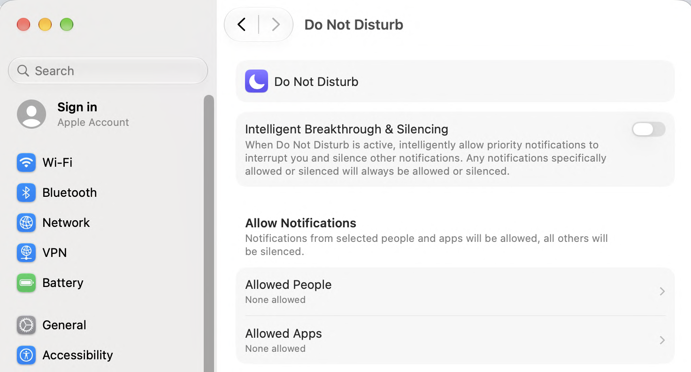

    > *Text shown in the image:* System Settings → Do Not Disturb. Sidebar: Search · Sign in (Apple Account) · Wi-Fi · Bluetooth · Network · VPN · Battery · General · Accessibility. Main: Do Not Disturb · Intelligent Breakthrough & Silencing (toggle off) — “When Do Not Disturb is active, intelligently allow priority notifications to interrupt and silence other notifications. Any notifications specifically allowed or silenced will always be allowed or silenced.” · Allow Notifications — “Notifications from selected people and apps will be allowed, all others will be silenced.” · Allowed People (None allowed) · Allowed Apps (None allowed).

<u>A4. Use a fresh browser</u>

On a personal account, the browser is where PII most often leaks: address-bar suggestions, saved addresses and cards, the bookmarks bar, your Google avatar. Install [Mozilla Firefox](https://www.mozilla.org/firefox/) and use it only for tasking. A fresh browser has none of your history, saved addresses, or bookmarks.

On first launch, choose Skip when Firefox offers to import from another browser, and don't sign in to a Firefox account.

<u>A5. Rename your Mac</u>

This is for confidentiality. Your task will be sent back if we see any private information at all.

By default your Mac is named after you ("Jane's MacBook Pro"), and that name appears in the Finder sidebar, in every Open and Save dialog, and in Terminal.

1. System Settings → General → About → click the Name field and change it to something neutral, like Mac.
2. System Settings → General → Sharing → under Local hostname, click Edit and set it to match.

    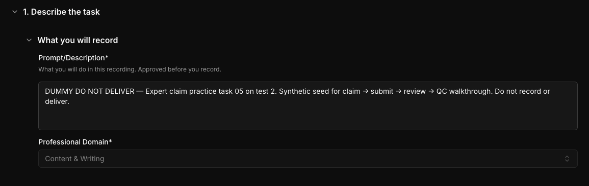

    > *Text shown in the image:* System Settings → General → About. Sidebar (General highlighted). Main: MacBook Air (13-inch, M4, 2025) · Name: My MacBook Air · Chip: Apple M4 · Memory: 16 GB.

ℹ️ One thing you can't hide: your macOS username appears in Save/Open dialogs and file paths. If it's your real name, keep those dialogs brief — or use the separate Recorder account, which is the only way to avoid it entirely.

<u>A6. Run a 10-second test recording</u>

Start a short recording, switch between two task apps, open a Save dialog, stop. Watch it back and look for your name, email addresses, personal filenames, or notifications. Fix anything you see before your first real task.

---

**Part B — Before every recording (1 minute)**

- [ ] Turn on Do Not Disturb — Control Center → Focus → Do Not Disturb.
- [ ] Quit every app you don't need with ⌘ + Q (the red button only closes the window). Press ⌘ + Tab — only your task apps and the recorder should appear.
- [ ] Don't click the Downloads stack in the Dock during a recording — it previews your recent downloads. Open Finder → Downloads instead.
- [ ] Quit all project material — Studio, Slack, the Writer Guidelines. Nothing on screen should say Mercor or Odin.
- [ ] Opening document shows only your Goal text — never the Approval ID.

    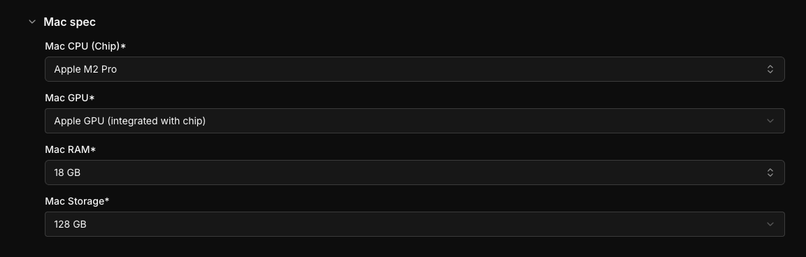

    > *Text shown in the image:* macOS desktop with the Finder menu bar and calendar widget; icons at the left: “desktop folder”, “Workpuls 8.1.22”, “TaskRecorder”.

---

After you finish recording

Turn Do Not Disturb off. If you want your Desktop files back, drag them out of the Desktop items folder.

**Download & Install Xcode**

*The Accessibility Inspector is accessed through Xcode and must remain running throughout every recording. Xcode itself may be closed.*

1. Search and install **Xcode** from the App Store.

    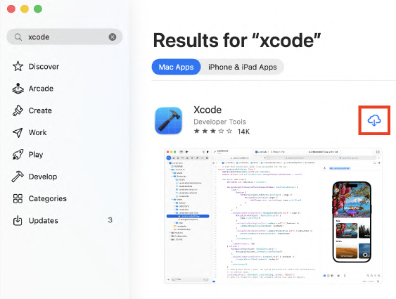

    > *Text shown in the image:* Mac App Store search: “xcode”. Sidebar: Discover · Arcade · Create · Work · Play · Develop · Categories · Updates (3). Results for “xcode” (Mac Apps / iPhone & iPad Apps): Xcode — Developer Tools, 14K ratings, with the download (cloud) button highlighted by a red box.

***If you have macOS 26.6 or lower:***

1. First, determine which version of Xcode you need, based on your macOS version, by checking [here](https://developer.apple.com/xcode/system-requirements/).
2. Navigate to the [Apple Developer More Downloads](https://developer.apple.com/download/all/) page.
3. Sign in with your Apple ID.
    - a. Accept the Apple Developer Agreement and decide whether you would like to receive communications from Apple.

        

        > *Text shown in the image:* Apple Developer Agreement page. Navigation: Get Started · Platforms · Technologies · Community. Download PDF. THIS IS A LEGAL AGREEMENT BETWEEN YOU AND APPLE INC. (“APPLE”). YOUR PARTICIPATION AS AN APPLE DEVELOPER. PLEASE READ THIS … (“AGREEMENT”) BEFORE PRESSING THE “AGREE” BUTTON AT THE …  “AGREE,” YOU ARE AGREEING TO BE BOUND BY THE TERMS OF THIS … Apple Developer Agreement — 1. Relationship With Apple; Apple Account and Password. … (text is cut off at the right edge of the screenshot). I’d like to receive communications announcing the latest events, news and … — ○ Yes · ◉ **No** (selected, highlighted) · **Agree** button

    - b. Select “I’m not interested” when asked to “Customize your experience with Apple Developer”

        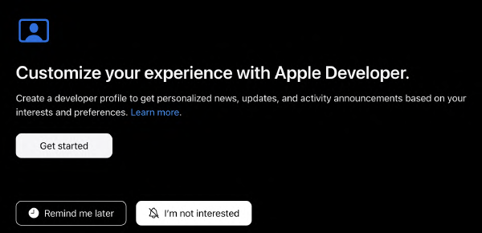

        > *Text shown in the image:* Customize your experience with Apple Developer. Create a developer profile to get personalized news, updates, and activity announcements based on your interests and preferences. Learn more. · Get started · Remind me later · I’m not interested

**Download & Install TaskRecorder**

1. Download TaskRecorder2.4.4.dmg from Important Links.

    TaskRecorder2.4.3.dmg and earlier packages are obsolete. A browser-added duplicate suffix such as (1) does not change the version.

2. Open the downloaded DMG. (Using a separate Recorder account? See the Appendix for where to put the installer first.)
3. Quit every running TaskRecorder copy (⌘Q) and eject older TaskRecorder disk images (DMGs). After installing the current app, remove obsolete app copies and old DMGs so you do not reopen them. Keep all recordings and exports.
4. Drag TaskRecorder into **Applications**, *select **Replace** if prompted*.

    

    > *Text shown in the image:* Finder window “TaskRecorder”: the TaskRecorder app icon, a red arrow, and the “To Applications” folder shortcut (drag TaskRecorder onto To Applications).

---

**Required Mac Settings**

**Change Required UI Elements**

1. Keep the system language set to English.
2. **Configure the clock to display seconds:** Go to **System Settings > Menu Bar > Clock Options** > toggle **Display the time with seconds** on

    

    > *Text shown in the image:* System Settings → Menu Bar. Sidebar: Search · Sign in · Wi-Fi · Bluetooth · Network · VPN · Battery · General · Accessibility · Appearance · Apple Intelligence & Siri · Desktop & Dock · Displays · Menu Bar (highlighted) · Spotlight · Wallpaper. Main: Automatically hide and show the menu bar (In Full Screen Only) · Show menu bar background (off) · Recent documents, applications and servers (10) · Menu Bar Controls (Add Controls…) · Clock with a “Clock Options…” button (red arrow pointing to it) · Siri · Spotlight (checked) · Wi-Fi (checked) · Bluetooth · Battery (checked, Battery Options…) · AirDrop.

    

    > *Text shown in the image:* Clock options dialog. Date: Show date (on) · Show the day of the week (on). Time: Style — Digital (selected) / Analogue · Flash the time separators (off) · Display the time with seconds (ON, red arrow) · Announce the time (off) · Interval: On the hour · Voice: System Voice · Customise Voice… · Done button.

3. Set dock at left/right: Go to **System Settings > Desktop & Dock > Bottom** dropdown > select **Left/Right > Make sure ‘Automatically hide and show the dock’ is off > Show indicators for open applications is on**

    

    > *Text shown in the image:* System Settings → Desktop & Dock. Dock: Size / Magnification sliders · Dock position on screen: Bottom (red arrow) · Minimized window animation: Genie Effect · Window title bar double-click action: Zoom · Minimize windows into application icon (off) · Automatically hide and show the Dock (off) · Animate opening applications (on) · Show indicators for open applications (on) · Show suggested and recent apps in Dock (on). Desktop & Stage Manager: Show items — On Desktop (checked) / In Stage Manager · Click wallpaper to show desktop: Always.

    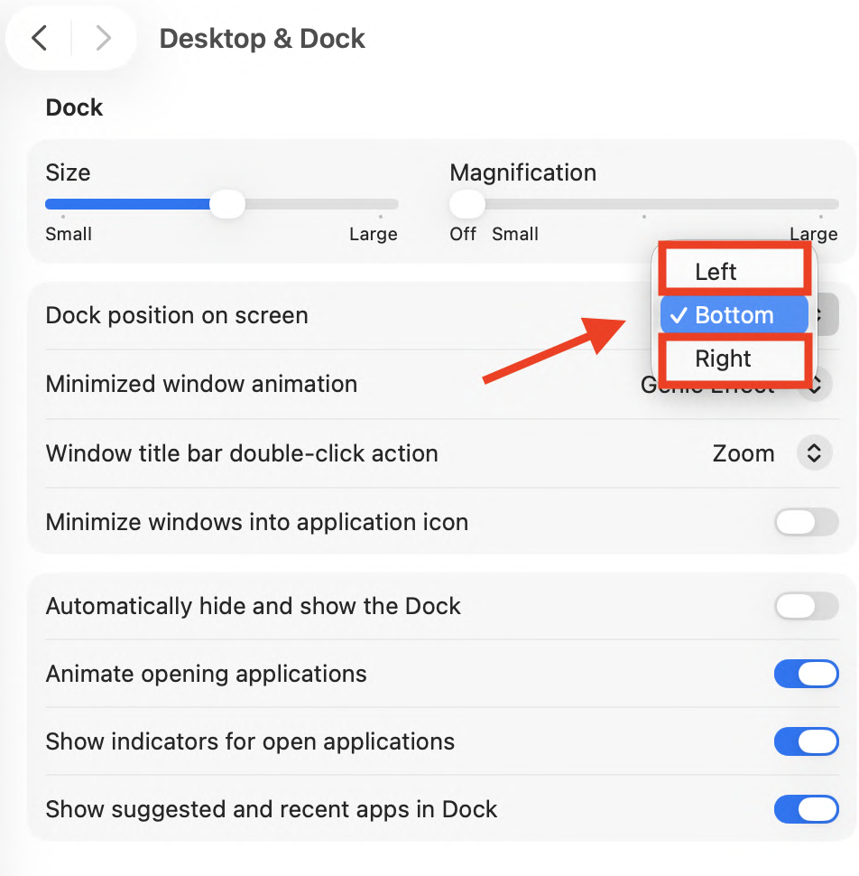

    > *Text shown in the image:* Desktop & Dock → Dock position on screen dropdown with the options Left · ✓ Bottom · Right (red arrow). Other settings shown: Size / Magnification sliders · Minimized window animation: Genie Effect · Window title bar double-click action: Zoom · Minimize windows into application icon (off) · Automatically hide and show the Dock (off) · Animate opening applications (on) · Show indicators for open applications (on) · Show suggested and recent apps in Dock (on).

4. Change at least one UI element per recording; more is better: wallpaper, light or dark mode, accent color, Dock size, sidebar icon size, screen resolution, or an in-app theme.

    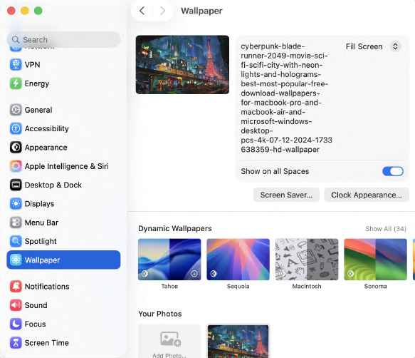

    > *Text shown in the image:* System Settings → Wallpaper. Sidebar: Search · VPN · Energy · General · Accessibility · Appearance · Apple Intelligence & Siri · Desktop & Dock · Displays · Menu Bar · Spotlight · **Wallpaper** (selected) · Notifications · Sound · Focus · Screen Time. Main pane: current wallpaper (a cyberpunk city image, file name “cyberpunk-blade-runner-2049-movie-sci-fi-scifi-city-with-neon-lights-and-holograms-best-most-popular-free-download-wallpapers-for-macbook-pro-and-macbook-air-and-microsoft-windows-desktop-pcs-4k-07-12-2024-1733638359-hd-wallpaper”) · Fill Screen · Show on all Spaces (on) · Screen Saver… · Clock Appearance… · Dynamic Wallpapers (Show All (34)): Tahoe, Sequoia, Macintosh, Sonoma · Your Photos: Add Photo…

*Studio, Slack, the Writer Guidelines, and other project material should be quit before you start a recording (see Part B).*

**Set up and Log into Workpuls/Insightful**

1. Follow [**Step 2: Sign in**](https://talent.docs.mercor.com/how-to/use-insightful#step-2-sign-in) to log into Insightful.
2. For hourly-paid work, select Odin in Insightful and press **play** to track active work. Do not run the timer for eligible tasks retaining old per-task terms (Pay FAQ Q9).

    

    > *Text shown in the image:* Insightful app. Search projects · 62:15 h/week · Assigned Projects: **Odin** (highlighted) — 387:47:19 — 1 TASK · Last sync: Today at 10:15 PM · Open Dashboard

    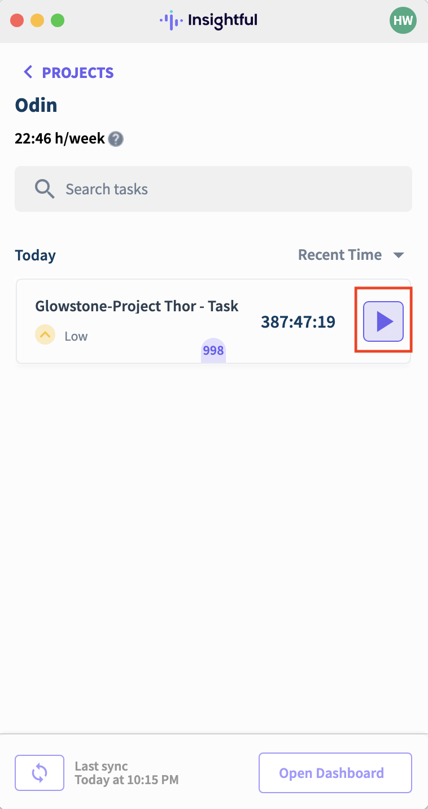

    > *Text shown in the image:* Insightful app. ‹ PROJECTS (back link) · Odin · 22:46 h/week · Search tasks · Today (Recent Time): task “Glowstone-Project Thor - Task” — Priority: Low — 387:47:19 — with a ▶ play button (highlighted) · Last sync: Today at 10:15 PM · Open Dashboard

*For Insightful setup or tracking issues, tag Maven in #odin--helpdesk. Pause hourly-paid work if tracking stops or your approved hours run out.*

**Set up Accessibility Inspector**

1. Open **Xcode** from Applications and go through the initial Xcode setup until you see the view below.

    

    > *Text shown in the image:* Finder → Applications folder (sidebar: Shared · Favorites: Applications, Desktop, Documents, Downloads · Locations: iCloud Drive, hannahw, Macintosh HD, TaskRecorder, AirDrop, Network). Apps shown: Slack · Stickies · Stocks · System Settings · TaskRecorder · TextEdit · Time Machine · Tips · TV · Utilities · Voice Memos · Weather · WeChat · Workpuls · **Xcode** (highlighted)

    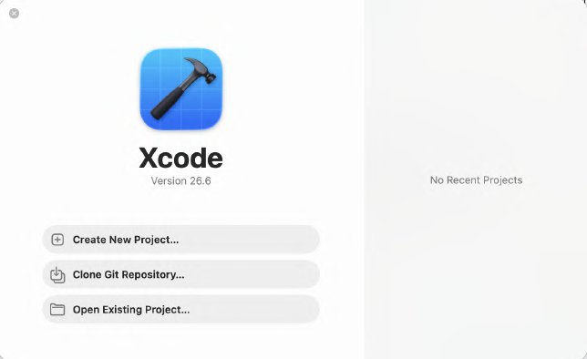

    > *Text shown in the image:* Xcode — Version 26.6. Create New Project… · Clone Git Repository… · Open Existing Project… · No Recent Projects

2. In the dock, right-click on Xcode > **Open Developer Tool > Accessibility Inspector**

    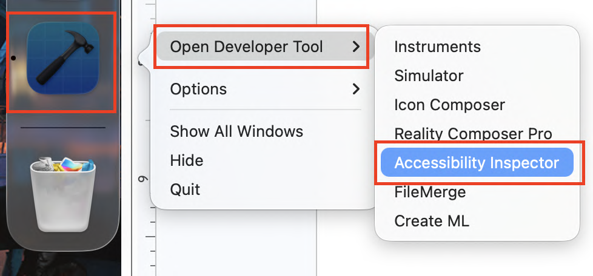

    > *Text shown in the image:* Right-click the Xcode icon in the Dock (highlighted) → **Open Developer Tool** (highlighted) → submenu: Instruments · Simulator · Icon Composer · Reality Composer Pro · **Accessibility Inspector** (highlighted) · FileMerge · Create ML. Other menu items: Options · Show All Windows · Hide · Quit

3. After Accessibility Inspector is opened, click the **red X** in the upper-right corner to close the Accessibility Inspector window using the red button.

    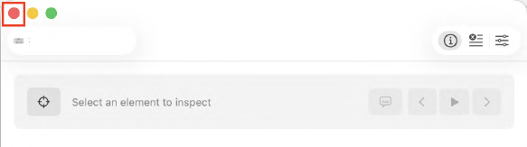

    > *Text shown in the image:* Accessibility Inspector window — close button (red, highlighted); toolbar: “Select an element to inspect”

    - a. Do not minimize or fully quit the application.
4. Confirm that the blue magnifying-glass icon remains in the dock with a **dot** underneath it.

    

    > *Text shown in the image:* Dock icon of the Accessibility Inspector app with a small black dot (open-application indicator) highlighted by a red box at its left.

**Set up TaskRecorder**

1. Open TaskRecorder from the Applications folder.

    

    > *Text shown in the image:* Finder → Applications list (columns Name · Date Modified · Size · Kind). The first row, “TaskRecorder” (Date Modified 1 Jan 1980 at 09:00, 11.6 MB, Application), is highlighted with a red arrow. Other rows: Games · Shortcuts · Font Book · Voice Memos · News · System Settings · Image Playground · Clock · QuickTime Player · Tips · Siri · FaceTime · Calculator.

2. If macOS says Apple could not verify the developer or check the app for malicious software, and you downloaded the official package above, select Done, then go to System Settings > Privacy & Security > Open Anyway and confirm. If the warning says the app is damaged, contains malware or will damage your computer, do not bypass it; share the exact warning in #odin--helpdesk.

    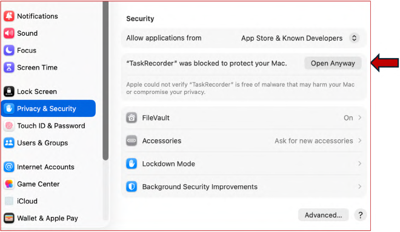

    > *Text shown in the image:* System Settings → Privacy & Security → Security. Allow applications from: App Store & Known Developers · “TaskRecorder” was blocked to protect your Mac. [Open Anyway] (red arrow) — “Apple could not verify “TaskRecorder” is free of malware that may harm your Mac or compromise your privacy.” · FileVault (On) · Accessories (Ask for new accessories) · Lockdown Mode · Background Security Improvements · Advanced…

    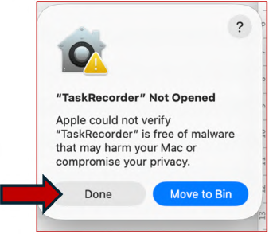

    > *Text shown in the image:* Dialog: “TaskRecorder” Not Opened — “Apple could not verify “TaskRecorder” is free of malware that may harm your Mac or compromise your privacy.” Buttons: Done (red arrow pointing to it) · Move to Bin.

3. Authenticate and confirm that you want to open the application.

    

    > *Text shown in the image:* Left: dialog Open “TaskRecorder”? — “Apple is not able to verify that it is free from malware that could harm your Mac or compromise your privacy. Don’t open this unless you are certain it is from a trustworthy source.” Buttons: Move to Bin · Open Anyway (red arrow) · Done. Green arrow to the right: dialog Privacy & Security — “You are attempting to open an app that may cause harm to your Mac or compromise your privacy. Enter an administrator’s username and password to allow this.” Fields: Username · Password (red arrow) · Cancel · OK.

*See <u>Technical Issues</u> if TaskRecorder does not open normally.*

**Grant Permissions and Open TaskRecorder**

1. Grant TaskRecorder access to:
    - a. Accessibility
    - b. Screen Recording
    - c. Microphone

        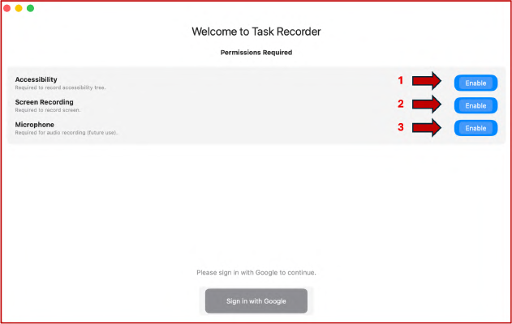

        > *Text shown in the image:* Welcome to Task Recorder — Permissions Required. 1 Accessibility (Required to record accessibility tree.) [Enable] · 2 Screen Recording (Required to record screen.) [Enable] · 3 Microphone (Required for audio recording (future use).) [Enable] (red arrows 1, 2, 3 pointing at the Enable buttons). Bottom: “Please sign in with Google to continue.” [Sign in with Google].

2. Confirm that all three permissions show green check marks in TaskRecorder.

    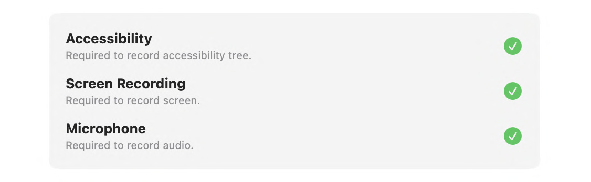

    > *Text shown in the image:* Permissions list with all three granted (green ✓): Accessibility — Required to record accessibility tree. · Screen Recording — Required to record screen. · Microphone — Required to record audio.

3. TaskRecorder 2.4.4 does not require OTA or Google sign-in. If you have an older version, please use the latest version.
4. Identify the downloaded package by TaskRecorder2.4.4.dmg. Run a short test recording and check video, narration audio and screenshots before starting a task.

    

    > *Text shown in the image:* Authentication code received.

    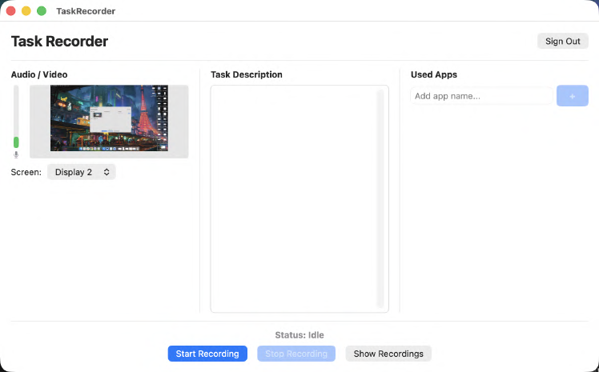

    > *Text shown in the image:* Task Recorder window (TaskRecorder) after sign-in, [Sign Out] at top right. Columns: Audio / Video (preview, Screen: Display 2) · Task Description (empty) · Used Apps (Add app name… [+]). Bottom: Status: Idle · [Start Recording] · [Stop Recording] (disabled) · [Show Recordings].

*See Technical Issues if TaskRecorder still asks for sign-in after updating. If the updated app freezes before displaying a window after the installation and Open Anyway steps, report a launch failure in #odin--helpdesk with your Mac chip, macOS version, exact behavior and a redacted screenshot. A launch freeze is separate from a Google-account password error. Do not disable macOS security protections or run commands from unverified sources.*

**Appendix**

**(optional) Create a Recorder Mac User**

*Use a separate macOS account for all project recordings. This prevents personal information, accounts, notifications, and unrelated project content from appearing in your recording.*

1. Open **System Settings.**

    

    > *Text shown in the image:* Mac menu bar: Chrome · File · Edit · View · History. Apple menu open: About This Mac · **System Settings…** (highlighted) · App Store · Recent Items · Force Quit Chrome (⌥⇧⌘⎋) · Sleep · Restart… · Shut Down… · Lock Screen (⌃⌘Q) · Log Out Hannah W… (⇧⌘Q)

2. Go to **Users & Groups**.

    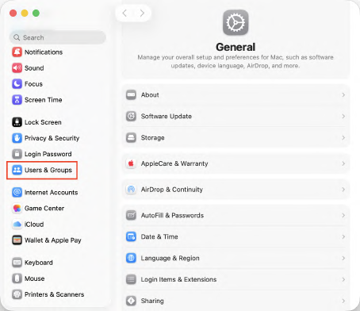

    > *Text shown in the image:* System Settings. Left sidebar: Search · Notifications · Sound · Focus · Screen Time · Lock Screen · Privacy & Security · Login Password · **Users & Groups** (highlighted) · Internet Accounts · Game Center · iCloud · Wallet & Apple Pay · Keyboard · Mouse · Printers & Scanners. Main pane: General — Manage your overall setup and preferences for Mac, such as software updates, device language, AirDrop, and more. · About · Software Update · Storage · AppleCare & Warranty · AirDrop & Continuity · AutoFill & Passwords · Date & Time · Language & Region · Login Items & Extensions · Sharing

3. Click **Add User**.

    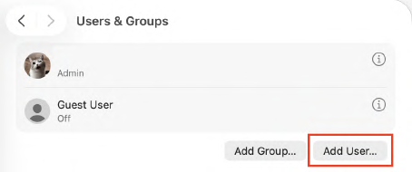

    > *Text shown in the image:* Users & Groups: Admin · Guest User (Off) · Add Group… · **Add User…** (highlighted)

4. Create an **Administrator** user and use a neutral account name such as ***Recorder***. *Do not use a real name.*

    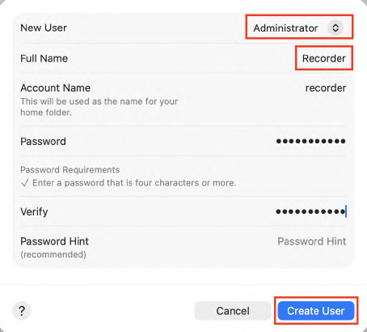

    > *Text shown in the image:* New User dialog: New User — **Administrator** (highlighted) · Full Name — **Recorder** (highlighted) · Account Name — recorder (This will be used as the name for your home folder.) · Password (hidden) · Password Requirements: ✓ Enter a password that is four characters or more. · Verify (hidden) · Password Hint (recommended) · Cancel · **Create User** (highlighted)

If you use a separate Recorder account, also do the following:

1. Sign out of your personal account and sign in to the Recorder account. Complete the initial setup without connecting an iCloud account.
2. Download the TaskRecorder installer on your regular account and move its DMG to /Users/Shared. Then, in the Recorder account, open /Users/Shared and install it from there.
3. Do the Part A steps (wallpaper, Do Not Disturb, Firefox, Mac name) in the Recorder account. Its Desktop will already be empty.
4. Keep Studio, Slack, the Writer Guidelines, and other project material in your regular account.

# Task Ideation

A strong task reflects realistic professional work, demonstrates meaningful expertise and judgment, and produces a clear final deliverable.

**IMPORTANT:** Plan for a recording, including the short intro and epilogue, that is at least 15 minutes and no more than 50:59 minutes (15:00-50:59). The workflow should feel natural, be mostly mouse-driven, and use real task apps. **IMPORTANT:** Every task **Idea** must be submitted and approved in the Studio first. Once your Idea for your task is approved, the same Studio task you proposed it in moves to In Progress. Continue in that task; do not create a duplicate or wait for a new task.

**Brainstorming Stage**

**Step 1. Define the Professional Context**

Start by identifying:

- Your professional role
- The purpose of the task
- The intended user, client, or stakeholder

The scenario should be realistic for someone working in your domain of expertise. [Need a task idea? Ask Loki in #odin–ideation. Tag Loki to start, then keep replying](https://mercor.enterprise.slack.com/archives/C0C9R6AUZNG) in your thread!

**Step 2. Plan Complex Professional Work**

Choose realistic work in your domain that uses skills and judgment you already have and produces a clear, useful deliverable.

Examples include:

🎨 **Healthcare / Medicine:** Review de-identified patient education materials, compare them with clinic guidance, and create an updated handout.

📊 **Engineering / Data:** Clean and compare a permitted dataset, create clear charts, and prepare a short findings report for a stakeholder.

🏢**Architecture:** Update a room layout from a client brief, check the dimensions and circulation, and export a labeled plan for review.

> **Note:** Using several apps or completing many basic steps does not make a task complex.

**Step 3. Select Your Apps**

Use genuine task apps that materially contribute to the workflow. Unrestricted apps may be used without prior approval; an app does not need to appear in an approved-app catalog. Follow the current banned-app, limited-use and app-specific rules in App Eligibility and Limited Use.

- Use only apps with a license that **allows commercial use**. If you are using a trial or free version, please check that it allows commercial use.
- One app is the bare minimum, so a single-app task is allowed if it is reasonably complex, but aim for 2-3 apps that each do real work in the workflow.
    - Using multiple apps is encouraged when each contributes meaningfully to the workflow.
- Repeated use of the same app still counts as one app
- A supporting app counts only when it contributes meaningfully to the task or final output
    - **Example: Clockify**
        - Only starting and stopping a timer → **does not count**
        - Manage relevant client, project, and task records, assign tracked time or billing details, and generate or export a report or invoice that contributes to the task results → **does count**
- The opening Task Description(Goal) document app does not count unless it is used again for substantive task work
- Insightful never counts as a task app
- **DO NOT** use restricted apps
- For paid apps, we reimburse up to $50 USD per writer per rolling 30 days. See [Software and Licensing Expectations subsection](#macos-technical-setup) for more information.

> Vary your app choices across submissions when possible.

**Step 4. Prepare Appropriate Input (if applicable)**

Identify any files, datasets, templates, and source materials you may need for the task. Input files are not a requirement for tasking.

Websites you only visit for research or context during the task (e.g., reading documentation, looking up reference data) are not input files. They don't need to be in Deliverables.zip or listed in Final Notes. An input file is a file you prepare before recording and open or use in the task.

Inputs must:

- Contain no private or non-public personal information
- Be self-created, synthetic, or AI-generated before recording
- Contain no visible watermarks (a Gemini watermark is the one exception) or copyrighted materials
- Be available before the recording begins

Do not use paywalled, watermarked, copyrighted, Unsplash, or unclear-rights content. Verify the original source and license.

**Note:** AI may be used to prepare inputs before recording (only Gemini is permitted), but no AI interaction or branding may appear during the recording (a Gemini watermark on a prepared input is allowed).

**In Studio Final Notes:**

- For AI-generated inputs: Enter AI-generated before recording
- For non-AI inputs: Provide the original source URL if applicable.

**Step 5. Define the Final Deliverables**

Every task must produce at least one clear, useful final output.

Before recording, identify:

- What you will create
- Who will use it
- What format it will use
- How you will verify its accuracy, quality, or completeness

> The recording should show the complete process that leads to the final deliverable.

**Metadata.rtf Drafting Stage**

[Download the provided Metadata.rtf template, and complete the three sections:](https://drive.google.com/file/d/1_WThzOJgZzk_WcUdDtqO1QR4qYG1tbGa/view)

1. **Topology:** List every app visit in chronological order, repeating an app each time you return to it. Use only LOOKUP, CREATE, or MODIFY to identify the action for each visit to each app.
2. **Request:** Paste the same Goal text you entered in TaskRecorder. It must match TaskRecorder exactly.
3. **Task Description:** Write a numbered, high-level outline of the main task steps, naming the apps, key methods, and final deliverable. The steps should reflect the workflow in Studio and TaskRecorder.

> - Propose your task idea in the Mercor Studio and get it approved before recording.
>
> - See the Golden Example page for complete Task
>
> Description/Metadata.rtf/Recording examples.

# Step-by-Step Studio Workflow

Complete the <u>Technical Setup</u> page instructions before following the Studio workflow below.

**Part 1. Start in Studio**

Studio is the main platform for Project Odin task workflows. Let’s get started by getting logged in, and finding key information, and navigating to the correct “World”.

1. Go to **Okta** ([https://c-mercor.okta.com/](https://c-mercor.okta.com/)) and sign in with the personal email <u>linked to your Mercor account.</u>

    

    > *Text shown in the image:* Okta sign-in page: “Connecting to … Sign in with your account to access Okta Dashboard”. MERCOR logo · Sign In · [Sign in with Okta FastPass] · OR · Personal Email (“same login as work.mercor.com”) text field · ☐ Keep me signed in · [Next] · Help.

    **Do not use a VPN** - Okta blocks sign-ins through a VPN, proxy, or other anonymizing network and shows a 403 Access Forbidden error before the sign-in page loads. Turn off any VPN (system-wide app or browser extension) before starting the Okta setup and whenever you sign in to Okta. See the Account Security and Conduct policy.

2. Click the Studio tile in Okta My Apps to open Studio.

    

    > *Text shown in the image:* Dashboard (side menu): My Apps · Work · Add section · Notifications · Add apps · Last sign in: a few seconds ago. My Apps → Work: Google Workspace Mail · Slack Enterprise · Google Workspace Drive · Google Workspace Calendar · **Studio** (tooltip “Studio”) · Google Workspace Sites

3. Within Studio, you can navigate to the project guidelines or to your active workstreams using the left sidebar.

    

    > *Text shown in the image:* Studio — Odin - Annotator view. Left menu: Project Guide · Announcements (new-activity dot) · Tasks · Dashboards. INTRODUCTION — ⚡ Introduction ⚡ Project Odin Guidelines ⚡ Last updated: Sep 29, 2026. Changes in the last 14 days: • Sep 29, 2026: Complete guide refresh Tasks follow the guidelines in effect when they are submitted. A small one- or two-hour allowance applies only to recordings already underway when guidance changes, not to submitted tasks.

4. Navigate to Tasks from the left sidebar.

    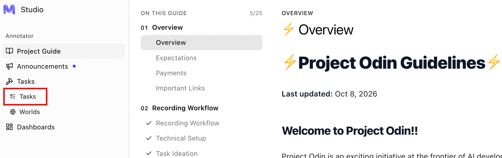

    > *Text shown in the image:* Studio (Annotator) — left menu: Project Guide · Announcements (dot) · Tasks (highlighted with a red box) · Worlds · Dashboards. ON THIS GUIDE 5/25: 01 Overview (Overview · Expectations · Payments · Important Links) · 02 Recording Workflow (Recording Workflow · Technical Setup · Task Ideation). Main: OVERVIEW — ⚡Project Odin Guidelines⚡ · Last updated: Oct 8, 2026 · “Welcome to Project Odin!!” · “Project Odin is an exciting initiative at the frontier of AI develop…”

5. Within Tasks, navigate to the World **Odin Production Full Workflow** if you need to.

    

    > *Text shown in the image:* Tasks — “Create and manage tasks for annotation • 2077 tasks in this world”. Worlds dropdown (currently Odin Production Core) with a search box “Search worlds…” listing: ✓ Odin Production Core (Other) · Odin Production Full Workflow (Other) — the second item is highlighted with a red box. Buttons: Filter · Columns · Group.

## Part 2. Create your Idea

Now that we are logged in to Studio, we can get to work! We will first propose a task for submission. The review team will check this for novelty and compliance before you progress to actually recording a workflow. Your idea must be approved before you record.

1. Create a new task with the button **+ Create Task**

    

    > *Text shown in the image:* Tasks — Manage tasks in Odin Production Full Workflow. Tabs: Tasks · Query. Workflow selector: Odin Production Full Workflow. Button: + Create Task

2. In studio, the process should be fairly easy to follow step by step

Watch this [video](https://drive.google.com/drive/u/0/folders/11gufuqK9xR-x4vCv900DEY2hNOi6CaSJ), we update it regularly.

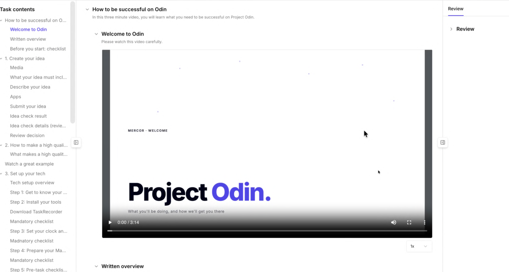

> *Text shown in the image:* Studio page “How to be successful on Odin”. Left panel “Task contents”: How to be successful on O… · Welcome to Odin · Written overview · Before you start: checklist · 1. Create your idea (Media · What your idea must incl… · Describe your idea · Apps · Submit your idea · Idea check result · Idea check details (revie… · Review decision) · 2. How to make a high quali… (What makes a high qualit… · Watch a great example) · 3. Set up your tech (Tech setup overview · Step 1: Get to know your … · Step 2: Install your tools · Download TaskRecorder · Mandatory checklist · Step 3: Set your clock an… · Madnatory checklist · Step 4: Prepare your Ma… · Mandatory checklist · Step 5: Pre-task checklis…). Main: “How to be successful on Odin — In this three minute video, you will learn what you need to be successful on Project Odin.” · Welcome to Odin — “Please watch this video carefully.” · video “MERCOR · WELCOME — Project Odin. What you’ll be doing, and how we’ll get you there” (0:00 / 3:14) · Written overview. Right panel: Review.

3. Open section **1. Create your idea**. If the section is collapsed, click its title to expand it.
4. Fill in **Describe your idea.** The box is pre-filled with five headings. Write you answer after each heading and replace nothing else:

    

    > *Text shown in the image:* DESCRIBE YOUR IDEA card. “Your description of the professional task you will model goes here, using the template. Pick your apps in the next card.” Describe your idea* — “Answer after each of the five headings. See ‘What your idea must include’ above.” Template text box: Domain / Role: … · Goal: … · Starting materials: … · Steps (with the apps for each): … · Deliverable: …

    - a. **Domain / Role:** The field this task comes from, and who would do it (e.g., financial analyst, music producer).
    - b. **Goal**: The desired outcome of someone executing this task, and who will use the resulting work product.
    - c. **Starting materials**: Say whether you are starting from scratch or using existing material. Where existing material is being used, describe it: files, data, or a project you already have on hand before beginning recording.
    - d. **Steps (with the apps for each)**: A rough outline of how you will do the work, showing your professional judgment. Name the app you use for each step.
    - e. **Deliverable**: What will be produced by the work conducted, and how a reviewer can check that it is complete. This refers to the work product being recorded, not the recording itself.
5. Fill in **Apps: Choose the app or apps you will use. One app is the bare minimum, so a single-app task is allowed if it is reasonably complex, but aim for 2-3 apps that each do real work in the workflow. Multiple apps are encouraged when each contributes meaningfully to the workflow.** Unrestricted apps do not need prior approval or an approved-catalog entry. Follow the current App Eligibility and Limited Use rules rather than legacy labels in screenshots or the dropdown. Banned apps remain prohibited and limited-use conditions still apply.

    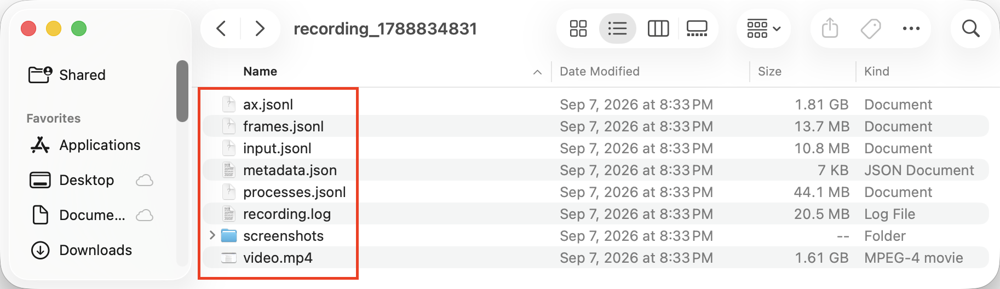

    > *Text shown in the image:* APPS card. Apps — “Use at least 3 apps by default; 1 or 2 only when the main app work is deeply technical and complex.” Field shows “2 selected”; dropdown with search “Search, or type a value not listed…” and options: 3D Slicer · Activity Monitor.app · 🚫 RESTRICTED Adobe Acrobat.

6. **Submit Idea:** The task will be passed to the review team, who will check your work and either return it to you for edits or approve the task.

    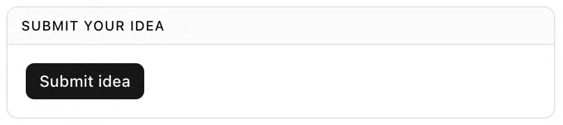

    > *Text shown in the image:* SUBMIT YOUR IDEA — button: Submit idea

**Key Points:**

- Keep Ideas Current: One approved idea = one Studio task
- Never reuse an Approval ID. A pending change request does not replace your current approval; always use the newest approved revision.
- If your plan changes materially, submit a change request and wait for approval before recording.
- Wrote your idea before Oct 19? Your earlier answers appear read-only in Your original idea (written before Oct 19). You can't edit them there. Copy anything you still want into **Describe your idea**; reviewers and the automated checks use Describe your idea and Apps.

**Idea Examples**

➡

**Domain / Role**: Chemical engineer, process safety

**Goal:** As a chemical engineer, investigate an uncontrolled exothermic temperature spike during an industrial polymer curing cycle. DBeaver will query a local SQLite reactor database, aggregating thermal sensor logs to extract the precise timeline of the thermal runaway. Visual Studio Code will be used to modify the reactor's Python control script, lowering the catalyst injection thresholds to prevent future thermal breaches. Mimestream will draft and format an urgent process-safety notification, attaching the SQL temperature logs and updated script, dispatched directly to the plant operations manager.

**Starting materials:** Starting from scratch

**Steps (with the apps for each)**:

- DBeaver: query a local SQLite reactor database and aggregate the thermal sensor logs to extract the precise timeline of the thermal runaway.
- Visual Studio Code: modify the reactor's Python control script, lowering the catalyst injection thresholds to prevent future thermal breaches.
- Mimestream: draft and format an urgent process-safety notification, attaching the SQL temperature logs and updated script.

**Deliverables:**

- A finalized chemical safety audit containing the DBeaver thermal anomaly dataset (exothermic\_spike\_timeline.csv)
- The corrected VS Code automation script (catalyst\_injection\_controller.py)
- The dispatched Mimestream safety alert

    (operations\_manager\_warning\_sent.eml)

➡

**Domain / Role**: Data analyst supporting a facility engineer

**Goal:** I am a data analyst supporting a facility engineer who has to decide whether a harmonic filter installed on a factory feeder is good enough to keep. Using synthetic current waveforms sampled at 10 kHz before and after the filter was installed, I will compute the FFT spectrum of each waveform, measure the amplitudes of the 50 Hz fundamental and its odd harmonics up to the 13th, calculate total harmonic distortion, generate a one-page PDF report with the two spectra, check each harmonic against its limit in a spreadsheet, and annotate the report with the distortion result and a keep or replace decision. I will build and calibrate a digital signal processing pipeline from scratch on a blank audio track in Audacity. The goal is to generate harmonic test signals, apply multi-notch filter cascades to remove electrical hum, execute Nyquist low-pass filtering to attenuate high-frequency noise, measure Signal-to-Noise Ratio (SNR) and RMS dynamic range in dB, and export spectral frequency renders alongside signal metrics logs.

**Starting materials:** Using existing material

**What is already available?:** Two synthetic CSV files of current samples (one second each at 10 kHz, before and after the filter) and a small Python helper module with the FFT and plotting functions. All are AI-generated before recording.

**Steps (with the apps for each)**:

- Jupyter Notebook: compute each waveform's FFT spectrum, harmonic amplitudes and total harmonic distortion.
- Google Sheets: check each harmonic against its limit and record a keep or replace decision.
- Skim: annotate the PDF report with the distortion result and the decision.

**Deliverables**

- The executed notebook (.ipynb), the harmonic amplitude table (.csv)
- The spreadsheet with the per-harmonic limit check
- The decision downloaded as .xlsx, and the one-page PDF report annotated in Skim

> **Top Tip: Use your "Goal" for Recording:** Paste only the Goal section into TaskRecorder, the opening document, and the "Request" section in Metadata.rtf. Do not show the Approval ID or the rest of the approval text on screen.

**Missing Task?**

Approval states are saved during account setup. Follow your dashboard's next step or use **Copy Setup Request**. An authorized admin will review existing tasks before new creation.

---

## Part 3. Fill Out and Submit a Task

### Step 1. Complete the Pre-Recording Fields

**Before recording:**

1. Once your idea is approved, the same task you proposed in moves to In Progress. Continue in that task; do not create a new task or wait for another one.

    

    > *Text shown in the image:* Tasks page — “Create and manage tasks for annot…”. Badge: ⚠ 2 Unowned · Filter · Columns. Table: Task Name / Task Status — Task bnd3add6: Idea Draft · Task yvif6b04: In Progress (red arrow pointing to the In Progress status).

2. Click on your task and go through the checklist before you record.

    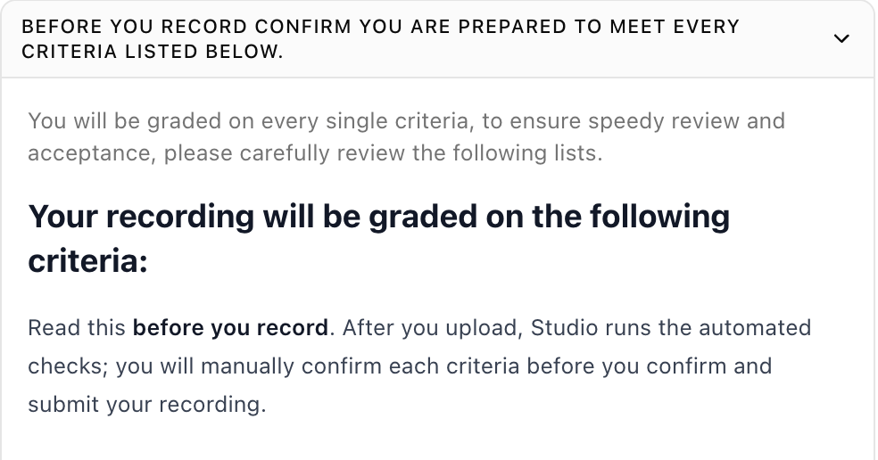

    > *Text shown in the image:* BEFORE YOU RECORD CONFIRM YOU ARE PREPARED TO MEET EVERY CRITERIA LISTED BELOW. “You will be graded on every single criteria, to ensure speedy review and acceptance, please carefully review the following lists.” Your recording will be graded on the following criteria: “Read this before you record. After you upload, Studio runs the automated checks; you will manually confirm each criteria before you confirm and submit your recording.”

3. Inputs Used
    - a. **CC0 or public domain sources from the web:** Provide the Web source URL for the source.
    - b. **AI-generated file:** Files generated using Gemini. (No other AI models allowed)
    - c. **Manually created file:** Any file you manually created before the recording.

        

        > *Text shown in the image:* INPUT AND ARTIFACT FILES Input and artifact files — Select any that apply for input/artifact files used on this task. You may select multiple options, or none. Select options… → Search options… · Royalty-free and copyright-free sources from the web · AI-generated file · Manually created file

### Step 2. Record the Task and Check Files

Follow the <u>How to Record Step By Step</u> page to complete the task with TaskRecorder.

### Step 3. Upload the Verified Files and Submit in Studio

1. On the Studio task page, upload your completed metadata.rtf, .mp4, TaskRecorder zip, & Deliverables.zip.
    - a. **DO NOT** include Metadata.rtf in Deliverables.zip.

        

        > *Text shown in the image:* WHAT TO UPLOAD HERE Upload ALL FOUR files into Studio (not Google Drive). For every task, upload these four items here: 1. Screen recording (MP4) — your MP4 screen recording of the task 2. deliverables.zip — the deliverables package for this task 3. Task Recorder zip — the zip exported from Task Recorder (`recording_*.zip`) 4. Metadata.rtf — download the template link below, fill it in, and upload the filled file Confirm all four are attached before you continue to the submit step.

        

        > *Text shown in the image:* TASK FILES Metadata.rtf Template — Static Metadata.rtf template (same Google Drive file for every Odin task). Download, fill in, and upload with your recording. https://drive.google.com/file/d/1_WThzOJgZzk_WcUdDtqO1QR4qYG1tbGa/view?usp=drive_link Metadata.rtf Upload* — The filled-in Metadata.rtf for this recording. [Upload File] Screen recording (MP4)* — The MP4 screen recording for this task. [Upload File] Task Recorder zip* — The zip exported from Task Recorder (recording_*.zip). [Upload File] Deliverables.zip* — The deliverables.zip package for this task. Name every file in the zip by what it is: Inputs: input 1, input 2, … · In-between files: artifact 1, artifact 2, … · The result: final output 1, final output 2, … Keep the extension, for example “final output 1.xlsx”. For a code project, put the whole project in a folder named “final output 1”. [Upload File]

2. Run AutoQC checks
    - a. You must run both AutoQCs before submitting.
    - b. **Files & Recording:** Your uploads (video.mp4, Deliverables.zip, Task Recorder zip, Metadata.rtf) and your screen recording

        

        > *Text shown in the image:* AUTOMATED CHECKS (1 OF 2): FILES & RECORDING. “Studio runs these for you after you upload. You do not fill anything in here. Checks marked “blocks submit” must pass or be disputed before you can submit.” “If you see “Run limit reached — no new run”: AutoQC already ran on this recording; address feedback and re-record or dispute feedback if you think AutoQC is wrong.” Status: Not run yet — 35 checks in 4 sections · [Run AutoQC] · ▸ What gets checked.

    - c. **Narration:** Your voiceover

        

        > *Text shown in the image:* AUTOMATED CHECKS (2 OF 2): NARRATION Studio runs these for you about 10 minutes after the file checks. You do not fill anything in here. Checks marked “blocks submit” must pass or be disputed before you can submit. Not run yet — 6 checks in 1 section · [Run AutoQC] · ▸ What gets checked

    - d. Major flags block submission: fix or dispute every Major flag before you submit. Minor flags do not block submission: treat them as advice, and fix them if it is quick or apply the feedback on your next task. A Minor flag still points to a quality rule, and a reviewer can send the task back if the recording genuinely breaks that rule.
        - i. **Dispute: If a flag is wrong, state why, with a timestamp when useful.**
        - ii. **Fix: If a flag is right, fix the cause. For a file or metadata issue, upload the corrected file and re-run AutoQC; no new recording is needed. Re-record only for a genuine recording problem, and never edit the video.**
3. Manual Checks
    - a. Manual self-review checklist that you need to go through. Only check a box once you have verified it.

        

        > *Text shown in the image:* MANUAL CHECKS: YOU VERIFY THESE YOURSELF Studio cannot check these for you. Tick each item only after you have checked it against your recording, then confirm below. Confirm that you have completed each necessary component before submitting your task. This is critical to the success of your submission. MANUAL CHECKS (22 ITEMS) — Each box is required before you can submit for review. ☐ Metadata.rtf apps and OTA listed match the apps and OTA listed in Studio — Studio. Tick only after you have checked this against your recording. (Checklist item 4) ☐ Seconds are displayed on the menu bar clock — Video spot check. Tick only after you have checked this against your recording. (Checklist item 9) (The screenshot is cut off here; the remaining items are not visible.)

4. Checklist and PII Confirmation
    - a. Review the **Task Checklist** and confirm your task meets all requirements. In Full Workflow, tick the epilogue checkbox if you included the required epilogue OR your idea was originally approved before October 19, 2026, 6 pm PT (PDT). Pre-cutoff ideas remain exempt, including after later revision or reapproval; ticking the checkbox confirms that exemption. Do not tick it if neither condition is true. This manual checkbox is separate from AutoQC. If an AutoQC finding is wrong, use Dispute and provide a written reason with the task link and relevant timestamps. Do not re-record an exempt task solely to add an epilogue. If submission remains blocked, send the task link and exact error to #odin--helpdesk.
    - b. Review **PII Guidelines** and confirm your task meets all requirements.
    - c. Before you submit, open the checklist and PII guidelines links, and double-check.

        

        > *Text shown in the image:* CHECKLIST AND PII CONFIRMATION — Open the linked docs, review your recording against them, then confirm. Task Checklist 🔒 — I HAVE REVIEWED THIS TASK AGAINST THE TASK CHECKLIST. Open the checklist below, then confirm. https://docs.google.com/document/d/1tOxjGqxhA6T49kXw9hrhwpEsk8ERaFOsB6gqZcrLAHg/edit?tab=t.cs8oabjr7dht Checklist Confirmation* — I HAVE REVIEWED THIS TASK AGAINST THE TASK CHECKLIST. Select… PII guidelines 🔒 — I HAVE VERIFIED NO PERSONALLY IDENTIFIABLE INFORMATION IS CONTAINED WITHIN THIS RECORDING. Review the Writer Guidelines (PII rules), then confirm. https://docs.google.com/document/d/1tOxjGqxhA6T49kXw9hrhwpEsk8ERaFOsB6gqZcrLAHg/edit?tab=t.yef60lr6ji08 PII Checkbox* — I HAVE VERIFIED NO PERSONALLY IDENTIFIABLE INFORMATION IS CONTAINED WITHIN THIS RECORDING. Select…

5. Final Confirmation box
    - a. Check this box only after every Major AutoQC flag has been fixed or disputed and every manual check has been completed.

        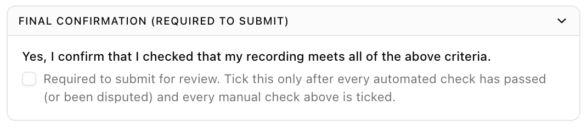

        > *Text shown in the image:* FINAL CONFIRMATION (REQUIRED TO SUBMIT) Yes, I confirm that I checked that my recording meets all of the above criteria. ☐ Required to submit for review. Tick this only after every automated check has passed (or been disputed) and every manual check above is ticked.

6. Add any **Final Notes** that you would like to convey to the Reviewer.

    

    > *Text shown in the image:* BEFORE YOU SUBMIT → FINAL NOTE Final note — Optional notes for reviewers (issues while recording, quirks, etc.). Writers fill this before submit. Reviewer Feedback is separate. (Placeholder) Any issues while recording, edge cases, or notes for review…

7. Select **Submit** to send the task for review.
    - a. Select **Revise idea** if you need to update your idea, then re-submit for idea checks and updated idea will get reviewed again as normal.

        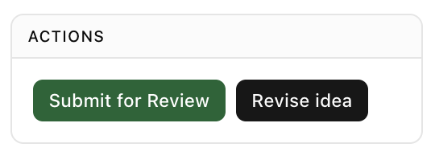

        > *Text shown in the image:* ACTIONS — buttons: Submit for Review · Revise idea

> The task will only Submit after all required fields have been filled out!

*After clicking **Submit for Review**, the Task Status should change to **Ready for Review**.*

---

## After Submission

Check the statuses your task will go through after submission

⏱️ **Ready for Review / In Review:** the task has been submitted and is waiting for a Reviewer / is actively being reviewed.

📝 **Needs Edits:** the task can be fixed and resubmitted. Required action may include **re-recording, files/metadata, clarification, or a combination**.

✅ **Review Approved:** the task has passed human review. This is distinct from final QC clearance.

🛂 **Awaiting Final QC:** the task has been randomly selected for additional QC and is being held until it passes.

🚚 **Ready for Delivery:** the task has cleared all required checks, including QC if sampled.

⛔ **Rejected:** the task is unusable within its approved scope and cannot be fixed through edits. An invalid task concept is an example.

Track your task status in the **My Tasks** tab of the Dashboard in Studio.

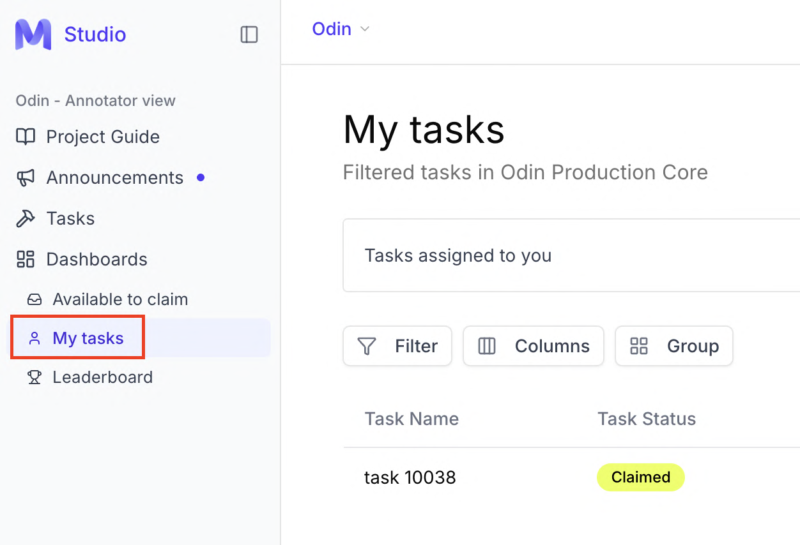

> *Text shown in the image:* Studio — Odin - Annotator view. Left menu: Project Guide · Announcements (dot) · Tasks · Dashboards · Available to claim · **My tasks** (highlighted) · Leaderboard. Main: My tasks — Filtered tasks in Odin Production Core. “Tasks assigned to you”. Filter · Columns · Group. Table: Task Name “task 10038” — Task Status “Claimed”

> Always check the Reviewer and Auditor comments at each status' change to avoid repetitive mistakes.

# How To Record: Step-by-Step

This page explains how to prepare, record, stop, and verify a task. Quick reference: [Odin Writer Cheat Sheet (PDF)](https://mercor.enterprise.slack.com/files/U0B3NDJ6N9E/F0CAVNURE90/odin-writer-cheat-sheet-a4.pdf)

## Recording Workflow at a Glance

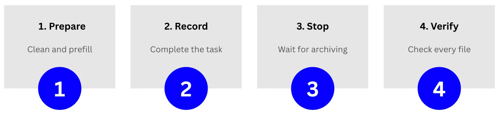

> *Text shown in the image:* 1. Prepare — Clean and prefill · 2. Record — Complete the task · 3. Stop — Wait for archiving · 4. Verify — Check every file

## Step 1. Prepare the Recording

Clean your desktop and prefill all of the fields in Task Recorder.

|   |   |
|---|---|
| ☐ **Accessibility Inspector** | **CRITICAL:** Keep Accessibility Inspector running throughout the recording. Close only its window with the red button; do not quit the app. A dot must remain beneath its Dock icon. |
| ☐ **TaskRecorder** | TaskRecorder 2.4.4 is open, all three permissions are green, the microphone is on, and the correct display is selected. OTA or Google sign-in is not required for the recorder. |
| ☐ **Display** | The resolution matches Studio, the dock is on the left or right, the clock displays seconds in the menu bar, and the cursor uses its default appearance. |
| ☐ **System** | The Mac is connected to power and has enough free storage. |
| ☐ **Privacy** | Personal accounts, notifications, recent files, and private information are hidden |
| ☐ **Project Materials** | Close or Minimize Studio, Slack, the Writer Guidelines, Google Drive folders, Metadata.rtf, and anything showing Mercor or Project Odin. |

**Unused Softwares**

Quit unused apps, calls, screen-sharing/recording tools, and unnecessary background utilities before starting. Close unused

browser tabs and pause nonessential sync or downloads. **Keep TaskRecorder and Accessibility Inspector running**; do not disable required system or security services.

**Task Details**

Your idea is approved in the Mercor Studio, and the full approval

text is pre-filled in Studio Prompt/Description.

**Task Apps**

Launch, log in to, load, and minimize every genuine task app. No

task work has been completed yet.

**Input Files**

Prepared inputs must follow the requirements in Task Ideation,

Step 4.

Open a document containing only the Goal section of your **Opening Doc**

approval text in Word or Google Docs, or an allowed app. It is the only window visible behind the TaskRecorder. Do not show the Approval ID or the rest of the approval text. **DO NOT** use Notes.app or TextEdit.app.

**Prefill TaskRecorder Fields**

After preparing the recording environment, complete the TaskRecorder fields before selecting Start Recording. For every new task, check for details left from the previous task and replace them with the current Task Description (Goal) and app list. TaskRecorder 2.4.4 does not require an OTA account or Google sign-in; assigned OTA accounts are retired and no longer apply to task apps.

| **Field** | **What to Enter** |
|---|---|
| **Task Description** | • Paste only the **Goal** section of your approval text, exactly as approved. Do not include the Approval ID, task revision, apps list, or other approval sections. • Do not shorten, revise, or summarize it. • Never paste a link, a file path or a document URL in place of the description. Source URLs for input files |

|   |   |
|---|---|
|   | go only in Final Notes. |
| **Used Apps** | • Add every genuine app you will use to complete the task. • The app list must match Studio and your approval. |

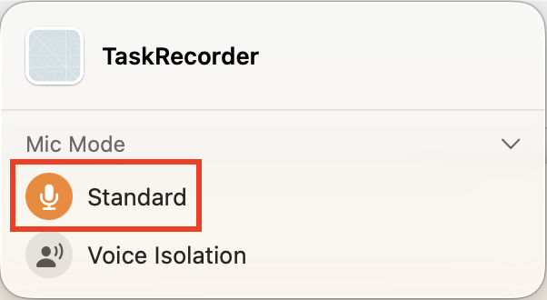

> *Text shown in the image:* Task Recorder window (macOS TaskRecorder app, Sign Out button). Audio / Video: preview, Screen: Display 1. Task Description: “Use Android Studio Logcat to diagnose a runtime issue in an Android application by capturing relevant application logs, filtering them by application process and log level, searching for the relevant error, and identifying the cause of the failure. The result will provide a clear diagnostic finding that an Android developer can use to troubleshoot the application.” Used Apps: (Add app name…) Android Studio. Status: Idle · Start Recording · Stop Recording (disabled) · Show Recordings

> **Important:** The Task Description (Goal) and Used Apps must be correct before recording. Missing or mismatched information may cause a task to be rejected.

**Step 2. Start and Record**

1. Leave the Task Description (Goal) document on screen and behind the TaskRecorder, then click the **Start Recording** button in TaskRecorder.

    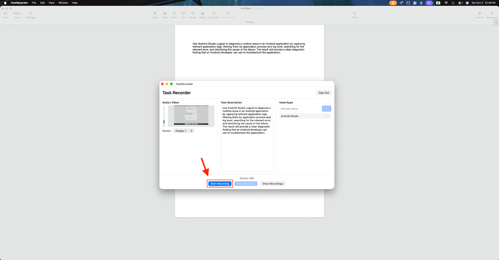

    > *Text shown in the image:* Full desktop screenshot with a document showing the task description (“Use Android Studio Logcat to diagnose a runtime issue in an Android application…”) and the Task Recorder window in front of it; a red arrow points to the **Start Recording** button (highlighted).

2. Minimize the TaskRecorder window.
3. Leave the Task Description (Goal) document window visible for a few seconds and say:

    ❝ **I will be beginning my task soon. Here is the workflow I have in mind. ❞**

    - a. Keep the introduction narration under 20 seconds. **DO NOT** read or explain the full Task Description (Goal).
4. Minimize or close the Task Description (Goal) document.
5. Start your task recording and complete the professional workflow while following all of the <u>Recording Expectations</u>.
6. **NEW:** Epilogue narration
    - a. **NEW** - Epilogue narration
        - i. **All task ideas originally approved at or after Oct 19, 2026 6PM PT must include an epilogue narration. Tasks whose ideas were** originally approved before this time do not need to include an epilogue narration. Later revision or reapproval does not remove this exemption. In Full Workflow, tick the epilogue checkbox for a completed required epilogue or an exempt pre-cutoff idea. The checkbox confirms either condition; do not tick it if neither is true. If an AutoQC finding is wrong, dispute it with a written reason; see Studio Workflow for the submission steps**.**
        - ii. After the task is finished and before the expert closes the task recorder, provide a brief summary of your work, including their assessment of whether the task was completed, any relevant reflections, or any other important highlights to mention. Below are the possible questions to cover:
            1. **Completion and outcome:** How did you verify the successful completion of the task? Were there any limitations?
            2. **Approach and key decision:** What was your overall approach? Why did you choose this approach?
            3. **Challenges and problem solving:** What was the most difficult, ambiguous, or unexpected part? Did you encounter any errors or need to change your approach? How did you resolve the issue?
            4. **Quality assessment:** How would you evaluate the quality of your final result? Ar there any weaknesses or potential issues with the result?
            5. **Reflection and improvement**: If you were to do the task again, what would you do differently? If you had additional time, what would you improve or verify?
            6. **Insight:** What is one important principle, consideration, or common mistake that someone less experienced might overlook when performing this type of task?
        - iii. **<u>T</u>**arget a 3-4 minute epilogue narration, with a maximum of 4:00. Three minutes is not a minimum; cover the required reflections. Epilogues longer than 4:00 may be sent back.
        - iv. **<u>Mouse is permitted to remain idle during the epilogue narration</u>**

## Step 3. Stop and Archive

1. After completing the task, save all artifacts and outputs.
2. Bring TaskRecorder to the front, then click the **Stop Recording** button.

    

    > *Text shown in the image:* Task Recorder window while recording — Status: Recording… (green). Audio / Video: “No Preview Available”, Screen: Display 1 (disabled). Task Description: “Use Android Studio Logcat to diagnose a runtime issue in an Android application by capturing relevant application logs, filtering them by application process and log level, searching for the relevant error, and identifying the cause of the failure. The result will provide a clear diagnostic finding that an Android developer can use to troubleshoot the application.” Used Apps: Android Studio. Buttons: Start Recording (disabled) · **Stop Recording** (highlighted) · Show Recordings

3. Do not quit TaskRecorder while it processes the recording.
4. Wait for the status to move through **Stopping > Archiving > Idle**.

> **DO NOT** interrupt the archiving process. Continue only after TaskRecorder displays **Idle**.

5. Click the **Show Recordings** button and locate the newest timestamped recording folder.

    

    > *Text shown in the image:* Task Recorder window — Status: Idle. Task Description: “Use Android Studio Logcat to diagnose a runtime issue in an Android application by capturing relevant application logs, filtering them by application process and log level, searching for the relevant error, and identifying the cause of the failure. The result will provide a clear diagnostic finding that an Android developer can use to troubleshoot the application.” Used Apps: Android Studio. Buttons: Start Recording · Stop Recording (disabled) · **Show Recordings** (highlighted)

## Step 4. Validate the Output

Locate the corresponding/newest recording\_TIMESTAMP.zip and recording\_TIMESTAMP folder.

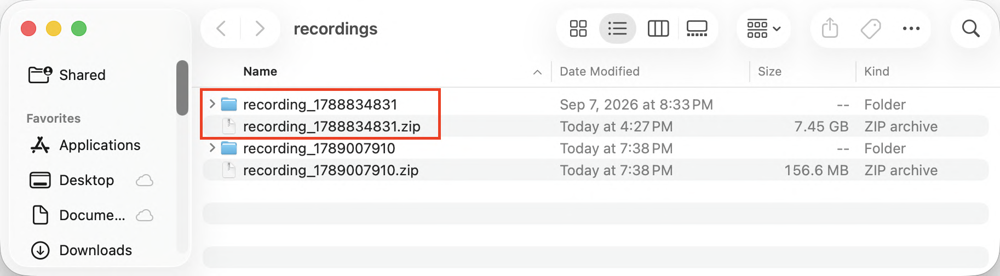

> *Text shown in the image:* Finder → recordings folder (list view; Name · Date Modified · Size · Kind). Highlighted with a red box: recording_1788834831 (Folder) and recording_1788834831.zip (ZIP archive, 7.45 GB). Also listed: recording_1789007910 (Folder) and recording_1789007910.zip (ZIP archive, 156.6 MB). Sidebar: Shared · Favorites: Applications · Desktop · Documents · Downloads.

⇩

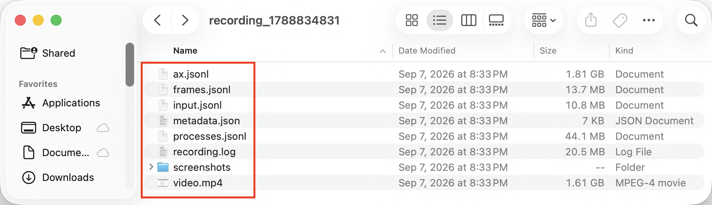

> *Text shown in the image:* Finder → recording_1788834831 folder contents (highlighted with a red box): ax.jsonl · frames.jsonl · input.jsonl · metadata.json · processes.jsonl · recording.log · screenshots (folder) · video.mp4.

> **DO NOT** re-name, delete or modify the recording files.

### Video.mp4 Verification

Open video.mp4 file

- **IMPORTANT: Open video.mp4 in QuickTime and check the beginning, middle, and end.** Confirm that it is the correct complete attempt, the picture is usable, narration and any task-relevant audio are audible, and the recording has no corruption or unexpected truncation.
- If corrupted: Upload the recording\_TIMESTAMP.zip to the [TR Recordings](https://drive.google.com/drive/folders/1kQ0r-Yj_1i1urwvOdIZL5JWNW1ObQUk-?usp=drive_link) folder.
    - a. This task does not qualify for submission, but submitting your failed recording may help us identify bugs.

#### Screenshot Verification

Open the screenshot folder and confirm that the matching recording archive contains the screenshots folder (PNG files), video.mp4, frames.jsonl, ax.jsonl, input.jsonl, processes.jsonl and recording.log. Check that video.mp4, the archive, and the task files all belong to the same recording attempt; do not mix files from different attempts.

- Divide the PNG screenshot count by the video duration in seconds.

|   |   |
|---|---|
| ✅ **OK** | ❌**BAD** |
|  • A 15-minute recording should contain more than 450 screenshots. • More than 0.5 per recording second. • Healthy captures often contain many more. | 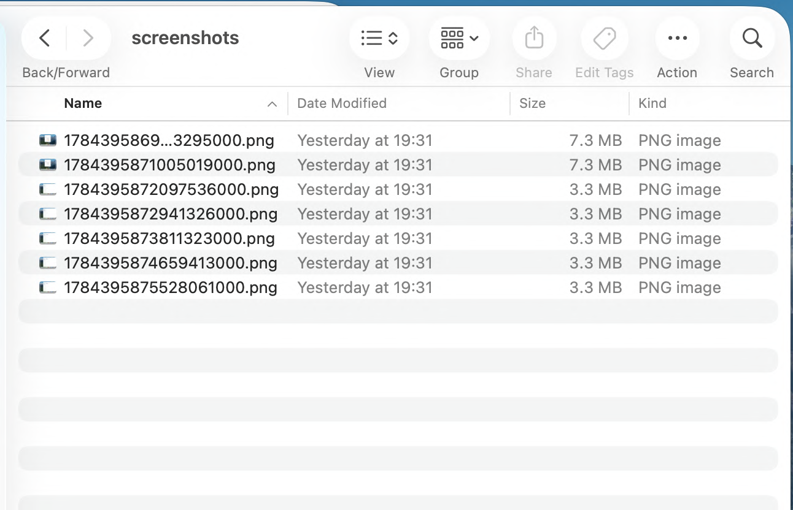 • Only a few screenshots were saved • Fewer than 0.5 per recording second. • Do not submit. • Follow [steps in the FAQ](#getting-help) to troubleshoot. |

### Organize Output

Organize and rename files inside Deliverables.zip using clear names:

- **Inputs:** Any original starting files prepared in advance
    - input 1, input 2, etc.
- **Intermediate Artifacts:** Any files downloaded during recording, intermediate deliverables, or work-in-progress artifacts created during the task
    - artifact 1, artifact 2, etc.
- **Final Outputs:** The final product produced by the expert
    - final output 1, final output 2, etc.

---

## Continue in Studio

Before uploading, open Deliverables.zip and check that every input, intermediate artifact, and final output is present, correctly labeled, and readable. Confirm that the recording archive and separate video.mp4 match this same attempt. Upload Metadata.rtf separately to Studio, not inside Deliverables.zip.

After recording and files pass validation, follow [Studio Workflow, Part 3](#step-3-upload-the-verified-files-and-submit-in-studio) to upload the verified files and submit the task. Confirm that the status changes to Ready for Review

# Workflow Checklist

This is the most important document in this manual: Please check off every item before

submitting, this checklist will help you be most successful quickly! Quick reference: [Odin Writer Cheat Sheet (PDF)](https://mercor.enterprise.slack.com/files/U0B3NDJ6N9E/F0CAVNURE90/odin-writer-cheat-sheet-a4.pdf)

**<u>Before Recording (Task Plan)</u>**

- [ ] **Workpuls/Insightful:** Insightful/Workpuls is running and minimized during active hourly-paid Odin work. Keep it off for eligible tasks retaining old per-task terms (Pay FAQ Q9).
- [ ] **Metadata Consistency**: The Request section of Metadata.rtf matches the Goal in TaskRecorder. Topology and Request describe the same objective, inputs, app order, methods, and outputs.
- [ ] **Input Files**: If applicable, prepare files free of private or non-public PII, CC0 or public domain sources only.
- [ ] **Input Provenance**: In Final Notes, record actual non-AI source URLs or exactly “AI-generated before recording”; complete Source of Data when applicable.

**<u>Before Recording (Prepare)</u>**

- [ ] [**Storage and Power**](#step-1-prepare-the-recording): The Mac is connected to power and has enough free storage for the complete recording and archives.
- [ ] [**Clean Workspace**](#step-1-prepare-the-recording): Hide personal accounts, notifications, recent files, and private information; close project materials before recording. Before you hit record, check the top-right account corner of every app you will use, your browser profile button, and your Finder sidebar for your name, photo or email.
- [ ] **Focus Mode**: Get into Do Not Disturb or “Focus mode” to avoid any notifications.
- [ ] **Minimal Background Noise**: Make sure you are recording in a quiet environment.
- [ ] **Accessibility Inspector**: Accessibility Inspector is running with its window closed.
- [ ] **UI Diversity**: Change at least one per recording; more is better: wallpaper, light or dark mode, accent color, Dock size, sidebar icon size, screen resolution, or an in-app theme.
- [ ] **Mouse cursor:** Mouse cursor size & color must stay default.
- [ ] [**Recording Settings**](#step-1-prepare-the-recording): The selected display and resolution match Studio; TaskRecorder permissions are green, and the microphone is on.
- [ ] **Dock Visibility**: Keep the Dock visible and set it to left or right, not bottom. Automatically hide is off and indicators for open apps are on.
- [ ] [**Clock Seconds**](#step-1-prepare-the-recording): Seconds are displayed on the menu bar clock.
- [ ] [**Open Apps**](#step-1-prepare-the-recording): Fully launch, log in, load, open required files/workspaces; minimize to the dock.
- [ ] [**Background Apps**](#step-1-prepare-the-recording): Quit unused apps, calls, and unnecessary background utilities; keep TaskRecorder and Accessibility Inspector running.
- [ ] **Workpuls/Insightful**: Minimize the Insightful window.
- [ ] **Task Description (Goal)**: Open the approved Goal document behind the TaskRecorder window.
- [ ] **Prefill TR**: Paste the approved Goal and genuine used apps in TaskRecorder.

**<u>During Recording (Record and Validate)</u>**

- [ ] **Minimize TR**: Immediately minimize TaskRecorder after clicking Start Recording.
- [ ] **Continuous Recording**: Use one uninterrupted recording from Start Recording through the saved final output and Stop Recording.
- [ ] **Brief Intro**: In under 20s, say the intro sentence, minimize or close Task Description (Goal), and begin.
- [ ] **Recording Length**: Plan for a recording, including the short intro and epilogue, that is at least 15 minutes and no more than 50:59 minutes (15:00-50:59).
- [ ] **Narration**: Narrate continuously: identify what, where, and why; avoid vague “here” and “this”.
- [ ] **Audio Quality**: Speech is clear and synchronized with the screen; narration and any task-relevant audio are audible.
- [ ] **Audio Gap**: No single silent gap over 45s.
- [ ] **No Profanity**: No profanity in narration or shown in recording.
- [ ] **No AI Use During Recording**: Show no AI interaction or policy-violating content
- [ ] **No PII**: Show no private or non-public PII or project references; follow the documented public GitHub and research-author exceptions.
- [ ] **Mouse Activity**: No single mouse inactivity over 45s outside the closing epilogue; the mouse may remain still during the epilogue.
- [ ] **Teaching Pointer**: Point to what you describe, move naturally, and allow about one second around completed clicks so viewers can follow.
- [ ] **Limited Typing**: Keep the workflow mouse-driven and avoid long typing blocks
- [ ] **Keyboard Shortcuts**: Use visible mouse actions when practical; explain every necessary keyboard shortcut as you use it.
- [ ] **Window Management**: Keep one ordinary task window clear or arrange task windows side by side.
- [ ] [**Keep TR Hidden**](#step-3-stop-and-archive): TaskRecorder remains hidden during recording; only open again before stopping.

**<u>After Recording (Upload and Submit)</u>**

- [ ] **Final Output Quality**: Complete and save the promised output, then check that it is accurate, readable, and professionally usable.
- [ ] [**Recording Archive**](#step-4-validate-the-output): The archive contains the screenshots folder (PNG files), video.mp4, frames.jsonl, ax.jsonl, input.jsonl, processes.jsonl and recording.log; the archive, video, and task files belong to the same attempt.
- [ ] [**Video integrity**](#videomp4-verification): Check the beginning, middle, and end for the correct complete task, usable picture, and audible narration.
- [ ] [**All files uploaded**](#step-3-upload-the-verified-files-and-submit-in-studio): Upload the unmodified recording\_TIMESTAMP.zip, the separate video.mp4 and Deliverables.zip to Studio. Upload Metadata.rtf separately in Studio.
    - [ ] [**Deliverables Save**](#organize-output): Label every input, intermediate artifact, and final output clearly, preserving the correct file extensions.
    - [ ] [**Metadata Upload**](#step-3-upload-the-verified-files-and-submit-in-studio): After recording, upload the completed Metadata.rtf in its separate Studio field; keep it outside Deliverables.zip.
    - [ ] **Deliverables Zip**: All task inputs, intermediate artifacts, and final outputs are included in Deliverables.zip.
    - [ ] [**Archive Readability**](#continue-in-studio): Open Deliverables.zip and verify that every required input, intermediate artifact, and final output is present and readable.

# Core Recording Standards

A strong recording shows a complete, realistic professional workflow. It should demonstrate how you think, make decisions, use your tools, and produce a usable result.

\> ⏱️**Task Length:** Plan each recording, including the short intro and epilogue, to be at least 15 minutes and no more than 50:59 minutes (15:00-50:59).

**What a Strong Recording Demonstrates**

| **Quality** | **What It Means** |
|---|---|
| **Natural** | Work and narrate as you normally would when demonstrating a professional process. |
| **Complete** | Show the full workflow through completion and saving of the final deliverables. |
| **Correct** | Use your @mercor.expert account or a new anonymised account, apps that comply with the current banned-app and limited-use rules, the required resolution, and proper recording setup. Unrestricted apps need no prior approval. |
| **Mostly Mouse-Driven** | Use visible application controls whenever practical. Avoid long typing-only sections and excessive keyboard shortcuts. |
| **Professional** | Apply meaningful expertise, methods, standards, calculations, or decision-making. |
| **Deliberate** | Work at a natural pace and allow actions to finish before continuing. Do not rush through the task. |
| **Appropriate** | Do not display sexually explicit, graphically violent, hateful, discriminatory, or otherwise prohibited content. |

---

**In This Section**

1. **<u>Domain Expertise</u>**

    *Demonstrate domain expertise and avoid repeatedly submitting the same workflow.*

2. **<u>Narration</u>**

    *Narrate What, Where, and Why with clear, continuous, synchronized audio.*

3. **<u>Apps and Desktop</u>**

    *Use genuine task apps, avoid restricted software, and maintain a clean recording environment.*

4. **<u>On-Screen Presentation</u>**

    *Manage windows clearly, use the cursor as a teaching pointer, and follow the typing limits.*

5. **<u>PII, Licensed Content, and AI Use</u>**

    *Protect private information, use permitted content, and avoid prohibited AI interactions.*

**Complete and Meaningful Final Output**

Create at least one final deliverable during the recording. It should be accurate, complete, clean, readable, and usable by a client, stakeholder, or colleague. Before stopping the recording, review the finished work and confirm that it was saved and rendered correctly.

> **Follow the Organize Output instructions for file naming conventions.**

# Professional Expertise and Task Variety

A strong recording shows how a professional thinks, makes decisions, and verifies their work. Across tasks, it should also demonstrate meaningful variety rather than repeating the same workflow with a different topic.

**Demonstrate Professional Expertise**

Apply methods and skills you already understand. Explain what you are analyzing, changing, or deciding, why those choices matter, and how you will verify the results.

| **Demonstrate Expertise** | **Does Not Prove Expertise** |
|---|---|
| Applying domain standards, calculations, or decision criteria | Using a professional title or technical vocabulary |
| Explaining the reasoning behind important choices | Only opening a complex application |
| Using app features and methods appropriate to your task | Completing only generic actions that do not use domain knowledge |
| Checking the final result against clear requirements | Adding unnecessary apps, clicks, or steps |

Use the litmus test: "Can an intern or college student with a few weeks of experience and with no domain expertise complete this task?" If yes, choose a task that better uses your domain skills. The task should show skills and judgment you already have, with app use appropriate to the work.

You can show professional expertise through a technically deep workflow or, when the assigned app is simple by nature, through clear professional reasoning about choices, standards, risks and checks. A basic workflow in an app that supports much deeper work is not enough. Ask: could a friend with no domain expertise complete and explain this task? If so, add genuine professional judgment rather than extra clicks. Unless an announced supporting-app exception applies, the assigned app should do most of the work.

---

**Mistakes and Corrections**

Small slips are normal. If you mistype, misclick or open the wrong menu now and then, notice it, say what you are fixing, fix it, check the fix and carry on. Restart only if:

1. searching, guessing, undoing or redoing starts to take over the recording, or
2. an error changes the final result and you cannot fix it on screen.

Frequent errors that break the flow of the task will be sent back. Do not learn the software by trial and error while recording: know how you will do each step before you start. Do not re-record just for an occasional corrected typo; submit and use the review feedback."

One small mistake does not automatically invalidate a recording. Occasional small slips are acceptable when you identify the mistake, explain the correction, fix it and check the result. Restart if repeated searching, guessing, undoing or redoing dominates the recording, or a material error cannot be corrected on screen.

---

**Create Meaningful Task Variety**

You may not submit tasks **that substantially repeat the same workflow**. You may reuse the same app, but the work performed should change meaningfully. You can create variety by changing:

- The professional objective
- The type or structure of the inputs
- The decisions, constraints, or evaluation criteria
- The methods, calculations, or specialist features used
- How information moves between apps
- The final deliverable and how it is verified

**Task variety is checked when you propose your idea on the Mercor Studio. Ideas that substantially repeat existing work will not be approved.**

**Note:**

- Changing only the title, client, topic, location, colors, browser, dataset, or file format is insufficient.
- Replacing an app with another app that performs the same function is also too similar.

> Changing only the topic, wording, company name, colors, or source material does not create a meaningfully different workflow

---

**A small mistake is handled deliberately**

*Q: Which recording meets the standard?*

> *Text shown in the image:* **Recording A:** A writer creates a fourth competitor report by changing the company names, repeatedly guesses and undoes calculations, and finishes without verifying the result. **Recording B:** A strategy analyst uses familiar apps for a new market-entry workflow, applies weighted criteria, corrects one formula error, verifies the results, and produces primary and fallback recommendations.

❝

**Recording B meets the standard.** Professional methods are applied, a

meaningful different workflow is demonstrated, and one small mistake is handled deliberately. ❞

# Narration Quality

TaskRecorder captures microphone audio, and narration is required throughout the task. Speak like a professional teaching a colleague who cannot see your screen.

**Prepare Your Audio**

**Before recording:**

1. Check your microphone in TaskRecorder in the top-right menu bar.

    

    > *Text shown in the image:* TaskRecorder — Mic Mode: Standard (selected) · Voice Isolation

2. Say a short test sentence and confirm that the volume bar beside the preview rises into the **green**.

    

    > *Text shown in the image:* Task Recorder — Audio / Video: microphone level meter (green bar) highlighted by a red box beside the screen preview; Screen: Display 2.

3. Keep the selected microphone connected for the entire recording.

Do not switch, disconnect, or reconnect input or output devices while recording. If a previous recording lost audio, make a short control recording with the built-in microphone before attempting another full task.

> When available, use headphones with a dedicated microphone for clearer audio.
>
> **Note:** For **audio or video tasks** that will feature audio playback, TaskRecorder does not capture internal system audio stream. Audio will only be captured by TaskRecorder if played aloud and picked up by your microphone.

**Narrate the Complete Workflow**

Narrate your thought process and meaningful actions, including:

- What you are analyzing, changing or deciding
- Mouse movements, clicks, and scrolling
- Why you selected a method, setting, or value
- What happened after the action
- How you verified the result
- **NEW** - Epilogue narration
    - **<u>All task ideas originally approved at or after Oct 19, 2026 6PM PT</u>** **must include an epilogue narration. Tasks whose ideas were** originally approved before this time do not need to include an epilogue narration. Later revision or reapproval does not remove this exemption. In Full Workflow, tick the epilogue checkbox for a completed required epilogue or an exempt pre-cutoff idea. The checkbox confirms either condition; do not tick it if neither is true. If an AutoQC finding is wrong, dispute it with a written reason; see Studio Workflow for the submission steps.
    - After the task is finished and before you close the task recorder, provide a brief summary of your work, including your assessment of whether the task was completed, any relevant reflections, or any other important highlights to mention. Below are the possible questions to cover:
        - **Completion and outcome:** How did you verify the successful completion of the task? Were there any limitations?
        - **Approach and key decision:** What was your overall approach? Why did you choose this approach?
        - **Challenges and problem solving:** What was the most difficult, ambiguous, or unexpected part? Did you encounter any errors or need to change your approach? How did you resolve the issue?
        - **Quality assessment:** How would you evaluate the quality of your final result? Are there any weaknesses or potential issues with the result?
        - **Reflection and improvement**: If you were to do the task again, what would you do differently? If you had additional time, what would you improve or verify?
        - **Insight:** What is one important principle, consideration, or common mistake that someone less experienced might overlook when performing this type of task?
    - **<u>T</u>**arget a 3-4 minute epilogue narration, with a maximum of 4:00. Three minutes is not a minimum; cover the required reflections. Epilogues longer than 4:00 may be sent back.
    - **<u>Mouse is permitted to remain idle during the epilogue narration</u>**

Speaking frequently is not enough. A listener should be able to identify the exact app and control, understand the purpose of the action, follow the workflow in the correct order, and hear the confirmed result without seeing the screen.

> **DO NOT** simply read or recite the written Task Description (Goal).

**Use What, Where, and Why**

For each meaningful step, say what you are doing, identify the control and where it is on screen, and explain the purpose or result when it is not obvious. Keep your cursor on the item you are naming. Speak naturally; while an occasional ‘this’ or ‘here’ is fine when the reference is clear, do not make viewers guess. Every detail should be talked through with extreme detail.

Common Mistakes: Narrate the action, exact location, and purpose of meaningful steps, with your cursor on the item you name."

| **Element** | **Explain** |
|---|---|
| **What** | The action you are taking |
| **Where** | The exact app, control, file, value, or interface location |
| **Why** | The purpose or what happens after the action |
| **Cursor** | Point to or briefly hover over the item you name; tracing text while reading can help |

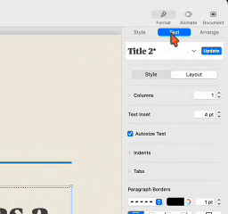

> *Text shown in the image:* Pages/Keynote-style Format sidebar: toolbar (Format · Animate · Document), tabs Style · Text · Arrange (Text selected, cursor pointing to it). Paragraph style “Title 2*” [Update]; Style / Layout toggle; Columns 1 · Text Inset 4 pt · ☑ Autoshrink Text · Indents · Tabs · Paragraph Borders.

**Example:** ❝ I’ll **click** the **Title 2 at the top to open the Headings Dropdown Menu**, then **select Subtitles to change the text to the subtitle headings format**. ❞

Narration is **REQUIRED** for each meaningful step. Use it naturally to teach the workflow, not to list robotic actions.

**Narration Examples**

**1. Finance: calculate the purchase-order total**

[Source video at 11:45](https://drive.google.com/file/d/1TOANq_bwgQ_Qyti7PL2R86mR1xAgctUP/view?usp=sharing&t=705)

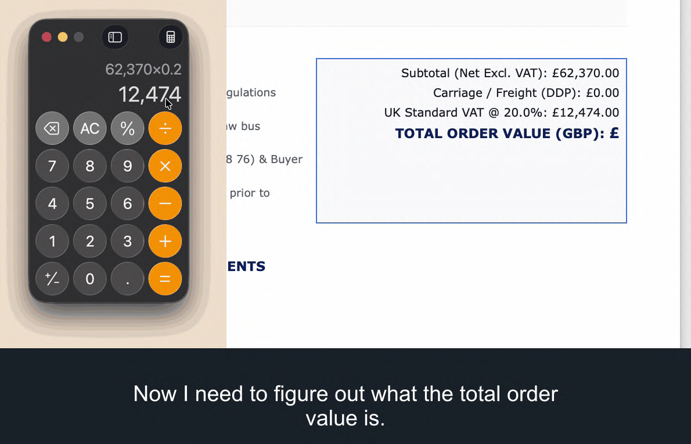

> *Text shown in the image:* Screenshot with a Calculator app showing “62,370×0.2 = 12,474” next to a document box reading “Subtotal (Net Excl. VAT): £62,370.00 · Carriage / Freight (DDP): £0.00 · UK Standard VAT @ 20.0%: £12,474.00 · TOTAL ORDER VALUE (GBP): £”. Caption: “Now I need to figure out what the total order value is.”

- “Now I need to figure out what the total order value is.” \[What\] \[Why\]
- “I can do that by adding this £12,474 amount to the £62,370.” \[What\] \[Why\]
- “I'm going to left-click on the plus sign in Calculator, then enter six, two, three, seven, zero.” \[What\] \[Where\]
- “I'll click equals at the bottom-right of the Calculator.” \[What\] \[Where\]
- “The final value is £74,844, exactly what it should be per the contract.” \[What\] \[Why\]

**2. Typography: narrow the anatomy list to eight terms**

[Source video at 00:48](https://drive.google.com/file/d/1T5H40VnOM61CnNUQb0zYkhBw2PgIZ8R8/view?usp=sharing&t=48)

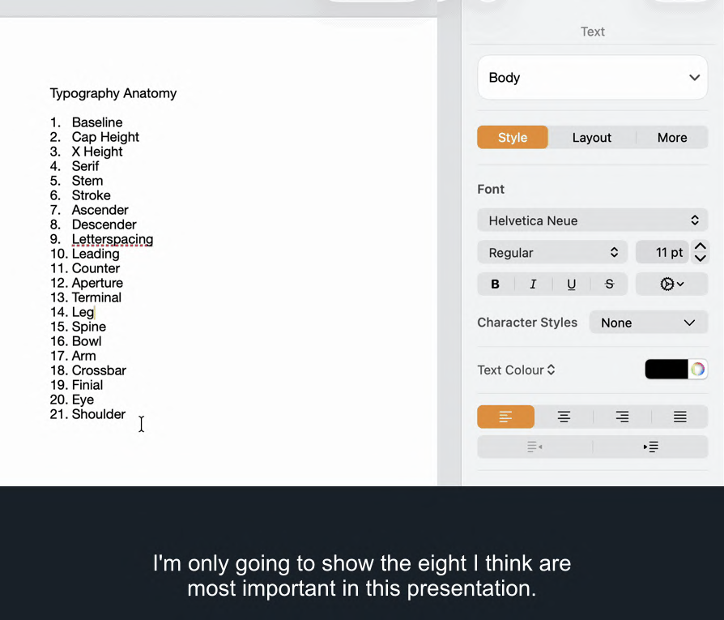

> *Text shown in the image:* Screenshot of a Pages/Keynote document “Typography Anatomy” with a numbered list: 1. Baseline 2. Cap Height 3. X Height 4. Serif 5. Stem 6. Stroke 7. Ascender 8. Descender 9. Letterspacing 10. Leading 11. Counter 12. Aperture 13. Terminal 14. Leg 15. Spine 16. Bowl 17. Arm 18. Crossbar 19. Finial 20. Eye 21. Shoulder; Format sidebar (Text · Body · Style/Layout/More · Font: Helvetica Neue Regular 11 pt · Character Styles: None · Text Colour). Caption: “I’m only going to show the eight I think are most important in this presentation.”

- “I'm only going to show the eight I think are most important in this presentation.” \[What\] \[Why\]
- “I'll drag from just after Shoulder up to just below Counter.” \[What\] \[Where\]
- “On the right-hand side, I'll click the strikethrough text option.” \[What\] \[Where\]
- “I'll select Leading and click strikethrough, then select from Stroke up to Stem and do the same.” \[What\] \[Where\]
- “That should leave me with eight.” \[What\]

**3. Audio and music: set the string-track level**

[Source video at 06:20](https://drive.google.com/file/d/18aeXVN8jy6rAIQPv_BMUByg53KDnnSrq/view?usp=sharing&t=380)

> *Text shown in the image:* Screenshot of Logic Pro: Region: MIDI Defaults · Track: Authentic Strings · Tracks “1 Steinway Grand Piano” and “2 Authentic Strings” (M S R I) · channel strip with EQ, MIDI FX, ES2, Phaser, Delay D, Space D, Sends, Audio FX, Mastering. Caption: “We’ve properly loaded our additional string track.”

- “We've properly loaded our additional string track.” \[What\]
- “Just to the lower right of Authentic Strings is its volume slider.” \[Where\]
- “These string patches tend to be very loud, so I'll click the volume slider.” \[What\] \[Why\]
- “I'll move it left to about minus 10 dB, which is a good place to start.” \[What\] \[Why\]

**4. VFX: give the printed ink a slight height**

[Source video at 30:55](https://drive.google.com/file/d/1wVBfJCTIAPJHJ6w3hoVHnZxSk-ujKYLA/view?usp=sharing&t=1855)

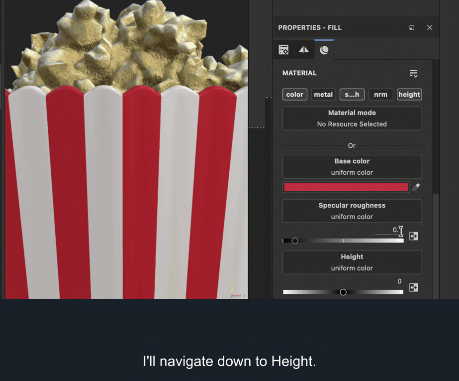

> *Text shown in the image:* Screenshot of Substance 3D Painter: a 3D popcorn bucket with popcorn, and the PROPERTIES – FILL panel (MATERIAL: color · metal · s…h · nrm · height; Material mode: No Resource Selected; Base color: uniform color; Specular roughness: uniform color; Height: uniform color). Caption: “I’ll navigate down to Height.”

- “I'll navigate down to Height.” \[What\] \[Where\]
- “The red ink on a cardboard box forms a slightly raised layer.” \[Why\]
- “I'll go to the black-and-white gradient bar under Height and click the zero in its text box.” \[What\] \[Where\]
- “I'll type 0.01 for an ever-so-slight height difference and press Enter.” \[What\] \[Why\]

**5. Software: apply the exported app icon**

[Source video at 24:11](https://drive.google.com/file/d/14Fgj-2mtxKmCXIMiGnUT57EElc5rnjec/view?usp=sharing&t=1451)

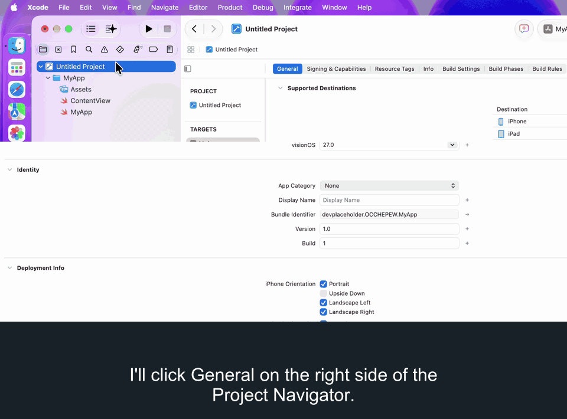

> *Text shown in the image:* Screenshot of Xcode (Untitled Project): Project Navigator with “Untitled Project”, Assets, ContentView, MyApp; the cursor is on the project; General tab with Supported Destinations (iPhone, iPad), Identity (App Category: None, Display Name, Bundle Identifier: devplaceholder.OCCHEPEW.MyApp, Version 1.0, Build 1), Deployment Info (iPhone Orientation: Portrait, Upside Down, Landscape Left, Landscape Right). Caption: “I’ll click General on the right side of the Project Navigator.”

- “I'll click General on the right side of the Project Navigator.” \[What\] \[Where\]
- “I'll drag the scrollbar down until I see App Icons and Launch Screen.” \[What\] \[Where\]
- “In that section, I'll click the App Icon field, type AppIcon without a space, and press Enter.” \[What\] \[Where\]
- “This applies the icon we exported to the app.” \[What\] \[Why\]

---

**Name the Exact Target**

Avoid vague references such as “this”, “that”, or “here”. Identify each item clearly before or while interacting with it.

| **Avoid** | **Use Instead** |
|---|---|
| I’ll click this button | I’ll select the blue Export button in the top-right corner |
| I’m changing that value | I’m changing the font size, which is currently set to 12 |
| I’ll click the right-side button | I’ll select Plotly’s camera icon, Download as PNG |
| I’ll place that up there | I’ll click, hold, and drag the title to the upper center of the Preview |
| It’s saved | Article.pdf is now saved in the Desktop folder |

> For an unlabeled icon, name its app or panel, function, or visible symbol. Identify visual assets by their subject or filename, not only by position or color.

---

**Coordinate Your Voice and Cursor**

Your narration, cursor, and on-screen action should work together.

- Name the target before or while moving toward it.
- Rest the cursor briefly over the named control before acting.
- When searching, scan the relevant menu or toolbar naturally and explain what you expect to find.
- If an action fails, explain what happened, make one deliberate correction, and confirm the corrected result.
- Announce every keyboard shortcut before or while using it.

---

**Follow the Audio Standards**

|   |   |
|---|---|
| **Will be approved if:** | **Will be rejected if:** |
| • Describes What / Where / Why during the action. • Follows the video; the cursor points, hovers, and guides attention. • The voiceover is clear, coherent, well-paced, understandable, and free of sustained or distracting background noise. • Announces every keyboard shortcut before or as it is used. • 100% in English, including reading | • Misses actions, mismatches the video, or recites the written Task Description (Goal) instead of narrating the work. • Narration is too vague to identify What, Where, Why, or the result. • An audio pause exceeds 45 seconds. • Sustained background noise affects the recording (background noise effects >30% of the recording) • Uses keyboard shortcuts without verbal explanation. • Audio includes private or non-public PII or profanity. |

---

**Review the Audio**

Before submitting, review the recording to confirm that:

- [ ] Narration is audible near the beginning, middle, and end.
- [ ] The narration matches the actions shown.
- [ ] No audio gap exceeds 45 seconds.
- [ ] Actions, decisions, and results are explained clearly.
- [ ] No sustained background noise (background noise effects >30% of the recording), private information, or profanity.
- [ ] Every keyboard shortcut is announced.

---

**Pause and Decide**

*Q: Which recording meets the standard?*

> *Text shown in the image:* **Recording A:** “In Excel, I’ll select cell F12 in the Summary worksheet to verify the annual revenue formula. The formula bar shows SUM(B12:E12), confirming that all four quarterly totals are included. I’ll now press Command and S on my keyboard to save the verified workbook” **Recording B:** “I’ll click this here and fix the value.”

❝

**Recording A meets the standard.** The narration identifies the app and

location, explains the purpose, confirms the result, and announces the keyboard shortcut. ❞

# Apps and Desktop

A strong recording uses tools that genuinely contribute to the work, a fresh browser (Firefox preferred), and a clean desktop that varies naturally across tasks.

**Choose Apps that Contribute**

Choose the app or apps that suit the task. Multiple apps are encouraged when each makes a meaningful contribution to the professional workflow or final deliverable.

| **Counts as a Genuine Task App** | **Does Not Count** |
|---|---|
| Supports meaningful research, analysis, creation, editing, or verification | Is only opened, named, or briefly visited |
| Produces or changes information used elsewhere in the workflow | Is used only for setup, navigation, or project administration |
| Has a clear purpose in the Task Description (Goal) | Display the opening Task Description (Goal) but is not used again |

The intro Task Description (Goal) document app counts only if you also use it for substantive task work.

> List the same genuine apps in Task Description, Studio, and TaskRecorder.

**Single-App Tasks**

A single-app task is acceptable. It must meet the same standard for substantive professional work, meaningful skill and judgment, and a clear deliverable as any other task. App count alone does not establish complexity.

For example, an advanced editing, mixing, mastering, and verification workflow in professional audio software may qualify. Completing basic actions in a complex app does not.

> A complex app does not automatically make a complex task.

All other requirements still apply, including narration, originality, recording length, and a complete deliverable.

---

**Follow the App Categories**

Check App Eligibility and Limited Use before choosing your tools. Banned apps must not be opened, displayed or used in new recordings. Minimal use means less than 20% of the task under the project operating rule; background-only and app-specific supporting-use limits still apply; apps in the alternatives-preferred category remain allowed. The cutoff and in-flight protections are stated in that list. If your planned workflow requires a banned app:

1. Choose a permitted alternative before recording
2. Revise the Task Description
3. Update the Use Apps in Task Description, Studio, and TaskRecorder.

> For new work, banned apps must not appear in the recording. Minimal use means less than 20% of the task under the project operating rule; background-only and app-specific supporting-use limits still apply.

---

**Vary the Desktop Appearance**

Before recording, change at least one of these; more is better:

- Screen resolution
- Light or dark mode
- Wallpaper (a built-in one)
- Dock size
- Accent color, sidebar icon size, or an in-app theme

> The dock must remain on the **left or right** side of the screen, never at the bottom. The dock must not auto-hide and indicators for open applications should be on. Mouse cursor size & color must stay default.

---

**Pause and Decide**

*Q: Which recording meets the standard?*

> *Text shown in the image:* **Recording A:** The writer researches competitor pricing in Firefox and uses a spreadsheet to normalize pricing tiers and calculate weighted scores, then uses WPS Presentation to create a client recommendation. **Recording B:** The writer displays the Task Description in Word, renames a file in Finder, and briefly opens a browser without using it for the task.

❝

**Recording A meets the standard.** Each app contributes meaningfully to a

connected professional workflow through research, analysis, and stakeholder communication. ❞

### On-Screen Presentation

A quality recording should make the work easy to follow visually. Keep the active content visible and use the cursor to direct the viewer’s attention.

**Manage Windows Clearly**

Keep one clear active window, or arrange only the task-relevant windows you need side by side. Other task apps may remain open, but minimize them when you don't need them for the current step.

| **Do** | **‼️Avoid ‼️** |
|---|---|
|  Use ordinary **Fill** for one active window | 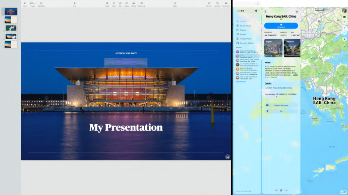 Using Full Screen or full-screen Split View |
| 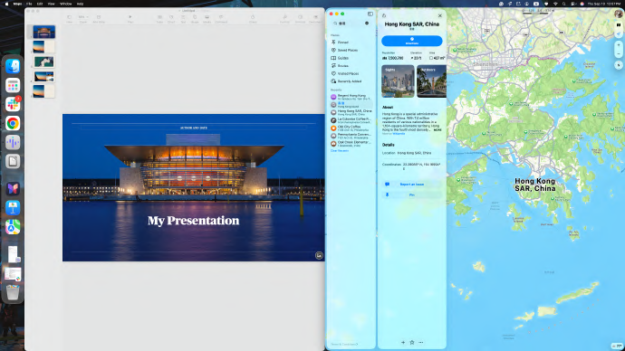 Arrange relevant windows side by side when both are needed | 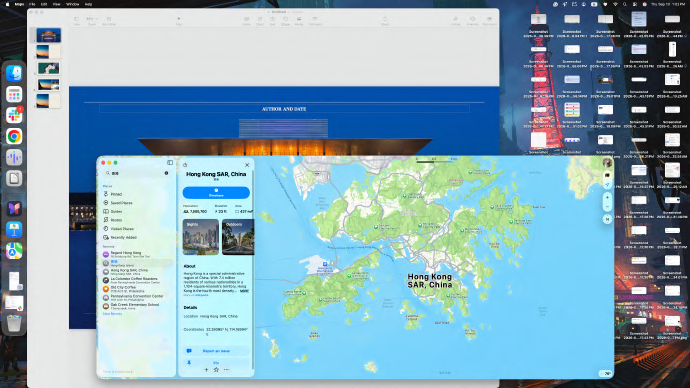 Stacking, overlapping, or pushing windows open |
| • Keep the menu bar, clock, and dock visible. • Rearrange or minimize a window if it becomes substantially covered. • Keep active windows large and easy to read. | • Leaving unused or fully covered windows open. • Covering a task window by more than approximately 25%. • Using small floating windows surrounded by unused desktop |

**Pop-ups Exception**

- Temporary pop-ups or dialogs within the same app may overlap while you are actively using them.

**Window Management Examples and Resources**

- [One-at-a-time window management example](https://drive.google.com/file/d/1WQ0XPW9-U4RfN0INEY-6npWJFZ2SJCqh/view?usp=drive_link) (0:31)
- [How to use window tiling on Mac | Apple Support](https://www.youtube.com/watch?v=U3KAmUYkkVc) (Youtube, 1:16)
- [Move and arrange app windows on Mac](https://support.apple.com/guide/mac-help/work-with-app-windows-mchlp2469/mac)

---

**Use the Mouse as a Teaching Pointer**

The cursor should guide the viewer’s attention and make each action easy to follow. Move naturally, pause before acting, and point to the content you are discussing.

✅ **Good Example**

❌ **Bad Example**

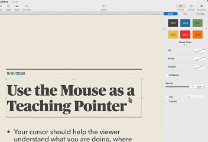

> *Text shown in the image:* Keynote slide “Use the Mouse as a Teaching Pointer” (9/10/2026) — bullet: “Your cursor should help the viewer understand what you are doing, where…”. The cursor is at the end of the title; Format sidebar (Style) is open on the right.

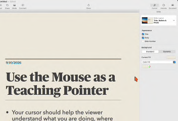

> *Text shown in the image:* Keynote slide “Use the Mouse as a Teaching Pointer” (9/10/2026) — bullet: “Your cursor should help the viewer understand what you are doing, where…”. The cursor is to the right of the title; Format sidebar (Slide: layout “Title, Bullets & Photo”, Appearance, Background, Current Fill) is open on the right.

*The cursor moves naturally, shows what is being*

*The cursor moves too quickly and distracts the discussed, and makes the next action clear.*

*viewer from the task.*

**When practical:**

- Point to text, buttons, icons, or interface areas as you discuss or use them.
- Trace along text or an area when it helps direct attention.
- Pause briefly over a useful control so its tooltip or preview can appear.
- Scan the relevant toolbar or panel naturally when locating a tool.
- Use visible interface controls instead of relying only on keyboard shortcuts.
- Clicks should be deliberate and unrushed; **pause about 1 second after every click**.

> Move, Pause, Point, and then Act.

**Limit Typing Time**

Typing is expected, and the cursor may remain still while you type. But it should not dominate the recording.

| **Recording Type** | **Typing Limit** |
|---|---|
| **Coding + Content & Writing tasks** | Up to **30%** of the total recording |
| **All other tasks** | Below **20%** of the total recording |
| **Any task** | No continuous typing segment or mouse inactivity longer than 45s. The mouse-idle rule does not apply during the closing epilogue. |

Break longer entries into shorter segments. Between typing segments, review what you entered, use the cursor to point out important details, format the content, test the result, or complete another meaningful action.

---

**Pause and Decide**

*Q: Which recording meets the standard?*

> *Text shown in the image:* **Recording A:** In a 20-minute data-analysis recording, the writer spends 3 minutes typing. No typing segment exceeds 40 seconds, and the writer reviews and points to the entered content between segments. **Recording B:** In a 20-minute coding recording, the writer spends 6 minutes typing, but one uninterrupted typing segment lasts 60 seconds.

❝

**Recording A meets the standard.** The total typing time is below 20% for a

non-coding task, and every typing segment stays under 45 seconds. ❞

## PII, Licensed Content, and AI Use

Keep all private information, project materials, unlicensed content, and prohibited AI activity out of the recording. These rules apply to task apps, input files, filenames, notifications, and anything else that may appear on screen. **Note on browser tabs: W**ebsites you only visit for research or context during the task (e.g., reading documentation, looking up reference data) are not input files. They don't need to be in Deliverables.zip or listed in Final Notes. An input file is a file you prepare before recording and open or use in the task. **As such, they are not subject to rules related to CC0 and copyright restrictions, but they must be free of any PII.**

**Protect Personal and Project Information**

Do not show information that could identify a real private person, including:

- Personal email addresses or phone numbers
- Home addresses
- Account or identification numbers
- Biometrics
- MAC addresses
- Your personal name or account information
- Other private or non-public personal information

**PII is not tolerated** and will always lead to task rejection.

Where PII slips in without you noticing. Check these before you record, and again in the last few minutes of your video:

• App profile corners: your name or photo in the top-right account area of PowerPoint, Word, Excel, Google Docs, Sheets or Slides, or your browser's profile button.

• Usernames in paths: your name in the Finder sidebar, a window title, a save or export dialog (/Users/yourname/...), or the Terminal prompt.

• Logged-in accounts: a personal email or profile photo in Chrome, Gmail, Google Drive or any web app.

• Autofill and history: your name or email in search suggestions, recent-file lists, or notification previews.

Example: an otherwise strong task was sent back because the writer's name and profile photo were visible in PowerPoint's account area at 22:10. The writer never clicked on it; it was just sitting in the corner of the window.

Ideally, project information is also hidden, including references to:

- Mercor
- Project Odin
- Project Odin Writer Guidelines
- Studio instructions or task-management pages
- Other project-administration materials

This will be tolerated in small quantities and should not lead to task rejection on its own. Still, it should be avoided when possible.

---

**Use Licensed Content**

Images, videos, and other downloaded assets must be CC0 or Public Domain. Confirm that the source terms permit commercial use; royalty-free alone does not establish either requirement.

Do not use content that contains:

- A visible creator watermark
- A copyright symbol or ownership notice
- Unverified or unclear licensing
- Paywalled or otherwise restricted material

> AI-generated content is acceptable, however, this has to be done before recording.

---

**Avoid Prohibited AI Use**

Do not interact with AI or generate or revise task content during recording. Eligible AI-prepared input files may be shown and used if created before recording, with no AI interface, branding, or watermark visible. Follow the prepared-input disclosure instructions in Studio Final Notes.

| **Use Case** | **Status** | **Rule** |
|---|---|---|
| Standard Google Search results | **Allowed** | Use search results normally |
| Opening a static link shown in Google AI Overview, including under **Show more** | **Allowed** | Do not interact with the AI Overview |
| Selecting **Ask anything** in Google AI Overview | **Not allowed** | This begins an AI interaction |
| Using AI Mode, Gemini, ChatGPT, Claude, or another conversational assistant | **Not allowed** | Do not prompt, chat, ask follow-up questions, generate, or summarize |
| Using AI to generate task content during recording | **Not allowed** | Task content must be created manually through the recorded professional workflow |
| Using an AI-powered feature for substantive task work | **Not allowed** | The feature cannot make meaningful task decisions or create the deliverable |
| Using ordinary built-in functionality that is not presented as AI | **May be allowed** | It must involve no prompting, conversation, generation, or summarization |
| Running software that contains an AI or ML component | **Conditionally allowed** | It must be part of normal software validation and cannot act as an assistant that completes the task |

> When an ordinary built-in feature is permitted, narrate the action and result without describing the feature as AI.

**AI-Prepared Input Files**

An eligible input file may be created with Gemini **before** the recorded session. The file must still meet all privacy, licensing, and prepared-file requirements. During the recording:

- Do not show the AI tool, interaction, branding, or watermark
    - A Gemini watermark is allowed, as long as Gemini is not used during the recording itself. No other watermark is allowed.
- Do not discuss how the file was generated
- Do not use AI to revise or generate additional task content during recording

> Follow the Prepared Input Files instructions for the required disclosure outside the recording.

---

**Pause and Decide**

*Q: Which recording meets the standard?*

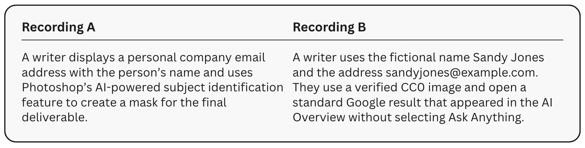

> *Text shown in the image:* **Recording A:** A writer displays a personal company email address with the person’s name and uses Photoshop’s AI-powered subject identification feature to create a mask for the final deliverable. **Recording B:** A writer uses the fictional name Sandy Jones and the address sandyjones@example.com. They use a verified CC0 image and open a standard Google result that appeared in the AI Overview without selecting Ask Anything.

❝ **Recording B**

**meets the standard.** Fictional information, verified CC0 content, and Google Search without interacting with generative AI. ❞

# ⚡Additional Resources⚡

# 🏅Golden Examples🏅

Use the Golden Examples to study task complexity, professional workflow, and narration standards.

---

1. [Finance](#golden-examples)
2. Design
3. Audio & Music
4. Animation & VFX
5. Software & AI/ML Engineering

---

[1. Finance](https://drive.google.com/file/d/1TOANq_bwgQ_Qyti7PL2R86mR1xAgctUP/view?usp=sharing)

**Task Description**

I am an Account Receivable personnel at a company in the UK and have been tasked with adding a new vendor to our ERP system and creating a Purchase Order (PO) tracking workflow for our Accounting team to manage POs better. I will begin by adding missing information onto a sample PO on the Pages app, then transfer the vendor details, and PO line items onto our ERP system on Microsoft Dynamics 365 Business Central, and finally create a PO tracking workflow on Monday.com. I will verify the flow is complete by running the same at the end of its creation and check if the status updates as per the trigger, and deliver the final PO raised on Microsoft Dynamics 365 Business Central and the PO workflow from Monday.com to my team.

**Apps Used**

Monday.com

Microsoft Dynamics 365 Business Central

Pages

Video: [Full task recording](https://drive.google.com/file/d/1TOANq_bwgQ_Qyti7PL2R86mR1xAgctUP/view?usp=sharing) (44:19)

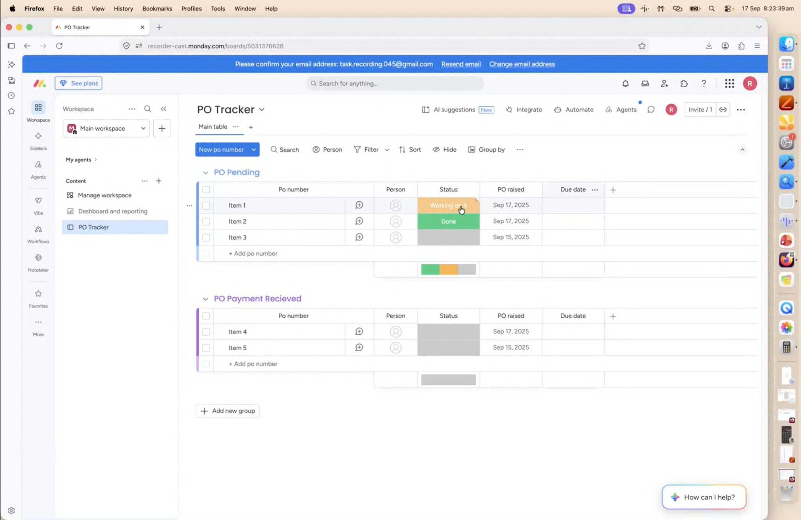

> *Text shown in the image:* Screenshot of Firefox with the monday.com “PO Tracker” board (groups “PO Pending” and “PO Payment Received”, columns PO number, Person, Status, PO raised, Due date).

[2. Design](https://drive.google.com/file/d/10HcP0usXgrPBP4AdVLBUNdjpONvHc_Iq/view?usp=sharing)

**Task Description**

I am a Content Creator preparing aspects of a new podcast. Using OBS Studio, I will setup different scenes for different aspects of the podcast such as pre-show and screen-share, which will involve the import of some images. The final deliverables will be the export of the scenes created in OBS.

**Apps Used**

OBS Studio

Video: [Full task recording](https://drive.google.com/file/d/10HcP0usXgrPBP4AdVLBUNdjpONvHc_Iq/view?usp=sharing) (24:44)

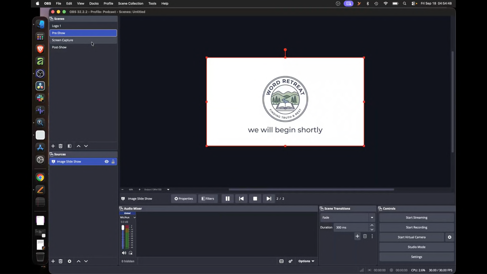

> *Text shown in the image:* Screenshot of OBS Studio (Scenes: Logo 1, Pre-Show, Screen Capture, Post Show) previewing a “we will begin shortly” Word Retreat slide.

[3. Audio & Music](https://drive.google.com/file/d/18aeXVN8jy6rAIQPv_BMUByg53KDnnSrq/view?usp=sharing)

**Task Description**

I am a film score composer and I’m working on the underlying theme for a heroic end credit sequence. I will use Logic Pro in the second phase (P2) of the execution to compose a string accompaniment for the piano top melody created in phase one (PI). I will also establish a chordal sequence (I - vi - IV - V) to define the passage. The final deliverable will be a stereo export of the complete Logic Pro session.

**Apps Used**

Logic Pro

Video: [Full task recording](https://drive.google.com/file/d/18aeXVN8jy6rAIQPv_BMUByg53KDnnSrq/view?usp=sharing) (22:58)

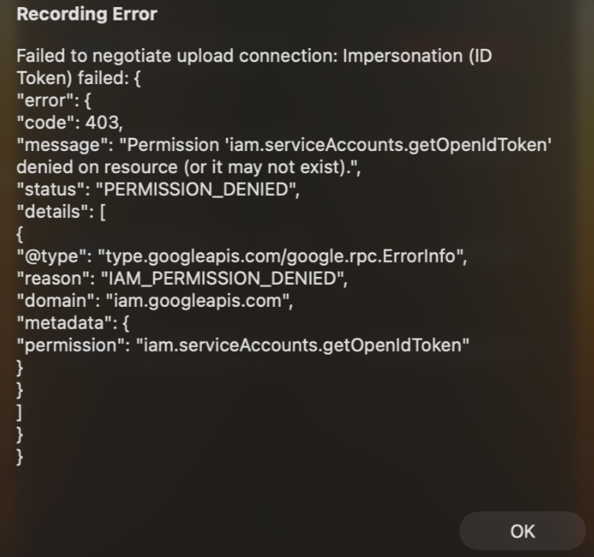

> *Text shown in the image:* Screenshot of Logic Pro Piano Roll (Hero – Piano Roll) with MIDI notes, Time Quantize, Strength, Swing, Scale Quantize and Velocity controls.

[4. Animation & VFX](https://drive.google.com/file/d/1wVBfJCTIAPJHJ6w3hoVHnZxSk-ujKYLA/view?usp=drive_link)

**Task Description**

You are a 3D Modeler tasked with cleaning up the textures of a photogrammetry model for use in Unreal Engine. Use Adobe Substance 3D Painter to bake the provided high poly model onto the provided low poly model, apply the provided photogrammetry diffuse texture, clean up artifacts on the texture, add a powdery finish to the popcorn and add red and white striped packaging textures to the popcorn box. Export the texture maps appropriate for use in Unreal Engine.

**Apps Used**

Substance 3D Painter

Video: [Full task recording](https://drive.google.com/file/d/1wVBfJCTIAPJHJ6w3hoVHnZxSk-ujKYLA/view?usp=drive_link) (40:59)

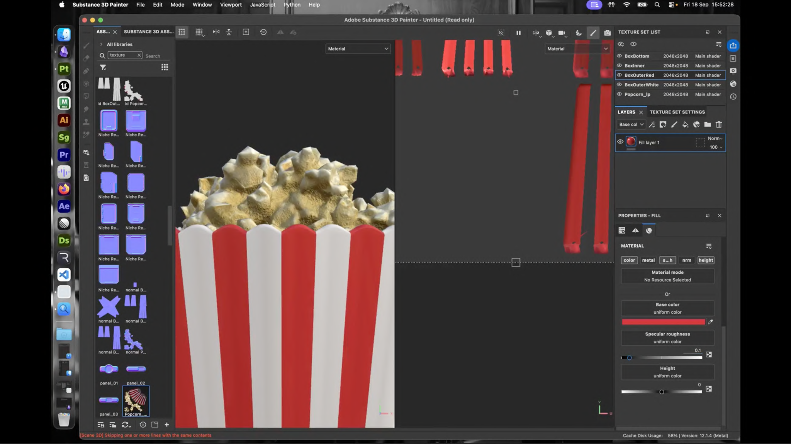

> *Text shown in the image:* Screenshot of Adobe Substance 3D Painter (Untitled) with a 3D popcorn bucket, texture set list, layers and Properties – Fill panel.

[5. Software & AI/ML Engineering](https://drive.google.com/file/d/14Fgj-2mtxKmCXIMiGnUT57EElc5rnjec/view?usp=drive_link)

**Task Description**

As an iOS app developer I want to create a distinctive visual identity for a simple Music Player app. Use SF Symbols as independent visual components, and compose them as separate layers in Icon Composer. Build & refine the multi-layered icon in Icon Composer and integrate the resulting icon into a SwiftUI Music Player app in Xcode. Deliver the layered icon and Xcode project; verify that the app builds successfully and the icon is correctly integrated.

**Apps Used**

Device Hub

Xcode

SF Symbols

Icon Composer

Video: [Full task recording](https://drive.google.com/file/d/14Fgj-2mtxKmCXIMiGnUT57EElc5rnjec/view?usp=drive_link) (28:37)

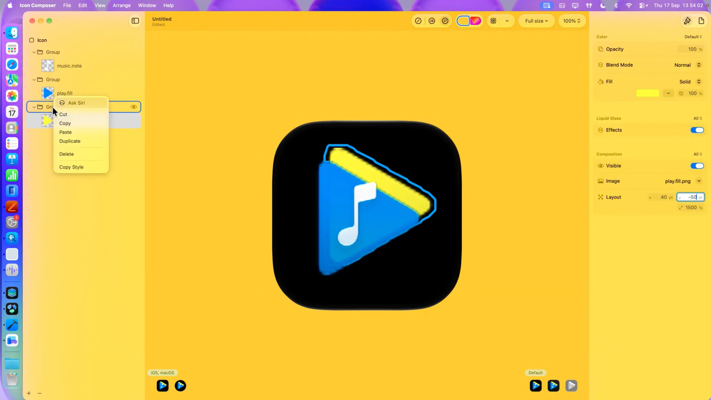

> *Text shown in the image:* Screenshot of Icon Composer with a yellow background, a blue music-play icon, layer tree (Group / play.00) with a context menu, and the Fill/Layer inspector on the right.

## Good vs. Bad Task

Below are key points of a good TaskRecorder task and what to avoid. Use the Golden Examples to study professional workflow and narration.

| **PROJECT Odin · GOOD VS. BAD TASK** |   |   |
|---|---|---|
|   | **Bad Task** | **Good Task** |
| **Task Description** | • Task description (Goal) is too vague to explain the task, apps, or intended result. | • Get your idea approved. Use only the Goal in TaskRecorder and the opening doc. • Task description (Goal) document is not a restricted app. |
| **Intro** | • The recording does not show the Task Description (Goal) briefly at the start, followed by minimizing it. • Introduction narration is long and descriptive rather than saying the provided introduction sentence. • The introduction does **not** include narration, only an app with the written Task Description (Goal). • Recording starts after important actions for the task are completed • The recording includes preparation that belongs before the task, such as drafting the Task Description (Goal), loading apps, or changing the desktop setup. | • TR is *<u>minimized immediately</u>* after the recording starts. • Setup takes place *<u>before</u>* the recording. • Narrates a concise introduction • Recording starts with apps open (dot under the app in the dock) and Task Description (Goal) shown • Task Description (Goal) document is *<u>minimized or closed a few seconds after the introduction has concluded</u>* . |
| **UI Diversity** | • No change in any of the UI elements • Dock at the bottom of the screen • Menu bar clock does not show seconds | • Change at least one UI element per recording; more is better: wallpaper, light or dark mode, accent color, Dock size, sidebar icon size, screen resolution, or an in-app theme. • Dock at the left or right of the screen • Menu bar clock shows seconds |
| **Screen Discipline** | • Scrolls past relevant content repeatedly without acting • More than ~25% of a window/app is covered by other windows/apps and left un-minimized for >6s • **Windows are stacked on top of each other**, fully covering background apps • A small floating window makes the content hard to see and leaves most of the desktop unused. | • Environment set up intentionally before starting • Organized workspace maintained throughout • Only windows relevant to the current task/sub-task remain visible; all others minimized • Use one clear ordinary window or place needed windows side by side. Temporary pop-ups or dialogs within the same app may overlap while you use them. • Full-screen (clock and dock not visible) is **not** used |
| **Cursor & Mouse** | • Constant aimless circles or jitter, no task intent • Frequently uses keyboard shortcuts where mouse actions were expected • The cursor remains inactive for more than 45 seconds outside the closing epilogue. Keep pauses brief, ideally under 30 seconds, without artificial mouse movement. The mouse may remain still during the epilogue. | • Deliberate, goes only where attention is • Use the cursor as a teaching pointer so viewers can follow your reasoning. |
| **Pacing & Presence** | • Experts rush through steps • Uneven pacing; idle periods present but task moves forward • Duration padded with unnecessary actions | • Well-paced start to finish; every segment has task value • Work naturally, explain your decisions and avoid unnecessary waiting. • Experts wait 1s beat before clicking the next item |
| **Workflow Adherence & Complexity** | • No clear task goal or planned workflow. • Abandoned within 30 sec, no meaningful attempt • **Restricted app used** • No coherent workflow; unrelated activity begins • The stated task goal is not completed. • Less than half of the intended workflow completed • Tasks substantially repeat the same workflow; changing only the topic or wording does not make it different. • None of the client required apps is used in the task (if applicable) • The workflow stays at basic steps and the output is too simple to be useful. • Majority completed; one major step skipped or weak • Coding and Content & Writing tasks: up to 30% of the recording may be typing. • All other tasks: below 20%. • For every task, no continuous typing segment or mouse inactivity longer than 45 seconds. The mouse-idle rule does not apply during the closing epilogue. • Extra apps are added only to increase the count, without contributing meaningful work. Single-app tasks are acceptable when they meet the same quality and expertise standards. • Metadata file is shown in the recording | • At least one client required app is used in the task (if applicable) • Keep the work mouse-driven. Treat 30% typing for Coding + Content & Writing tasks and 20% for other tasks as upper limits, not targets. • Complete the planned workflow and produce a clear, useful final deliverable. • Explain your choices and the professional reasons behind them. • Use each app naturally and give it a clear purpose in the task or final output. • Metadata file is NOT shown in the recording |

|   |   |   |
|---|---|---|
| **Completion** | • Recording incomplete or missing • Deliverables not saved • Output present but too thin or generic to be usable • Continues tinkering after task done, ambiguous endpoint | • Output is reviewed before stopping; clear wrap-up • Add further work only when it genuinely improves the promised result in a relevant direction • Prior feedback fully addressed • Include every input, intermediate artifact and final output in Deliverables.zip, using the required labels and file extensions. |
| **Accuracy and Error Recovery** | • Multiple significant errors, no self-correction • Notices error but doesn’t fully resolve it • Corrects mistake but doesn’t verify the fix | • No material error occurs, or any error is promptly diagnosed, corrected and verified without disrupting the workflow • Final output is carefully reviewed |
| **Domain & Tool Expertise** | • Basic, generic work that someone without your domain expertise could do. • Basic work that does not require domain knowledge combined with surface level app tool use • Meanders through menus with no progress visible • Learns the software by trial and error during recording | • Use professional methods and app features you already know. Explain important choices and anticipate relevant edge cases. |
| **Narration & Audio** | • No narration, or audio absent/unintelligible • Narration contradicts what’s on screen • Gap >45 sec, speaking the Task Description (Goal), or profanity • Long stretches unnarrated; major steps happen in silence • Rambling or filler that doesn’t track the workflow • Narrates some steps but skips others; intermittent gaps • Explains what but rarely why • Occasional shortcuts not called out • Background noise obscures narration (background noise effects >30% of the recording) | • Narrate throughout, as if teaching someone how to do the task. • Name what you are doing, where you are doing it and why, using specific control and location names. • The cursor is positioned over the item being referred to in the narration. • Explain your reasoning and small professional decisions as they happen. • Clean synchronised audio; concise, no rambling; no background noise |
| **Written Quality** | • Writing errors affect the meaning or make the final output unusable. | • Use accurate, professional writing and clean formatting. Minor errors are acceptable only if they do not affect the meaning or core result. |

# App Eligibility and Limited Use

Effective for new work started on or after 2026-10-16 18:08 PDT.

The approved-app requirement is retired. Unrestricted apps may be used without prior approval, including apps absent from the catalog. Use these three categories and the canonical restricted-app and limited-use rules when older Studio labels or copied lists disagree.

Canonical app list: [https://odin-mercor1.vercel.app/validated-apps](https://odin-mercor1.vercel.app/validated-apps) Work already underway before the cutoff is protected from newly applied app restrictions. Do not discard, restart or reject that work solely because of this update. Other quality checks still apply.

Previously rejected ideas or tasks involving an app that is now allowed may be reconsidered, subject to all other applicable quality checks.

Existing licensing, account, AI-use, opening-Goal and task-quality requirements still apply. Payment terms are unchanged.

## Banned for new work

- Godot
- VSCodium
- Inkscape
- GIMP
- Blender
- MATLAB
- Sublime Text
- Photoshop
- Ableton Live / Live
- ZBrush
- Grammarly
- Microsoft Whiteboard
- Adobe Bridge
- Adobe Animate
- Unreal Editor
- Telegram
- KNIME
- Reactotron
- Craft
- LiquidText
- Media Encoder
- Sublime Merge
- Vital
- Twinmotion
- KNIME Analytics Platform
- Figma
- Adobe Lightroom
- Autodesk FBX Review
- Defold
- KiCad
- OpenVSP
- anatomyapp
- FL Studio / FruitLoops Studio
- GameMaker
- LTspice
- Parallels Desktop
- UCSF Chimera
- VMD
- Wolfram Mathematica
- Substance 3D Stager
- Sticky Notepad
- Penpot
- MohrPlotter
- JASP
- TextExpander

## Allowed for minimal use

Project operating rule: minimal use means less than 20% of the task. Workpuls/Insightful and Splashtop Streamer remain background-only, and app-specific supporting-use limits still apply.

- iTerm: minimal use only.
- Workpuls / Insightful: background or toolbar only; do not actively use it or show its window during recording.
- Splashtop Streamer: background only; do not actively use it during the task.
- RecipeKeeper: only when needed for minimal supporting use; do not use as the main application.
- drawBook: only when needed for minimal supporting use; do not use as the main application.
- Milanote: only when needed for minimal supporting use; do not use as the main application.

## Allowed, but prefer alternatives when practical

- Safari
- Chrome
- Preview
- LibreOffice
- TextEdit: permitted for creating metadata.rtf.
- Freeform
- Stickies
- Calendar
- Terminal
- Canva
- Numbers
- Reminders
- Simplenote

## Before recording

Check the current app status and use apps that contribute meaningfully to the task. Safari and Chrome are allowed, with Firefox preferred where practical. Apps absent from the restricted list need no separate app approval. Follow the current app categories and usage conditions, and record only after the idea is approved. Licensing and all other quality checks still apply.

**Common Mistakes**

| **Rejection Item** | **Explanation** |
|---|---|
| Task Description | Use the friend-with-no-domain-expertise test to choose a task that uses your skills. The Task Description (Goal) should briefly explain your role, the apps and key methods, and the intended result; it does not need to fill a page. |
| Task Recorder Version | You must use the current version of Task Recorder and not an older one from past phases. |
| [Frame loss (TR)](#screenshot-verification) | Missing PNGs or low PNG count (&lt;0.5 per second of recording). We must have all the data required for the client. |
| Restricted app | Do not use an app on the banned list at https://odin-mercor1.vercel.app/validated-apps, including by entering it under Other in Studio. Ignore stale 'restricted' labels in Studio; Word, Excel, PowerPoint, Premiere Pro and Illustrator are allowed. |
| UI Diversity | Each recording must change at least one UI element (wallpaper, light or dark mode, accent color, Dock size, sidebar icon size, screen resolution, or an in-app theme); more is better. |
| Dock | Dock should be on the left or right and not minimized. Dock should **not** be at the bottom of the screen. |
| Menu bar clock | Seconds must be displayed on the menu bar clock. |
| No Setup/Introduction | Task description (Goal) document must be displayed at the beginning of the video and intro narration should not last longer than 20 seconds. |
| Accessibility Inspector | Accessibility Inspector not running during the video. |
| Task length | Total video length: Plan recording length, including the short intro and epilogue, to be at least 15 minutes and no more than 50:59 minutes (15:00-50:59). |
|   | Narration below the target Narration does not clearly describe What, Where and Why for each meaningful step. |
| Profanity | Profanity must not be in narration or shown in recording |
| Silence gap | Any single audio silence gap over 45s threshold is not allowed |
| AI usage | Any generative AI in video. **Only ordinary built-in functionality not presented as AI is permitted; do not prompt, converse, generate or summarize task content with AI during recording.** AI may prepare inputs before recording. At first use, explain the prepared file's contents, purpose and CC0 or public domain status without naming an AI tool or inventing a source. Put “AI-generated before recording” in Studio Final Notes. |
| PII | Private or non-public personal information must not be visible or audible. Examples of exceptions are public GitHub user information/emails and author information/emails in public research papers; these do not permit unrelated private information. |
| Project references | Keep Mercor, Project Odin, Studio and other project materials out of view. TaskRecorder may appear only for the required Start Recording and Stop Recording actions; minimize it immediately after starting. |
| Copyright | Do not use paywalled, watermarked, Unsplash or unclear-rights content. Check the original source for CC0/public-domain or equivalent permission and terms permitting AI-training use; a search filter alone is not sufficient. |
| Input files (if applicable) | Include all input files in Deliverables.zip. In Studio Final Notes, provide each non-AI source URL or exactly “AI-generated before recording” for AI-created inputs; complete Source of Data when applicable as well. |
| Window Management | Applications and windows covered by another window (excluding pop-ups within the same app) by more than approximately 25% for >6s. |
| Mouse inactivity | Any single cursor pause > 45 seconds is not allowed outside the closing epilogue; the mouse may remain still during the epilogue. |
| Excessive typing | Typing should not take up too much of video length |
| Deliverable File missing from the .zip | The deliverable must contain a final output file in the Deliverables.zip. If input files, intermediate artifacts, or multiple final outputs exist in the task, all of them must be present in the Deliverables.zip. |
| Metadata visibility | Metadata.rtf window should not be shown in the recording |
| Workpuls/Insightful | Workpuls/Insightful window can not be opened in the recording (it is allowed minimized in the Dock) |

# Known Technical Issues

## System Audio Issues

A known issue is that changing your audio input/output during a recording may prevent your narration from being captured. If your workflow requires this, make a short test recording first to see whether your system is affected.

## TaskRecorder Technical Issues

⚠️ **<u>A few troubleshooting tips - if you see the following errors</u>**

---

### <u>popping out:</u>

**\[Zero or very few screenshots, empty recordings, unreadable/cut-off videos\]** Do not submit. Close large accessibility trees and interfering apps (e.g. close calls, screen sharing, computer-control agents, unused complex browser tabs, large Finder folders and large unused documents), restart after a severe failure, and record the task again.

**\[Daemon is not ready\]** It means a background program (daemon) could not be initiated. Terminate the TaskRecorder app and restart again

If you need to share logs in #odin--helpdesk, logs will be inside each recording’s folder (archive) as recording.log

### For a fresh restart:

1. Start simple: fully quit and reopen TaskRecorder and Accessibility Inspector. Reboot after a zero-screenshot, unreadable-video or repeated failure before trying again.
2. Make sure Xcode is installed and Accessibility Inspector is running. Close the Accessibility Inspector window with the red button, but do not quit or yellow-minimize the app. Its blue Dock icon must keep a dot below it.
3. If TaskRecorder lacks a permission, remove and re-add TaskRecorder under the matching System Settings → Privacy & Security category, grant it again, then fully quit and reopen TaskRecorder.
4. There is no separate macOS screenshot switch to enable. Verify TaskRecorder’s Screen Recording and Accessibility permissions instead.

### Specific Error

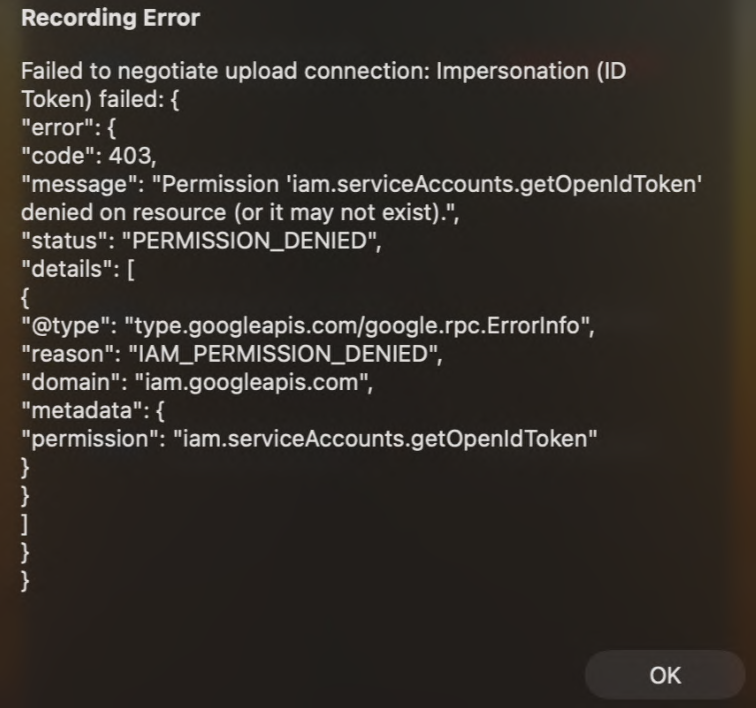

> *Text shown in the image:* Recording Error Failed to negotiate upload connection: Impersonation (ID Token) failed: { "error": { "code": 403, "message": "Permission 'iam.serviceAccounts.getOpenIdToken' denied on resource (or it may not exist).", "status": "PERMISSION_DENIED", "details": [ { "@type": "type.googleapis.com/google.rpc.ErrorInfo", "reason": "IAM_PERMISSION_DENIED", "domain": "iam.googleapis.com", "metadata": { "permission": "iam.serviceAccounts.getOpenIdToken" } } ] } } [OK]

If TaskRecorder asks for OTA or Google sign-in, quit every running copy (⌘Q), download TaskRecorder2.4.4.dmg from Important Links, install it in Applications and choose Replace, then reopen from Applications. Remove obsolete app copies and old DMGs, but keep recordings and exports. Version 2.4.4 needs no recorder sign-in; task-app account rules still apply. If the prompt remains, ask Loki with the exact downloaded filename and a redacted screenshot.

> *Text shown in the image:* Left: Accessibility permission list — Discord (off), OnScreen Control (on), OSCMultiMonitor (on), TaskRecorder (on), Workpuls (on), zoom.us (off). Right: Welcome to Task Recorder — Permissions Required: Accessibility (Required to record accessibility tree.) [Enable]; Screen Recording (Required to record screen.) ✓; Microphone (Required for audio recording (future use).) ✓

**<u>Solution:</u>** Remove/add TaskRecorder in accessibility (System Settings -> Privacy/Security -> Accessibility). Click at - and then at + and include TaskRecorder again. ON/Close/Reopen. The same route can also be followed for Screen Recording if needed.

# Frequently Asked Questions (FAQ)

- [General Understanding](#general-understanding)
    - [What am I actually doing in this project?](#onboarding)
    - [Am I being evaluated on how well I do the task?](#onboarding)
- [Onboarding](#onboarding)
    - [In the onboarding document, it's mentioned "Any laptop and processor works for this version of Project Odin". Can we use a Windows laptop?](#onboarding)
    - [When will my task be reviewed?](#onboarding)
    - I need more time to complete onboarding. What should I do?
    - What happens if my first task needs revision or is rejected?
    - Do I run Insightful, and is onboarding paid?
- [Tasks](#tasks)
    - [In my domain of expertise, all tasks follow a largely consistent workflow, with only minor variations. Given this, is it okay to continue working on these types of tasks?](#recording)
    - [Can I create an iCloud account with my OTA credentials?](#recording)
- [Recording](#recording)
    - [Can I pause a recording?](#recording)
    - [What if I make a mistake during the task?](#stopping--submitting)
- [Stopping & Submitting](#stopping--submitting)
    - [How do I stop recording?](#stopping--submitting)
    - [If I re‑record the same task multiple times, which version gets reviewed?](#stopping--submitting)
    - [Can I watch my recordings?](#stopping--submitting)
- [Finishing the Task](#finishing-the-task)
    - [How do I know I’m completely done?](#studio)
    - [Is it okay to redo a task if I think it’s bad?](#studio)
- <u>Studio</u>
    - [What goes in "Description" in Studio?](#studio)
    - [What counts as a task app, and what if it is not listed?](#studio)
    - [Where is Finder in the list of apps?](#accounts--privacy)
    - [What goes in "Crash Console messages" and "Final Notes" in Studio?](https://docs.google.com/document/d/1pWRX4iYK_GHQRDPEbAC9N6mDZ9ClvLm5efPS-OUziCo/edit?tab=t.vdcsjsu6gniw#heading=h.ajy46zcqmgnk)
    - [I don't see a field to add the task link in Studio. Should I submit the task in the task platform and Studio separately?](https://docs.google.com/document/d/1pWRX4iYK_GHQRDPEbAC9N6mDZ9ClvLm5efPS-OUziCo/edit?tab=t.vdcsjsu6gniw#heading=h.6s0f5pq08vje)
- [Accounts & Privacy](#accounts--privacy)
    - [Can I use my personal Google, Apple, or app accounts?](#accounts--privacy)
    - [What if I accidentally logged into a personal account during recording?](#accounts--privacy)
    - Can I work on any computer?
    - What should my computer look like if I have successfully completed the account and Task Recorder setup?
    - [What is the difference between my Mercor expert email and the OTA accounts?](#pre-recording-preparation)
- [Pre-Recording Preparation](#pre-recording-preparation)
    - [What should my opening note contain?](#task-recorder-device-and-system-requirements)
    - [Does the note-taking app count as a task app?](#task-recorder-device-and-system-requirements)
    - [What is the required opening sequence?](#task-recorder-device-and-system-requirements)
- [Task Recorder Device and System Requirements](#task-recorder-device-and-system-requirements)
    - [Does having an M‑series MacBook (Apple Silicon) solve compatibility issues with TaskRecorder?](#taskrecorder-installation)
    - [How can I check whether my Mac is Intel or Apple Silicon?](#taskrecorder-installation)
    - [I have an Intel Mac. What happens to my contract?](#taskrecorder-installation)
    - [How do I share my Mac specifications if support asks for them?](#taskrecorder-installation)
- [TaskRecorder Installation](#taskrecorder-installation)
    - [Why is macOS required for TaskRecorder?](#taskrecorder-installation)
    - Do I need to uninstall the old versions ?
    - I can’t install TaskRecorder, the install fails
    - On TaskRecorder the login button isn’t clickable.
    - I enabled Accessibility, but TaskRecorder keeps sending me back to settings.
    - [I deleted TaskRecorder to reinstall, but it still appears in permissions.](#taskrecorder-accounts-and-browsers)
    - [How do I confirm I’m fully ready?](#taskrecorder-accounts-and-browsers)
- [TaskRecorder Accounts and Browsers](#taskrecorder-accounts-and-browsers)
    - [Which browser should I use for task apps?](#taskrecorder-accounts-and-browsers)
    - [Which accounts should I use for TaskRecorder and task apps?](#taskrecorder-accounts-and-browsers)
    - [My login still fails after clearing cache, cookies, and reinstalling. Any other tricks?](#taskrecorder-stopping--uploading)
- [TaskRecorder Stopping & Uploading](#taskrecorder-stopping--uploading)
    - [How do I stop recording?](#taskrecorder-stopping--uploading)
    - [Where are my recordings saved?](#taskrecorder-stopping--uploading)
    - [If I re‑record the same task multiple times, which version gets uploaded?](#taskrecorder-errors--troubleshooting)
    - [Can I watch my recordings before uploading?](#taskrecorder-errors--troubleshooting)
- [TaskRecorder Errors & Troubleshooting](#taskrecorder-errors--troubleshooting)
    - [What if permissions won’t turn green?](#taskrecorder-errors--troubleshooting)
    - [What if the app behaves differently than the guide?](#getting-help)
    - [What if video.mp4 is unreadable, ends early, or TaskRecorder crashes?](#getting-help)
    - [What if I get an empty recording or very few screenshots?](#getting-help)
- [Getting Help](#getting-help)
    - [When should I ask for help?](#getting-help)
    - [How do I contact support?](#payments--bonuses)
    - [Unfortunately, I won’t be able to work on the project, how do I get offboarded?](#payments--bonuses)
- [Payments & Bonuses](#payments--bonuses)
    - [What if my payment is delayed?](#payments--bonuses)
    - [I have received an incorrect amount.](#window-management)
    - [My bonus payment is missing.](#window-management)
- [Window Management](#window-management)
    - [What is the simplest window-management rule?](#window-management)
    - [Does a second window from the same app count?](#window-management)
    - [What if a window opens on top of another window?](#window-management)
    - [What is the difference between Fill and Full Screen?](#window-management)
    - [How should I arrange the opening note and task apps before recording?](#window-management)

---

## General Understanding

**What am I actually doing in this project?**

Please read the <u>Project Overview Section</u>

---

**Am I being evaluated on how well I do the task?**

Yes. Quality is essential, and the task itself must be distinct, realistic and within your domain of expertise. It should demonstrate authentic professional expertise through deliberate execution, clear narration and a complete deliverable. Ask yourself: "Can your friend with no domain expertise complete this task?" If yes, choose a task that better uses your domain skills. Review the “Good” vs “Bad” Task section, and ask Loki first if you are unsure.

---

## Onboarding

**In the onboarding document, it's mentioned, "Any laptop and processor works for this version of Project Odin". Can we use a Windows laptop?**

TaskRecorder requires a Mac (Apple silicon or Intel) running macOS 15 or newer; Windows laptops are not supported. Intel Macs use TaskRecorder2.4.4-Intel.dmg. Check the current TaskRecorder Device and System Requirements before tasking.

---

**When will my task be reviewed?**

New writers' tasks receive priority in review; there is no guaranteed turnaround. Track status and comments in Studio and do not create duplicate submissions. Open-task limits are 3 in Trial or as Throttled Writer, 5 as Writer and 10 as Super Writer. Tasks waiting for approval count as open; rejected tasks are closed.

Track the task’s status and comments in Studio. Please do not contact individual reviewers or create a duplicate submission.

We understand that the feedback is important and our reviewers are doing an incredible job, but you should also use the checklists; feedback is instant, and you can't get it wrong. The secret to first-pass approval is... USING THE CHECKLIST

---

**I need more time to complete onboarding. What should I do?**

Complete onboarding before beginning your first task. Start tasking only when the phase is open and you are ready to follow the full guidelines.

---

**What happens if my first task needs revision or is rejected?**

Needs Edits: Follow the feedback, make the requested corrections, and resubmit before the active phase deadline. Rejected: Do not attempt or resubmit the same task.

---

**When should I start and stop the Workpuls (Insightful) timer?**

Run Insightful for active hourly-paid Odin work within your approved limit, including extra hours approved in advance. Pause it for breaks, idle time and off-project activity. Do not run it for eligible tasks retaining old per-task terms (Pay FAQ Q9). Only up to 3 setup hours are paid hourly; the first task follows fixed submission and RFD milestones.

From October 21, 2026 at midnight Pacific: up to 3 setup hours at your contract's base rate, $150 once on first submission and $250 once on first RFD approval. Trial then starts with 12 hours at base pay, adds 3 hours per RFD approval, and ends after 3 Trial tasks reach RFD. Rejected tasks do not count toward these 3 approvals. At 0 hours, pause and contact Maven. Production starts as Writer; at a $40 base, Throttled/Writer/Super rates are $40/$55/$75 per hour, scaling proportionally for higher bases. See [Payments](https://docs.google.com/document/d/1tOxjGqxhA6T49kXw9hrhwpEsk8ERaFOsB6gqZcrLAHg/edit?tab=t.kx83c7sgyk8i) for limits, transition rules and existing-work protections.

---

## Tasks

**In my domain of expertise, all tasks follow a largely consistent workflow, with only minor variations. Given this, is it okay to continue working on these types of tasks?**

A similar professional workflow is acceptable only when each task has meaningful variation in its goal, inputs, decisions or deliverable. Do not add an app artificially just to make a task look different.

---

**Can there be too much typing and not enough mouse movements for a coding task?**

Software engineering tasks are an exception where more typing is acceptable; however, it’s still highly recommended to reduce it to a minimum where possible.

---

**Can I create an iCloud account with my OTA credentials?**

No. Please create tasks where iCloud isn't required.

Do not create an iCloud/Apple ID for tasks; choose tasks where iCloud is not required. OTA accounts are retired. They also ask for a phone number, which would expose private personal information.

---

## Recording

**Can I pause a recording?**

No. There is no pause function.

If you need to stop:

- End the recording
- Restart the task

---

**What if I make a mistake during the task?**

- **Small mistake:** Continue
- **Big mistake:** Stop and restart the task.

Restarting is always allowed and preferred over submitting low-quality work.

---

## Stopping & Submitting

**How do I stop recording?**

See [TaskRecorder Stopping & Uploading](#taskrecorder-stopping--uploading) for the current stop, archive, and validation sequence.

---

**If I re‑record the same task multiple times, which version gets reviewed?**

- See [TaskRecorder Stopping & Uploading](#taskrecorder-stopping--uploading) for complete attempt-selection and upload guidance.
- Upload only the final verified attempt.

---

**Can I watch my recordings?**

See [TaskRecorder Stopping & Uploading](#taskrecorder-stopping--uploading) for the complete recording-validation procedure.

If you identify a problem, re-record or ask Loki first and follow the support route in <u>Contacts</u> if needed.

---

## Finishing the Task

**How do I know I’m completely done?**

You are done when:

- Recording is stopped, and the required platform questions and submission steps are complete.
- For TaskRecorder, upload and validate the required recording and deliverable files.
- All Studio fields are complete, and the status is Ready for Review.

---

**Is it okay to redo a task if I think it’s bad?**

Yes. It is always better to redo a task than submit something unclear or incomplete.

---

## Studio

**What goes in "Description" in Studio?**

Follow the <u>Task Ideation</u> page to plan your idea, then propose it in a task in Studio. Once it is approved, record the work exactly as approved.

**Important:** Your Description and Apps Used fields must match the actual recording. The Prompt/Description is automatically filled into a task. If you need to change the prompt/description/used apps field, you must ‘Revise Idea’ and resubmit your task idea for review.

---

**What counts as a task app, and what if it is not listed?**

An app counts only when it is meaningfully and necessarily used during the task to create, edit, analyze, transform, or validate the result.

Simply opening an app, signing in, moving a file, or briefly switching to it does not make it count. Finder and Apps.app do not count. The pre-recording note-taking app does not count; it counts only if you materially use it again during the task.

• One app is the bare minimum, so a single-app task is allowed if it is reasonably complex, but aim for 2-3 apps that each do real work in the workflow. Every task must still demonstrate substantive professional work, skill and judgment, and a clear deliverable

• Each app must be necessary to the professional workflow

• Every app entered in Studio must be visibly and meaningfully used

If an app is missing from Studio, select Other and enter its exact name. Unrestricted apps may be used without prior approval; catalog inclusion is not required. Check the current banned-app, limited-use and app-specific rules before recording. Licensing and all other task requirements still apply.

If an app is not in the Studio dropdown, select “Other” at the end of the Apps list in your idea proposal and type its exact name. The app is reviewed with your idea, so do not record until the idea is approved.

---

**Where is Finder in the list of apps?**

Finder and Apps.app do not count as genuine task apps. Consider only apps in which you demonstrate expertise and that are essential to the professional workflow or deliverable.

---

## Accounts & Privacy

**Can I use my personal Google, Apple, or app accounts?**

- Assigned OTA accounts are retired. Sign in to apps with your mercor.expert account, or a new anonymised account you create for that task. Never expose PII.
- Use only licenses that allow commercial use.
- You may use your own licensed copy if you activate it before recording and no name, email or license detail appears in the recording.

---

**What if I accidentally logged into a personal account during recording?**

If any PII appears, stop immediately and do not submit the recording. Hide it and re-record from the beginning. If you are unsure whether private or non-public personal information appeared, ask Loki first.

---

**Can I work on any computer?**

TaskRecorder must run directly on a physical Mac (Apple silicon or Intel) on macOS 15 or newer. Intel Macs use TaskRecorder2.4.4-Intel.dmg.

With Task Recorder, check <u>Mac requirements</u>.

---

**What should my computer look like if I have successfully completed the account and Task Recorder setup?**

- Hours, minutes & seconds in the clock on the menu bar
- Dock positioned to left or right side
- Wall paper changed
- Accessibility Inspector running in the dock
- Opening note with the Goal (not Notes.app or TextEdit) ready behind TaskRecorder
- TaskRecorder 2.4.4 open and populated with the same Task Description (Goal) as the opening note, as well as all apps that will be used in the task
- All apps launched, preprepared files ready and everything minimized in the dock. **Note:** in the below example you can also see further customization as it has dark mode enabled.

    

    > *Text shown in the image:* Screenshot of Microsoft Word (Document1) on a dark desktop with the Task Recorder window open: Audio / Video preview (Screen: Display 1) · Task Description (“I am an Accounts Receivable personnel at a company in the UK and have been tasked with adding a new vendor to our ERP system and creating a Purchase Order (PO)…”) · Used Apps (Monday.com · Microsoft Dynamics 365 Business… · Pages) · Status: Idle · [Start Recording] [Stop Recording] [Show Recordings].

---

**What is the difference between my Mercor expert email and the OTA accounts?**

Your [Mercor expert email](https://talent.docs.mercor.com/working/expert-email) account is used to access

- Mercor resources
- **onboarding documents.**

Assigned OTA accounts are retired. Use your @mercor.expert account or a new anonymised account for task-app sign-in. Okta and the dashboard use your personal work.mercor.com email. TaskRecorder 2.4.4 has no sign-in.

- TaskRecorder 2.4.4 does not require an OTA login; assigned OTA accounts are retired and are not required for task apps
- Used to log into Google services (Gmail, Drive etc) during tasks.

---

## Pre-Recording Preparation

**What should my opening note contain?**

You need to propose your idea in the task and wait for approval first. Once the idea is approved, the same task moves to In Progress, and the full approval text, including the Approval ID, will be pre-filled in the Studio Prompt/Description field. Paste only the **Goal** section into TaskRecorder, your opening note, and the Metadata.rtf Request section. See the Task Ideation page in the Writer Guidelines.

**Does the note-taking app count as a task app?**

No. It does not count toward the required task apps unless you materially use it to complete the task itself.

**What is the required opening sequence?**

Before recording, enter the Task Description (Goal) and Used Apps (genuinely used apps) in TaskRecorder. Fully launch every task app, complete startup dialogs, log in and load, open required files or workspaces, position each window, and minimize every app. Do not perform task work yet; leave only the prepared opening note visible. Start recording, immediately minimize TaskRecorder, and say: “I will be beginning my task soon. Here is the workflow I have in mind.” Use only this sentence and keep the entire recorded introduction under 20 seconds. Then minimize or close the note, bring prepared apps forward from the Dock, and begin tasking. Never launch or set up an app after Start Recording.

## Task Recorder Device and System Requirements

**Does having an M‑series MacBook (Apple Silicon) solve compatibility issues with TaskRecorder?**

- TaskRecorder is designed for
    - Apple silicon (M-series) Macs
    - running macOS 15 or higher

Intel Macs are supported through the Intel build, TaskRecorder2.4.4-Intel.dmg, on macOS 15 or newer.

---

**How can I check whether my Mac is Intel or Apple Silicon?**

- Click the Apple menu → “About This Mac” to see the chip type (Intel, M1/M2/M3, etc)

---

**I have an Intel Mac. What happens to my contract?**

Intel Macs are supported. Install TaskRecorder2.4.4-Intel.dmg from Important Links and continue tasking as normal; your contract is unaffected.

---

**How do I share my Mac specifications if support asks for them?**

- Open the Apple menu → “About This Mac”
- Take a screenshot showing your Mac model, chip type (for example, M2), and macOS version (for example, 15.x or newer).
- Ask Loki first and attach this screenshot. If the answer remains unresolved, forward the Loki thread and screenshot to the relevant channel listed in <u>Contacts</u>.

---

## TaskRecorder Installation

**Why is macOS required for TaskRecorder?**

Project Odin aims to capture **real, native macOS desktop workflows**. The recordings must reflect how users actually interact with macOS applications, menus, system behaviors, and shortcuts.

Because of this:

- Tasks must be completed on a **real Mac**
- TaskRecorder must run directly on a compatible physical Mac
- Browser-based Mac environments are **not used** for this part of the project

The client cannot accept recordings created outside native macOS environments for TaskRecorder tasks.

---

**Do I need to uninstall the old versions?**

- If an older TaskRecorder is already installed, first remove TaskRecorder from Privacy & Security > Screen Recording and > Accessibility (select it and click -), move the old app from Applications to the Bin, then install the new version and grant all three permissions again.

---

**I can’t install TaskRecorder; the install fails**

Restart your computer and try again.

---

---

**TaskRecorder shows an old or unclickable login button. What should I do?**

Quit the older app and install TaskRecorder 2.4.4 from Important Links. It does not require OTA or Google sign-in. Grant Accessibility, Screen Recording and Microphone permissions, then reopen TaskRecorder.

---

**I enabled Accessibility, but TaskRecorder keeps sending me back to settings.**

If a permission remains missing after you enable it, remove and re-add TaskRecorder in that permission panel:

1. Open **System Settings**
2. Go to **Privacy & Security > Accessibility**
3. Select **TaskRecorder** and click **- (minus)** to remove it
4. Click **+ (plus)** and add **TaskRecorder** again from **Applications**
5. Toggle it **ON**
6. Quit TaskRecorder completely and reopen it

---

**I deleted TaskRecorder to reinstall, but it still appears in permissions.**

MacOS may keep the permission entry even after deleting the app. Therefore, removing permissions separately before uninstalling the app is recommended.

---

**How do I confirm I’m fully ready?**

Do a short test recording:

1. Select the intended display and start a short recording.
2. Bring TaskRecorder to the front, click Stop Recording, and wait through Stopping → Archiving → Idle.
3. Click on “Show Recordings” in TaskRecorder or In Finder choose Go → Go to Folder and open ~/Library/Application Support/TaskRecorder/recordings
4. Confirm you see in a new folder
    - screenshots/ containing PNG files
    - video.mp4
    - frames.jsonl, ax.jsonl, input.jsonl, processes.jsonl and recording.log

Run a short test with the permitted app(s) and any critical dialog or audio action you expect to use. Stop through Idle, then confirm that automatic recording\_TIMESTAMP.zip exists, video.mp4 opens and reaches the end, narration is audible near the beginning and end, and screenshots appear at more than 0.5 per second.

---

## TaskRecorder Accounts and Browsers

**Which browser should I use for task apps?**

Use a fresh install of Firefox for tasking (see Technical Setup, A4). Sign in to task apps there with your mercor.expert account, or a new anonymised account you create for that task, and keep PII out of it.

---

**Which accounts should I use for TaskRecorder and task apps?**

- Use the accounts as follows:

    • Mercor Expert: Studio and project documents

    • mercor.expert account or a new anonymised account: task-app logins

    • TaskRecorder 2.4.4: no OTA or Google sign-in required

    • Personal accounts: only when there is no other way to access the app, and never showing PII

- TaskRecorder 2.4.4 does not require an OTA or Google account to open and record.
- For task apps, use your mercor.expert account or a new anonymised account you create for that task. Assigned OTA accounts are retired. No PII may appear.
- If an older TaskRecorder shows ServiceNotAllowed or an organization-access error, update to 2.4.4 from Important Links instead of retrying recorder sign-in. Google Docs, Sheets and Drive no longer require an assigned OTA account; sign in with your mercor.expert account or a new anonymised account you create for that task. If sign-in is still rejected, report the account alias, error screenshot and Task ID in #odin--helpdesk. Never post a password in a channel.

---

**TaskRecorder still opens a Google sign-in screen. What should I do?**

- Quit every running copy of TaskRecorder.
- Download TaskRecorder2.4.4.dmg from Important Links. TaskRecorder2.4.3.dmg and earlier installers are obsolete.
- Install it in Applications, choose Replace if prompted, and reopen from Applications. Remove obsolete app copies and old DMGs, but keep all recordings and exports.
- TaskRecorder 2.4.4 should not require OTA or Google sign-in. Keep your task-app privacy setup.

If that still fails, ask Loki first. If the answer remains unresolved, forward the Loki thread and screenshots to the technical-issues channel listed in <u>Contacts</u>.

---

## TaskRecorder Stopping & Uploading

**How do I stop recording?**

Bring TaskRecorder to the front and click Stop Recording. Command + Shift + 9 does not stop the current version of TaskRecorder.

---

**Where are my recordings saved?**

TaskRecorder stores each recording temporarily in the hidden folder:

~/Library/Application Support/TaskRecorder/recordings

You can open this folder by clicking “Show Recordings” in TaskRecorder.

When opened, the archive contains:

- screenshots/ containing PNG files
- video.mp4
- frames.jsonl, ax.jsonl, input.jsonl, processes.jsonl and recording.log

**Important: If you haven’t run a recording yet, you may not see the output folder structure.**

---

**If I re‑record the same task multiple times, which version gets uploaded?**

- Each attempt creates a timestamped local folder and a recording\_TIMESTAMP.zip archive automatically. Only the ZIP archive is accepted; older .tar.gz archives are not accepted.
- Use the timestamp to identify the final attempt

Keep the raw recording folder and earlier attempts until you've verified all contents have been uploaded to Studio. Then delete obsolete attempts, empty Trash, and recheck free storage before the next recording. Do not rename or edit the chosen archive.

---

**Can I watch my recordings before uploading?**

- Yes. And you should.
- To validate a copy, confirm video.mp4 opens and reaches the end, screenshots/ contains PNG files, there are hundreds of screenshots, and the JSONL files exist at the archive root. Listen near the beginning, middle, and final minute to confirm narration continues. For audio-production tasks, verify narration and required app playback separately. If playback appears delayed or out of sync, check the local video.mp4 in QuickTime before deciding the recording is defective. Do not rename, edit, unzip, or manually recreate the original recording\_TIMESTAMP.zip.
- Check for issues like missing narration, visible private or non-public personal information, or a TaskRecorder/Insightful overlay at the wrong time.

If any of these issues exist, re-record. Do not trim or edit the TaskRecorder archive.

---

## TaskRecorder Errors & Troubleshooting

**What if permissions won’t turn green?**

Go back to: **System Settings → Privacy & Security**

Enable the missing permissions, then return to TaskRecorder.

If the permissions still will not enable, ask Loki first and include a screenshot of the affected Privacy & Security panel.

---

**What if the app behaves differently than the guide?**

Stop and ask Loki first. Include the app version, current step, expected result, actual result and a screenshot; do not guess or improvise.

---

**What if video.mp4 is unreadable, ends early, or TaskRecorder crashes?**

- Do not submit the archive. Fully quit and reopen TaskRecorder and Accessibility Inspector, close interfering apps and large accessibility trees, and re-record. Reboot after a zero-screenshot, unreadable-video or repeated failure.
- Run one short test recording. If it fails again, upload the failed archive, ask Loki first and, if the issue remains unresolved, forward the Loki thread and archive link to [`#odin--helpdesk`](https://mercor.enterprise.slack.com/archives/C0C4F0M0PPX)

---

**What if I get an empty recording or very few screenshots?**

- A large or busy accessibility tree can delay a capture and block later screenshots. Close calls, agents, unused complex tabs, large Finder folders and large unused documents before re-recording.

After any failed recording:

- Fully quit and reopen TaskRecorder and Accessibility Inspector; reboot after a severe or repeated failure.
- Verify video.mp4 and screenshots before submission, and report persistent issues.
- After the recovery steps above, run one short test recording. If the screenshot issue persists, upload the failed archive, ask Loki first and, if the issue remains unresolved, forward the Loki thread and archive link to [`#odin--helpdesk`](https://mercor.enterprise.slack.com/archives/C0C4F0M0PPX)

---

## Getting Help

**When should I ask for help?**

Ask for help if:

- You are unsure whether a recording is valid
- You think private data may have been recorded
- You feel stuck or confused

Asking questions is expected and encouraged.

---

**How do I contact support?**

Ask Loki first. If the answer remains unresolved or Loki directs you onward, forward the complete thread to the designated project channel listed in <u>Contacts</u>. Include your Task ID, current step, expected result, actual result and a screenshot. Do not DM individual reviewers or EPMs unless specifically asked.

- What you expected to happen
- What actually happened
- A screenshot if possible

---

**Unfortunately, I won’t be able to work on the project, how do I get offboarded?**

If you go to [https://work.mercor.com/maven](https://work.mercor.com/maven), you can do a self-service project off-boarding. It only takes a moment, just ask to be removed from the Odin project and Maven will create a link for you. We are sorry to see you go and hope to work with you again soon on another project.

---

## Payments & Bonuses

**What if my payment is delayed?**

Check your email for verification requests and the schedule in Pay FAQ Q17. Hourly pay is sent Wednesday for the prior Saturday-to-Friday week in India time. If an expected payment is still missing after two pay cycles, submit the [payment query form](https://forms.gle/sQ8vcX4iki7Mbpgk6) (only accessible via @mercor.expert email).

---

**I have received an incorrect amount.**

- See the [Payment guidelines](https://talent.docs.mercor.com/how-to/payments)
- For a payment query, include Project Odin, your [Mercor expert email](https://talent.docs.mercor.com/working/expert-email), the affected dates, your contract rate, tracked hours, and relevant task or offer links.

---

**My bonus payment is missing.**

Tier bonuses are normally paid the Wednesday after the corresponding hourly pay, but may arrive earlier, including with that payment. Check Stripe or Wise for the payment and any verification requests. If an expected payment or bonus is still missing after two pay cycles, submit the payment query form with your task link and offer details. We will respond within 2 business days. See Pay FAQ Q17.

## Window Management

**What is the simplest window-management rule?**

Use one clear ordinary window, or arrange only the task-relevant windows you need side by side. Minimize the rest. See the full Window Management guidance.

**Does a second window from the same app count?**

Ordinary task windows must not overlap. Temporary pop-ups or dialogs within the same app may overlap while you are using them, including a Mail compose window over the inbox. Keep all private information hidden and minimize the pop-up when you no longer need it.

**What if a window opens on top of another window?**

Do not panic or rush. Correct it immediately by moving, resizing, minimizing or closing it, narrate the correction, then continue. A brief opening transition is not the problem; continuing to work with stacked windows is. Applications and windows covered by another window (excluding pop-ups within the same app) by more than approximately 25% for >6s is not permitted.

**What is the difference between Fill and Full Screen?**

Use ordinary Fill when you want one large window. It keeps the menu bar, clock and Dock visible. Avoid Full Screen and full-screen Split View. See [Apple’s short video](https://www.youtube.com/watch?v=U3KAmUYkkVc) and [Apple’s window guide](https://support.apple.com/guide/mac-help/work-with-app-windows-mchlp2469/mac).

**How should I arrange the opening note and task apps before recording?**

Before recording, fully launch every task app, complete startup dialogs, log in and wait for loading, open required files or workspaces, position each window, and minimize every app. Open a note in a permitted app containing only the Goal section of your approval text, and paste the same Goal into TaskRecorder. The full approval text goes in Studio Prompt/Description. Do not perform task work yet, and keep only the opening note visible. After Start Recording, immediately minimize TaskRecorder, say only the required sentence, and keep the entire introduction under 20 seconds. Then minimize or close the note, bring prepared apps forward from the Dock, and begin tasking.

# 📩 Contacts

## How to Get Unstuck, What Systems Are Involved, and Who Can Help

This page exists so you never have to guess what to do when something feels unclear or broken. If you are confused, unsure, or think you may have made a mistake, **stop and use this page** before continuing.

---

## How Support Works Overall

Slack is the primary place for support on this project. If something does not behave as expected, seek support. You are never expected to troubleshoot serious issues on your own.

Asking for help is normal and encouraged, especially early on. **Check the manual, search Slack, and ask Loki first!**

If you need to ask a new question, the fastest way to get help is to briefly explain where you are in the process, what you expected to happen, and what actually happened. Screenshots are helpful, so include them whenever relevant, especially for tech issues (error messages, missing buttons or options...).

We understand the desire to reach out directly to reviewers and EPMs; however, it is not the appropriate route and will only delay your answer.

|   |   |
|---|---|
| **Query Type** | **Where to look** |
| Access Issues (e.g., Insightful, Mercor Expert Email, etc.) | See the [Insightful guidelines](https://talent.docs.mercor.com/how-to/use-insightful), [Okta guidelines](https://talent.docs.mercor.com/how-to/okta-access), or [Mercor Expert Email](https://talent.docs.mercor.com/new-releases/new-expert-email) first. Otherwise contact: • **Okta/Slack Issues:** [support@mercor.com](mailto:support@mercor.com) |
| Payment Queries (e.g., bonus not paid, mismatched pay rates, etc.) | See the [Payment guidelines](https://talent.docs.mercor.com/how-to/payments) |
| Insightful Hours Inaccuracy | See the [Payment guidelines](https://talent.docs.mercor.com/how-to/payments) |
| All other questions | **Slack** (see below) |

---

## Slack Support Channels

### How to Get Support

For the fastest help, follow these three steps. Asking questions is encouraged, especially when you are new.

1. **Forward your question** from Loki’s channel only if Loki's answer is not enough. Please forward the question in the appropriate channel (see below) so that we can see that you asked Odin first, and give the team time to pick it up, channels are actively monitored across shifts. 🌐
2. **Escalation:** If guidance conflicts or you still need help after using the normal support route (Loki first, then a forward in the appropriate channel) say so in the thread and ask for escalation. The support team will route your question to the appropriate EPM.

|   |   |
|---|---|
| **Channel name** | **Purpose** |
| **Onboarding** |   |
| [#odin--new-onboarders](https://mercor.enterprise.slack.com/archives/C0C4F03Q9J9) | • Only for new joiners • Will be moved to ‘writers’ accordingly after signup • Got an onboarding question? Ask in [`#odin--helpdesk`](https://mercor.enterprise.slack.com/archives/C0C4F0M0PPX) **@Loki** |
| **After Completing Onboarding** |   |
| [#odin--announcements](https://mercor.enterprise.slack.com/archives/C0C4DS98P0T) | • Important project-wide updates • Important reminders • CHECK before recording |
| [#odin--helpdesk](https://mercor.enterprise.slack.com/archives/C0C4F0M0PPX) | • Tech-related questions • **Ask all questions to @Loki first** |
| [#odin--ideation](https://mercor.enterprise.slack.com/archives/C0C9R6AUZNG) | • All tasking related discussions happen here |

---

## Understanding the Systems You Are Using

**Slack (Primary Communication)**

Slack is where all coordination, questions, and support happen. If you are unsure where to ask a question, ask in Slack. If you are blocked or need quick clarification, Slack is the right place. If something is private, contact a project lead directly; otherwise use the relevant project channel.

# Instructions Changelog

This table records changes to the guidelines so you can see what changed and when. The Last Updated date and recent-change recap in the Introduction are updated with every change.

| **Date** | **Changes** |
|---|---|
| Oct 19, 2026 | 🟩 3 apps are suggested but not required. 🟩 Goal document should be closed or minimized after intro. 🟩 Reimbursements considered on a case by case basis. 🟩 Chrome profile setup replaced with Firefox. 🟩 For help, ask Loki first, and technical issues now go to #odin--helpdesk. 🟩 You no longer need a separate recorder account - you may use any account so long as the recording is free of any PII or copyrighted material. 🟩 **NEW - Epilogue narration requirements:** All task ideas originally approved at or after **Oct 19, 2026 6PM PT** must include an epilogue narration (target: 3-4 mins; maximum: 4:00; longer epilogues may be sent back) which serves as a brief reflection of the work. See <u>here</u> for more details 🟩Writer recording guidance remains 15:00 to 50:59 total, including intro and epilogue. Reviewers may accept recordings up to 54:59; this acceptance tolerance does not raise the writer planning target. |
| Oct 17, 2026 | 🟩 Added captions to the five Golden Example GIFs in Narration Requirements and corrected the software narration excerpt. 🟩 Studio Workflow: only Major AutoQC flags block submission; Minor flags are advice, and file-only issues need a corrected upload, not a re-record. Task Ideation, Studio Workflow, FAQ and Overview: an approved idea moves the same Studio task to In Progress. FAQ: Insightful note for promoted reviewers who write tasks; clarified how to add an unlisted app with Other. 🟩 Logging into apps with your mercor.expert account or a new anonymised account is acceptable |
| Oct 15, 2026 | 🟩 Task Idea section updated with Loki’s idea generation helper function. 🟩 Updated restricted apps list. |
| Oct 8, 2026 | 🟩 Task Idea section updated to reflect migration of Task Idea from Odin Dashboard to Mercor Studio. |
| Oct 3, 2026 | 🟩 Updated Idea Approval and Task Creation process. Once an Idea is approved, the Studio task will be auto-created. 🟩 Removed the rule on claiming 2 tasks at a time. |
| Oct 2, 2026 | 🟩 Clarified an earlier item about Goal &lt;-> metadata.rtf The following items must match each other: 1) Goal from Prompt/Description in Studio; 2) Task Description in TaskRecorder window/metadata.json; 3) Request section in metadata.rtf |
| Oct 2, 2026 | 🟩 Task length updated to more than 15 minutes and no more than 45:59 minutes (superseded: writers plan 15:00 to 50:59; reviewers accept up to 54:59). |
| Oct 1, 2026 | 🟩 Task ideas must be approved in the Odin Dashboard before claiming or recording (superseded: ideas are now proposed and approved in Studio). Paste the full approval text into Studio Prompt/Description; paste only the Goal into TaskRecorder, the opening doc, and the Metadata.rtf Request. Updated Workflow Overview, Studio Workflow, Task Ideation, How to Record, Workflow Checklist, Task Variety, FAQ, and Good vs Bad Task. |
| Sep 29, 2026 | 🟩 Updated to Odin & Loki |
| Sep 29, 2026 | 🟩 Complete overhaul of guide given RLStudio migration |
