# Reviewer Guidelines

## Welcome to Project Odin!!

Project Odin is an exciting initiative at the frontier of AI development. The goal is to capture realistic, professional macOS workflows to help train and evaluate AI systems. The recordings show how professionals use applications, menus, and system features to complete meaningful work.

These recordings help train and evaluate AI systems by showing **how real users interact with applications, menus, and macOS system behaviors.**

## Your Role

**Review tasks to ensure they meet Odin quality guidelines.**

## Before you start

- New reviewers: complete the onboarding in the New Reviewers section of the Canvas pinned in #odin-reviewers-hub. **You will not have Studio access to start live reviews until you have completed onboarding and passed the reviewer screening quiz.**
- Run Insightful while doing onboarding (reading the guidelines, going to an onboarding call, and taking the quiz).
- **Device:** Reviewers don’t need a Mac. Reviews are d in Studio through your browser, on Mac or Windows. (Writers record on macOS, so you’ll need a Mac only if you also want to write tasks)
- Writing tasks as a reviewer promoted from writer: when the review queue is empty, you are expected to write tasks. Keep your Insightful timer running while you write. You stay on your hourly rate and your hourly bonuses still apply; writer bonuses (per-task, sprint and boost) do not. See the Oct 15 announcement in #odin--announcements.
- The [Writer Guide](https://docs.google.com/document/d/1tOxjGqxhA6T49kXw9hrhwpEsk8ERaFOsB6gqZcrLAHg/edit?usp=sharing) covers what writers are told, particularly the Task Ideation and Studio Workflow pages. Its [Payments](https://docs.google.com/document/d/1tOxjGqxhA6T49kXw9hrhwpEsk8ERaFOsB6gqZcrLAHg/edit?tab=t.kx83c7sgyk8i) and [FAQ](https://docs.google.com/document/d/1tOxjGqxhA6T49kXw9hrhwpEsk8ERaFOsB6gqZcrLAHg/edit?tab=t.vdcsjsu6gniw) tabs explain the October 21 writer pay model. This writer-policy reference does not change the reviewer-specific compensation rules above.

## The Reviewer Assessment

### <u>Promoted Writers:</u>

- If you were promoted from writer to reviewer and you received first-pass approvals on 4 of your last 5 tasks, you do not need to complete the assessment. You may start reviewing immediately.
    - Please still reference the guides and ask questions in #odin-reviewers-hub.

### <u>Outside Hires:</u>

- If you were contracted as a reviewer and have never been a writer on this project or you did not have first-pass approvals on 4 of your last 5 tasks as a writer, you must take the Reviewer Assessment in the [Odin Dashboard](https://odin-mercor1.vercel.app/).
- **To pass a video, you need both:**
    - **A score of 80% or higher, and**
    - **If taking**
        - **Quiz 1: no more than 1 CRITICAL miss**
        - **Quiz 2: NO CRITICAL misses at all**
- Your assessment result decides where you start.
    - **Pass video 1:** you pass!
        - 95% or higher (with no more than 1 critical miss): you skip probation and start as an independent reviewer.
        - 80% to under 95%: you start as a reviewer on probation.
    - **Don’t pass video 1** (below 80%, or 2 or more critical misses): take quiz 2.
    - **Pass video 2** (80% or higher, no critical miss): you pass! You start as a reviewer on probation.
    - **Don’t pass video 2:** you do not pass.
- After each clip, the quiz shows your score, how many critical misses you had, and the maximum allowed. If you don’t pass, the final result tells you which requirement you missed.
- If you don’t pass either video, you won’t be onboarded as a reviewer on Project Odin.
    - To offboard from Project Odin:
        - Open [Maven on your Mercor dashboard](https://work.mercor.com/maven).
        - Ask: “Please send me the link to offboard from Project Odin.”
        - Open the offboarding link and complete the steps.
    - If Maven doesn’t provide a link or directs you back to the project team, contact your project point of contact in Odin Slack or email support@mercor.com.
- **Probation:** QC audits your first reviews before you can review independently.
    - Your **first 2 reviews of any kind** (approvals and send-backs) are audited **as a pair**.
    - You can complete **at most 4 reviews** while waiting to receive audit feedback.
    - **If both reviews pass the audit:** finish probation and become an independent reviewer.
    - **If both reviews fail the audit:** you will be offboarded as a reviewer (non-MacBook experts) or return to being a writer
    - **pass and fail:** try another pair (up to 2). You get **up to 2 chances** before being offboarded as a reviewer or moving back to being a writer.
- **Independent reviewer:** you review without the probation cap or paired audits.
    - QC still audits a sample of your approvals and send-backs, so **follow the Reviewer Checklist on every task**.
    - You move back to writer if QC finds either:
        - **3 or more defects in your latest 10 audited reviews**
        - **2 or more defects before your first 10 audited reviews**.

## Claiming and completing reviews

- Finish each review in sitting where possible. Finish each review in sitting where possible. If you need more time, check in with an EPM, then select Extend Review Claim on the right of the task page.
    - If you need more time, **check in with an EPM**, then select **Extend Review Claim** on the right of the task page.
- **Found a critical issue? Take ~10 more minutes to catch other critical issues, then send back with the template.**

## Send-backs and rejections

- **Complexity send-backs are for Review 1 only.** On a resubmission, do not reject (Core world) or send back (Full Production world) for complexity. If the task is otherwise approvable, approve it and note in **Internal Notes** that you believe it doesn't meet the complexity requirements.
    - If the Reviewer raised the complexity issue in R1 and the writer didn’t fix it, then R2 can send back.
- **Restricted apps in tasks already in flight:**
    - **In review, and Pages in the setup (or other restricted app) is the only issue:** Pause the review, add internal note and note the task ID in the [restricted-app tracking sheet](https://docs.google.com/spreadsheets/d/1i4Xp-l2RvPlBfDs_qvZAt3cMaAvCPz07k7BgFIrDvbc/edit?gid=0#gid=0). Do not reject and do not approve the task if Pages in the setup **(or other restricted app)** is the only issue. Leave the task as it is. **Contact an EPM.**
    - **Task idea approved with a restricted app but not recorded yet:** Ask the writer to change the app, and update the change for writers.(Changing the app is only possible in the Full Production world)
    - **In review, with other issues and a restricted app:** Send the task back for revisions (Full Production world) or reject it (Core world) and ask the writer to replace the restricted app.
    - **Already approved:** Note the task ID.
    - **Already rejected:** No action needed.

## Reviewer Expectations

These expectations apply to **all reviewers**. Your metrics inform your reviewer status, including promotion and demotion. **You are responsible for maintaining these metrics.**

- **Audit defect rate: under 10%**
    - Fewer than 10% of your audited reviews (approvals and send-backs) should have QC defects.
    - **Follow the Reviewer Checklist on every task** to keep your defect rate low.
- **Review pass rate: 30% or higher**
    - At least 30% of the tasks you review should be approved by you.
    - **20% to under 30%:** this is a warning for now.
    - **Help train writers up:** give clear, specific feedback in your Reviewer Comments and Slack DM so writers can fix every issue in pass and improve on their next task.
- **Review AHT: an average, not a per-review limit**
    - Keep AHT **under 45 minutes on average**. Individual reviews can take longer; maintain quality, and complete all required checks.
- **Hours per week: 15 hours**
    - Plan to spend 15 hours per week on reviews.

# Review Process

[Review Setup](#review-setup)

[Live List of Restricted Apps](https://docs.google.com/spreadsheets/d/1k7TUHLBaNWzjjgMnrvnR6q7CluMczI_SsHhQ4EUjqSg/edit?usp=sharing)

[Metadata.rtf Check](#metadatartf-check)

[Video Review](#video-review)

[Post-Video Review](#post-video-review)

> *Text shown in the image:* **The reviewer cycle** (8-step loop; after step 8 the arrow points back to step 1, labeled “Next task”). Centre text: “Every task, every time — Each audit makes your next review faster and more accurate.” 1. Claim a task — From the Review queue. Max 2 at once, 3-hour limit. 2. Verify the setup — Goal, Task Description and Request match. Check restricted apps. 3. Watch the recording — At 1.5x: setup, compliance, narration, task validity. 4. Score the checklist — 3–5 approve, 1–2 needs edits, invalid idea = reject. 5. Check Metadata.rtf — Apps, actions and order match 100%. Fix and re-upload. 6. Check deliverables — Inputs, artifacts and final outputs labeled. Verify AutoQC flags. 7. Write feedback — Reviewer Comment (1–2 sentences), Internal Notes, then Slack DM the writer. 8. Learn from QC (highlighted) — QC audits a sample. Apply what you learn to the next task.

**How to use this document**

Read through this document from start to finish to understand the entire review process. Use it as a reference during your initial reviews to build strong habits and attention to detail. As you become more comfortable with the workflow, work to decrease your average handling time (AHT) while maintaining quality and precision.

---

## <u>Review Setup</u>

1. Claim a Task
    - Access Studio through Okta

        

        > *Text shown in the image:* My Apps → Work (Sort): Slack Enterprise · Google Workspace Mail · Google Workspace Drive · Google Workspace Calendar · **Studio** (highlighted) · Google Workspace Sites

        **Do not use VPN** - Sign-ins to Okta through a VPN, proxy, or other anonymizing network are blocked and show a 403 Access Forbidden error before the sign-in page loads. Turn off any VPN (system-wide app or browser extension) before starting the Okta setup and whenever you sign in to Okta. See the Account Security and Conduct policy.

    - In Studio, click the **Project Selector** at the top, and select the Project Odin Studio space. Then, from the left-side navigation menu, under **Dashboards**, select **Review queue**

        

        > *Text shown in the image:* Studio — Odin - Annotator view. Left menu: Project Guide · Announcements · Tasks (Tasks, Worlds) · Dashboards (Available to claim, My tasks, **Review queue** (callout 3, highlighted), My current reviewed tasks, My reviewed tasks). Top: project selector **Odin** (callout 1). Project list (callout 2): Search all projects… · **Odin** (selected, highlighted) · Project Agnus · Project Enki 2 (WS) · Project Nucleus · Project Search Generalization

    - Select and then claim a task; prioritize (click on the column header to sort):
        - First submission
        - Longest time in the queue
    - You can also set the **Filter** to see tasks currently awaiting review.
    - **Do not have more than 2 reviews claimed at a time.**
    - **Finish in one sitting:**
        - Please try to finish your review in one sitting.
        - If you need more time, check in with an EPM and extend the claim rather than letting it lapse.
            - If you need an extension, **<u>please check in with one of the EPMs</u>** and then select **the Extend Review Claim** box on the right of the task page.

                

                > *Text shown in the image:* EXTEND REVIEW CLAIM Extend review claim to 24 hours ☐ If a review sits with no new activity for 3 hours, the claim is released so someone else can pick it up. Please try to finish in one sitting. If you need more time, check this box and the claim stays for 24 hours. We keep an eye on how often claims are extended.

### <u>Restricted vs. Allowed Apps</u>

Restricted apps in existing recordings: Complete the review. If a restricted app is the only issue, including in the opening Goal document, do not approve or reject the task. Add an Internal Note explaining the app and its use, add the task ID to the restricted-app tracking sheet, unclaim the task, and contact an EPM for a decision. If other issues require revisions or rejection, follow the existing send-back rules and ask the writer to replace the restricted app.

App eligibility: The approved-app requirement is retired. Unrestricted apps may be used without prior approval. Do not fail or hold a task solely because its app is unlisted or lacks prior app approval. Follow the canonical three-category app list at [https://odin-mercor1.vercel.app/validated-apps](https://odin-mercor1.vercel.app/validated-apps). It governs when older Studio labels or copied tables disagree. Project operating rule: minimal use means less than 20% of the task. Workpuls/Insightful and Splashtop Streamer remain background-only, and app-specific supporting-use limits still apply. Apply the 2026-10-16 18:08 PDT cutoff and in-flight protection stated there; now-allowed app rejections may be reconsidered subject to other quality checks. Only Notes.app and TextEdit cannot be used to display the opening Goal document; Preview and other apps are fine. Notes remain allowed but discouraged for genuine task work. The table below is historical; check the current category for each app.

### <u>What to verify</u>

- These must match each other exactly:
    - Goal in the Studio Prompt/Description
    - Task Description in the TaskRecorder window and metadata.json
    - TaskRecorder 2.4.4 requires no sign-in, so its metadata.json google\_account field may be empty.
    - Request section in metadata.rtf
- Writers and reviewers can't edit the Prompt/Description field.
- **If the recording differs from the Task Description or the app listed in metadata.json/Studio** (for example, the writer changed apps mid-task) and the task is otherwise approvable, note the discrepancy in **Internal Notes** and approve the task. This allowance does not authorize a restricted app; apply the restricted-app hold rule above.
- An approved idea creates the task automatically, so you don't need to check whether the idea was approved first. If you don't see an Approval ID in the Prompt/Description field, **check with an EPM**.
- To get live captions on recordings (Chrome only):
    - Click the ... in the top right of Chrome and select Settings.
    - On the left sidebar, select Accessibility.
    - Turn on Live Caption and make sure the language is English.
    - In Studio, click the download button on the recording to open it in a new tab. Captions appear during playback.
        - See the [Slack thread](https://966bfef42a4e586.slack.com/archives/C0C4DU3UPJB/p1790829591320389) for screenshots.

### <u>Metadata.rtf Check</u>

- Click and download the **Metadata.rtf** from the **Task files** section in Studio

    

    > *Text shown in the image:* Metadata.rtf Upload* — The filled-in Metadata.rtf for this recording. File: Metadata.rtf (46.7 KB) with a download icon (highlighted)

- Once it’s downloaded and saved to your computer, click and open it in TextEdit.app
    - Open it in any text editor (TextEdit on Mac; WordPad or Word on Windows). Keep the file in .rtf format.
- As you review, pull up the task’s **<u>Metadata.rtf file</u>** and make sure that the apps, actions, and chronology sync up 100% to the recording and the Task Description. If they do not match → Reviewer makes edits and re-uploads

**\*\*These must be 100% accurate for the task to be accepted.\*\***

Reviewers are expected to edit/correct any mistakes.

**Topology**

- Topology is a high-level overview of the chronological sequence/workflow shown in the recording
- There are ONLY 3 categories allowed in ***topology:***
    - **1.**LOOKUP **2.**CREATE **3.**MODIFY
- Apps can be repeated in the flow if they are used more than once
    - Examples:
        - Finder (LOOKUP) -> Note (CREATE) -> Chrome (LOOKUP) -> LibreOffice Impress (CREATE) →>

            Chrome (LOOKUP) -> LibreOffice Impress (MODIFY)

        - Safari (LOOKUP) -> Microsoft Excel (CREATE) ->

            GraphPad Prism (CREATE)

**Request**

- Should be the same as the **Goal** section in the **Prompt/Description**.
    - For example: I’ve approved the talking points for next week's meeting. Go ahead and make a slide deck that highlights the pros and cons of opening a restaurant in Midwest City, Oklahoma. Make sure to include demographic data and actual photos of the area — not stock images.

**Task Description**

- Provide a numbered, step-by-step outline of how you will complete the task.

### <u>Video Review</u>

- Reviewer acceptance: the total recording, including the short intro and epilogue, must be at least 15 minutes and no more than 54 minutes and 59 seconds (15:00-54:59). Writer guidance remains 15:00 to 50:59. Do not reject or request re-recording solely because a video is over 50:59 but no more than 54:59; all other quality requirements still apply.
- A single-app task is acceptable; there is no minimum app count. Using multiple apps is encouraged when each contributes substantively and meaningfully to the task.
    - Every task, regardless of app count, must reflect a realistic professional workflow within the domain of expertise, demonstrate meaningful skill and judgment, and result in a clear deliverable.

***Note:** Recordings should be reviewed at x1.5 speed.*

***Setup/Intro Review***

- Recording starts with the **TaskRecorder** window shown.
    - If the TaskRecorder window is not shown at the beginning of the recording, this might be a TR bug → **Review as normal and include in the internal notes**
    - **TaskRecorder** <u>window minimized at the beginning of recording, and never</u> shown during the recording outside start/stop flow.
- **Task Description** and **Used Apps** are already filled out in the TaskRecorder screen at the beginning of the recording, and the description matches the Studio (Goal section) and the Task Description document (Goal section).

    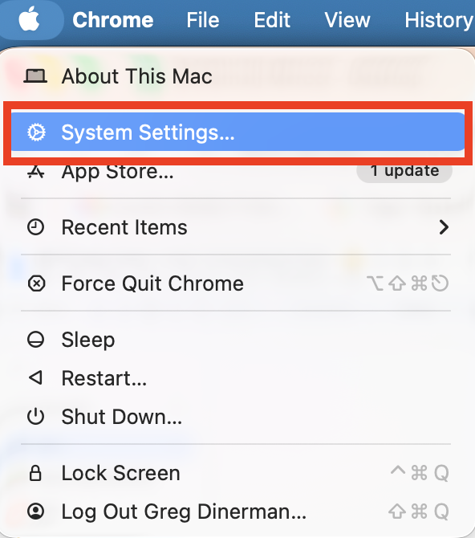

    > *Text shown in the image:* Task Recorder window (macOS TaskRecorder app, Sign Out button). Audio / Video: preview, Screen: Display 1. Task Description: “Use Android Studio Logcat to diagnose a runtime issue in an Android application by capturing relevant application logs, filtering them by application process and log level, searching for the relevant error, and identifying the cause of the failure. The result will provide a clear diagnostic finding that an Android developer can use to troubleshoot the application.” Used Apps: (Add app name…) Android Studio. Status: Idle · Start Recording · Stop Recording (disabled) · Show Recordings

- **Menu bar & Dock:**
    - **Menu bar:** the clock on the menu bar should display seconds (HH:MM:SS).
    - **Dock:** Visible at least at the beginning and the end of recording, with the **Accessibility Inspector** opened in the dock with a dot at the bottom.
        - Dock at the bottom of the screen → **BANNED, Request Edits**
        - Dock at the left/right of the screen → **preferred**
- **UI Diversity:**
    - **At least one element must be changed to create a diverse desktop** **<u>environment (this does not include dock position):</u>**
        - dark vs light mode
        - colors
        - resolutions
        - wallpaper
        - size of icon
        - theme
    - Mouse cursor size and color must stay default.

**Intro Steps**

1. Desktop setup (opening apps, changing UI elements, etc.) and draft the task description document
2. Minimize all apps to the dock
3. Leave the task description document open on screen
4. Open the TR window and click **Start Recording**
5. Minimizing TR window
6. Narrate “I will be beginning my task soon. Here is the workflow I have in mind.”
7. Wait a few seconds
8. Minimize task description
9. This marks the start of the task

***Task Review***

- The video demonstrates **domain expertise**.
    - **Domain Expertise:** We expect workflows that show knowledge relevant to the industry for each task. We want **unique** and **complex** tasks.
        - Expertise can also be demonstrated through **insightful narration explaining the “why”**. A task with a simple, basic UI workflow is still only valid if the app requested by the client is simple and basic in nature. A task should be approved if the writer’s narration clearly demonstrates expert-level knowledge of the subject matter
        - The final deliverable should look like a typical industry output, with good spelling and grammar. If the deliverable is code, it must function as intended.
            1. Some apps have limitations, and domain expertise shows in the creation rather than the output. For apps that contain these limitations, a screenshot or other mode of output is acceptable. **The task as a whole should still demonstrate domain expertise.**
- **App usage:**
    - A single-app task is acceptable. Do not request extra apps solely to reach an app count. Assess the professional workflow, skill, judgment, and deliverable requirements above.
    - Apps used during the tasks must match those listed in Studio.
    - Do not list the browser when it’s only used to open web apps (e.g., Google Docs in Opera). List the web apps themselves. A browser is listed only when it’s used as an app in its own right.
    - All listed apps need to provide meaningful contribution to the deliverable; meaningful work must be performed in all of the apps.
        - **For example:** If copying text from GDoc to Pages, this is not meaningful.
    - The notes app used in setup should not be listed in the AT unless used during the task.
- **AI Use:**
    - No AI tool or AI Mode interaction in the task is allowed
        - Use AI-generated input files → **Allowed**
        - Interacting with any type of AI or using AI to generate content during recording → **Not Allowed**
        - **Google interaction:**
            1. Looking at AI Overview search results or clicking **Show more → Allowed**
            2. **Interacting/communicating/chatting** with **Ask Anything** (for instance, asking a prompt in Ask Anything) → **Not Allowed**
        - Passive enhancement / ordinary built-in functionality → **Allowed**
- **PII & Copyrights:**
    - No personal accounts used or personal information shown.
    - Project information alone does not block approval. Continue checking independently for PII and other blocking issues.
    - Only use CC0/Public Domain images and files.
    - Input files should also be PII-free, royalty-free, and have no copyright information (CC0).
    - See the [PII and Royalty-free Issues](https://docs.google.com/document/d/1ChVlHBYVIXAYcGnAjE2edkFv_3qRFqYZZq5fBykuad8/edit?tab=t.twrf2ph0xlje) page for more details.
- **Mouse movement:**
    - The mouse should be continuously moving most of the time.
        - Typing doesn’t count as mouse movement; the cursor should not be idle for >45s in an instance outside the closing epilogue. The epilogue may be still. AutoQC excludes the final 5 minutes from its mouse-idle check; this technical buffer does not increase the 4-minute epilogue maximum.
    - Most actions should use the mouse rather than the keyboard. Typing fails when it takes up over 25% of the total recording time, or over 35% for Coding / Content & Writing tasks. Exactly 25% (35% for Coding / Content & Writing) does not fail this item.
    - Clicks should be deliberate and unrushed.
- **Audio: See detailed instructions on Audio Guidance** **<u>here</u>**
    - **Narration** should be from the Intro through the end of the recording.
        - Natural, clear, and aligned narration of actions and thought process.
        - No major pauses.
        - **Narration cadence, workflow actions, and interactions** should not be rushed.
        - Must follow the What, Where, Why criteria.
            1. No **<u>"this", "that", or "here".</u>**
                - ❌ Bad Examples:
                    - I’ll click on this button
                    - I need to change that value.
                - ✅ Good Examples:
                    - I’ll click the blue Export button in the top right corner.
                    - I need to change the font size, which is currently set to 12.
    - **Background noise obscuring 30–40% of the narration = option 2. Option 3 = N/A. Over 40% of the narration = option 4. Loud typing is acceptable if narration remains clear.**
- **Window Management:**
    - Writers should use the available screen space effectively. When possible, maximize application windows or arrange them side by side.
    - Writers should work to cover the desktop background. Small floating windows are not preferred.
    - **Side-by-side** window arrangement is encouraged
    - If more than **<u>~25% of a window or application</u>** is covered by other windows/apps, it should be minimized within 6 seconds.
        - ***Exception:** Slight delays are allowed if the writer clearly notices the overlap immediately and makes a dedicated, immediate effort to fix it (e.g. they are narrating while minimizing the window or moving the mouse slowly).*
    - Windows important for the task and the current sub-task can remain un-minimized if they are clearly visible and logically arranged.
    - **In-app Popups:** Temporary popups or dialogs within the same application are allowed while actively used. They should be closed afterward.
- Filling out **Metadata.rtf** should **NOT** be shown in recording
- **English is required as the primary language.** Narration, deliverables, webpages, and app menus must all be in English
- **NEW - Epilogue narration (ideas originally approved at or after Oct 19, 2026, 6PM PT)**
    - For Full Workflow, ideas originally approved before October 19, 2026, 6 pm PT (PDT) remain exempt from the epilogue, including after later revision or reapproval. Writers still tick the epilogue checkbox to confirm either a completed required epilogue or the pre-cutoff exemption; they must not tick it if neither condition is true. **For the time being, do not fail, send back, or require re-recording solely because an epilogue is missing, regardless of idea approval date.** This manual checkbox is separate from AutoQC: assess written disputes using the task and relevant timestamps. If submission remains blocked, ask the writer to send the task link and exact error to #odin--helpdesk. After the task is finished and before the writer closes the task recorder, they must provide a brief summary of their work (target: 3-4 minutes; maximum: 4:00; no 3-minute minimum), an assessment of whether the task was completed, any relevant reflections, or other important highlights: Possible topics include:
        - **Completion and outcome:** How did you verify the successful completion of the task? Were there any limitations?
        - **Approach and key decision:** What was your overall approach? Why did you choose this approach?
        - **Challenges and problem solving:** What was the most difficult, ambiguous, or unexpected part? Did you encounter any errors or need to change your approach? How did you resolve the issue?
        - **Quality assessment:** How would you evaluate the quality of your final result? Ar there any weaknesses or potential issues with the result?
        - **Reflection and improvement**: If you were to do the task again, what would you do differently? If you had additional time, what would you improve or verify?
        - **Insight:** What is one important principle, consideration, or common mistake that someone less experienced might overlook when performing this type of task?
        - **<u>Mouse is permitted to remain idle during the epilogue narration</u>**

### <u>Post-Video Review</u>

- **Download and verify deliverable.zip files match the recording:**
    - Everything below needs to be included in the deliverable.zip:
        - **Input File:** Any original starting files prepared in advance(e.g., file, image, etc.); the original and unedited files are clearly labeled using the format: ‘input 1’, ‘input 2’, etc.
        - Websites the writer only visits for research or context (e.g., reading documentation, looking up reference data) are not input files. Don't fail a task for not including them in deliverable.zip or Final Notes.
        - **Intermediate Artifacts:** Any files downloaded during recording, intermediate deliverables, or work-in-progress artifacts created during the task must be clearly labeled using the format: ‘artifact 1’, ‘artifact 2’, etc.
        - **Final Output:** The final product produced by the expert, clearly labeled as ‘final output 1’, ‘final output 2’, etc.
    - **<u>Example:</u>** If a writer prepared a photo in advance, edited the photo using PhotoPea, and added the photo to create a slide, they will include the following in the deliverable.zip:
        - Unedited/original photo → input 1
        - Edited photo → artifact 1
        - Slide → final output 1
- **Rate the writer** using the <u>Reviewer Checklist</u>.
- **Update Studio fields if needed:**
    - **If you need to change a task field,** explain what needs to be changed and why. Include this in the **Reviewer Comments** and as an **Internal Note**.
- **Add Internal Notes**: *These are notes that the writers will not see. They are for QC and EPMs only.*
    - Add anything that you want to pass to QC, any minor issues that you find which do not affect approval, and/or any strengths in the task that override the minor issues. Pro tip: If you find yourself making a judgment call on an edge case, explain your reasoning for approving the task in the Internal Notes.
- **Add Reviewer Comments:** *These are notes that are writer-facing and should reflect the DM that you send them.*
    - Please use this template at the top of every review. Always put your most recent review of the task at the top.
        - MM/DD @ HH:MM TIMEZONE, Review #\_\_\_\_\_\_\_\_, REVIEWER NAME

***Decide if the Task is Approved or Request Edits***

**Approve:** If a 3-5 is selected for a task, it is approved.

- 4-5 = Approvable as submitted (No 3s or 4s)
    - Excellent = Approvable as submitted (No 3s or 4s)
    - Good, but writer needs some tips = Lower quality, but likely useful (a couple of 3, but no 4s)
- 3 = Lower quality, but likely useful (No 4s)
    - Edge Case = Some 2s and 3s but no 4’s.

**Needs Edits:** If a 1-2 is selected, it is sent back to the writer for revisions.

- 2 = Needs revisions
    - Fair = Mostly 3s and at least one 4; Needs Revision.
- 1 = Needs revisions, task not salvageable
    - Poor = Mostly 3s and 4s, Needs Revision.

**QUALITY CLARIFICATION: DO NOT send tasks back solely because pauses after clicks are shorter than one second.** The exact threshold is under review. Continue assessing pacing and followability using the existing review standards.

***Needs edit reason***

If the task is being sent back for revisions, you will be asked to select every reason from the following reasons why:

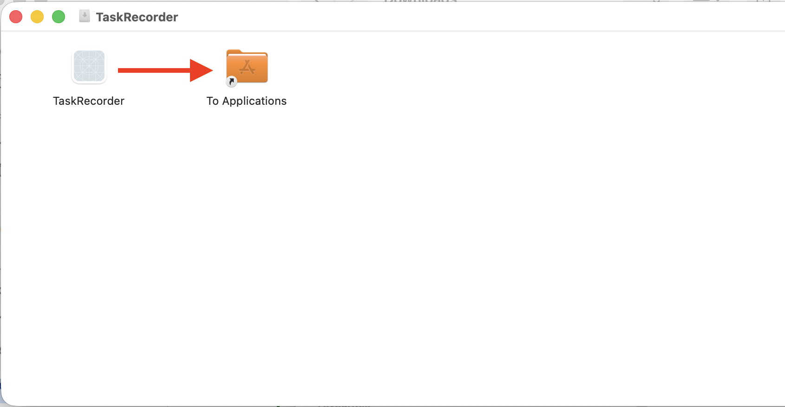

> *Text shown in the image:* Send-back reason chips. **Re-record:** No Deliverable · No/Incomplete Setup · Extended Pause(s) or Too Much Typing · Narration/Audio Issues · Poor Window Management · Restricted App Open/Used · Task Length is below threshold. **Files / metadata:** Observable PII/Paywalled Content · AI Used in Setup or Task. **Clarification:** Lacks Professional Domain Expertise · Other (Explain in Reviewer Comments)

***Feedback field***

**IMPORTANT!**

At the very end, send a Slack DM of your feedback to the Writer. Use the <u>DM Templates</u> for each flag in the task.

*These are visible to the writer and should be identical to the DM that you send them after you complete the review of the task.*

- Begin each review comment with:
    - Review \[#\]: \[MM/DD/YYY\] @ \[HH:MM TIMEZONE\] Reviewer: \[Name\]

**Always add the most recent comment at the top.**

The goal for reviewers is to leave no more than 1-2 sentences of personalized feedback to writers, regardless of whether the task is failed or approved. Please take this opportunity to advise writers on how to improve, provide encouragement, or congratulate them on submitting great work.

# Reviewer Checklist

Below is the Project Odin Reviewer checklist that will be used to verify the quality of tasks on Project Odin. When reviewing a task, you will be selecting which tolerance criteria have been met for each checklist item, which is on the following scale:

- 1 = Within client tolerance
- 2 = Within acceptable tolerance
- 3 = Within edge case tolerance
- 4 = Failing tolerance

Some checklist items have binary tolerance criteria - they either fulfilled it (1 = Yes) or they failed to meet it (4 = No). Other checklist items have a range which will be described within each checklist item.

|   |   |   |   |   |
|---|---|---|---|---|
| **Checklist item** | **Criteria** |   |   |   |
|   | **1 = Within client tolerance** | **2 = Within acceptable tolerance** | **3 = Within edge case tolerance** | **4 = Failing tolerance** |
| **1. \[Automated but PLEASE manually check\] Metadata.rtf matches the task (apps, workflow)** | Yes | Metadata.rtf >80% similar to the TaskRecorder Goal and to Studio | Metadata.rtf >70% similar to the TaskRecorder Goal and to Studio | Metadata.rtf &lt;70% similar to the TaskRecorder Goal or to Studio |
| **2. \[Automated but PLEASE manually check\] No unused window covers >25% of another for >6 s** | Yes | An unused window covers >25% of another (or is entirely covered by the window in use) for 6–30 s | N/A | An unused window covers >25% of another (or is entirely covered by the window in use) for >30 s with no clear effort to fix within time |
| **3. \[Automated but PLEASE manually check\] Narration says what, where and why for every action** | Yes | ≥70% of actions have 2 of the 3 Ws | N/A | Under 70% of actions have at least 2 of the 3 Ws (an action is anything that changes the state of the document) |
| **4. \[Automated but PLEASE manually check\] Eyes closed test: Viewer clearly understands what actions are being performed in the video with eyes closed (no 'click here', 'change this')** | Yes | ≥70% of actions have 2 of the 3 Ws | N/A | Under 70% of actions have at least 2 of the 3 Ws |
| **5. \[Automated but PLEASE manually check\] Screen recording shows the workflow described in the task** | Yes | N/A | N/A | No |
| **6. \[Automated but PLEASE manually check\] The menu bar clock shows seconds.** | Yes | N/A | N/A | No |
| **7. \[Automated but PLEASE manually check\] The task description document is shown at the start of the recording.** | Yes | N/A | N/A | No |
| **8. \[Manual\] Intro is under 20 seconds: writer says the intro sentences, minimizes the Goal document, then starts.** | Yes | 21-60 s | N/A | >60s |
| **9. \[Automated but PLEASE manually check\] Filling out Metadata.rtf is not shown in the recording.** | Yes | No, filling out Metadata.rtf shown for 10 s or less |   | No, filling out Metadata.rtf shown for >10 s |
| **10. \[Automated but PLEASE manually check\] Typing takes up 25% of the video or less (35% or less for Coding / Content & Writing tasks).** | Yes | Typing takes up ≤25% of the video (≤35% for Coding / Content & Writing); does not fail. | N/A | No, typing takes up >25% of the video (>35% for Coding / Content & Writing). |
| **11. \[Automated but PLEASE manually check\] Every silence lasts 45 seconds or less.** | Yes | 46–60 s | N/A | Over 60 s |
| **12. \[Automated but PLEASE manually check\] The narration audio is clear, with no background noise making it hard to hear. (Exception: loud typing is fine as long as it does not make narration unclear.)** | Yes | No, background noise 30–40% of the narration | N/A | No, background noise over 40% of the narration |
| **13. \[Manual\] The TaskRecorder window only appears when starting or stopping the recording.** | Yes | N/A | N/A | No |
| **14. \[Manual\] The writer pauses for at least 1 second after each mouse click (i.e. they don't click too fast)** | Yes | No, missing in 1-6 segments | No, missing in 6-12 segments | No, the writer consistently clicks too fast |
| **15. \[Manual\] The recording is free of disallowed AI use.** **Ordinary incidental enhancement may be acceptable; substantive AI task tools are not automatically allowed.** **Follow the detailed AI guidance and escalate unclear cases.** | Yes | No, Google AI Overview (no follow-ups), autocomplete, SWE/ML | N/A | No, AI interaction present |
| **16. \[Manual\] The recording is free of personal information (PII), both on screen and in the audio. Check app account corners (Office, Google, browser profile), Finder and save-dialog paths, and the last few minutes.** **See the PII and Royalty-free Issues tab for real examples that slipped through.** | Yes | N/A | N/A | No |
| **17. \[Manual\] Deliverable assets meet the applicable licensing requirements. Apply the PII and Copyright Issues guidance, including public-repository exceptions; merely browsing a website with a trademarked logo does not fail.** | Yes | N/A | N/A | No |
| **18. \[Manual\] The narration and everything on screen are free of profanity.** | Yes | No, minor profanity on screen, not typed by the writer | N/A | No, profanity said or typed by the writer, or more than minor on-screen profanity |
| **19. \[Manual\] Task is recorded in English and all task materials are in English** | Yes | N/A | N/A | No/Cannot verify |
| **20. \[Manual\] Recording includes an epilogue narration (a narrated summary of how the task was verified, the approach, challenges, quality, and reflections) of 4 minutes or less, before stopping recording (only for ideas originally approved at or after Oct 19, 2026 6PM PT). Target 3-4 minutes with no 3-minute minimum. All duration bands over 4:00 exceed the maximum; they record severity, not an allowance for extra duration. Additional unscored response: “Missing epilogue — does not block approval.” Use this dedicated response for a missing epilogue rather than N/A; it must not count as a numeric failure. Do not fail, send back, or require re-recording solely because an epilogue is missing, regardless of idea approval date.** | Yes | No, narration length is between 4:01-4:30 mins (exceeds the 4:00 maximum) | No, the narration lacked detail / length is between 4:31-5:00 mins (exceeds the 4:00 maximum) | N/A |
| **21. \[Manual\] The task contains sufficient complexity / domain expertise (e.g., multi-step workflow, domain judgement, use of multiple tools, output that would be produced for real work)** | Yes | A non-expert can do &lt;10% of actions | N/A | No, a non-expert can do >10% of the actions |

### <u>AutoQC checks of task elements (for reference purpose):</u>

---

These checks have been removed from the checklist as AutoQC has enough precision and recall to identify these issues. **HOWEVER, if you do see a mismatch between an AutoQC flag and one of these items, please flag it in your review feedback. You may send back tasks for violations of these items.**

1. All four task files uploaded (MP4, deliverables.zip, Task Recorder zip, Metadata.rtf)
2. Task Recorder zip contents complete, screenshots present
3. video.mp4 opens
4. Deliverables named correctly
5. Metadata.rtf matches the task (apps, workflow)
6. Video length within 15 to 54:59 minutes
7. Dock stays visible (not covered) in the start and end of recording
8. No unused window covers >25% of another for >6 s
    - a. **Major flag:** Unused window covers >25% of a task for >30s
    - b. **Minor flag:** Unused window covers >25% of a task for 6-30s
9. Mouse never idle >45 s
    - a. **Major flag:** Mouse idle for >90s
    - b. **Minor flag:** Mouse idle for ≥3 stretches within 45–90s
10. Narration says what, where and why for every action
11. Narration names what and where, no 'click here' / 'change this'
12. Screen recording shows the workflow described in the task
13. Metadata.rtf apps match the apps listed in Studio
14. Dock is not positioned at the bottom of the screen
15. Accessibility Inspector icon is visible in the Dock with a dot underneath
16. Accessibility Inspector window is not visible during the recording (exception: first-time writers)
17. At least 1 UI element has been changed from the default Mac setup
18. The task contains zero use of restricted apps
19. Narration cadence and workflow interactions are followable at normal speed

## PII and Copyright Issues

**No PII (Personally Identifiable Information) should be visible during the recording of the task, including in any of the input files**:

Any information that can identify a real person, such as:

- Writer’s full names
- email addresses
- phone numbers
- home addresses
- account numbers
- biometrics
- Mac Address
- etc.

**Where reviewers most often miss PII (4 send-backs on Oct 19-20):**

**• A writer's name and profile photo in PowerPoint's account area (top right) at 22:10.**

**• A writer's full name on screen at 34:59, near the end of the recording.**

**• A username visible in a Finder path at 5:03.**

**• A personal Chrome login with the profile photo showing in the top right of the browser.**

**How to check quickly: scrub to the start, every app switch, every save or export dialog, and the last few minutes, and look at the top-right corner of each app window and the Finder sidebar each time. A single frame with a real name, photo or personal email is a send-back.**

**Edge cases:**

- If the full name is of a public figure → **OK**
- If the full name is not combined with any other information that can increase the specificity → **OK**
    - Sandy Jones (alone) → **OK**
    - sandyjones@walmart.com → **PII** (identifies a person + company)
    - sandyjones@example.com → **Not PII** (example domain / not meaningfully identifying)
- If the name/email/phone number is obviously made up and fake, e.g. John Smith or [johnsmith@example.com](mailto:johnsmith@example.com) or 123-456-7890 → **OK**
- @mercor.expert account names → OK
- IP addresses → **OK**
- Mac Serial Number (found in the *Hardware Overview* page in *System Information.app*):
    - Standalone MAC serial numbers → **OK**
    - MAC serial number **PLUS** IPV6 → **PII**
- If you are unsure whether something is a PII issue, post in #odin-reviewers-hub.

@mercor.expert emails, or obviously fake name/email/phone numbers, are allowed. (Assigned OTA accounts are retired; TaskRecorder 2.4.4 has no sign-in.)

**<u>Ideally, project information is also hidden, including references to:</u>**

- **<u>Mercor</u>**
- **<u>Project Odin</u>**
- **<u>Project Odin Writer Guidelines</u>**
- **<u>Studio instructions</u>**

**<u>This will be tolerated in small quantities and should not lead to task rejection on its own.</u>**

**<u>EXCEPTIONS:</u>** Public profiles such as authors of publications or GitHub users from public GitHub repositories do not count as PII.

**SWE/ML/DS tracks: Public Repositories Exception**: Currently, the exception to the rule is for tasks involving gitflow, where the task involves pulling repositories from GitHub. Despite this, only public repositories are allowed; even then, steer toward repositories with MIT, BSD, Apache 2.0, CC0, public domain, ODC-by, or PDDL licenses, as these licenses are widely considered compliant under copyright laws. Licenses are typically found in the repository root or in [README.md](http://readme.md), under names like [LICENSE.md/LICENSE.txt](http://license.md/LICENSE.txt) or COPYING.txt.

**CC0/Public Domain Only:** If the task requires downloading images, videos, or assets, ensure they are under [CC0 license](https://creativecommons.org/public-domain/#:~:text=CC0%20Public%20Domain%20Dedication) or in the Public Domain.

This only applies to information that ends up in the Deliverable.zip. Browsing a website with a trademarked logo is acceptable.

- **Copyright:** a clear watermark (**exception: Gemini watermark**) or copyright logo → reject, unless it is CC0. Escalate to EPM if unsure.

**Note:** Please do not recommend a website to a writer unless you are 100% certain its content is under CC0 or its Terms & Conditions allow AI/ML training.

**Search & AI (and how to distinguish cases)**:

- Google Search only, including links in the AI overview, even in “Show more,” but **<u>no</u>** interaction with AI Overview “Ask anything”, **is allowed.**
- Generative/conversational AI → **Request Edits**.
    - Any prompting, chatting, follow-up question, AI Mode, Gemini/ChatGPT/Claude use, Google AI Overview “Ask anything,” or AI-generated task content during setup/task recording is not allowed.
- AI-powered task tools → **Request Edits.**
    - If an app feature uses AI/ML to perform substantive task work, such as identifying a subject, selecting/masking an object, generating text/images, summarizing, classifying, etc, request edits.
    - Example: Photoshop subject identification used to create/edit the deliverable.
- Passive enhancement / ordinary built-in functionality → **Escalate if unclear; may be acceptable**.
    - If the feature is not presented as AI, involves no prompting/generative AI, and only performs incidental quality cleanup rather than substantive task work, it may be acceptable.
    - Example: Voice Memos Enhance Recording was treated as an edge-case exception when no AI agent interaction occurred, and the task was otherwise strong. Escalate similar cases before rejecting.
- SWE/ML/AI exceptions → **Acceptable/Escalate if unclear**
    - For SWE tasks, writers may use code that includes an AI/ML component (such as building foundation models). Running the code may be acceptable **<u>only if</u>** it is part of normal SWE validation and not being used as an external assistant to complete the task.
    - Escalate ambiguous cases.

## Audio-specific Guidance

Narration must include thought process and actions (i.e., mouse movements, clicks, and scrolling, step by step)

### <u>Pacing and Audio Quality</u>

- **Avoid Rushing** - Ensure all clicks and actions are narrated at a deliberate, measured pace. Workflows and mouse interactions should be in sync with narration. Rule of thumb: if you need to slow the video down to .75x speed, or pause and rewind for more than 30% of the recording, it is rushed.
- **Audio Environment** - Ensure there is no background noise when recording audio. Ideally, use headphones with a dedicated microphone when available to maintain clear audio quality.
- **Pause After Clicks** - Experts should wait 1 second after clicking on something.

### <u>Narration is trying to meet 3 criteria:</u>

1. **What** - What physical action produces the interaction (scroll, right-click, left-click)?
2. **Where** - Where on the screen does the interaction take place (top left, bottom right, left panel)?
3. **Why** - Why is this interaction important? What does the interaction do (closes the app, saves the doc, etc.)?

### <u>Common Pitfalls:</u>

- Failing to narrate each major step of a workflow as it happens.
- Long introduction
- Long gaps without audio.
- No narration of shortcuts. All shortcuts used must provide keystrokes and resulting action.
- Narration that is difficult to hear/understand.
- Noise or audio distractions interfere with intelligibility.
- Referencing the task description verbatim. The task should be described naturally, as it happens.
- Golden narration is clear, concise, coherent, easy to understand, logically structured, and directly supports the steps being shown, while still allowing for a natural speaking style, such as natural pauses or conversational fillers.
- Note: Natural conversational fillers like “uh” or “um” are acceptable; the goal is simply to avoid extended, off-topic tangents.

## Studio Idea review

- Idea review is separate from task (recording) review.
- Idea reviews happen in Studio, in the **Odin Production Full Workflow** world.
- Idea checks are mostly automated. Distinct ideas are approved automatically so the writer can start recording.
- Ideas the model can't verify appear as **Needs Review** in the review queue.

    Watch a walkthrough video:

    [https://mercor.enterprise.slack.com/files/U0AEX1WLK88/F0C815XMYG5/video.mp4](https://mercor.enterprise.slack.com/files/U0AEX1WLK88/F0C815XMYG5/video.mp4)

1. Head to the Review Queue in Studio and check if you have selected the **Odin Production Full Workflow** world in there.

    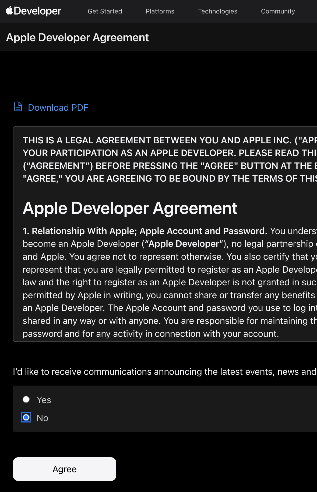

    > *Text shown in the image:* Studio — Review queue (Odin Production Full Workflow). Left menu: Odin ▾ · Project Guide · Announcements · Tasks (Tasks, Worlds) · Dashboards (Available to claim, My tasks, **Review queue** (selected), My current reviewed tasks, My reviewed tasks, QC Queue, Leaderboard, Task Status Counts, Total Video Length, Writer Quality). Main: “Review queue — Filtered tasks in Odin Production Full Workflow”; workflow selector “Odin Production Full Workflow”; + Create Task. “Tasks awaiting review that you can claim.” Toolbar: Filter · Columns · Group · Page 1 of 1 · 74 tasks · Showing 1–74 of 74 · 100 rows. Columns: Task Name · Task Status · Created By · Updated By · Needs Attention From · Created At · Prompt/De… (cut off). Rows (Needs Attention From and Prompt columns show —): Task dmevb8b0 — Needs Review — [EXP] Cecile E / [EXP] Cecile E — 09/10/2026, 8:04:10 BST Task 12y2baed — Needs Review — [EXP] Alexandra R / [EXP] Alexandra R — 08/10/2026, 15:06:39 BST Task wgl7bb6c — Needs Review — [EXP] Philbeth O / [EXP] Philbeth O — 09/10/2026, 0:22:55 BST Task 15f885fc — Ready for Review — [EXP] Sumit J / [EXP] Sumit J — 08/10/2026, 18:50:39 BST Task ffj0b55f — Ready for Review — [EXP] Jay N / [EXP] Pradhuman S — 08/10/2026, 12:57:50 BST Task 1tie47df — Ready for Review — [EXP] Vamsy C / [EXP] Vamsy C — 08/10/2026, 16:59:12 BST Task 5nyt4887 — Ready for Review — [EXP] Aarju U / [EXP] Aarju U — 08/10/2026, 17:02:11 BST Task 1jt5dcdf — Needs Review — [EXP] Yan M / [EXP] Yan M — 08/10/2026, 16:03:06 BST Task x2xldad9 — Needs Review — [EXP] Basil P / [EXP] Basil P — 08/10/2026, 22:03:26 BST

2. Look for the Task Status **‘Needs Review’**. Open the idea>claim idea review and skim-read through the goal, starting point, suggested apps, and reviews and checks.

    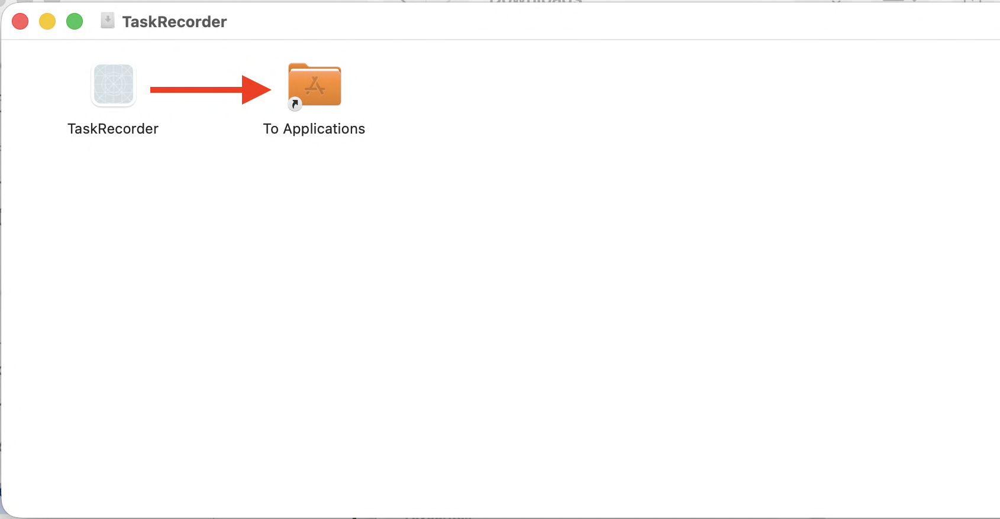

    > *Text shown in the image:* Task contents (left list): Your idea → Goal · Starting point · Apps · Result and che… · Previous work · Idea check res… · **Idea check det…** (selected) · Review decision · History. Main: Feedback (box) · **Idea check details (reviewers)** — Sent back: close to one existing task. The proposed knowledge-base reorganization substantially repeats the website-inventory-to-sitemap workflow: both group existing content into a navigable hierarchy in Miro. The other supplied library tasks share narrower classification or structuring steps but have different core decisions. Human approval is still required. Similarity check — • Organize an unstructured website content inventory into a clear two-level sitemap so users can find key information efficiently and the design team has a defined structure for the (task_84ff204442b046ae8cd563a861308ac1): substantial overlap. Shared: Both take an unstructured inventory of existing content, group related items, and define a navigable two-level information hierarchy in Miro. Different: The website sitemap also distinguishes primary … (text cut off in the screenshot). Review decision — button: Claim idea review · ▸ History

3. Read through the results generated in the **Idea check details (reviewers)** section to compare the model’s findings to similar tasks in the project and check the same against the guidelines provided here**.**

    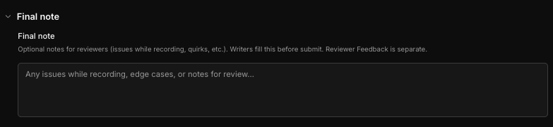

    > *Text shown in the image:* Idea check details (reviewers) — Sent back: close to one existing task. The proposed knowledge-base reorganization substantially repeats the website-inventory-to-sitemap workflow: both group existing content into a navigable hierarchy in Miro. The other supplied library tasks share narrower classification or structuring steps but have different core decisions. Human approval is still required. Similarity check — • Organize an unstructured website content inventory into a clear two-level sitemap so users can find key information efficiently and the design team has a defined structure for the (task_84ff204442b046ae8cd563a861308ac1): substantial overlap. Shared: Both take an unstructured inventory of existing content, group related items, and define a navigable two-level information hierarchy in Miro. Different: The website sitemap also distinguishes primary … (text cut off in the screenshot).

4. Please complete the Idea review by adding your decision to the ‘Review’ panel to the left. Add feedback and either **Approve, Reject, or Send back to the Writer**.

    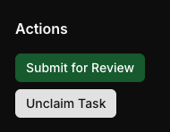

    > *Text shown in the image:* Idea review screen. Left list (Task contents): Your idea → Goal · Starting point · Apps · Result and che… · Previous work · Idea check res… · Idea check det… · Review decision · History. Your idea → Goal — What are you trying to accomplish? (Include the purpose and who will use the result.) “As a Pharmacovigilance Scientist in the UK, I have been tasked with reviewing a set of clinical trial adverse event (AE) cases to determine whether each event meets the defined seriousness criteria. I will compare the case narratives with the structured safety data, assess the applicable seriousness criteria, document the rationale for each classification, and identify any inconsistencies or missing information requiring clarification. I will produce a completed SAE Assessment Matrix and a concise summary of the key findings and recommended follow-up actions for a pharmacovigilance reviewer.” Starting point — Existing material means files, data or a project you already have before recording. Options: Starting from scratch · **Using existing material** (selected). What is already available? (For example: A workbook with cleaned sales data, but no charts or calculations.) “A self-created dataset containing approximately 12-15 clinical trial adverse event cases, including structured case information and supporting narratives, alongside a predefined AE/SAE Seriousness Assessment Reference Checklist prepared before recording. The cases will cover a range of seriousness considerations, including death, life-threatening events, hospitalisation, persistent or significant disability, congenital anomalies and medically important events. Some cases will contain incomplete or inconsistent information requiring further assessment. All materials will contain no real patient, sponsor or confidential clinical trial information.” Right panel — **Review:** chips: Narration/Audio Issues · Poor Window Management · Restricted App Open/Used · Task Length is below threshold · *Files / metadata:* Observable PII/Paywalled Content · AI Used in Setup or Task · *Clarification:* Lacks Professional Domain Expertise · Other (Explain in Reviewer Comments). Feedback (text box). Review History: No previous review rounds yet. Buttons: Approve idea · Reject idea · Send back to writer · Save

# QC auditor guidelines

## Before you start

Bookmark the [QC Resources canvas](https://mercor.enterprise.slack.com/docs/T09M1S7BCMR/F0B967AFF26). It has every link you need in one place.

- 

## Claiming and completing QC

Finish each QC in one sitting where possible. Finish each QC in one sitting where

- 

    possible. If you need more time, check in with an EPM, then select Extend Review Claim on the right of the task page. The QC AHT target is under 45 minutes on average per completed QC. Individual QCs can take longer when needed.

    QC AHT policy assessment uses the last seven complete Pacific calendar days

- 

    (America/Los\_Angeles), ending at midnight PT at the start of today and advancing daily. Calculate AHT as (eligible logged QC hours in that window × 60) ÷ completed QC decisions in the same window. Pool hours and decisions across all seven days; do not average daily AHTs. Dashboard display/report filters do not change the policy assessment window.

    If you need more time, **check in with an EPM**, then select **Extend Review**

    - 

        **Claim** on the right of the task page.

**Watch the full recording**, and judge followability at normal (1x) speed.

- 

    **Complete the entire QC even if you know early that it's a send-back.** Complete the

- 

    checklist thoroughly so the writer can fix it all in one pass.

    Leave feedback for the writer on every task, whether it is approved or sent back

- 

## What to check for reviewers

Along with the task itself, look over the reviewer's work.

The reviewer completed every item on the Reviewer Checklist, and their answers match

- 

    what you see in the recording.

    No **critical checklist items** were missed

- 

    Every review comment is tied to checklist items, and the reviewer notes are clear and

- 

    helpful. Comment is 1-2 sentences.

    Mistakes in Metadata.rtf were corrected, and the AutoQC results were validated.

- 

    The send-back rules were followed (see QC rules to remember).

- 

**If you want to give the reviewer feedback, leave it in the Internal Notes text box or DM them.** If you see the same reviewer missing the same thing more than once, flag it to an EPM.

## QC rules to remember

The same send-back rules apply to QC as to reviewers:

- 

    Complexity send-backs are for Review 1 only. On a resubmission, do not send

    - 

        back for complexity. If the task is otherwise approvable, approve it and note your concern in Internal Notes.

    - If the Reviewer raised the complexity issue in R1 and the writer didn’t fix it, then R2 can send back.
- **NEW - We have aligned the QC checklist to the reviewer checklist** If the recording differs from the Task Description or the app listed, and the task is
- 

    otherwise approvable, note it in Internal Notes and approve.

    If the reviewer missed a mistake in Metadata.rtf, correct it and re-upload the file.

- 

    **When you are unsure** (Narration, PII edge cases, passive AI features, SWE/ML

- 

    exceptions), **escalate before you decide.** Post in the QC channel or check with an EPM.

- For the condition ‘Narration says what, where and why for every action,’ please align to the following condition:
    - **If the task contains ≥70% of 2 of the 3 of where, what, and why in its narration, IT IS APPROVABLE!!**

## AutoQC checks

You are asked to verify various AQC flags on the task. For each flag, compare with the recording and make your assessment of what tolerance criteria it aligns with. If the writer disputed a flag, check their explanation against the recording and score what you see. Mention in your comment whether you agreed with the dispute.

Minor (advice) flags never block approval on their own. Score the checklist items as usual.

### <u>Possible AQC cards on the task:</u>

**Files and deliverables**

- Metadata.rtf matches the task (apps, workflow): see checklist item 1.
    - Fails when Metadata.rtf is under 80% similar to the TaskRecorder Goal or Studio.

**Recording**

- No unused window covers >25% of another for >6 s: see checklist item 2.
    - 6–30 s = option 2; over 30 s with no clear effort to fix within time = fail (4). If 6–30 s of overlap is the only issue, approve with a short growth note.
- Mouse never idle >45 s (no checklist item; score it here on the same ranges):
    - 1: never idle over 45 s.
    - 3: idle 45–60 s, one to three times.
    - 4: idle over 60 s at least once, or 45–60 s more than three times.
    - The closing epilogue is exempt.

**Writer performance**

- Narration says what, where, and why for every action: see checklist item 3.
    - Fails when under 70% of actions have at least 2 of the 3 Ws. An action is anything that changes the state of the document.
- Screen recording shows the workflow described in the task: see checklist item 5.

### <u>AutoQC checks of task elements (for reference purpose):</u>

---

These checks have been removed from the checklist as AutoQC has enough precision and recall to identify these issues. **HOWEVER, if you do see a mismatch between an AutoQC flag and one of these items, please flag it in your review feedback. You may send back tasks for violations of these items.**

1. All four task files uploaded (MP4, deliverables.zip, Task Recorder zip, Metadata.rtf)
2. Task Recorder zip contents complete, screenshots present
3. video.mp4 opens
4. Deliverables named correctly
5. Metadata.rtf matches the task (apps, workflow)
6. Video length within 15 to 54:59 minutes
7. Dock stays visible (not covered) in the start and end of recording
8. No unused window covers >25% of another for >6 s
    - a. **Major flag:** Unused window covers >25% of a task for >30s
    - b. **Minor flag:** Unused window covers >25% of a task for 6-30s
9. Mouse never idle >45 s
    - a. **Major flag:** Mouse idle for >90s
    - b. **Minor flag:** Mouse idle for ≥3 stretches within 45–90s
10. Narration says what, where and why for every action
11. Narration names what and where, no 'click here' / 'change this'
12. Screen recording shows the workflow described in the task
13. Metadata.rtf apps listed match the apps listed in Studio
14. Dock is not positioned at the bottom of the screen
15. Accessibility Inspector icon is visible in the Dock with a dot underneath
16. Accessibility Inspector window is not visible during the recording (exception: first-time writers)
17. At least 1 UI element has been changed from the default Mac setup
18. The task contains zero use of restricted apps
19. Narration cadence and workflow interactions are followable at normal speed

# Project Odin QC Auditor Checklist

Purpose

When reviewing a task, you select which tolerance criterion has been met for each checklist item.

**Ask:** *“For every item, which tolerance band does this recording actually sit in — and can I point at the moment that puts it there?”*

# Where this sits

*Read from the Odin Studio campaign on 20 Oct 2026. Confirm with an EPM before you rely on it if the flow has changed since.*

|   |   |
|---|---|
| **Field** | **Value** |
| World(s) in scope | Odin Production Core and Odin Production Full Workflow. Both run the same sampler and the same 21-item review form. |
| Status you audit at | Awaiting Final QC — the unclaimed pool. Claiming a task moves it to In QC Review. You leave it at QC Approved, Needs QC Revision or Rejected. |
| Audit sampling rate | 20% of tasks. The sampler draws when a task reaches Review Approved. The other 80% go straight to Ready for Delivery and are never audited. |
| Where you record the bands | The Review checklist card on the task’s review form. It has one field per item 1–21, then Writer’s Quality Score and Feedback. Odin Production Full Workflow also has Needs edits reason. |
| AutoQC module | Two modules run on every task: Odin upload checks and Odin narration checks. Their flags are the AQC cards described above. Odin recording shows task check and Odin Eyes Closed check exist but are switched off. |

# How to audit

1. Work items 1–21 in order. For each item, select which tolerance criterion has been met.
2. Use the four-point scale: 1 = within client tolerance, 2 = within acceptable tolerance, 3 = within edge case tolerance, 4 = failing tolerance.
3. Some items are binary — they were either fulfilled (1 = Yes) or they failed to meet it (4 = No). The rest give a range, written into the item’s own row.
4. Items 1–12 are automated, except item 8, which is manual. You are still asked to check them by hand, so do not score them from the automated result alone.
5. Cite a timestamp for every item you score at anything other than band 1, so the writer can find what you saw.
6. Please also refer to the AutoQC checks of task elements above - **if you see a mismatch between the AutoQC result and the recording, please flagt it in your reviewer feedback**

# Ground rules

|   |   |
|---|---|
| **Rule** | **What it means** |
| The four-point scale | 1 = within client tolerance · 2 = within acceptable tolerance · 3 = within edge case tolerance · 4 = failing tolerance. Record a band for every item, not only the ones that go wrong. |
| Binary items | Some items have binary tolerance criteria — they either fulfilled it (1 = Yes) or they failed to meet it (4 = No). Those items read N/A in bands 2 and 3. |
| Range items | The rest give a range, and the range is written into that item’s own row. Use the row, not your own judgement of how bad it looks. |
| No severity ranking | The guidelines grade by tolerance band only. They do not rank items as critical, major or minor, and this checklist does not add such a ranking. |
| Evidence | Cite the timestamp and the band you selected. “Item 11, band 4 — silence from 12:04 to 13:20”, not “too much silence”. |
| Not a defect | Loud typing, as long as it does not make the narration unclear (item 12). Ordinary incidental enhancement may be acceptable under the detailed AI guidance (item 15); substantive AI task tools are not automatically allowed, and unclear cases must be escalated. An epilogue under 3 minutes — item 20 sets a 4-minute maximum and no minimum. |

# Section 1 · Items 1–12 — mostly automated, but check them by hand

*Every item here except 8 is labelled “Automated but PLEASE manually check”. Item 8 is manual. A green automated result is never a band 1 on its own.*

|   |   |   |   |   |
|---|---|---|---|---|
| **Checklist item** | **1 = Within client tolerance** | **2 = Within acceptable tolerance** | **3 = Within edge case tolerance** | **4 = Failing tolerance** |
| \[Automated but PLEASE manually check\] 1. Metadata.rtf matches the task (apps, workflow) | Yes | Metadata.rtf >80% similar to the TaskRecorder Goal and to Studio | Metadata.rtf >70% similar to the TaskRecorder Goal and to Studio | Metadata.rtf &lt;70% similar to the TaskRecorder Goal or to Studio |
| \[Automated but PLEASE manually check\] 2. No unused window covers >25% of another for >6 s | Yes | An unused window covers >25% of another (or is entirely covered by the window in use) for 6–30 s | N/A | An unused window covers >25% of another (or is entirely covered by the window in use) for >30 s with no clear effort to fix within time |
| \[Automated but PLEASE manually check\] 3. Narration says what, where and why for every action | Yes | ≥70% of actions have 2 of the 3 Ws | N/A | Under 70% of actions have at least 2 of the 3 Ws (an action is anything that changes the state of the document) |
| \[Automated but PLEASE manually check\] 4. Eyes closed test: Viewer clearly understands what actions are being performed in the video with eyes closed (no 'click here', 'change this') | Yes | ≥70% of actions have 2 of the 3 Ws | N/A | Under 70% of actions have at least 2 of the 3 Ws |
| \[Automated but PLEASE manually check\] 5. Screen recording shows the workflow described in the task | Yes | N/A | N/A | No |
| \[Automated but PLEASE manually check\] 6. The menu bar clock shows seconds. | Yes | N/A | N/A | No |
| \[Automated but PLEASE manually check\] 7. The task description document is shown at the start of the recording. | Yes | N/A | N/A | No |
| \[Automated but PLEASE manually check\] 8. Intro is under 20 seconds: writer says the intro sentences, minimizes the Goal document, then starts. | Yes | 21-60 s | N/A | >60s |
| \[Automated but PLEASE manually check\] 9. Filling out Metadata.rtf is not shown in the recording. | Yes | No, filling out Metadata.rtf shown for 10 s or less | N/A | No, filling out Metadata.rtf shown for >10 s |
| \[Automated but PLEASE manually check\] 10. Typing takes up 25% of the video or less (35% or | Yes | Typing takes up ≤25% of the video (≤35% for | N/A | No, typing takes up >25% of the video (>35% |
| less for Coding / Content & Writing tasks). |   | Coding / Content & Writing); does not fail. |   | for Coding / Content & Writing). |
| \[Automated but PLEASE manually check\] 11. Every silence lasts 45 seconds or less. | Yes | 46–60 s | N/A | Over 60 s |
| \[Automated but PLEASE manually check\] 12. The narration audio is clear, with no background noise making it hard to hear. (Exception: loud typing is fine as long as it does not make narration unclear.) | Yes | No, background noise 30–40% of the narration | N/A | No, background noise over 40% of the narration |

# Section 2 · Items 13–21 — manual checks

*The guidelines label each of these “Manual”. Nothing automated covers them.*

|   |   |   |   |   |
|---|---|---|---|---|
| **Checklist item** | **1 = Within client tolerance** | **2 = Within acceptable tolerance** | **3 = Within edge case tolerance** | **4 = Failing tolerance** |
| \[Manual\] 13. The TaskRecorder window only appears when starting or stopping the recording. | Yes | N/A | N/A | No |
| \[Manual\] 14. The writer pauses for at least 1 second after each mouse click (i.e. they don't click too fast) | Yes | No, missing in 1-6 segments | No, missing in 6-12 segments | No, the writer consistently clicks too fast |
| \[Manual\] 15. The recording is free of disallowed AI use. Ordinary incidental enhancement may be | Yes | No, Google AI Overview (no follow-ups), autocomplete, SWE/ML | N/A | No, AI interaction present |
| acceptable; substantive AI task tools are not automatically allowed. Follow the detailed AI guidance and escalate unclear cases. |   |   |   |   |
| \[Manual\] 16. The recording is free of personal information (PII), both on screen and in the audio. Check app account corners (Office, Google, browser profile), Finder and save-dialog paths, and the last few minutes. See the PII and Royalty-free Issues tab for real examples that slipped through. | Yes | N/A | N/A | No |
| \[Manual\] 17. Deliverable assets meet the applicable licensing requirements. Apply the PII and Copyright Issues guidance, including public-repository exceptions; merely browsing a website with a trademarked logo does not fail. | Yes | N/A | N/A | No |
| \[Manual\] 18. The narration and everything on screen are free of profanity. | Yes | No, minor profanity on screen, not typed by the writer | N/A | No, profanity said or typed by the writer, or more than minor on-screen profanity |
| \[Manual\] 19. Task is recorded in English and all task materials are in English | Yes | N/A | N/A | No/Cannot verify |
| \[Manual\] 20. Recording includes an epilogue narration (a narrated summary of how the task was verified, the approach, challenges, quality, and reflections) of 4 minutes or less, before stopping recording (only for ideas originally approved at or after Oct 19, 2026 6PM PT). Target 3-4 minutes with no 3-minute minimum. All duration bands over 4:00 exceed the maximum; they record severity, not an allowance for extra duration. Additional unscored response: “Missing epilogue — does not block approval.” Use this dedicated response for a missing epilogue rather than N/A; it must not count as a numeric failure. Do not fail, send back, or require re-recording solely because an epilogue is missing, regardless of idea approval date. | Yes | No, narration length is between 4:01-4:30 mins (exceeds the 4:00 maximum) | No, the narration lacked detail / length is between 4:31-5:00 mins (exceeds the 4:00 maximum) | N/A |
| \[Manual\] 21. The task contains sufficient complexity / domain expertise (e.g., multi-step workflow, domain judgement, use of multiple tools, output that would be produced for real work) | Yes | A non-expert can do &lt;10% of actions | N/A | No, a non-expert can do >10% of the actions |

# Section 3 · Automated coverage

- Two AutoQC modules run on every task in both production worlds — Odin upload checks and Odin narration checks. Between them they cover items 1 to 12.
- Two further modules exist but are switched off: Odin recording shows task check and Odin Eyes Closed check. Items 4 and 5 are still covered, by checks inside the two live modules.
- Because items 1 to 12 are flagged for manual re-checking, a green automated result is not a band 1 on its own.

|   |   |
|---|---|
| **Automated coverage** | **Covers** |
| Automated — Odin upload checks and Odin narration checks (re-check by hand) | 1, 2, 3, 4, 5, 6, 7, 8, 9, 10, 11, 12 |
| No automated coverage | 13, 14, 15, 16, 17, 18, 19, 20, 21 |

*Gap: items 13 to 21 have no automated coverage, including every content-safety item (16 PII, 17 copyright, 18 profanity) and the expertise item (21). If audit volume drops, nothing else catches those. The modules also flag things no checklist item covers — restricted apps, mouse idle over 45 s, and whether the narration is followable at normal speed. Raise those in your comment rather than as a band.*

# Verdict

**One item at band 4 sends the task back. Band 3 does not count — items at 2 or 3 are within tolerance and are feedback only. Three items never fail on their own: a missing epilogue (item 20), complexity on a resubmission (item 21), and a minor AutoQC advice flag.**

Until the project lead sets that threshold, do not invent one. Record the band for every item and raise anything at band 4 rather than deciding a verdict yourself — two auditors scoring a task identically would otherwise send back different tasks.

Items scored 2 or 3 are within tolerance by the guidelines’ own wording. They are feedback, not a failure.

# Feedback

## Paste template

Audit — &lt;your name> — &lt;date>

Items at band 4: &lt;list, or none>

Item &lt;n> — band &lt;1-4> — &lt;timestamp> — &lt;what happens on screen>

Why it matters: &lt;the tolerance criterion it missed>

To fix: &lt;what the writer should do differently>

## Worked example

❌ **Too vague to act on**

*“Narration is weak and there’s too much dead air. Sending it back.”*

✅ **Specific, sourced, actionable**

Audit — R. Mensah — 20 Oct 2026

Items at band 4: 11, 4

Item 11 — band 4 — 12:04–13:20. The recording is silent for 76 seconds while a build runs. Band 4 is “over 60 s”.

Item 4 — band 4 — 06:41, 09:15 and 14:02. The narration says “now I change this value here” without naming the field or the value. With eyes closed those steps cannot be followed, and well under 70% of actions carry 2 of the 3 Ws.

Why it matters: the narration has to teach someone who cannot see the screen, and a silence longer than 60 seconds leaves them with nothing to follow.

To fix: name the field and the value every time you change something, and narrate what you are waiting for during a long-running step instead of going quiet.

# 🏅Bad Example🏅

Use the Bad Example to study Project Odin quality guideline violations.

1. **Data Science and Analytics**

**Task Description**

As a data scientist who is compiling information to help guide decision making for the upcoming state election in Victoria, I have been tasked with presenting specific demographic data to decision makers. As part of this I need to prefer data for age demogramphics for a regional town area (Ararat, VIC) against overall state averages to be used in a future presentation.

I will use Firefox to obtain the data for the publicly available census 2026 data that can be commercial planning, market research, and strategy and download as a CSV file. I will then load the data into Google Sheets to analyse the data and create a plot of the data in a comparison format between the community and state. I will then print the data to pdf to be used as required, and open it in preview to show that the print worked.

**Apps Used**

Firefox

Google Sheets

Video: [Full task recording](https://drive.google.com/file/d/1urN8CdMfuahC6cgA50YVVosaWDYKd6_d/view?usp=sharing) (16:41)

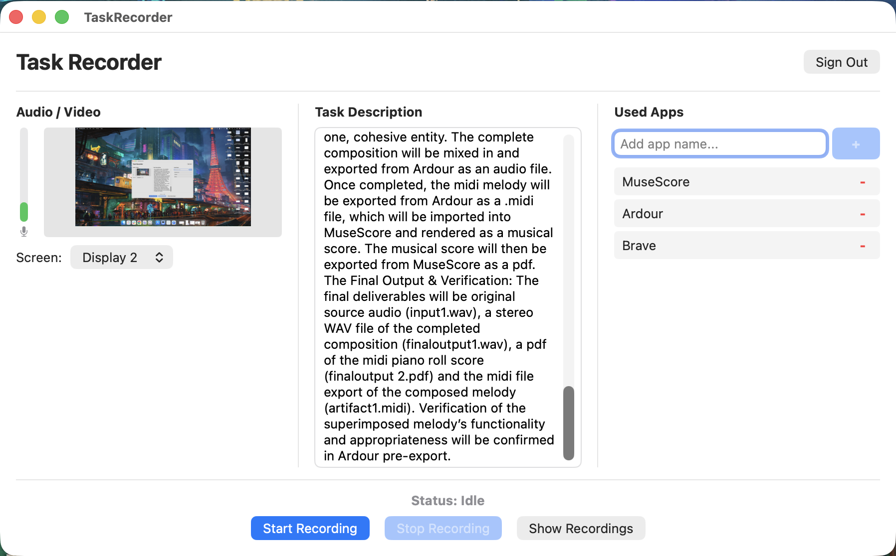

> *Text shown in the image:* Example frame from a recording: Firefox “New Tab” page with the TaskRecorder window open in front (Status: Recording… · Stop Recording). Task Description: “Obtain demographics data for the LGA of Ararat in Western Victoria. Find the age demographics data within this informaiton and create a table of this in Google Sheets. Then compare this table against the census data online to show the table has been correctly produced”. Used Apps: Google Sheets · Firefox.

|   |   |   |   |   |
|---|---|---|---|---|
| **Checklist item** | **1 = Within client tolerance** | **2 = Within acceptable tolerance** | **3 = Within edge case tolerance** | **4 = Failing tolerance** |
| \[Manual\] Metadata.rtf apps listed match the apps listed in Studio | Yes |   |   |   |
| \[Manual\] The menu bar clock shows seconds. | Yes |   |   |   |
| \[Manual\] The Dock is visible at the start and end of the recording. | Yes |   |   |   |
| \[Manual\] The Dock is on the left or right side of the screen, not the bottom. | Yes |   |   |   |
| \[Manual\] The Accessibility Inspector icon is in the Dock with a dot under it, which means the app is running. | Yes |   |   |   |
| \[Manual\] The Accessibility Inspector window stays hidden during the recording. | Yes |   |   |   |
| \[Manual\] The TaskRecorder window only appears when starting or stopping the recording. | Yes |   |   |   |
| \[Manual\] The TaskRecorder window shows the correct task description and apps. | Yes |   |   |   |
| \[Manual\] The task description document is shown at the start of the recording. |   |   |   | No |
| \[Manual\] Filling out Metadata.rtf is absent in the recording. | Yes |   |   |   |
| \[Manual\] The recording is free of disallowed AI use. Ordinary incidental enhancement may be acceptable; substantive AI task tools are not automatically allowed. Follow the detailed AI guidance and escalate unclear cases. | Yes |   |   |   |
| \[Manual\] The recording is free of personal information (PII), both on screen and in the audio. | Yes |   |   |   |
| \[Manual\] Project information alone does not block approval; assess PII and other blocking issues separately. | Yes |   |   |   |
| \[Manual\] Deliverable assets meet the applicable licensing requirements. Apply the PII and Copyright Issues guidance, including public-repository exceptions; merely browsing a website with a trademarked logo does not fail. | Yes |   |   |   |
| \[Manual\] The narration and everything on screen are free of profanity and explicit content. | Yes |   |   |   |
| \[Manual\] The narration and actions are easy to follow at normal (1x) speed. | Followable at normal speed |   |   |   |
| \[Manual\] Each pause in narration lasts 45 seconds or less. | Yes |   |   |   |
| \[Manual\] The narration audio is clear, with no background noise making it hard to hear. (Exception: loud typing is fine as long as it does not make narration unclear.) | 0% |   |   |   |
| \[Manual\] The task follows the current banned-app, limited-use and app-specific rules; unrestricted apps need no prior approval. |   |   |   | No |
| \[Manual\] Typing takes up 25% of the video or less (35% or less for Coding / Content & Writing tasks). | Yes, ≤20% of task |   |   |   |
| \[Manual\] The video shows professional-level skill in the domain, meaning it isn't something anyone could do. | Yes |   |   |   |
| \[Manual\] The writer pauses for at least 1 second after each mouse click. |   |   |   | No, missing in 11+ segments |
| \[Manual\] Task checklist and PII confirmation were truthfully completed by the writer |   |   |   | No |
| \[Manual\] At least 1 UI element has been changed from the default Mac setup | Yes |   |   |   |
| \[Manual\] Task is recorded in English | Yes |   |   |   |

# What makes a good vs. a bad task

|   |   |
|---|---|
| ✅ **Good task** | ❌ **Bad task** |
| Has a complex goal, every app’s use, professionally usable deliverables and steps to verify their outcome that shows the writer’s professional domain expertise. | Has repetitive steps or a workflow that could be completed by a friend/junior stall personnel in the same domain. |
| Has no set-up issues (menubar is visible with the seconds, accessibility inspector has a dot underneath it and TaskRecorder is prefilled with the goal and the task apps) | Set-up is incomplete/absent |
| Task length is within the 15 minute and 54:59 minute threshold | Task length is either lower than the 15 minute threshold or over the 54:59 minute threshold |
| Does not contain any PII | Contains details like personal emails, contact information, name or addresses. |
| Does not use any restricted apps. | Uses restricted apps. |
| No AI accessed during the task | The writer uses AI during their recording/ interacts with AI prompts such as ‘Ask me anything’. |
| Has all the 4 files including the Metadata.rtf file, video.mp4 file, recording\_TIMESTAMP.zip and the deliverables.zip | Is missing one or all the files required to review the task. |
| The deliverables.zip contains all the files including the input file, artifacts and final outputs. | The deliverables.zip contains is missing the final output |
| Dock is positioned to the left or right of the screen | Dock is positioned at the bottom of the screen. |
| Has at least one UI element changed apart from the position of the dock, such as the wallpaper, resolution, the mode or the colour of the icons. | No UI change apart from the position of the dock. |
| No applications and windows covered by another window (excluding pop-ups within the same app) by more than approximately 25% for more than 6s. | Applications and windows covered/stacked by another window (excluding pop-ups within the same app) by more than approximately 25% for more than 6s. |
| Mouse inactivity is less than 45s outside the closing epilogue; the mouse may remain still during the epilogue. | Mouse inactivity is more than 45 s |
| Typing is ≤25% for a non-coding and non-Content & Writing task and ≤35% for a Coding / Content & Writing task | epiTyping is >25% for a non-coding and non-Content & Writing task and >35% for a Coding / Content & Writing task |
| Narration covers the 2 of the 3Ws for at least 70% of the total task length and is precise. | Narration covers the 2 of the 3Ws for at least &lt;70% of the total task length, and is vague with the writer using words like ‘this’ and ‘here’. |
| Metadata.rtf file is hidden throughout the task and does not appear in the recording. | Metadata.rtf file is not hidden throughout the task and appears in the recording. |
| Project information alone does not block approval, whether present or absent. Check independently for PII and other blocking issues. | Project references alone are not a bad-task criterion. PII or other independently blocking issues must be assessed separately. |

# 🏅Golden Examples🏅

Use the Golden Examples to study task complexity, professional workflow, and narration standards.

---

1. [Finance](#golden-examples)
2. Design
3. Audio & Music
4. Animation & VFX
5. Software & AI/ML Engineering

---

[1. Finance](https://drive.google.com/file/d/1TOANq_bwgQ_Qyti7PL2R86mR1xAgctUP/view?usp=sharing)

**Task Description**

I am an Account Receivable personnel at a company in the UK and have been tasked with adding a new vendor to our ERP system and creating a Purchase Order (PO) tracking workflow for our Accounting team to manage POs better. I will begin by adding missing information onto a sample PO on the Pages app, then transfer the vendor details, and PO line items onto our ERP system on Microsoft Dynamics 365 Business Central, and finally create a PO tracking workflow on Monday.com. I will verify the flow is complete by running the same at the end of its creation and check if the status updates as per the trigger, and deliver the final PO raised on Microsoft Dynamics 365 Business Central and the PO workflow from Monday.com to my team.

**Apps Used**

Monday.com

Microsoft Dynamics 365 Business Central

Pages

Video: [Full task recording](https://drive.google.com/file/d/1TOANq_bwgQ_Qyti7PL2R86mR1xAgctUP/view?usp=sharing) (44:19)

[2. Design](https://drive.google.com/file/d/10HcP0usXgrPBP4AdVLBUNdjpONvHc_Iq/view?usp=sharing)

**Task Description**

I am a Content Creator preparing aspects of a new podcast. Using OBS Studio, I will setup different scenes for different aspects of the podcast such as pre-show and screen-share, which will involve the import of some images. The final deliverables will be the export of the scenes created in OBS.

**Apps Used**

OBS Studio

Video: [Full task recording](https://drive.google.com/file/d/10HcP0usXgrPBP4AdVLBUNdjpONvHc_Iq/view?usp=sharing) (24:44)

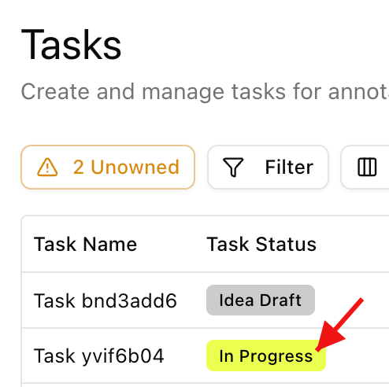

[3. Audio & Music](https://drive.google.com/file/d/18aeXVN8jy6rAIQPv_BMUByg53KDnnSrq/view?usp=sharing)

**Task Description**

I am a film score composer and I’m working on the underlying theme for a heroic end credit sequence. I will use Logic Pro in the second phase (P2) of the execution to compose a string accompaniment for the piano top melody created in phase one (PI). I will also establish a chordal sequence (I - vi - IV - V) to define the passage. The final deliverable will be a stereo export of the complete Logic Pro session.

**Apps Used**

Logic Pro

Video: [Full task recording](https://drive.google.com/file/d/18aeXVN8jy6rAIQPv_BMUByg53KDnnSrq/view?usp=sharing) (22:58)

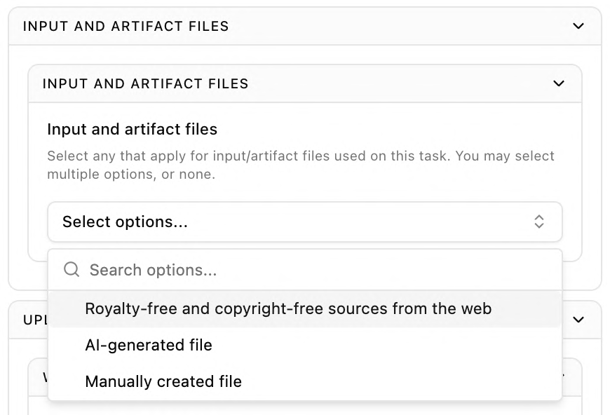

[4. Animation & VFX](https://drive.google.com/file/d/1wVBfJCTIAPJHJ6w3hoVHnZxSk-ujKYLA/view?usp=drive_link)

**Task Description**

You are a 3D Modeler tasked with cleaning up the textures of a photogrammetry model for use in Unreal Engine. Use Adobe Substance 3D Painter to bake the provided high poly model onto the provided low poly model, apply the provided photogrammetry diffuse texture, clean up artifacts on the texture, add a powdery finish to the popcorn and add red and white striped packaging textures to the popcorn box. Export the texture maps appropriate for use in Unreal Engine.

**Apps Used**

Substance 3D Painter

Video: [Full task recording](https://drive.google.com/file/d/1wVBfJCTIAPJHJ6w3hoVHnZxSk-ujKYLA/view?usp=drive_link) (40:59)

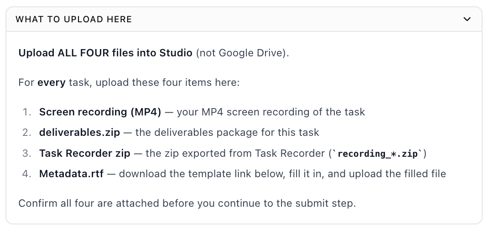

[5. Software & AI/ML Engineering](https://drive.google.com/file/d/14Fgj-2mtxKmCXIMiGnUT57EElc5rnjec/view?usp=drive_link)

**Task Description**

As an iOS app developer I want to create a distinctive visual identity for a simple Music Player app. Use SF Symbols as independent visual components, and compose them as separate layers in Icon Composer. Build & refine the multi-layered icon in Icon Composer and integrate the resulting icon into a SwiftUI Music Player app in Xcode. Deliver the layered icon and Xcode project; verify that the app builds successfully and the icon is correctly integrated.

**Apps Used**

Device Hub

Xcode

SF Symbols

Icon Composer

Video: [Full task recording](https://drive.google.com/file/d/14Fgj-2mtxKmCXIMiGnUT57EElc5rnjec/view?usp=drive_link) (28:37)

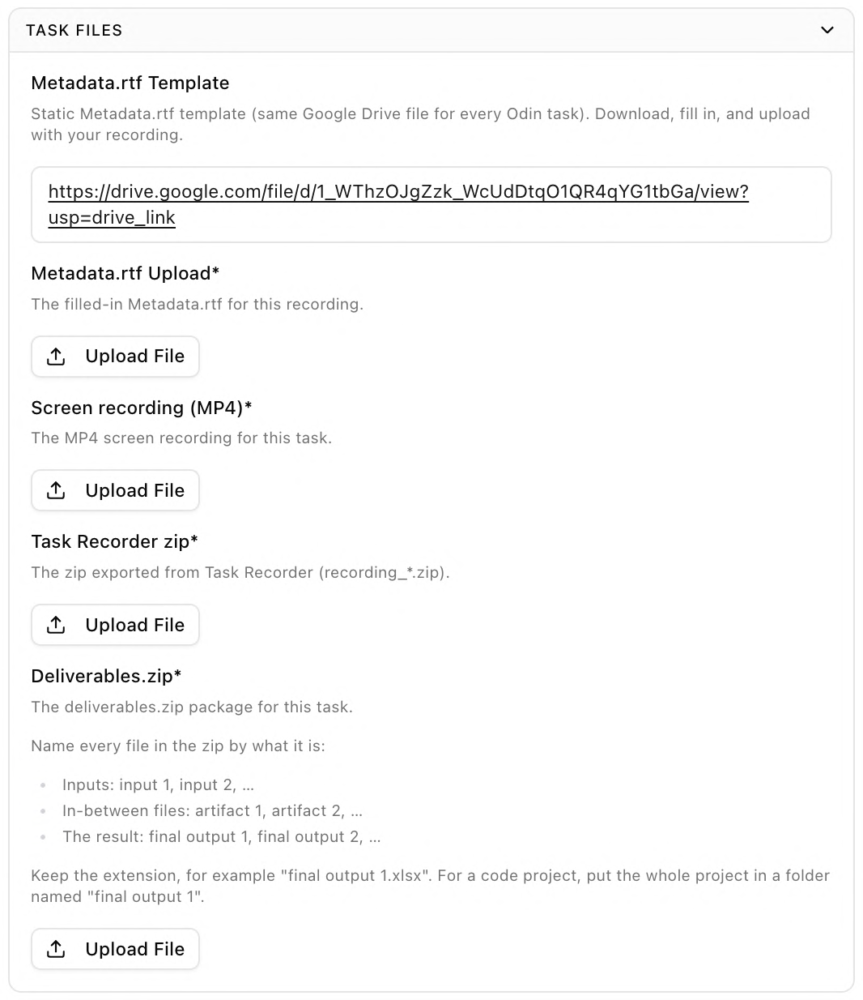

# Odin Reviewer Playbook: Faster Reviews

Target: average review time under 45 minutes per task, with the same quality bar. AHT is looked at together with your QC pass rate, so speed only counts if your approvals hold up.

**The 30-second version**

\1. Watch at **1.5x or faster** with live captions on.

\2. Check **every AutoQC flag**: confirm the real ones, dismiss the false ones. 3. Spend your watch time on what AutoQC misses, **narration first**.

\4. Found a critical issue? Take **~10 more minutes** to catch other critical issues, then send back with the template.

\5. Minor issue you can fix yourself? **Fix it and approve.**

**What's in this guide**

- [1) Quick Wins](#1-quick-wins)
- [2) The Efficient Review Flow](#2-the-efficient-review-flow)
- [3) What AutoQC Misses](#3-what-autoqc-misses)
- [4) Quick Send-Backs](#4-quick-send-backs)
- [5) Fix and Approve vs Send Back](#5-fix-and-approve-vs-send-back)
- [6) Re-reviews](#6-re-reviews)
- [7) Habits That Slow You Down](#7-habits-that-slow-you-down)

## 1) Quick Wins

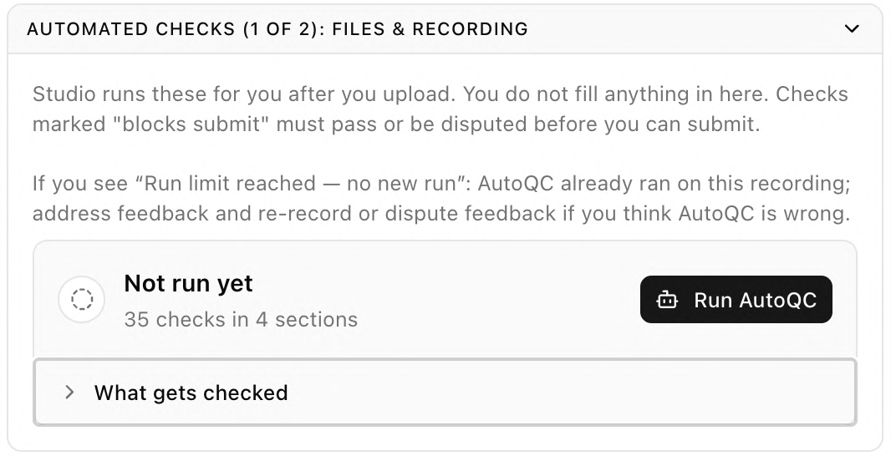

> *Text shown in the image:* **Same 30-minute recording, different speeds** — 1x: 30 min of watching · 1.5x: 20 min · 2x: 15 min. Use 2x for long typing, loading, or idle stretches. Slow down only for the moments you need to judge.

- **Watch at 1.5x or faster.** Go to 2x through long typing, loading, or idle stretches, and skip ahead when nothing new is happening on screen.
- **Turn on live captions** (Chrome Live Caption or macOS Live Captions). Reading the narration while you watch makes the narration check much faster.
- **Start loading the video as soon as you claim the task.** Do the Goal and metadata check while it buffers.
- **Clear "My re-reviews" first**, then work the Prioritized Review Queue from the top. See the [Re-reviews](#6-re-reviews) section for more details.
- **Jump to timestamps, don't rewatch.** Use AutoQC flag timestamps to go straight to the moment in question.
- **Keep feedback short.** One line per issue with a timestamp and the fix. Use the send-back template in Section 4.

## 2) The Efficient Review Flow

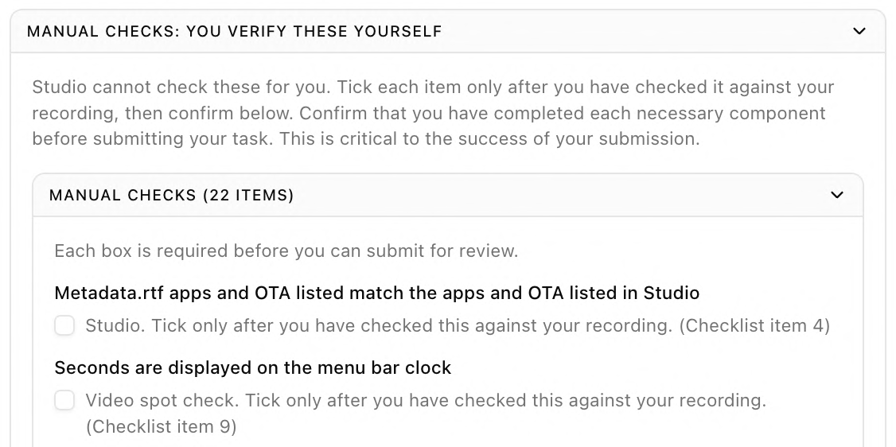

> *Text shown in the image:* **The efficient review flow** — 1. Read the task: Goal + metadata. Too simple? Send back. (2-3 min) → 2. Check AutoQC: Open every flag. Real or false? (3-5 min) → 3. Watch the video: 1.5x+, captions on. Narration first. (most of your time) → 4. Decide: Approve, fix + approve, or send back. (3-5 min)

In step 3, focus on the checks in [Section 3: What AutoQC Misses](#3-what-autoqc-misses).

**Step 2 in detail: checking AutoQC flags**

- Open **every** flag, major and minor, jump to its timestamp, and decide if it is real.
- **Real flag:** treat it like any issue you found yourself (Sections 4 and 5).
- **False flag:** dismiss it and move on. Common false flags: mouse idle while the writer is typing, "no narration found" on videos with audible narration, and the TaskRecorder window flagged for a split second.
- If AutoQC passes something, you don't need to recheck it unless something on screen looked off.

## 3) What AutoQC Misses

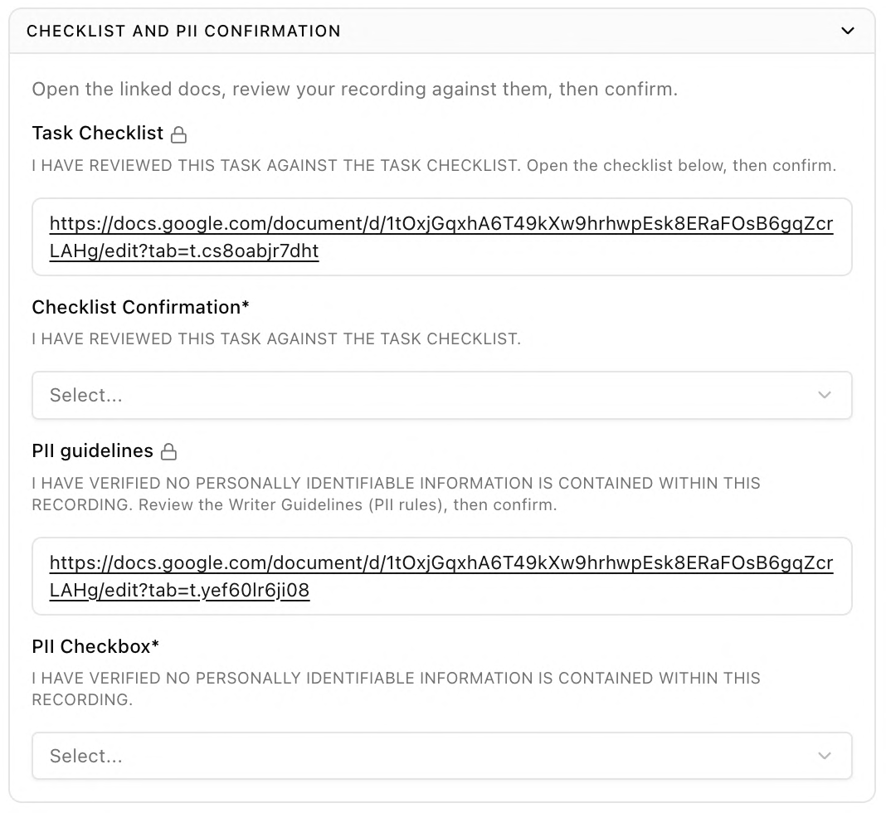

> *Text shown in the image:* **Who checks what.** *AutoQC is good at* (Open every flag and confirm it. If it passes, trust it unless something looked off.): Recording length · Typing % · Mouse idle and silences · Window overlap timing · Click pauses. *You need to check* (AutoQC misses these often. This is where your watch time goes.): **Narration: what, where, why** (tagged “#1 ISSUE”) · Restricted apps, even if not listed · PII and sensitive info · Video matches the Goal · Stacked windows, trial-and-error

**Narration is by far the most common quality issue.** It is the top reason writers get sent back, and the top issue QC finds in tasks reviewers approved. Give it most of your attention.

- **Narration:** does it explain what is happening, where on screen, and why? Would it pass the eyes-closed test (could you follow along without seeing the screen)? Watch for vague words like "this", "that", "here".
- **Restricted apps:** check every app that appears on screen against the Restricted Apps list, even ones opened for a few seconds. A frequent miss: the writer uses a restricted app but doesn't list it in Studio, or even in TaskRecorder, so it only shows up in the video.
- **PII and sensitive info:** personal email addresses, account details, addresses, financial or private data on screen.
- **Video matches the Goal:** the writer actually completes the task described.
- **Stacked windows and trial-and-error:** windows fully covered by another window, or fumbling that makes the workflow hard to follow.

## 4) Quick Send-Backs

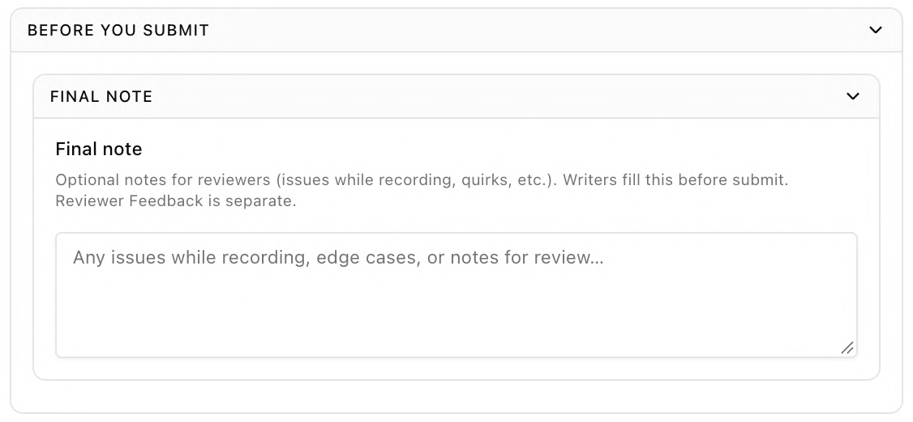

> *Text shown in the image:* **Found an issue? What to do** (flowchart): You spot an issue → Is it a critical issue? (see the critical list) → YES: Look ~10 more min for other critical issues → **SEND BACK** (Template + timestamps). NO: Can you fix it yourself? (metadata, app fields, file names) → YES: **FIX + APPROVE**. NO: More than 3 major issues? (see the major issues box) → YES: **SEND BACK**. NO: **APPROVE** (+ growth note)

If you confirm one of the critical issues below, **you don't need to finish the full review.** Spend **about 10 more minutes** scanning for other critical issues (especially the common ones in Section 3), so the writer can fix everything in one re-record. Then send back using the template.

| **Critical issue** | **What it looks like** |
|---|---|
| **Narration fails** | Missing narration, or narration that fails the eyes-closed test across much of the video. One weak sentence is not a fail. |
| **Restricted app used** | Any restricted app on screen, whether or not it is listed in Studio or TaskRecorder. No leeway. If it is the only issue, follow the hold-and-escalate process in the reviewer guide. |
| **PII or sensitive info** | Personal email address, account details, addresses, or financial info visible for more than a passing moment. Using a personal account is fine as long as none of this is shown. |
| **Video doesn't match the Goal** | The task isn't completed, or the writer does a different task than described. |
| **Desktop setup missed** | Any of: clock without seconds, Dock at the bottom or not visible at the beginning or end, Accessibility Inspector not running, nothing changed from a standard Mac desktop (wallpaper, dark mode, icon size, etc.), or TaskRecorder fields not filled in before recording. |
| **Task too simple (first review only)** | Not a multi-step expert workflow. Someone with no domain knowledge could do it. |

**Rule of thumb:** send back if any critical item fails, or if more than 3 major items fail. Everything else is approvable.

**Major issues** (count only clear fails): metadata.rtf or TaskRecorder shown mid-recording briefly but corrected, a single silence over 60 seconds, background noise obscuring over 40% of the narration, rushed narration that is still understandable, missing click pauses, non-obvious copyrighted content, etc.

**Send-back template (paste into Reviewer Comments for quick reviews)** Hi! Sending this back so you can fix the following:

• **\[Issue\]** at **\[timestamp\]**: \[what to change\]

• **\[Issue\]** at **\[timestamp\]**: \[what to change\]

Before you re-record, a quick check on the most common issues:

• **Narration:** say what you're doing, where on screen, and why. Someone with their eyes closed should be able to follow. Avoid "this", "that", "here".

• **Restricted apps:** check every app you open, even briefly, against the Restricted Apps list. List every app you use in Studio and TaskRecorder.

• **PII:** close personal email, accounts, and notifications before recording.

• **Setup:** clock with seconds, Dock on the left or right, Accessibility Inspector running, and at least one change from the standard Mac desktop.

• **Goal:** make sure the recording completes the exact task in your Goal.

Thank you for your hard work!

## 5) Fix and Approve vs Send Back

A send-back costs the writer a re-record and costs you a second review. If you can fix it yourself, or it is minor, **fix it, leave a growth note, and approve.**

| **Issue** | **Action** | **How** |
|---|---|---|
| metadata.rtf errors (Request wording, topology, small mismatches with the Goal) | **FIX + APPROVE** | Fix it yourself. Never send back for metadata alone. |
| Goal and TaskRecorder text describe the same task but aren't word-for-word identical | **FIX + APPROVE** | Fix metadata if needed. |
| A non-restricted app was used but not listed, or a listed app wasn't used | **FIX + APPROVE** | Update the app fields and files so they match the video. |
| Deliverable file name is slightly off | **FIX + APPROVE** | Rename the file yourself. |
| A restricted app appears in the video, listed or not | **SEND BACK** | See Section 4. |
| Desktop setup missed (clock, Dock, Accessibility Inspector, no change from a standard Mac) | **SEND BACK** | See Section 4. |
| Brief glimpse of "Mercor", "Odin", a project folder, or a non-sensitive item | **APPROVE** | No note needed. |
| Intro a few seconds over | **APPROVE** | Growth note. |
| Window overlap between 6 and 30 seconds as the only issue | **APPROVE** | Growth note. |
| Short idle or silent stretches within their nonblocking tolerance bands; pauses after clicks under 1 second. This approval allowance does not apply to typing over the limit: typing fails above 25% of the recording, or above 35% for Coding / Content & Writing. Exactly 25% or 35%, respectively, does not fail. | **APPROVE** | Growth note. |
| More than 3 major issues together (see Section 4) | **SEND BACK** | Use the template. |

## 6) Re-reviews

Re-reviews should be much faster. You already know the task, and the writer has fixed your notes, so there is usually less to flag and less to write.

- **Only files changed?** Check the items from the last send-back and the new AutoQC result. No need to rewatch the whole video.
- **Re-recorded?** Watch it, but focus on the issues you flagged last time and the Section 3 checks.
- **Resubmitted with no changes?** Send back quickly, pointing to the original note.

## 7) Habits That Slow You Down

- Watching at 1x from start to finish.
- Watching to the end after you've already confirmed a critical issue.
- Sending back for a minor issue you could fix yourself.
- Writing long feedback instead of more pointed bullets that are easier for the writer understand.

Questions or edge cases: post in the #odin-reviewers-hub channel with the task link.

# Odin Reviewer DM Templates

## How to use

Every DM is built from three parts:

- Header
- Opener (sections 2–5)
- One snippet per item that did not score 1 (sections 6–7).
    - The lowest score on the checklist decides which opener you use.

Header line for every DM:

> MM/DD @ HH:MM TIMEZONE, Review #\_\_\_, REVIEWER NAME

Writing rules for every snippet:

- Give a timestamp (MM:SS) for anything seen in the video.
- Say what was wrong, why the client needs it, and what to do next time.
- Use the current status names: Needs Edits and Rejected (not "Needs Revision").
- Point to the Writer Guidelines section by name when it helps.

Approved (all items at 1)

Use when every manual item and every AutoQC card passes. Delete any line that does not apply to this task.

> MM/DD @ HH:MM TIMEZONE, Review #\_\_\_, REVIEWER NAME
>
> Comments: Task approved. Clear, well-paced recording narrated with What, Where and Why. Setup verified: menu bar clock shows seconds, Dock visible on the left/right at start and end, Accessibility Inspector running with its window hidden, at least one UI element changed. TaskRecorder shown only at start and stop, with the correct Goal and apps. Goal document shown and intro no longer than 60 seconds (21–60 seconds is an edge case). Metadata.rtf matches Studio (apps, workflow) and was not shown in the recording. Current banned-app, limited-use and app-specific rules followed; unrestricted apps need no prior approval; no disallowed AI use, PII, or licensing/profanity violations after applying the documented exceptions. Project information alone does not block approval. Good window management, deliberate clicks, and typing within limits. Video length, screenshot count, recording ZIP, video.mp4 and deliverables.zip verified. Professional-level work with a complete final deliverable.

Approved with growth notes (worst item at 2 or 3)

Use when the task passes, but one or more items scored 2 or 3. Paste the matching snippets from section 6 under "Areas to grow".

> MM/DD @ HH:MM TIMEZONE, Review #\_\_\_, REVIEWER NAME
>
> Hi \_\_\_,
>
> I've approved task \_\_\_. You did a strong job on \_\_\_.
>
> Areas to grow for your next tasks:
>
> - \[paste snippet\]
>
> - \[paste snippet\]
>
> None of these blocked approval this time, but items at the edge of tolerance can fail on a future task. The Workflow Checklist in the Writer Guidelines covers each one. Keep up the great work!

Needs Edits (any item at 4)

Use when at least one item fails, but the task can still be fixed within its approved idea. Split fixes into what needs a re-record and what only needs files or metadata corrected, so the writer knows the size of the job.

> MM/DD @ HH:MM TIMEZONE, Review #\_\_\_, REVIEWER NAME
>
> Hi \_\_\_,
>
> I've completed my review of task \_\_\_. You did a good job on \_\_\_, but the items below need to be fixed before I can approve it.
>
> Requires a re-record:
>
> - \[paste snippet\]
>
> Requires a file or metadata fix only:
>
> - \[paste snippet\]
>
> Growth notes (did not block approval):
>
> - \[paste snippet\]
>
> Please run both AutoQC checks again before resubmitting, and use the Workflow Checklist in the Writer Guidelines. Once these are addressed, the next version should be ready to approve. I look forward to seeing it!

Rejected (Invalid Task Idea)

Rejected status is for tasks that cannot be fixed through edits, such as an invalid task concept. Many fails in one task is a Needs Edits, not a Rejected. If you are unsure if the task description is valid, DM the writer and Send for Edits instead. Pick the reason that applies and delete the others.

> MM/DD @ HH:MM TIMEZONE, Review #\_\_\_, REVIEWER NAME
>
> Hi \_\_\_,
>
> I've completed my review of task \_\_\_. Unfortunately, this task can't be approved or fixed through edits, for the reason below. Please don't resubmit this task.
>
> - Task concept: The approved workflow doesn't seem like it can be completed without \[excessive typing /exceeding the allotted timeframe\], so no re-record of this idea would meet the requirements.
>
> - Does not match approval: The recording performs a different task from the approved idea. Material changes need a change request approved before recording.
>
> For your next task, please propose a new idea in Studio and review the Professional Expertise and Task Variety section of the Writer Guidelines. I look forward to your next submission.

## Item-by-item snippets

[Setup and TaskRecorder](https://docs.google.com/document/d/189DQeCMU9nH3GzMy4L9COqbahyuEaZRCyjs4P4L1EOY/edit?tab=t.azkqn7x7qva6)

**Metadata.rtf corrected by reviewer — file fix; do not send back for metadata alone**

**Menu bar clock shows seconds** — 4

**Dock visible at start and end** — 4

**Dock on left or right** — 4

**Accessibility Inspector running (dot under Dock icon)** — 4

**Accessibility Inspector window hidden** — 4

**TaskRecorder window only at start and stop** — 4

**TaskRecorder shows the correct task description and apps** — 4

**Task description document shown at start** — 4

**Intro: 21–60 seconds is an edge case; over 60 seconds fails**

**Filling out Metadata.rtf absent from recording** — 4

**At least 1 UI element changed** — 4

**Recorded in English, all materials in English** — 4

## [Content and compliance](https://docs.google.com/document/d/189DQeCMU9nH3GzMy4L9COqbahyuEaZRCyjs4P4L1EOY/edit?tab=t.gm70jnqq864s)

**Free of disallowed AI use — Ordinary incidental enhancement may be acceptable; substantive AI task tools are not automatically allowed. Follow the detailed AI guidance and escalate unclear cases.**

**Free of PII (screen and audio)** — 4

**Project information alone — nonblocking; assess PII separately**

**Deliverable assets meet licensing requirements — apply documented exceptions**

**Profanity — apply the minor on-screen exception; explicit content assessed separately**

**Follows restricted-app and limited-use rules; no approval needed for unrestricted apps: 4**

**Shows professional-level skill** — 4

T**ask checklist and PII confirmation completed truthfully** — 4

## [Performance](https://docs.google.com/document/d/189DQeCMU9nH3GzMy4L9COqbahyuEaZRCyjs4P4L1EOY/edit?tab=t.lt6sk5tgu5qv)

**Easy to follow at 1x speed**

**Each narration pause 45 seconds or less**

**Narration audio clear (loud typing OK if narration stays clear)**

**Typing 25% or less (35% or less for Coding / Content & Writing)**

**Pauses at least 1 second after each mouse click**

# Setup and TaskRecorder

**Metadata.rtf corrected by reviewer — file fix; do not send back for metadata alone**

> Metadata.rtf - I corrected Metadata.rtf to match the task and re-uploaded it. No writer action is needed for this metadata correction. Reviewer: use this message only after making and verifying the correction; do not send back for metadata alone.

**Menu bar clock shows seconds** — 4

> Clock seconds - The menu bar clock doesn't show seconds \[or: couldn't be verified at MM:SS\]. Go to System Settings > Menu Bar > Clock Options and turn on "Display the time with seconds," then re-record.

**Dock visible at start and end** — 4

> Dock visibility - The Dock was not visible at the beginning or end of the recording. Please keep the Dock visible at the beginning and end. It does not need to remain visible throughout the recording.

**Dock on left or right** — 4

> Dock position - The Dock is at the bottom of the screen. Please move it to the left or right in System Settings > Desktop & Dock before re-recording.

**Accessibility Inspector running (dot under Dock icon)** — 4

> Accessibility Inspector - Accessibility Inspector wasn't running during the recording (no dot under its Dock icon). TaskRecorder needs it running for the whole recording to capture the required data. Open it from Xcode > Open Developer Tool, close only its window with the red button, and confirm the dot stays under its icon.

**Accessibility Inspector window hidden** — 4

> Accessibility Inspector window - The Accessibility Inspector window was visible at MM:SS. Close its window with the red button before recording (don't minimize or quit the app) so it keeps running in the background.

**TaskRecorder window only at start and stop** — 4

> TaskRecorder window - The TaskRecorder window was open at MM:SS. Please minimize it right after clicking Start Recording and only bring it back when you're ready to click Stop Recording.

**TaskRecorder shows the correct task description and apps** — 4

> TaskRecorder fields - The TaskRecorder Task Description/Used Apps didn't match the approved task description. Before clicking Start Recording, paste only the approved Goal, exactly as written, and list every app used. Check for leftover details from your previous task.

**Task description document shown at start** — 4

> Opening Task Description Document - The Goal document wasn't shown at the start of the recording. After starting, minimize TaskRecorder so the Goal document is visible, say the intro sentence, then minimize the document. Use Word, Google Docs or another allowed app (not Notes or TextEdit), and show only the Goal, not the Approval ID.

**Filling out Metadata.rtf absent from recording** — 4

> Metadata.rtf visible - Metadata.rtf was \[open/being filled out\] at MM:SS. Please complete Metadata.rtf before recording and keep it closed during the recording.

**At least 1 UI element changed** — 4

> UI diversity - The desktop uses the default Mac setup. Please change at least one UI element before recording, such as the wallpaper, light/dark mode, Dock size or resolution.

**Recorded in English, all materials in English** — 4

> Language - \[The narration / the file \_\_\_ / the app interface\] was not in English at MM:SS. All narration and task materials must be in English, and the system language must stay set to English.

# Content and compliance

**Free of disallowed AI use — Ordinary incidental enhancement may be acceptable; substantive AI task tools are not automatically allowed. Follow the detailed AI guidance and escalate unclear cases.**

> AI use - \[Tool/feature\] was used to \[prompt / generate / summarize\] at MM:SS. No AI interaction is allowed during recording, including Google AI Overview's "Ask anything" and AI Mode. Inputs may be prepared with Gemini before recording, with "AI-generated before recording" selected in Studio.

**Free of PII (screen and audio)** — 4

> PII - \_\_\_ was \[shown on screen / said aloud\] at MM:SS. Please re-record without any private personal identifiable information, including names, emails, phone numbers, addresses, account details, biometrics, and Mac Addresses. TaskRecorder 2.4.4 requires no sign-in. Use your assigned mercor.expert email for app logins when required.

**Project information alone — nonblocking; assess PII separately**

> Project information - A project reference was visible at MM:SS. Project information alone does not block approval. Continue checking independently for PII and other blocking issues.

**Deliverable assets meet licensing requirements — apply documented exceptions**

> Copyright - \_\_\_ included in deliverables.zip at MM:SS does not meet the applicable licensing requirement: \_\_\_. Apply the asset-licensing requirement to material included in
>
> deliverables.zip. Browsing a website with a trademarked logo is acceptable. Apply the public-repository licensing exceptions in the PII and Copyright Issues guidance. For assets subject to the CC0/public-domain rule, verify the source terms; a search filter alone is not enough. Gemini-generated inputs prepared before recording are allowed. Escalate unclear licensing before deciding.

**Profanity — apply the minor on-screen exception; explicit content assessed separately**

> Profanity - Minor on-screen profanity not typed by the writer is option 2 and does not block approval. Profanity said or typed by the writer, or more than minor on-screen profanity, is option 4. For an option-4 failure: \[Profanity was said / profanity was typed / more than minor on-screen profanity was shown\] at MM:SS; please re-record without it. Explicit content is assessed separately: if explicit content was shown at MM:SS, re-record without it.

**Follows restricted-app and limited-use rules; no approval needed for unrestricted apps: 4**

> App-policy issue: \_\_\_ was \[opened / shown / used\] at MM:SS and conflicts with this current banned-app or limited-use condition: \_\_\_. Check https://odin-mercor1.vercel.app/validated-apps and the in-flight protections before requesting changes. An unlisted app or missing prior app approval is not a failure by itself.

**Shows professional-level skill** — 4

> Professional expertise - The work in this task could be completed by someone without domain expertise. For example, \_\_\_ at MM:SS is a basic action repeated without professional reasoning. Please show the methods, standards, decisions and checks you'd use as a professional, and explain why you make each choice.

**Task checklist and PII confirmation completed truthfully** — 4

> Submission checklist - The checklist/PII confirmation was marked complete, but \_\_\_ (MM:SS) does not meet that item. Please open the checklist and PII guidelines and verify each item against your recording before checking the box.

# Performance

**Easy to follow at 1x speed**

Score 2 (a few areas rushed):

> Pacing - A few spots felt rushed (MM:SS, MM:SS). For future tasks, slow down at those moments: move, pause, point, then act, so viewers can follow at normal speed.

Score 3 (some parts rushed):

> Pacing - Several parts felt rushed (MM:SS, MM:SS, MM:SS), which is at the edge of what we can accept. Please work at a natural pace, let each action finish before the next one, and keep the cursor on what you're describing.

Score 4 (most or all rushed):

> Pacing - Most of the recording moved too fast to follow at normal speed (for example MM:SS and MM:SS). Please re-record at a deliberate pace: move, pause, point, then act, and let each result appear before continuing.

**Each narration pause 45 seconds or less**

Score 2 (46–60s):

> Narration gap - There was a \_\_-second silent gap at MM:SS. For future tasks, keep narrating while you work, even during typing or repeated steps, so no gap goes over 45 seconds.

Score 3: N/A for silence.

> Silence has no score-3 band. A gap over 60 seconds fails and should use the score-4 template below.

Score 4 (over 60s):

> Narration gap - There was a \_\_-second silent gap at MM:SS. This gap exceeds the 60-second failure threshold, so this needs to be re-recorded with continuous narration.

**Narration audio clear (loud typing OK if narration stays clear)**

Score 2 (30–40% of the narration):

> Audio quality - Background noise obscured about \_\_% of the narration (30–40%; e.g., MM:SS). This is option 2 and does not block approval. For future tasks, record in a quieter space or use headphones with a dedicated microphone.

Score 3: N/A for background noise.

> Background noise has no score-3 band. Noise obscuring over 40% of the narration fails and should use the score-4 template below.

Score 4 (over 40% of the narration):

> Audio quality - Background noise obscured about \_\_% of the narration (over 40%; e.g., MM:SS), exceeding the failure threshold. Please re-record in a quieter space or use headphones with a dedicated microphone. Check the microphone level in TaskRecorder first, and don't switch audio devices during recording.

**Typing 25% or less (35% or less for Coding / Content & Writing)**

> Typing - Typing took up about \_\_% of your \_\_-minute recording, over the limit of 25% (35% for Coding / Content & Writing). Please re-record with a mouse-driven workflow, and keep every typing segment under 45 seconds. If the idea can't be done without heavy typing, this may need a new task idea instead.

**Pauses at least 1 second after each mouse click**

Score 2 (missing in 1–3 segments):

> Click pacing - A few clicks were rushed (MM:SS, MM:SS). For future tasks, pause about one second after each click so the result is captured.

Score 3 (missing in 4–10 segments):

> Click pacing - Clicks were rushed in several places (MM:SS, MM:SS, MM:SS), which is at the edge of what we can accept. Please click, wait a second, then continue.

Score 4 (missing in 11+ segments):

> Click pacing - Clicks were rushed throughout the recording (for example MM:SS and MM:SS). The client needs about a one-second pause after every click, so please click, wait a second, then continue.

## AutoQC snippets

Ratings 1 and 2 need no snippet, though a short line for 2 shows the writer their dispute was read. Ratings 3 (disputed, I disagree) and 4 (failed / not run) use the fail snippet; for a 3, start with the dispute line.

Dispute lines:

> AutoQC dispute (agreed) - I reviewed your dispute on the \_\_\_ check and agree with you; it did not count against this task.
>
> AutoQC dispute (not agreed) - I reviewed your dispute on the \_\_\_ check but confirmed the issue at MM:SS, so it still needs to be fixed:

Not run:

> AutoQC not run - The \_\_\_ AutoQC wasn't run before submission. Please run both AutoQCs (Files & Recording and Narration) and resolve any blocking findings before resubmitting.

## [Files and deliverables (file fixes unless the recording itself is bad)](https://docs.google.com/document/d/189DQeCMU9nH3GzMy4L9COqbahyuEaZRCyjs4P4L1EOY/edit?tab=t.yb7qt9i81wvy)

**All four task files uploaded**

**Task Recorder zip contents complete, screenshots present**

**video.mp4 opens**

**Deliverables named correctly**

**Metadata.rtf matches the task (apps, request, workflow)**

## [Recording](https://docs.google.com/document/d/189DQeCMU9nH3GzMy4L9COqbahyuEaZRCyjs4P4L1EOY/edit?tab=t.bqh0hivmlain)

**Video length within 15:00 to 54:59**

**Dock visible at start and end** — 4

**No app window covers more than 25% of another for over 6s (allowed up to 30s)**

**Mouse never idle over 45s outside the closing epilogue; the mouse may remain still during the epilogue.**

- Major flag (blocks submission): mouse idle for more than 60s at least once, or mouse idle for >45s more than four times. The closing epilogue is exempt from this mouse-idle rule.
- Minor flag, but permissable: mouse idle for 45-60s, one to three times

## [Writer performance](https://docs.google.com/document/d/189DQeCMU9nH3GzMy4L9COqbahyuEaZRCyjs4P4L1EOY/edit?tab=t.bqh0hivmlain)

**Narration says What, Where and Why (≥70% on 2 of the 3)**

**Screen recording shows the workflow described in the task**

# Files and deliverables

(file fixes unless the recording itself is bad)

**All four task files uploaded**

> Missing files - \_\_\_ is missing from Studio. Each task needs four uploads: video.mp4, deliverables.zip, the TaskRecorder recording\_TIMESTAMP.zip, and Metadata.rtf in its own field (not inside deliverables.zip).

**Task Recorder zip contents complete, screenshots present**

> Recording archive - The TaskRecorder zip is \[missing files / has only \_\_ screenshots for a \_\_-second video, below 0.5 per second\]. This data is required by the client, so the task needs to be re-recorded. Before your next recording, quit unused apps and large browser tabs, keep enough free storage, and run a short test. Don't rename, unzip or edit the original archive.

**video.mp4 opens**

> Video file - video.mp4 \[won't open / ends early at MM:SS / is corrupted\]. Please check the beginning, middle and end in QuickTime before uploading. If the file is corrupted, the task needs to be re-recorded.

**Deliverables named correctly**

> Deliverable naming - Please name the zip "deliverables.zip" and label files inside it as input 1, artifact 1, final output 1, etc., keeping the correct extensions. Every input, intermediate artifact and final output needs to be in the zip.

**Metadata.rtf matches the task (apps, request, workflow)**

> Metadata.rtf - The \[Topology / Request / Task Description\] section doesn't match the recording: \_\_\_. Topology should list every app visit in order as LOOKUP, CREATE or MODIFY, and Request must match the TaskRecorder Goal exactly.

# Recording

**Video acceptance length between 15:00 and 54:59**

> Video length - Your video is \_\_:\_\_ long, outside the reviewer acceptance range of 15:00 to 54:59 including the intro and epilogue. Please \[plan a more complex workflow / simplify the workflow\] and re-record, planning for the writer guidance of 15:00 to 50:59.

**Dock visible at start and end** — 4

> Dock visibility - The Dock was not visible at the beginning or end of the recording. Please keep the Dock visible at the beginning and end. It does not need to remain visible throughout the recording.

**No app window covers more than 25% of another for over 6s (allowed up to 30s)**

> Window management - \[App 1\] covered \[App 2\] by more than 25% for about \_\_ seconds at MM:SS. Please use one Fill window or place task windows side by side, and minimize windows you aren't using. Avoid Full Screen and small floating windows. Pop-ups within the same app are fine while in use.

**Mouse never idle over 45s outside the closing epilogue**

> Mouse inactivity - The mouse was idle for about \_\_ seconds at MM:SS outside the closing epilogue. Please keep the cursor active as a teaching pointer and keep any single pause under 45 seconds, without artificial movement. Remember typing does not count as mouse activity. The closing epilogue may be still; AutoQC excludes the final 5 minutes from this check. This technical buffer does not increase the 4:00 epilogue maximum.

# Writer performance

**Narration says What, Where and Why (≥70% on 2 of the 3)**

> Narration - The narration needs to be clear enough that a listener could follow the task without seeing the screen. Your task was missing \[What / Where / Why\] in several places, for example MM:SS, MM:SS and MM:SS. Name the action, the exact control and its location, and the reason, and avoid vague words like "here" and "this."

**Screen recording shows the workflow described in the task**

> Workflow match - The recording doesn't complete the approved Goal: \_\_\_ \[was skipped / was replaced with \_\_\_\] at MM:SS. Please record the workflow as approved. If your plan changes materially, submit a change request in Studio before recording.

🖊️ **<u>Changelog of Reviewer Guidelines</u>**

|   |   |
|---|---|
| Date | Details of changes |
| Oct 20, 2026 | 🟩 Reviewer and QC checklist are now aligned 🟩Reviewer Checklist: every item now states its fail point in option 4. \[Automated\] items are scored on the same 1–4 ranges as manual items. 🟩 Studio, Airtable, Mercor and Project Odin information (item 17) is now OK in the recording and no longer blocks approval. 🟩 Metadata.rtf (item 1): fails when it is under 80% similar to the TaskRecorder Goal or Studio. 🟩 Window overlap (item 2): 6–30 s = option 2; over 30 s with no clear effort to fix within time = option 4. 🟩 What / Where / Why (item 3): fails when under 70% of actions have at least 2 of the 3 Ws. An action is anything that changes the state of the document. 🟩 Eyes Closed (item 4): 4 or more ambiguous references is edge case. A 2+ minute stretch narrated mostly with "here" and "this" fails. 🟩 NEW Intro length (item 8): 21–60 s is edge case; over 60 s fails. 🟩 Metadata.rtf shown (item 9): up to 10 s is edge case; over 10 s fails. 🟩 Typing (item 10): fails over 25% (over 35% for Coding / Content & Writing). 🟩 Silence (item 11): 46–60 s is edge case; over 60 s fails. 🟩 Background noise (item 12): 30–40% of narration = option 2; option 3 = N/A; over 40% fails (option 4). 🟩 Profanity (item 18): minor on-screen profanity not typed by the writer = option 2 and does not block approval; profanity said or typed by the writer, or more than minor on-screen profanity, fails (option 4). 🟩 Domain expertise (item 23): fails when a non-expert could do more than 10% of the actions. 🟩 Pace (item 24): 10–15% of the video above 220 WPM is edge case; over 15% fails. 🟩Missing epilogues DO NOT FAIL tasks regardless of approval date |
| Oct 19, 2026 | 🟩 Clarified that CC0, public domain, copyright, royalty free issues only apply to information that ends up in the deliverable.zip. Browsing websites with logos doesn’t violate our terms. 🟩Clarified that while ideally project information is hidden (e.g., references to Mercor, Project Odin, Studio Instructions), they will be tolerated in small quantities and should not lead to task rejection on its own. 🟩**NEW - Epilogue narration requirements:** All task ideas originally approved at or after **Oct 19, 2026 6PM PT** must include an epilogue narration (target: 3-4 mins; maximum: 4:00; longer epilogues may be sent back) which serves as a brief reflection of the work. See [here](https://docs.google.com/document/d/1tOxjGqxhA6T49kXw9hrhwpEsk8ERaFOsB6gqZcrLAHg/edit?tab=t.nvo0dh78tkt4) for more details 🟩Reviewer acceptance is up to 54:59 total, including intro and epilogue. Writer recording guidance remains no more than 50:59; the higher acceptance limit is not a writer target. |
| Oct 17, 2026 | 🟩 Clarified Insightful and pay for reviewers who write tasks (Getting Started). Promoted reviewers keep Insightful running and stay hourly while writing; directly hired reviewers do not run Insightful while writing. |
| Oct 16, 2026 | App-policy update (effective 2026-10-16 18:08 PDT): Historical restriction entries below, including the blanket TextEdit ban, are superseded by the [canonical three-category app list](https://odin-mercor1.vercel.app/validated-apps). TextEdit may be used for metadata.rtf; separate opening-Goal instructions remain unchanged. In-flight work is protected and now-allowed app rejections may be reconsidered subject to other quality checks. |
| Oct 14, 2026 | 🟩 Added the following apps to the restricted app list - all tasks submitted before 10/14 5PM PST should be approved if their only failure mode was a restricted app on this list: 1. anatomyapp 2. Autodesk FBX Review 3. Defold 4. drawBook 5. FL Studio / FruitLoops Studio 6. GameMaker 7. JASP 8. KiCad 9. LTspice 10. Milanote 11. MohrPlotter 12. OpenVSP 13. Penpot 14. qemu-system-aarch64 15. Sticky Notepad 16. Substance 3D Stager 17. TextExpander 18. VMD |
| Oct 14, 2026 | 🟩 Added “If the Reviewer raised the complexity issue in R1 and the writer didn’t fix it, then R2 can send back.” 🟩 Added DM templates |
| Oct 13, 2026 | 🟩 Added “The goal is to leave 1-2 sentences of feedback” 🟩 Added New Reviewer info: Run Insightful and Device Requirements |
| Oct 12, 2026 | 🟩 TextEdit is now fully restricted, including for filling out Metadata.rtf: the restricted app list entry “FOR METADATA.RTF ONLY - TextEdit.app” was changed to “TextEdit.app” (Odin Production Full Workflow world). |
| Oct 12, 2026 | 🟩 Full Facelift |
| Oct 11, 2026 | 🟩 Added the following apps to the restricted app list (Odin Production Full Workflow world): 1. Adobe Express 3. Google Gemini 4. Google Play 5. Kali Linux 6. Screenshot 7. Splice 8. Steam 9. Trading View 10. WPS Office |
| Oct 10, 2026 | 🟩 Added the following apps to the restricted app list (Odin Production Full Workflow world): 1. Adobe Acrobat 2. Adobe After Effects 3. Adobe Illustrator 4. Adobe InDesign 5. Adobe Premiere Pro 6. Antigravity IDE 7. App Store.app 8. Apple Music Classical 9. Cisco Packet Tracer 10. CleanMyMac X 11. Complete Anatomy 12. Dictionary.app 13. Font Book.app 14. Games.app 15. GoodNotes 16. GraphPad Prism 17. Linear 18. Magnet 19. Maps.app 20. Mendeley 21. Microsoft Intune 22. Microsoft Store 23. Microsoft Support 24. Music.app 25. News.app 26. NVivo 27. Paprika Recipe Manager 28. Parallels Desktop 29. PDFgear 30. Podcasts.app 31. Shazam 32. Siri.app 33. SnapGene 34. Spotify 35. Substance 3D Painter 36. TradingView 37. UCSF Chimera 38. Wolfram Mathematica |
| Oct 4, 2026 | 🟩 Added the following apps to the restricted app list (Odin Production Core world): 1. Apple Compressor 2. Apple Motion 3. Final Cut Pro 4. iMovie 5. Keynote 6. Logic Pro 7. MainStage 8. Pages |

# Reviewer Q&A

Quick answers to your most common questions. Last updated October 22, 2026.

## Status and probation (Mercor team is working on fixing these issues)

**Q1. How do I know if I passed probation?**

Maven sends you the audit result for each review. Pass, and you become a Reviewer with an 80 h/week cap.

**Q2. My review matched the final decision. Why did I fail the audit?**

Auditors also check that you caught every critical issue, not just the outcome.

**Q3. My role went back to Writer, or Studio says "Project not found." Known sync bug.** Access is being restored, and you don't need to redo anything.

**Q4. I passed probation, but my role or hour cap didn't update.**

We're fixing affected accounts. Not reported yet? Post in #odin-reviewers-hub.

**Q5. I don't see any tasks to claim.**

Claim reviews from the Prioritized Review Queue in Studio. Queue missing? See Q3. Or you can claim from the normal review queue.

## Reviewer screening

**Q6. I didn't pass the screening. What now?**

You stay a writer or can become a writer if you are a new reviewer. There are no retakes.

**Q7. The screening glitched or didn't save.**

Post the time you took it and screenshots in #odin-reviewers-hub.

## Making the call

**Q8. What can I approve with a growth note?**

- Silence of 46–60 seconds
- Intro of 21–60 seconds
- Window overlap of 6–30 seconds
- Metadata.rtf on screen for up to 10 seconds
- 4 or more vague references like "here" or "this"
- Minor on-screen profanity the writer didn't type

**Q9. What never blocks approval on its own?**

- A missing epilogue
- Mercor, Studio, Airtable or Odin info on screen
- A minor AutoQC flag
- Wrong metadata, file names or app list (fix it yourself and approve)

**Q10. I found a critical issue. Do I keep watching?**

Check about 10 more minutes for other critical issues, then send back with timestamps. Note in Internal Notes that you stopped early.

**Q11. The narration says "click here" a lot but explains What, Where and Why.**

Approve with a growth note, unless there's a 2+ minute stretch of "here" and "this."

**Q12. Do deliverables need to be in English?**

**Yes.**

**Q13. Is an educational software license OK?**

**If it is not a commercial license then no,** send it back. A full license is fine.

## Task statuses

**Q14. What does RFD mean?**

Ready for Delivery: the task is approved. We'll confirm what "Minor" adds.

## Pay and time

**Q15. How do I get paid?**

Through Insightful. Run your timer during active project work. Your efficiency counts toward performance.

**Q16. Can I track time for calls like this Q&A?**

**Yes.**

**Q17. What are the pay tiers?**

- Probation: $40/h, 6 hours total
- Standard: $50/h, up to 80 h/week
- Trusted: $60/h, up to 80 h/week (10+ reviews and defect rate under 10%)

**Q18. How is my defect rate calculated?**

(defects + 1) ÷ (audits + 10). One defect in your first audit is about 18%.

**Q19. What counts toward bonuses?**

Recording reviews, re-reviews and probation audits. Not idea reviews.

## Known account issues we're fixing

Affected and haven't reported it? Post in #odin-reviewers-hub.

- Role reset to Writer after passing probation
- "Project not found" or missing review queue in Studio
- Role or hour cap not updated after probation
- Probation results not yet shared
- Probation reminders after not passing the screening
- Odin dashboard redirecting to onboarding
- Contract, Studio, dashboard and Maven showing different roles
- Contract still showing pay per task
- No access to project docs or Slack channels
- Requests to move back to the writer role

## More questions

**Q20. How long do probation audits take?**

We aim to have probation audits done within 48 hours of submission but some cases may run longer.

**Q21. What happens if I don't pass probation?**

If you don’t pass probation then you will be offered a writer contract to remain on the project.

**Q22. Are screening scores shared?**

Screening scores are not shared in order to keep the answers confidential. You can get feedback from your first few reviews on probation or through reaching out to your review lead / EPM.

**Q23. How do I move back to the writer role?**

You can request moving back in the #odin-reviewers-hub channel.

**Q24. What do RFD – Minor and "Under Quality Review" mean?**

More information coming soon!

**Q25. Do send-backs count toward bonuses?**

Yes the bonuses are typically driven by just number of hours logged or number of reviews completed given it’s under a certain AHT (average handling time). Send-backs therefore count as we want to drive quality and will be auditing tasks sent back as well as approved to ensure you made the right decision in either direction.

**Q26. When will bonuses and Studio data show on the Odin dashboard?**

We are currently revamping our dashboard so you all can stay up to date. There is not a set ETA but we will see how quickly we can build it to get you all more visibility.
